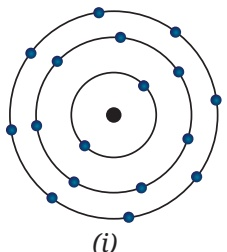
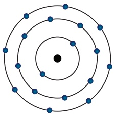
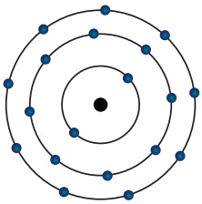
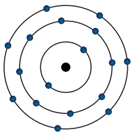

7. Which of the following, in Fig. 9.18, correctly represents Cl– ion (Atomic number of chlorine = 17).

(ii)

Fig. 9.18

(iii)

(iv)

8. Determine the formula unit mass of the following substances.

(i) Ammonium nitrate $\mathrm{(NH_{4}NO_{3})}$ , used as a nitrogen fertiliser, which is essential for plant growth.

(ii) Phosphoric acid $(  H _3 PO _4 )$ , used to make phosphate fertiliser and detergents.

(iii) Sodium hydrogencarbonate $(NaHCO_{3})_{2}$ , used to relieve acidity and helps in digestion.

9. Write the formulae for the compounds formed by the reaction of:

(i) Magnesium and nitrogen

(ii) Lithium and nitrogen

(iii) Sodium and sulfur

(iv) Aluminium and oxygen

10. Complete the Table 9.3 by writing the formulae of the compounds formed by the cations on the left and the anions at the top. LiNO is given as an example.

Table 9.3

|  | NO3- | SO42- | PO43- |
| --- | --- | --- | --- |
| NH4+ |  |  |  |
| Li+ | LiNO3 |  |  |
| Al3+ |  |  |  |
| Cu2+ |  |  |  |

11. 5.3 g of sodium carbonate and 6.0 g of acetic acid react to produce 2.2 g of carbon dioxide, 0.9 g of water, and 8.2 g of sodium acetate. Verify whether the law of conservation of mass is valid.

12. If a species has 11 protons, 12 neutrons and 10 electrons then

(i) what is its atomic number and mass number?

(ii) is it neutral, a cation or an anion? Explain.

(iii) write its electronic configuration.

(iv) name the species.