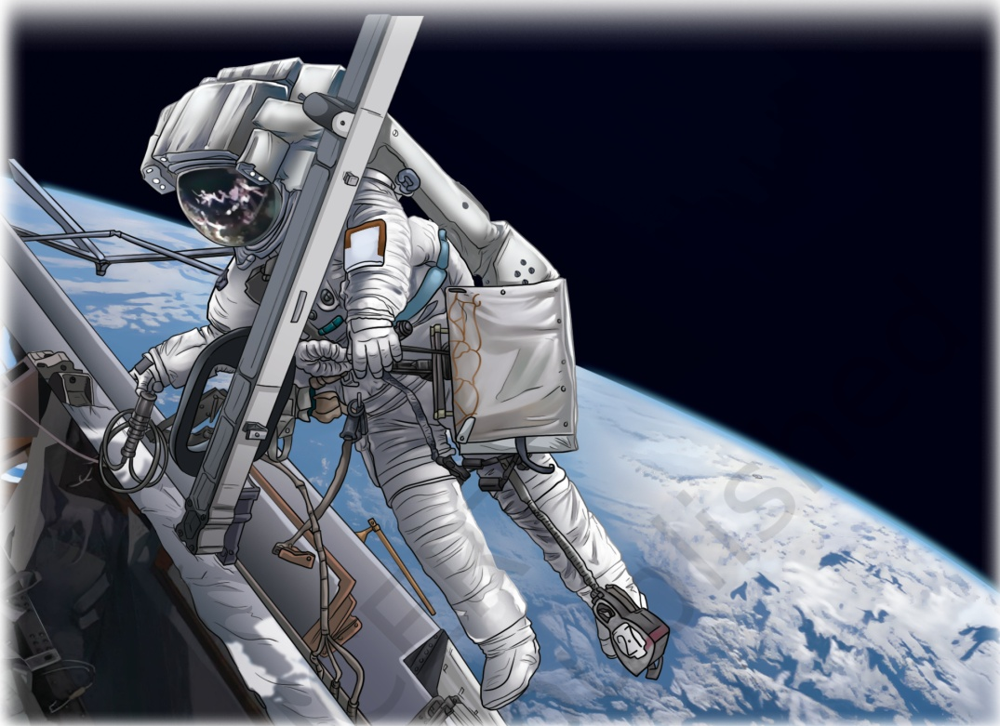
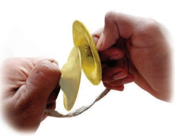

# Sound Waves: Characteristics and Applications

0906CH10

**Chapter**

10

## Think It Over

Two astronauts are repairing the arm of a space station together during a spacewalk. Can they talk to each other and hear the sounds of metal clanking as they do on the Earth?

How do most bats use sound to locate their prey in the dark at night?

Sound is an everyday sensory experience that helps us become aware of our surroundings. Every day, we hear a variety of sounds in our surroundings, such as human voices, birds chirping, waves crashing on the seashore, leaves rustling, mobile phones ringing, vehicles honking, music, and the claps of thunder. You have learnt in Chapter 7 that sound is a form of energy. You have also learnt that energy can neither be created nor be destroyed. It only changes from one form to another. Which form of energy gets converted to sound energy? How is sound produced and how does it reach our ears? In this chapter, we will try to find the answers to these questions.

## 10.1 Production of Sound

You learnt a few ways to produce sound in your textbooks for arts in the earlier grades.

4 **Grade 7** Curiosity **Chapter 4**

4 **Grade 3 Bansuri I Chapter 9**

4 **Grade 4 Bansuri Chapter 13**

4 **Grade 5 Bansuri Chapter 12**

4 **Grade 6** Kriti I **Chapter 7**

Do you also remember learning about sonority earlier, a property of some metals where sound is produced when struck with an object (Fig. 10.1)?

Fig. 10.1: Taal a musical instrument