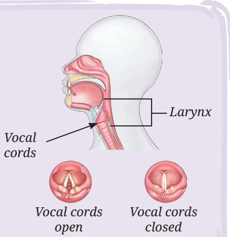

**Activity 10.1: Let us explore**

1. Take a cardboard box with one side open and a rubber band.

2. Stretch the rubber band across the open side of the box (Fig. 10.2).

3. Holding the box steady with one hand, pluck the rubber band with a finger. Do you hear any sound?

4. Pluck the rubber band again and watch it carefully. Is it vibrating?

5. Wait till the rubber band stops vibrating. Do you still hear the sound?

Fig. 10.2: Vibrating rubber band produces sound

6. Change the tension in the rubber band by stretching it more or loosening it slightly and plucking it each time. Does the sound change? What changes do you **notice**?

7. Remove the rubber band from the box. Stretch it between two fingers and pluck it near your ear. Is the sound still produced? Is it as loud as before?

You may have noticed that as long as the rubber band is stretched and vibrating, sound is produced. Once the vibration stops, so does the sound. From this activity, we **conclude** that sound is produced by vibrations. **Vibration** refers to the periodic to and fro motion (oscillations) of an object.

Pulling a stretched string or striking a metal object makes them vibrate, which produces sound. Likewise, when you blow through a bansuri (flute), vibration of the air inside the hollow pipe produces sound. You have learnt earlier that some of these methods are used in a variety of musical instruments. Sound can be produced by vibrating strings membranes, air columns, and many other vibrating objects. In most musical instruments, more than one vibrating part is involved in producing sound. The object that produces sound is called the ‘source’ of the sound.

4 **Grade 4 Bansuri Chapter 13**

## Threads of Curiosity

How do humans and animals create sound? While talking or singing, gently touch your throat. Do you feel vibrations anywhere? In humans and some other animals, sound is produced by the vibration of vocal cords, which are tightly stretched muscular flaps located inside the voice box or larynx, in the throat (Fig. 10.3). The tongue, lips, mouth and nasal cavity in humans help in converting sound into speech or music.

Some animals produce sound by striking or rubbing certain body parts. For example, grasshoppers and crickets rub their wings or legs to produce sound.

Fig. 10.3: Vocal cords in humans