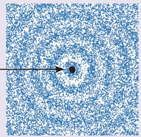
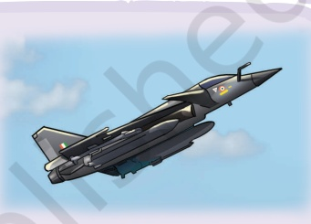
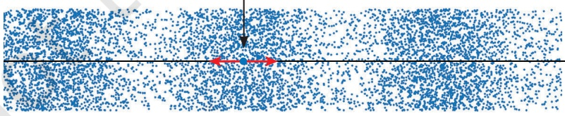

Point Source

Fig. 10.10: Sound from a point source propagates in all directions as spherical waves

When the medium is not confined to a tube, its vibrating particles collide with the surrounding particles in all directions, and thus, the sound wave spreads out in all directions. A small sound source continuously producing sound in all directions causes compressions and rarefactions that spread through the surrounding medium in all directions as spherical waves (Fig. 10.10). When they reach the listener, they are perceived as sound.

## Threads of Curiosity

What causes sudden loud sounds, such as when firecrackers explode or during a clap of thunder? These sounds are produced in a slightly different way. When air or gases are heated rapidly, they expand very rapidly in a short time. This rapid expansion creates a sudden disturbance in the air density that travels outward. When this disturbance reaches our ears, we perceive it as a loud sound pulse.

Fig. 10.11: A supersonic aircraft

A similar but more complex disturbance is produced when a supersonic aircraft (Fig. 10.11) flies at a speed higher than the speed of sound, creating a loud sound known as a sonic boom.

Did you notice (Fig. 10.9) that the displacement of the medium is parallel to the direction of wave propagation? In sound waves, the particles of the medium vibrate back and forth parallel to the direction of propagation of disturbance (Fig. 10.12). Such waves where the particles vibrate in a direction parallel to the direction of the wave propagation are known as **longitudinal waves**.

Direction of particle vibration

Fig. 10.12: A longitudinal wave

Direction of wave propagation

If there is no medium (i.e., no particles), is the propagation of sound waves possible? Without a material medium, sound waves cannot propagate. Waves that require a material medium for propagation are called **mechanical waves**. Sound wave is a type of a mechanical wave.