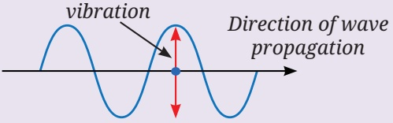
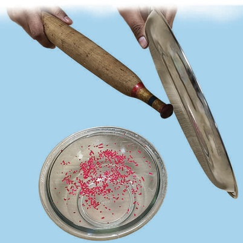

## Ready to Go Beyond

Mechanical waves are of two types: longitudinal waves and transverse waves. Sound wave is an example of a longitudinal wave where the particles vibrate parallel to the direction of the wave propagation. In a transverse wave, the particles vibrate in a direction perpendicular to the direction of wave propagation (Fig. 10.13).

Direction of particle

Fig. 10.13: Transverse Wave

Earthquakes produce seismic waves that travel through the Earth. These waves could be longitudinal or transverse. The longitudinal seismic waves are the first to be detected by seismographs that detect the earthquakes.

Not all waves are mechanical waves, i.e., not all waves need a medium to propagate. Light, which is a transverse wave, can travel through vacuum. This is why light from the Sun and other stars can reach the Earth. You will study waves in more detail in higher grades.

**Next Level Up**

## Pause and Ponder

4. Assertion (A): Compressions and rarefactions move through the medium. Reason (R): Individual particles of the medium continuously move forward with the wave.

Choose the correct statement:

(i) Both A and R are true, but R is not the correct explanation of A.

(ii) Both A and R are true, and R is the correct explanation of A.

(iii) A is true, but R is false.

(iv) A is false, but R is true.

## 10.4 Energy of Sound Waves

## Activity 10.6: Let us experiment

1. Take a wide mouthed container, a cellophane or rubber sheet (such as that of a balloon) of size larger than its opening, a loud sound source (such as a metal plate and a beater) and some grains or particles (such as rice, semolina, salt, or chalk powder).

2. Stretch the sheet over the edges of the container tightly and fix it with tape or a rubber band (Fig. 10.14).

3. Sprinkle the grains evenly over the sheet, ensuring they are not clumped together.

4. Produce a loud sound near the bowl without touching it. Observe the grains on the sheet. Does the sound have any effect on the grains?

Fig. 10.14: Sound moving grains (coloured)