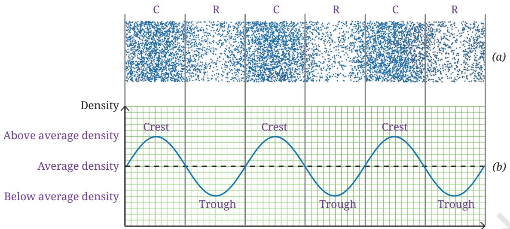
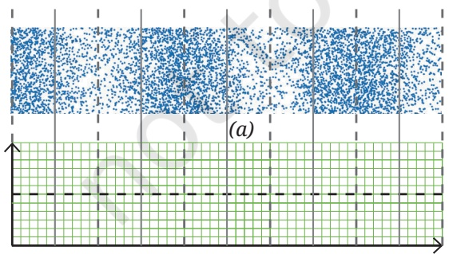
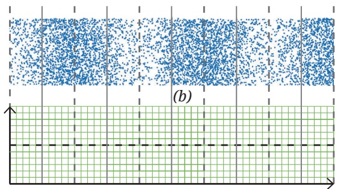

Distance

Fig. 10.16: For a sound wave (a) variation of density of medium, (b) graphical representation of variation of density with distance

In the region of a compression, the density of the medium increases above the average density and the highest point represents the maximum density (Fig. 10.16b). Thereafter, the density decreases and eventually falls below the average density in the region of rarefaction and the lowest point represents the minimum density. The highest point is called the **crest** and the lowest point is called the **trough** of the wave.

## Ready to Go Beyond

Another way to make a graphical representation of a sound wave is to plot the variation of density of the medium with time, at a particular location in the medium.

## Pause and Ponder

6. The variation of density of the medium for two sound waves is shown in Fig. 10.17 (a) and (b). **Label** compression and rarefaction by C and R on it. In the graph given in Fig. 10.17 (c) and (d), label the axes and **draw** the curves corresponding to Fig. 10.17 (a) and (b).

Fig. 10.17: Drawing graph to represent the variation of density of the medium for two sound waves