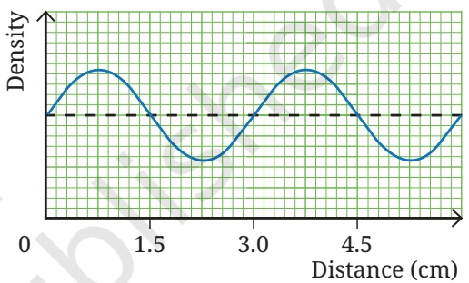
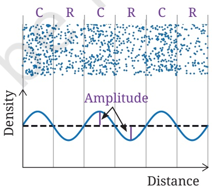
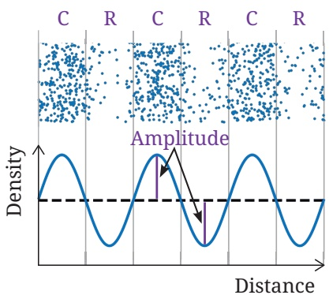

In this activity, you would have noticed that the frequency is lowest for the ‘Sa’ and gradually increases for the other notes. Each musical note has a distinct frequency, which makes it sound different. You can use the app to compare the frequencies of other sounds, including the voices of your friends too.

**Example 10.1:** If there are 10 density oscillations in 2 seconds at a given position, then **calculate** the (i) frequency of sound wave, and (ii) its time period.

**Answer:**     Frequency of sound $\mathrm{wave} = \frac{\mathrm{number of oscillations}}{\mathrm{time taken}} = \frac{10}{25} = 5\mathrm{Hz}$

Time taken for a single density oscillation at a position $\frac{2\mathrm{s}}{10} = 0.2\mathrm{s}$

## Pause and Ponder

7. Conduct Activity 10.1 once again with a thick rubber band and then with a thin rubber band. Does the thin rubber band vibrate faster than the thick rubber band? If yes, how do the frequency and time period of the sound produced by the thin rubber band differ from that of the thick rubber band?

8. If the frequency of a sound wave produced by an oscillating piston of a long tube filled with air is 20 Hz, then how many oscillations does the piston complete per minute?

Fig. 10.19: Graphical representation of a sound wave

9. For the sound wave represented by the graph shown in Fig. 10.19, what is half of its wavelength?

## 10.6.2 Amplitude and intensity of the sound waves

Sound propagates as density oscillations of the medium via compressions and rarefactions. The **amplitude** of a sound wave is the maximum change in the density of air in a compression (or a rarefaction) compared to the average density. A larger change in density corresponds to a larger amplitude (Fig. 10.20).

The amplitude and the amount of energy a wave carries

(a) Low amplitude

(b) High amplitude

Fig. 10.20: Sound waves

are related. A wave with a larger amplitude carries more energy than the one with a smaller amplitude. This can be seen in Activity 10.6. When the plate is struck harder, more energy is transferred to the particles of surrounding medium, causing larger displacements from their mean positions. As a result, the sheet vibrates to a larger displacement and the grains jump higher.

The amount of sound energy passing through a unit area perpendicular to the direction of the propagation of sound wave in a unit time is called the **intensity** of sound.