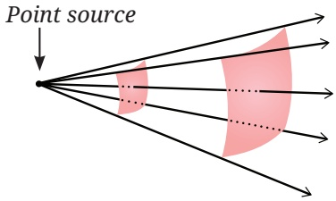

As sound wave travels away from its source, it spreads over a larger area (Fig. 10.21). Since the energy must be conserved, the same amount of energy is now spread over a larger area. Hence, the intensity decreases with distance from the source. Sounds produced with initial larger amplitude carry more energy and can travel a larger distance before intensity reduces to zero.

Fig. 10.21: Sound energy spreading over a larger area with distance

## 10.6.3 Speed of Sound

The speed of sound describes how fast sound waves propagate through a medium. In terms of compressions and rarefactions, one can think of speed as how fast these density disturbances propagate through the medium. The **speed of sound** can be defined as the distance which a point on a wave, such as a crest (or a trough), travels in unit time.

For a sound wave of given frequency, the distance between two consecutive crests (or two consecutive troughs) is one wavelength ( λ ). This distance is covered by the disturbance in one time period (T ). Therefore, the speed of sound (v) is

$$
\mathrm{speed} = \frac{\mathrm{distance}}{\mathrm{time}}
$$

$$
x = \frac { \pi } { T }
$$

We know that frequency $\hat { \nu } \equiv \frac { 1 } { T }$ (Eq. 10.1). Thus,

$$
\overline { { \upsilon } } = \lambda \times \nu\tag{10.2}
$$

$$
\mathrm { \bar { s p e e d } = \bar { w a v e l e n g t h } \times \bar { f r e q u e n c y } }
$$

The speed of sound depends on the medium through which it travels. It travels fastest in solids, slower in liquids, and slowest in gases. For example, sound travels about 4 – 5 times faster in water and typically 15 – 20 times faster in solids than in the air.

The speed of sound in air also depends on the temperature and humidity. As we increase the temperature or humidity, the speed of sound increases. For example, the speed of sound in dry air is about 331 m $S ^ { - 1 }$ at $0 ^ { \mathrm { ~ o ~ } } \mathrm { C }$ and nearly 344 m $\mathbb { S } ^ { - 1 }$ at $\bar{2}\bar{2} ^{\circ} C .$

## What if …

## Ready to Go Beyond

the speed of sound in air depended on its frequency? Would music still sound pleasant when a singer performs with instruments? Why or why not?

In most media, such as air the speed of sound depends only on the medium and not the source or the frequency. If the frequency of the source changes, the wavelength of the sound wave in the medium changes, while the speed remains constant. Some special materials, such as porous foams or engineered structures can behave differently.

**Example 10.2:** Human hearing roughly spans 20 Hz to 20 kHz. What are the corresponding wavelengths in air for these two frequencies? Use the speed of sound in air as 344 m $S ^ { - 1 }$

**Answer:** Using the relation between wavelength ( λ ), frequency (ν ), and speed (v),

speed of the wave = frequency × wavelength