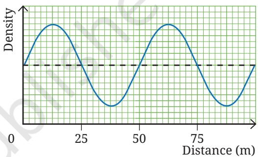

$$
\mathrm{Therefore, wavelength} \lambda = \frac{\mathrm{speed of the wave}}{\mathrm{frequency}}
$$

$$
\mathrm{For} \nu = 20 \mathrm{Hz}, \quad \lambda = \frac{344 \mathrm{m} \mathrm{s}^{-1}}{20 \mathrm{s}^{-1}} = 17.2 \mathrm{m}
$$

$$
(ii) For \nu = 20 kHz = 20000 Hz , \quad \lambda = \frac{344 ms ^{-1}}{20000 s ^{-1}} = 0.0172 m = 1.72 cm
$$

The wavelength of sound in air corresponding to the frequency (i) 20 Hz is 17.2 m, and (ii) 20000 Hz is 1.72 cm.

**Example 10.3:** During a thunderstorm, lightning is seen before thunder is heard because sound travels much slower than light. If the time delay between seeing the lightning flash and hearing the thunder is measured to be 5 s, estimate the distance to the lightning strike. Use the speed of sound in air as $3 4 0 ~ \mathrm { m ~ s ^ { - 1 } }$ . Assume that light (speed = 300000 km $\mathbf { S } ^ { - \hat { 1 } } )$ reaches you almost instantaneously.

**Answer:** Distance $v \times t = 340    m     s ^{-1} \times 5    s  = 1700    m$

Lightning struck about 1.7 km away.

**Example 10.4:** From the graphical representation of a sound wave propagating in steel (Fig. 10.22), find its wavelength. Calculate its frequency and time period if the speed of sound in steel is 5000 m $\mathbb { S } ^ { - 1 }$

**Answer:** From graph (Fig. 10.22), the wavelength $\lambda = 50    m$ Using Eq. (10.2), the frequency of the sound wave is

Fig. 10.22: Graphical representation of a sound wave

$$
\nu=\frac{\nu}{\lambda}=\frac{5000\  m \  s ^{-1}}{50\  m }=100\  Hz
$$

Using Eq. (10.1), the time period of the sound wave is

$$
T = \frac{1}{V} = \frac{1}{100   Hz } = 0.01   s
$$

## Pause and Ponder

10. Table 10.1 shows the speed of sound in a few media at atmospheric pressure. Table 10.1: Speed of sound in different media at $1 5 ~ ^ { \circ } \mathbb { C }$

| State | Substance/Medium | Approximate speed |
| --- | --- | --- |
| Solid | Steel | 5000 m s-1 |
| Liquid | Water | 1500 m s-1 |
| Gas | Air | 340 m s-1 |

Compare the speeds in different media by finding the ratio of (i) the speed of sound in water with respect to the speed in the air. (ii) the speed of sound in steel with respect to the speed in the water.