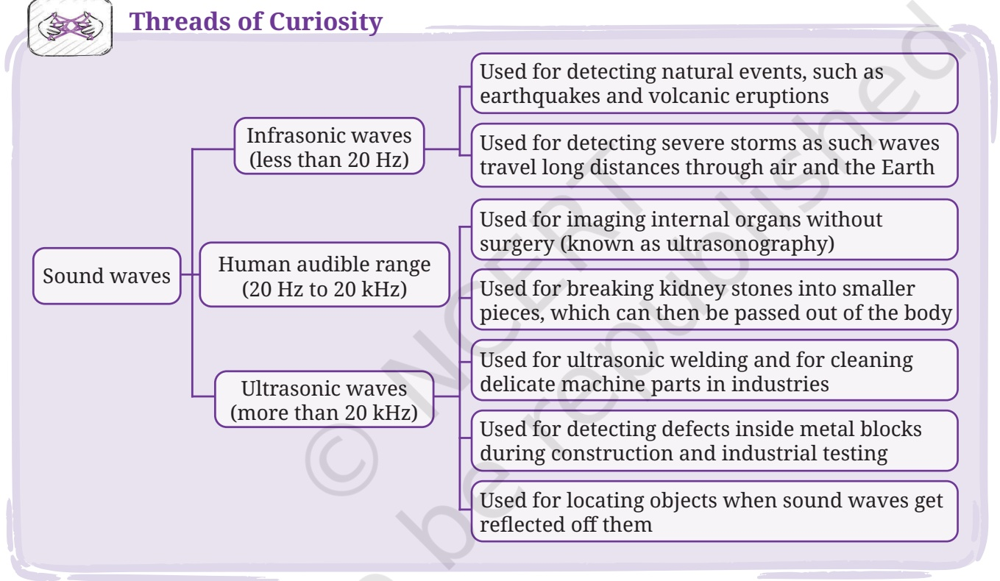
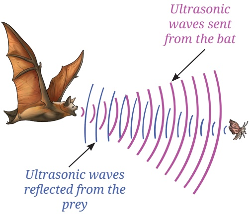

Medieval architects across the world, including in India, designed several monuments with deep acoustic insights. The renowned Whispering Gallery of the Gol Gumbaz in Bijapur, Karnataka, has a remarkable design that allows even a faint whisper to be heard multiple times across the large dome.

## 10.8 Ultrasonic and Infrasonic Waves, and their Applications

Sound waves with frequencies outside the human audible range have important applications in science, medicine, and technology.

Used for detecting natural events, such as <u>earthquakes and volcanic eruptions</u>

Used for detecting severe storms as such waves <u>travel long distances through air and the Earth</u>

Human audible range (20 Hz to 20 kHz)

Used for imaging internal organs without <u>surgery (known as ultrasonography)</u>

Used for breaking kidney stones into smaller <u>pieces, which can then be passed out of the bod</u>y

Used for ultrasonic welding and for cleaning <u>delicate machine parts in industries</u>

Used for detecting defects inside metal blocks <u>during construction and industrial testing</u>

Used for locating objects when sound waves get reflected off them

## What if …

humans could detect ultrasonic waves like dogs can? What would be the advantages and disadvantages?

## 10.8.1 Echolocation

Bats are nocturnal creatures that fly and search for their prey in the dark without colliding into objects. Most bats emit short bursts of ultrasonic waves which are reflected from nearby objects. By sensing the echoes the bat can determine the position of obstacles and prey (Fig. 10.27).

This ability to locate objects using reflected sound waves is called **echolocation**. Besides bats, animals such as dolphins, whales, and some birds also use echolocation for navigation and hunting.

Fig. 10.27: Echolocation by bats