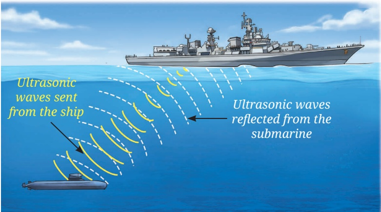
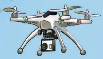

Humans have adapted the same principle in underwater exploration through sonar (sound navigation and ranging). In sonar, ultrasonic waves are sent into water and the reflected waves are analysed to determine the distance, direction, and speed of underwater objects, such as submarines or shipwrecks (Fig. 10.28).

Fig. 10.28: Functioning of sonar

**Example 10.6:** A naval sonar signal sent into seawater returns after 0.90 s. The speed of sound in seawater is $1 5 3 0 \; \mathrm { m \; s ^ { - 1 } }$ . How far is the object? **Answer:** Time taken for the signal to reach the object and travel back = 0.90 s

Time taken to reach the object is half of above time $\frac{0.90    s }{2} = 0.45    s$

Thus, distance = speed × time = 1530 m s–1 × 0.45 s = 688.5 m

## Bridging Science and Society

Drones (Fig. 10.29) and aircrafts produce characteristic sound from their motors and engines. Even when they are hard to see, the low frequency humming they generate can be detected using sensitive sound sensors. This method, called audio surveillance, helps monitor airspace for safety and security.

Fig. 10.29: A drone

## Pause and Ponder

13. Sound travels much farther in water than light, and thus, is used for various underwater applications. A sonar signal sent to find the depth of ocean takes 4 s to return. What is the depth of the ocean at that location if the speed of sound in seawater is 1500 m s–1?

## The Quest Continues …

Sound helps us explore places and phenomenon beyond human hearing. Space probes have recorded the first sounds from Mars, scientists are timing the sound of distant earthquakes to measure tiny changes in ocean temperature to understand the Earth’s changing climate, biologists are using the buzz of mosquitoes to identify disease-carrying mosquitoes, and researchers are listening to the tiny crackles produced by microbes in the soil to study soil health and biodiversity. As technology improves, sound is becoming an even more powerful tool to explore planets, living organisms, and the hidden activities of nature.