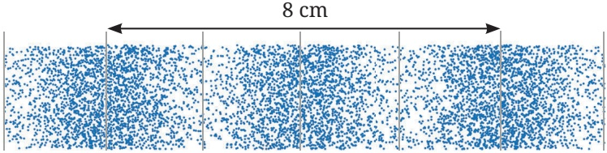
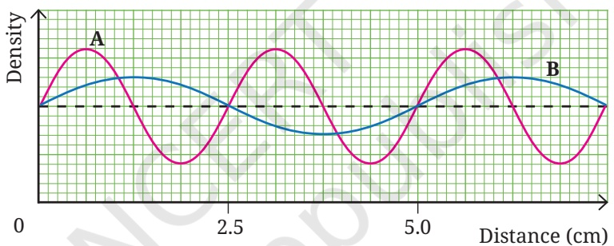
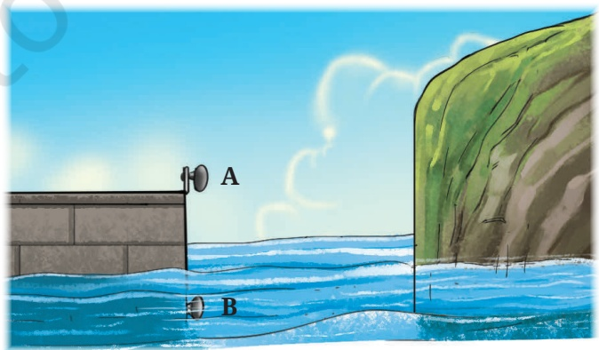

12. The speed of sound in air is about 331 m $\mathbb { S } ^ { - 1 }$ at $0 ^ { \circ } \mathrm { C }$ and nearly 344 m $\mathbb { S } ^ { - 1 }$ at $2 2 \; ^ { \circ } \mathrm { C } .$ Roughly how much extra time will the sound of thunder take to travel a distance of 1720 m, if the air temperature changes from $2 2 ~ ^ { \circ } \mathrm { C }$ to $0 ~ ^ { \circ } \mathrm { C } ?$ Assume that all other conditions remain unchanged.

13. The variation of density of medium for a sound wave propagating with a speed of 340 m $\mathbb { S } ^ { - 1 }$ is shown in Fig. 10.32. Calculate the wavelength and frequency of the sound wave.

Fig. 10.32

14. The graphical representation of two sound waves A and B propagating at the same speed of 345 m $\mathbb { S } ^ { - 1 }$ is shown in Fig. 10.33. What is the wavelength of each of them? Also, calculate their frequencies.

Fig. 10.33

15. Two identical sound sources are placed at A and B — one in air and one submerged in water (Fig. 10.34). Both produce sounds at the same time, which travel horizontally to the vertical side of the cliff and come back. If the time taken by the sound to return to A is 4.5 times than that of B, what is the ratio between the speeds of sound in air and water?

Fig. 10.34