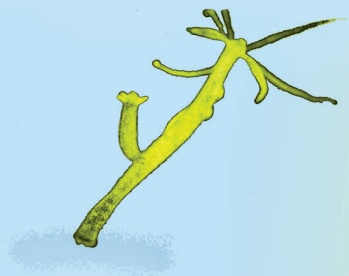
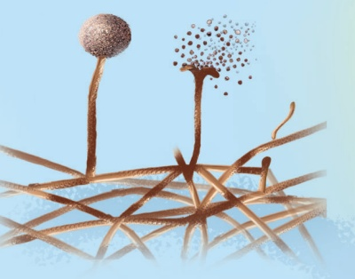
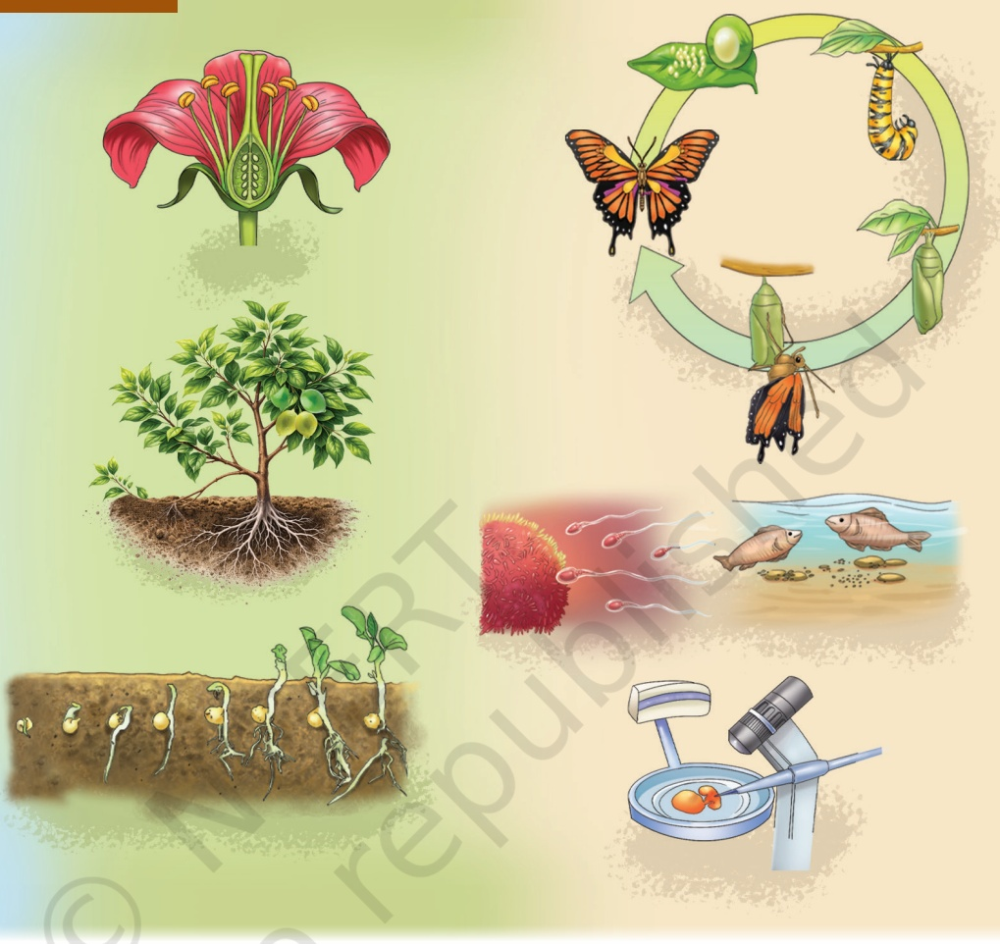

## Reproduction: How Life Continues

0906CH11

11

## Think It Over

When does a farmer prefer asexual or sexual methods of reproduction for crops production?

Why do you think most complex animals and flowering plants use sexual reproduction, while many simple organisms, like yeast and hydra mainly reproduce asexually?

You have learnt that one of the important characteristics of Grade 8 living beings is that they reproduce. Every organism has a Curiosity Chapter 13 definite life span — it is born, grows, matures, reproduces and eventually dies. Reproduction is a biological process by which living beings produce new individuals of their own kind. This is how life on the Earth continues to exist. For example, a mango tree may grow old and die, but its seeds continue to grow as new mango plants. Similarly, cows give birth to calves, dogs to puppies, cats to kittens and humans to children.

You have also learnt that living beings reproduce in two main ways — asexually, where a single parent produces offspring that are almost exact copies of the parent and sexually, where offspring inherit a mix of characteristics from the two individuals. This mixing of characteristics may lead to the small differences between parents and their young ones. Accumulated over many generations, such differences help living beings adapt to changing environments, and sometimes even give rise to new kinds of