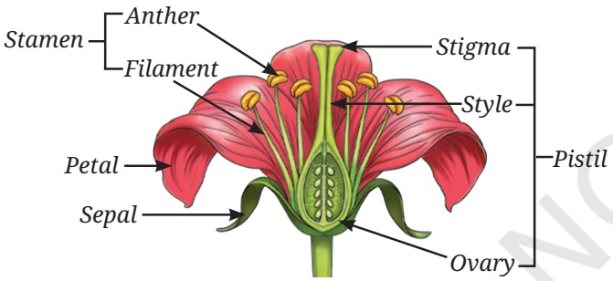

chromosomes. This creates variation among individuals, which is important for the survival of a species. Variation helps some individuals adapt better to changing environments and over time, this process contributes to evolution. For example, some people can tolerate low oxygen levels at high altitudes, or digest milk in their adulthood.

## 11.2.2 Sexual reproduction in flowering plants

Flowering plants, also called **angiosperms**, are the most diverse group of plants on the Earth. Flowers serve as reproductive organs in angiosperms, however, non-flowering plants like pines also reproduce sexually. You will study them in the next chapter.

Look at the herbs, shrubs and trees in your surroundings. Their leaves perform photosynthesis, their roots absorb water and nutrients from the soil, and their stems provide strength to the plant, these are some of the functions of a plant. Flowers also enhance the aesthetics of the plants as they are coloured and/or fragrant. How are these features of flowers useful for reproduction?

Explore flowers and their buds on some plants. Record your observations in your notebook. Do you observe thin, flat, green covering,

Fig. 11.10: Longitudinal section of a flower showing its different parts

and coloured projections present in both? In flower buds, the coloured projections are often covered by a green covering. In the bud stage, green covering around all the parts is the outermost whorl of the flower. This structure is called a **sepal**. Do you think that sepals protect flowers in the bud stage, along with other parts of the flower when it blooms? The coloured projections of flowers are called **petals** (Fig. 11.10). Do all flowers have these two parts? What are the other parts of a flower?

## Activity 11.5: Let us explore

1. Collect different types of flowers from your surroundings.

2. Carefully observe each part of the flowers you have collected, starting from the outer whorl to the inner one.

3. Record the presence of various floral parts in the different flowers that you collected in Table 11.1.

**Table 11.1: Observation table to study the parts of a flower**

<table><tbody><tr><td rowspan="2">S. No.</td><td rowspan="2">Flower parts</td><td colspan="4">Presence of floral parts in different flowers</td><td rowspan="2">Other feature(s)</td><td rowspan="2">Guess the function of flower part</td></tr><tr><td>A</td><td>B</td><td>C</td><td>D</td></tr><tr><td>1.</td><td>Sepal</td><td>Yes</td><td></td><td></td><td></td><td></td><td></td></tr><tr><td>2.</td><td>Petal</td><td>Yes</td><td></td><td></td><td></td><td></td><td></td></tr><tr><td>3.</td><td>Stamen</td><td>No</td><td></td><td></td><td></td><td></td><td></td></tr><tr><td>4.</td><td>Pistil</td><td>Yes</td><td></td><td></td><td></td><td></td><td></td></tr></tbody></table>