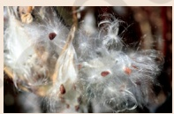

What is the approximate success rate of the common strategies — wind pollination and insect pollination — with respect to the seed formation?

## Activity 11.7: Let us find out

Studies of pollen production and seed formation by two different pollination strategies in different flowers show the following approximate trends (Table 11.3) —

Table 11.3: Pollen production and seed formation data

| Pollination strategy | Approximate pollen grains released per flower | Estimated average number of seeds formed |
| --- | --- | --- |
| Wind-pollinated grasses (e.g., maize, wheat) | 5,00,000 -10,00,000 | 50 -200 |
| Insect-pollinated plants (e.g., sunflower) | 20,000 - 40,000 | 800 -1,000 |

1. Compare and analyse the two strategies in terms of (Table 11.3) —

y Pollen to seed ratio

y Efficiency of pollination and seed formation

2. Explain why producing a very large number of pollen grains can still be an effective pollination strategy.

## 三 Pause and Ponder

1. In a china-rose (hibiscus or gudhal) plant, a pollen tube grows and continues through the style after pollen lands on the stigma. Which process is about to happen next?

2. Look at the pictures (Fig. 11.16) of calotropis (madar) seeds and dandelion seeds given below. Can you guess what kind of seed dispersal these seeds are adapted for?

(a) Madar seeds

3. A farmer plants two varieties of maize side by side, but notices that seeds form only when pollen from one variety reaches the stigma of the other. What type of pollination is this?

(b) Dandelion seeds Fig. 11.16

## Meet a Scientist

**P. Maheshwari**, known as the ‘Father of Indian Embryology’, was a leading scientist in the

field of embryology which is the study of plant reproductive organs. He developed the technique of in-vitro fertilisation in flowering plants by successfully fusing an egg and male gamete in a test tube to create new hybrid plants. He was also one of the first scientists to grow plant embryos on artificial nutrient media. His book, An Introduction to the Embryology of Angiosperms (1950), became a classic and is still widely used by scientists around the world.

## Bridging Science and Society

Sexual reproduction in plants has an applied importance in plant breeding. There are several methods of plant breeding, such as selective breeding, artificial hybridisation, genetically engineered crops, and more. In selective breeding, farmers select plants of desirable characters for reproduction. Process of artificial hybridisation involves removal of the stamens from the flowers, covering it with a bagging to prevent self-pollination, and manual transfer of the pollens with desired characters. Genetic engineering is also applied by inserting the genetic material of desired characters into the DNA of the selected varieties. This leads to the development of new varieties, such as high yielding varieties, disease resistant varieties, and so on. This has revolutionised crop production in agriculture.