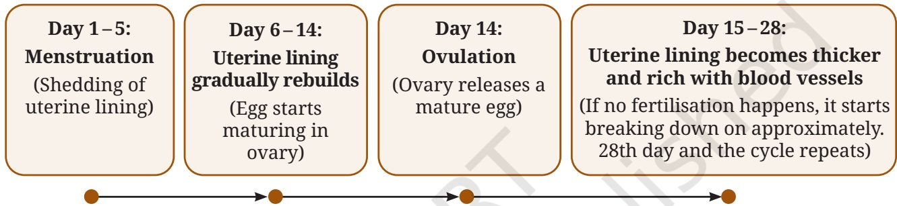

## 11.5.6 What happens when an egg is not fertilised?

If an egg is not fertilised, it remains viable for about a day and then it degenerates. The inner lining of the uterus, which became thick and rich with blood vessels to receive and nourish the developing zygote, is no longer needed. So, the lining sheds. This lining, along with some blood, leaves the body through the vagina. This process is called **menstruation** or a period, and usually lasts 3 to 7 days. You have read about this process earlier. Now, you can connect it to the events of ovulation and fertilisation.

**Grade 7** Curiosity **Chapter 8**

The cycle of ovulation, preparation of the uterus and menstruation repeats typically every 21 – 35 days (often around 28 days), and usually begins at puberty, between the ages of 10 – 14 in girls and continues till menopause i.e., around age 50 (Fig. 11.21).

**Uterine lining gradually rebuilds**

**Day 14: Ovulation**

(Egg starts maturing in ovary)

(Ovary releases a mature egg)

## Day 15 – 28:

**Uterine lining becomes thicker and rich with blood vessels** (If no fertilisation happens, it starts breaking down on approximately. 28th day and the cycle repeats)

Fig. 11.21: Key stages of the menstrual cycle across a typical 28-day period

## Threads of Curiosity

## What determines a baby’s biological sex?

So far, you have learnt that every person has two sex chromosomes. Females have XX and males have XY chromosomes. The mother always contributes an X chromosome to a baby and the father contributes either an X (Female: XX) or a Y (Male: XY) chromosome. Now, from the above information, can you predict who determines the sex of a baby?

## Bridging Science and Society

## Hygiene practices to follow during menstruation (period):

Use menstrual products, such as sanitary pads (preferably biodegradable ones), tampons, menstrual cups, etc.

Wash regularly — clean your genital area with water. Avoid using soap, as this can disrupt the natural bacterial balance.

Hand washing is the key — always wash your hands with soap and water, before and after changing your sanitary pad.

Proper disposal of used products — wrap used pads in newspaper or the wrapper they came in before disposing them in a bin. Do not flush them down the toilet.

Proper care for reusable products — if you use reusable pads, follow the manufacturer’s instructions for cleaning. Ensure reusable pads are completely dry before their next use.

Change menstrual products regularly — change pads in 4 – 6 hours, or more often if your flow is heavy.