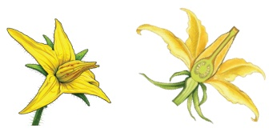
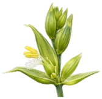
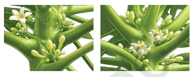
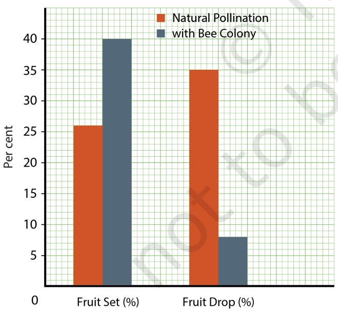

10. Suresh prepares slides with pollen grains in different sugar concentrations (0%, 2.5%, 5%, 7.5%, 10%) to study the germination of pollen.

(i) What are the different hypotheses which can be tested using this set-up?

(ii) What parameters should be kept the same in this set-up?

11. Look at the picture given below and think in line with the given prompts and find out which type(s) of pollination might have been followed in these flowers —

<table><tr><td>Tomato</td><td>Wheat</td><td>Papaya</td></tr><tr><td></td><td></td><td></td></tr><tr><td>Stamens cover the stigma.</td><td>Flowers openafter pollination.</td><td>Male and female flowersare often borne on differentpapaya trees.</td></tr></table>

12. In the lower Himalayan region of northern India, apples are an important cash crop that contribute significantly to farmer’s livelihoods. The fruit yield in apple cultivation is declining continuously, associated with climate change and a significant decline in the population of natural pollinators. A researcher-farmer group set up two experimental apple orchards at two distinct locations: Places A and B. In apple orchards at Place A, they allowed natural pollinators

to pollinate the flowers of the apple. In apple orchards at Place B, they applied mixed farming techniques of beekeeping. Along with honey, the farmer yielded apples. The yield of apples is depicted in Fig. 11.24, in terms of fruit setting (number of fruits/the total number of corresponding fruit-bearing branches) and fruit drop (premature falling of developing fruits) in the two types of experimental places of apple orchards.

(i) What are the hypotheses the researcherfarmers group has thought of for this investigation?

(ii) What are the different parameters in the experiment?

(iii) Compare and analyse the data of two experimental orchards Places A and B, in terms of high yields of apple fruits.

(iv) Based on your analysis, what do you infer from the data?

13. A student claims, “In humans, ovulation always happens on day 14 of the menstrual cycle”. Critically examine this claim and state whether the claim is correct or not. Give at least two reasons for your answer.