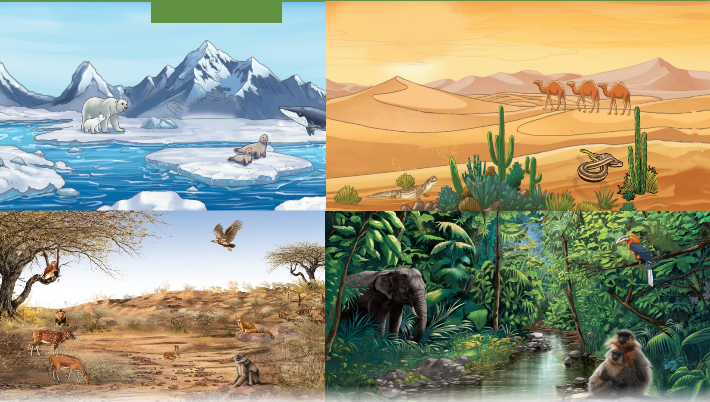

# Patterns in Life: Diversity and Classification

0906CH12

**Chapter**

12

## Think It Over

What do you understand by biodiversity?

How does the grouping of organisms help us understand diversity?

On what basis, are plants and animals classified?

How does classification help address problems in farming?

Have you ever wondered why some plants can survive long droughts while others cannot? Or, how certain insects protect crops while others damage them?

The Earth is home to an enormous variety of life forms. From microscopic organisms invisible to the naked eye to giant trees, from glowing jellyfish to soaring eagles, life exists in countless forms and habitats — from the snow-clad Himalayas to the coral reefs of the Andaman Sea. This immense variety of living organisms is known as **biodiversity**. Biodiversity is essential for life on the Earth. Every organism plays a role in keeping nature stable and functioning. Microscopic algae in the oceans release most of the oxygen we breathe. Fungi and bacteria decompose fallen leaves, and convert waste into manure, making the soil fertile. Birds, bees and bats pollinate flowers, while plants capture sunlight to prepare food that support nearly all life on the planet. These interconnections help sustain ecosystems and make the Earth suitable for living organisms.

Humans, too, depend on biodiversity for food, shelter, medicines and livelihoods. For centuries, farmers relied on their practical knowledge to conserve diverse crop varieties with useful