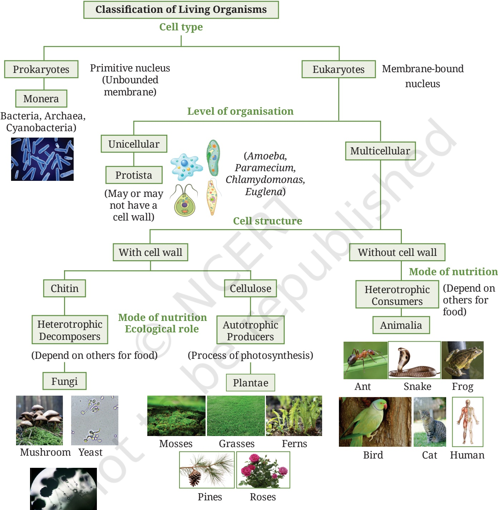

## Activity 12.3: Let us study

1. Study the concept map (Fig. 12.5).

2. List the criteria which form the basis of five kingdom classification.

Aspergillus

Fig. 12.5: Five kingdom classification

3. **Compare** the criteria you have listed after studying the concept map and the criteria given below:

y Cell type — prokaryote or eukaryote

y Cell structure — presence or absence of a cell wall