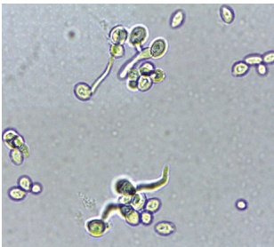
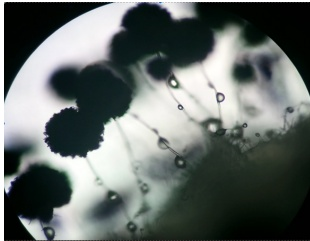
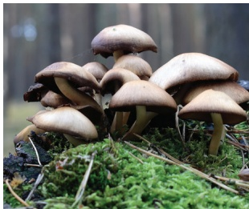

## Pause and Ponder

2. How can a single-celled organism carry out all its life processes when billions of cells are required to perform similar functions in multicellular organisms like us?

6. Slightly open the mouth of the bottle by removing the muslin cloth, just enough to insert a dropper inside it and carefully take a drop of water.

(a) Yeast

7. Put the drop of water on a clean slide and observe it under a microscope.

**Caution: The hay infusion may smell bad. Therefore, take precaution during lab exercises.**

Wear a lab coat, mask and hand gloves.

y Discard the hay infusion after autoclaving.

Do you notice moving organisms in the drop of water under the microscope? Can you **identify** them by comparing them with Fig. 12.7?

Protista includes single-celled eukaryotic organisms that live in water or moist places (Fig. 12.7). Some are autotrophic and others are heterotrophic. Protists are an important link in aquatic food chains, some produce oxygen while others serve as food for small animals. Some protists function as decomposers and help in nutrient cycling.

## 12.6.3 Kingdom Fungi — Multicellular, heterotrophic eukaryotes with a cell wall

Aspergillus

Fungi are mostly multicellular eukaryotes with cell walls made of chitin. They do not make their own food. They either absorb nutrients from dead or decaying matter through fine filaments (which together form a network known as mycelium). Most of the fungi are saprophytes and therefore, they play a very important ecological role as decomposers, that means, they feed on dead organic matter, such as fallen leaves, twigs or dead organisms. They break down the complex organic matter into simpler substances and make them readily available in soil as minerals. Some of the fungi establish a mutualistic (symbiotic) relationship with other organisms while others live as parasites, and cause diseases in plants and animals. They reproduce both sexually and asexually, often by forming spores, and grow best in warm and moist conditions.

(c) Mushrooms

Fig. 12.8: Common fungi

Yeast (Fig. 12.8a) and Aspergillus mould are common fungi. However, yeast is a unicellular organism, since its cell wall is made up of chitin, it has been put under fungi. Mushrooms (Fig. 12.8c) are macroscopic fungi that reproduce by spores. Some fungi like Aspergillus (Fig. 12.8b) and Penicillium are used to make enzymes and antibiotics. Fungi are important decomposers and help recycle nutrients. Without them, the decay of dead plants and animals would be greatly reduced, adversely affecting the soil fertility and ecological balance.

## Bridging Science and Society

Wild edible mushrooms are a valuable dietary food with high nutritional and medicinal values. They are important forest resources used and conserved by many communities, including tribal communities in India. These communities possess traditional knowledge about the edible and poisonous mushrooms based on folk taxonomy. Some wild mushrooms are used as sources of food and some as medicine for treating various ailments. Nowadays, mushroom cultivation is becoming a promising vocation for livelihood. Mushroom farming is easy and accessible due to its minimal space requirement, low investment and fast life cycle (30 – 45 days).