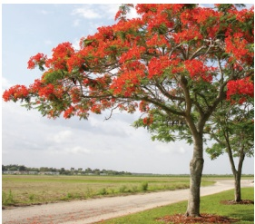

## Angiosperms — Efficient reproduction and seed dispersal

Angiosperms (angeion means vessel and spermos means seeds) or flowering plants, represent plants with the most complex body organisation.

**Grade 6 Curiosity Chapter 2**

They produce flowers and fruits (Fig. 12.13). Flowers attract pollinators, increasing the efficiency of reproduction, while fruits help spread seeds to new locations. These features allow angiosperms to occupy a wide range of environments. Therefore, they are the most diverse plant group on the Earth.

Fig. 12.13: An angiosperm tree (Gulmohar)

## Activity 12.8: Let us discuss

Collect different leaves from your surroundings, and observe their shape and venation. Group them as monocots or dicots. **Discuss** how their structures help them adapt in different conditions to survive.

## Bridging Science and Society

One of the earliest scientific books on Indian plants, Hortus Malabaricus, was compiled in the 17th century by Hendrik van Rheede with the help of Itty Achudan (an Indian Herbalist, Botanist and Physician) and other local experts. It describes hundreds of plant species and their medicinal uses, showing how traditional knowledge and science can work together.

Different plant groups present different ways of solving problems, each with advantages and challenges or exceptions for survival.

## Activity 12.9: Let us study

1. Carefully study the salient features of each plant group.

2. **Analyse** the salient features, and write the advantages for survival of the group and the exceptions or challenges faced in the given columns.

Table 12.3: Classes of Kingdom Plantae with their advantages and challenges

| Plant groups and salient features | Advantages of the group for survival | Exceptions/Challenges |
| --- | --- | --- |
| Thallopyta | y Simple plant body | y They cannot live |
| y Their body is like a thallus which facilitates easy | facilitates survival | on land. |
| absorption of water and nutrients, and exchange of | and its dispersal in | __________________ |
| gases from the surroundings. | water. | __________________ |
| Bryophyta | y They are plant | y They always |
| y Unlike algae, this group of plants began to colonise | amphibians. | need moisture. |
| land but with strong dependence on moisture. | y Their body is | __________________ |
| y Plant body shows slight differentiation in body parts | adapted to live on | __________________ |
| but not in root, stem, or leaves. | moist land. |  |
| y They lack vascular tissues for transporting water and | ____________________ |  |
| food. | ____________________ |  |
| y They require water for reproduction, as male |  |  |
| reproductive cells must swim to reach female cells. |  |  |
| Pteridophyta | y They live on land. | y Reproduction |
| y Pteridophytes possess true roots, stems and leaves. | y They transport food | does not take |
| y They have vascular tissues (xylem and phloem) that | and water to all | place without |
| transport water and food throughout the plant. | parts of the plant. | water. |
| y They still depend on water for reproduction. | ____________________ | __________________ |
| y They do not produce seeds. | ____________________ | __________________ |