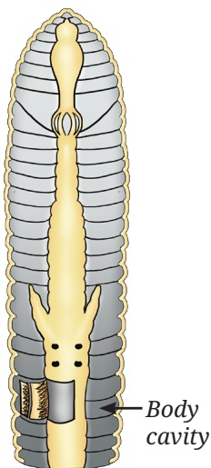
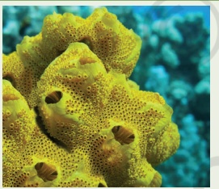
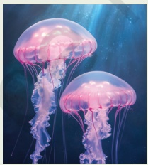
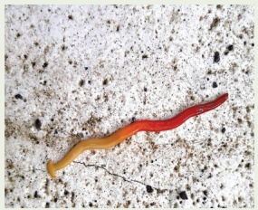

Fig. 12.15: Internal structure of an earthworm: Organ formation and body cavity

roundworms can survive, despite relatively simple internal organisation. The body has two openings (mouth and anus). The organ system level of body organisation is distinct in male and female worms.

**Annelida (segmented worms) — segmentation and body cavities** Annelids, such as earthworms (Fig. 12.16e), represent a notable development in body organisation. Their bodies are cylindrical and are divided into segments. What advantages segmentation might offer to an organism? Observing how an earthworm moves may help you form a hypothesis. They possess organ system level of organisation. Presence of muscles help them in locomotion, and nerve cord helps in control and coordination.

Segmentation allows greater flexibility and more precise control of movements. A body cavity is also present in them as shown in Fig. 12.15.

**Arthropoda — Jointed appendages and an external skeleton** Arthropods (arthro means limbs and poda means appendages) includes insects, crabs (Fig. 12.16f) and spiders. They have segmented bodies with different segments specialised for different functions. A defining structural feature of arthropods is the development of a hard external skeleton (rigid external covering). What advantages can the outer covering provide?

This outer covering provides protection, reduces water loss and supports powerful muscles, allowing arthropods to survive in dry and exposed environments.

## Pause and Ponder

6. An earthworm (annelida) and a beetle (arthropoda), both have segmented bodies but the beetle has a hard external skeleton. How does the beetle’s external skeleton help it survive?

<table><tr><td rowspan=3>Image</td><td></td><td></td><td></td><td></td></tr><tr><td>(a)</td><td>(b)</td><td>(c)</td><td>(d)</td></tr><tr><td>Porifera</td><td>Cnidaria</td><td>Platyhelminthes</td><td>Nematoda</td></tr><tr><td>Habitat</td><td>Water (Marine)</td><td>Water(Fresh and marine)</td><td>Water/inside host</td><td>Soil/water/insidehost</td></tr><tr><td>Level oforganisation</td><td>Cellular</td><td>Tissue</td><td>Organ</td><td>Organ system(digestive system)</td></tr><tr><td>Skeleton</td><td>X</td><td>X</td><td>X</td><td>X</td></tr></table>

Fig. 12.16: The animal kingdom