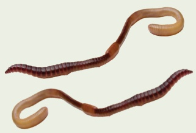
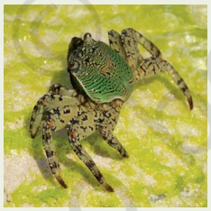
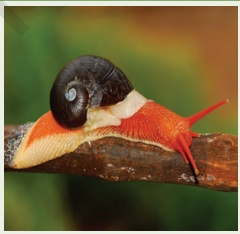
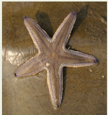

## Mollusca — Organ system level organisation with soft bodies

Molluscs, such as snails (12.16g), squids and octopuses show organ system level organisation with soft bodies. In many molluscs, the development of a shell provides protection to these soft bodies. Their body is segmented with a distinct head, a muscular foot and a hump.

This group shows how a basic body plan can be modified in different directions depending on environmental demands.

## Echinodermata — Internal support without a notochord

Echinoderms (echinos means spiny and derma means skin), such as starfish (Fig 12.16h) and sea urchins possess a hard internal skeleton made of calcium carbonate. Although they lack a notochord, this internal skeleton provides them protection and controlled movement. Their body organisation is quite like that of more complex animals, showing a gradual shift towards internal skeletal support.

## Looking across invertebrates

From sponges to echinoderms, animal body structure shows a pattern of increasing complexity in body organisation. New structural features improve feeding, movement and protection but often introduce new challenges. These help explain survival in diverse environments.

## Protochordates — The appearance of the notochord

Protochordates (like Amphioxus) possess a notochord at least once during their life. This structure provides internal support without restricting movement and represents a crucial change in body organisation. Protochordates are a primitive type of chordates which help us understand how animals with a notochord may have arisen from simpler forms.

<table><tr><td>(e)</td><td>(f)</td><td>(g)</td><td>(h)</td></tr><tr><td>Annelida</td><td>Arthropoda</td><td>Mollusca</td><td>Echinodermata</td></tr><tr><td>Moist soil/water</td><td>Land/water</td><td>Water/moist land</td><td>Marine water</td></tr><tr><td>Organ system</td><td>Organ system</td><td>Organ system</td><td>Organ system</td></tr><tr><td>X</td><td>Exoskeleton</td><td>Exoskeleton</td><td>Endoskeleton</td></tr></table>