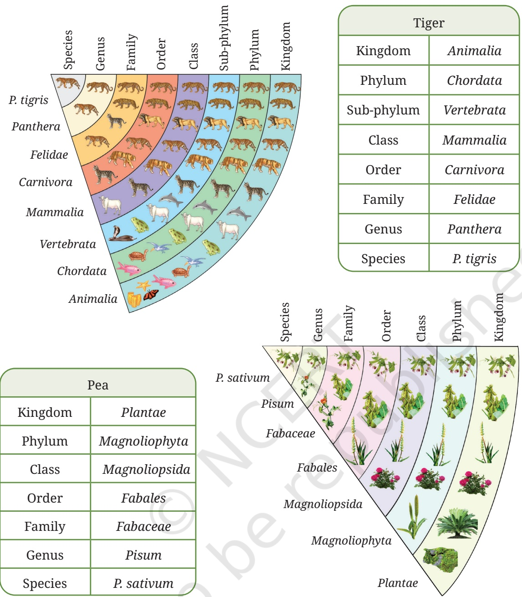
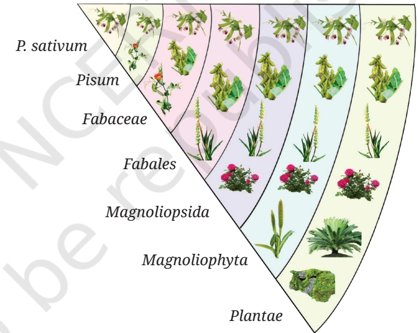

<table><tbody><tr><td colspan="2">Tiger</td></tr><tr><td>Kingdom</td><td>Animalia</td></tr><tr><td>Phylum</td><td>Chordata</td></tr><tr><td>Sub-phylum</td><td>Vertebrata</td></tr><tr><td>Class</td><td>Mammalia</td></tr><tr><td>Order</td><td>Carnivora</td></tr><tr><td>Family</td><td>Felidae</td></tr><tr><td>Genus</td><td>Panthera</td></tr><tr><td>Species</td><td>P. tigris</td></tr></tbody></table>

<table><tbody><tr><td colspan="2">Pea</td></tr><tr><td>Kingdom</td><td>Plantae</td></tr><tr><td>Phylum</td><td>Magnoliophyta</td></tr><tr><td>Class</td><td>Magnoliopsida</td></tr><tr><td>Order</td><td>Fabales</td></tr><tr><td>Family</td><td>Fabaceae</td></tr><tr><td>Genus</td><td>Pisum</td></tr><tr><td>Species</td><td>P. sativum</td></tr></tbody></table>

seal

V
甘茶茶
农
城
尖发
C
odes
Je
F

Fig. 12.17: Pyramids showing levels, from kingdom at the top to species at the base, with the examples of a tiger and a pea plant

## 12.8 Scientific Naming — The Binomial System

A tiger is called bagh in Hindi, or puli in Tamil, tiger in English and tigre in French. If people from different regions discuss this animal, confusion may arise. To avoid this, scientists use a universal system of naming living organisms called binomial nomenclature. This system was introduced by Carolus Linnaeus in the 18th century. According to this, every organism has a scientific name with two parts, written in Latin or a Latinised form (Table 12.3).