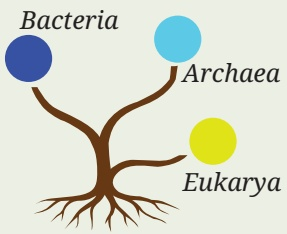

Fig. 12.18: Example illustrating a scientific name

Table 12.3: Scientific names of organisms in the binomial system of nomenclature

| S. No. | Common name | Scientific Name |
| --- | --- | --- |
| 1. | Tiger | Panthera tigris |
| 2. | Mango | Mangifera indica |

The first word, Panthera or Mangifera, is the name of the genus and the second, tigris or indica, is the name of the species. A genus groups closely related species that share common features, in this case, Panthera tigris (tiger) and Panthera leo (lion) under the genus Panthera — the roaring cats (possessing the ability to roar), have similar skull structure, and so on. The species name indicates a group of organisms that consists of similar individuals capable of interbreeding and producing offsprings. Together, the genus and species name form a unique scientific name used worldwide.

## Rules for writing the scientific names

1. The name has two parts — genus and species.

2. The genus name begins with a capital letter and comes first, followed by the species name, which is written in small letters (lower case).

3. The scientific name is written in italics when printed, or underlined when handwritten (Fig. 12.18).

## Ready to Go Beyond

The five kingdom classification offered a more comprehensive way to group organisms compared to the previous systems, but it still could not fully explain the diversity of life. Latest advances in genetic research aided in modifying this classification. With advances in microscopes and genetic studies, scientists began to compare organisms at Next the DNA level. As you have studied in Chapter 2, Level Up every living cell contains genetic material (DNA),

Fig. 12.19: Three domains of life

which carries the instructions for its growth and function.

Organisms with similar DNA are considered to have a common ancestry. Based on the genetic data, Carl Woese (1977) proposed the three domain system (Fig. 12.19) —

Bacteria

y Archaea

Eukarya

This system showed that microscopic life forms are far more diverse than previously believed.