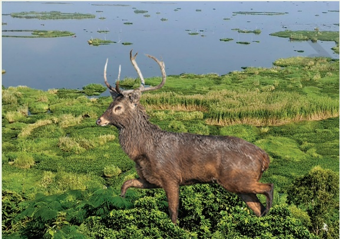
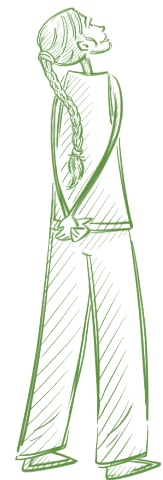

Floating grasslands, locally known as phumdis are classified as one of the unique habitats in the world. It is located in the Loktak lake of the Keibul Lamjo National Park, in Manipur, India. These floating beds of soil have a variety of rooted vegetation growing with rich organic matter in it. Its thickness varies from a few centimetres to two metres. The habitat supports an association of unique vegetation and is home to an endangered variety of Sangai, the dancing deer, endemic to Manipur. The deer spends considerable time on phumdis restricted to this small area. This deer species was declared extinct in 1951. In 1953 the deer species was rediscovered, with the efforts of naturalists based on their unique characteristics of having hooves and elongated patterns. These characteristics

of the deer species helped in their identification. Recently, the phumdis are degenerating and the Sangai deer is listed in the IUCN Red Data list. Habitat loss will significantly affect the Sangai population. Efforts for the conservation of phumdis and the Sangai deer are currently in progress. Provide your suggestions to save habitat and the Sangai deer.

## At a Glance

Life on the Earth exists in many forms, from simple bacteria to complex animals.

Scientists classify organisms based on the cell structure, number of cells, mode of nutrition and the organism’s ecological role.

Whittaker’s five kingdom classification system — Monera, Protista, Fungi, Plantae and Animalia — is a simple and useful system to understand diversity.

Kingdom Plantae is further divided into five classes — Thallophyta, Bryophyta, Pteridophyta, Gymnosperm and Angiosperm.

Kingdom Animalia is divided into non-chordata (invertebrates) and chordata (vertebrates) on the basis of formation of notochord. Non-chordata (Invertebrates) has been divided into phyla — Porifera, Cnidaria, Platyhelminthes, Nematoda, Annelida, Arthropoda, Mollusca, Echinodermata.

Protochordates show a transition from invertebrates to vertebrates as they possess notochord atleast once in their life. Vertebrates are further divided into groups — fish, amphibians, reptiles, birds and mammals.

Classification is not just about naming organisms. It helps us understand the relationships among organisms, trace the history of life on the Earth and conserve the biodiversity.