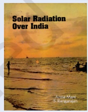
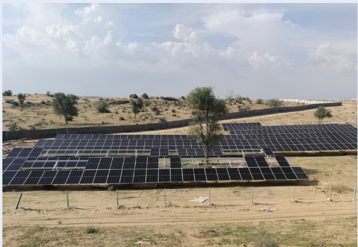

The solar constant is important because it helps scientists understand the Earth’s energy balance, climate and weather patterns. However, some of this energy is absorbed and scattered by gases, clouds and dust particles in the atmosphere before reaching the surface of the Earth. As a result, the maximum insolation reaching the Earth’s surface is lower than the solar constant and is about 1 $\mathrm { k W m ^ { - 2 } }$ under clear sky conditions. India, due to its geographical location in the tropical and sub-tropical regions, receives abundant sunlight throughout the year. This makes solar insolation highly significant as it drives the southwest monsoon, which influences India’s climate and agriculture. It also offers immense potential for harnessing solar energy as a renewable and sustainable source of energy.

## Bridging Science and Society

**Anna Mani**, India’s pioneering atmospheric scientist, mapped solar insolation across India in the 1950s. Along with S. Rangarajan, she later published **Solar Radiation Over India** in 1982, creating the country’s first **insolation atlas**. Her pioneering measurements showed India’s vast solar energy potential. Today, this is being realised through the large-scale deployment of solar power across the country. India is laying the foundation for a resilient, sustainable and solar-powered energy future that sets global benchmarks.

Fig. 13.3: Solar Radiation Over India by Anna Mani and S. Rangarajan

**Example 13.1:** How much solar energy will be received by a 1 $\mathrm { m } ^ { 2 }$ area in one hour, if the insolation on the surface of the Earth were 1 $\mathrm { k W m ^ { - 2 } }$

**Answer:** E = Intensity × area × time

$$
\mathrm{E}=1 \times 1000 \mathrm{~J} \mathrm{~S}^{-1} \mathrm{~m}^{-2} \times 1 \mathrm{~m}^{2} \times 3600 \mathrm{~s}
$$

$$
\mathrm{E}=3600000\mathrm{J}=3.6 \times 10^{6}\mathrm{J}
$$

(This amount of energy is approximately equal to the energy needed to melt 5 kg of ice and heat the water obtained to $1 0 0   ^ { \circ } \mathsf { C } ,$ It is also equal to one unit of electricity used in a household, as shown on an electricity bill).

## Think as a Scientist

An interesting estimation problem that helps us to appreciate the enormous amount of energy that we get from the Sun is to estimate how much of the Earth’s surface would be needed to be covered with solar panels to supply all the electric power that our country uses today (Fig. 13.4). To make this estimate, you can find these numbers on the internet, assume some insolation on the Earth’s surface and consider that some fraction of this energy is converted into electricity. You will probably find that even a fraction of the area of the Thar desert, if covered with solar panels, could supply India’s electricity needs.

Fig. 13.4: Solar panel in the desert