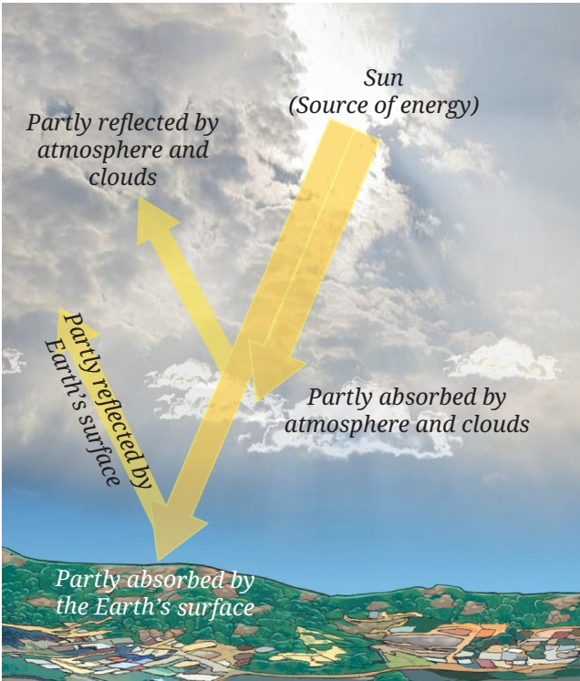

How does the Sun’s radiation interact with the Earth’s surface and atmosphere, and warm the Earth? We will discuss more about it in the following sections.

Fig. 13.5: Solar radiation and warming of the Earth

## 13.1.1 Interaction of solar radiation on the Earth’s surface

Different materials absorb and heat up differentl y under sunlight. You have already learnt Grade 7 how land heats up faster than water. Curiosity There may be some variation due to Chapter 7 the material forming the land and the colour of the soil. Dark surfaces absorb more sunlight, while light coloured surfaces reflect more and remain comparatively cooler. For example, dark coloured roads heat up more quickly, while light coloured surfaces remain comparatively cooler. You have also learnt why dark coloured clothes feel hotter than white ones in summer.

The fraction of solar radiation reflected by a surface is called its **albedo** (the word ‘albedo’ comes from Latin which means whiteness). High albedo surfaces stay cool because they reflect more light, while low albedo ones heat up more quickly as they reflect less and absorb more light (Fig. 13.5). Let us try to find out the albedo of some of the common objects we come across in our daily lives by conducting Activity 13.2.

**Activity 13.2: Let us find out**

Complete Table 13.1 using information from authentic sources like websites and books.

**Note**

Ensure that you do not share any personal information while using the internet.

Table 13.1: Reflection of solar radiation by surfaces of materials

| S. No. | Materials | Albedo |
| --- | --- | --- |
| 1. | Snow | 0.80 - 0.90 |
| 2. | Ice | 0.50 - 0.70 |
| 3. | Crushed rock | 0.25 - 0.30 |
| 4. | Light coloured soil |  |
| 5. | Black soil |  |
| 6. | Ocean water |  |

From Table 13.1, you must have seen that snow and ice have high albedo, meaning they reflect a large proportion of the incoming solar radiation. This makes polar regions very cold. On the other hand, surfaces like black soil and ocean water have lower albedo as they absorb more solar radiation, and hence, they are relatively warmer.