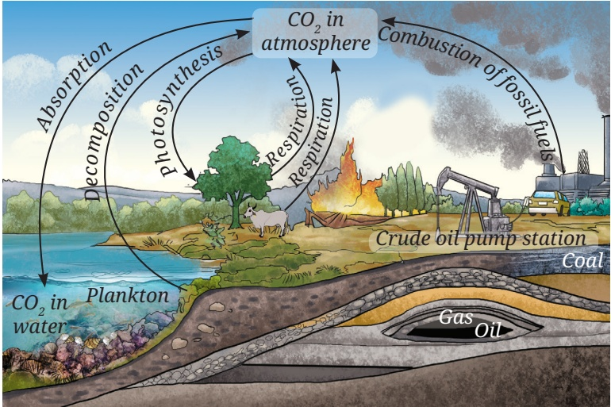
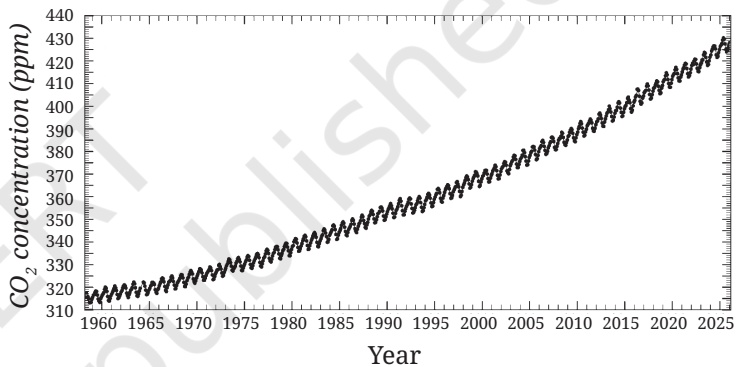

rocks and fossil fuels, such as coal and oil), and the hydrosphere (dissolved $\mathrm { C O } _ { 2 }$ and marine shells) as shown schematically in Fig. 13.13. Different parts of the carbon cycle operate at very different time scales. In the fast cycle, which happens over days to years, plants convert atmospheric $\mathrm { C O } _ { 2 }$ into glucose using sunlight through photosynthesis. $\mathrm { C O } _ { 2 }$ is released back into the atmosphere through respiration. Animals eat plants and/or other animals. When they die, $\mathrm { C O } _ { 2 }$ returns to air because of decomposition.

In the slow cycle, which happens over millions of years, dead plants and animals get buried, and are converted to fossil fuels, such as coal, oil and gas. These fuels are burnt to provide energy for various needs like heating, cooking, transportation and industrial purposes. When fossil fuels are burnt, carbon is released back as $\mathrm { C O } _ { 2 }$ on a very short time scale. The atmosphere and ocean water continuously exchange $\mathrm{CO}_{2}$ The ocean water absorbs atmospheric CO to form carbonate and bicarbonate ions. Phytoplankton use them for photosynthesis. Some marine organisms also use them to form shells. When organisms die, they sink to the ocean floor and their organic matter is stored as carbon for a long period.

Fig. 13.13: Carbon cycle

Fig. 13.14: Atmospheric CO concentration (1960 – 2025), the Keeling curve. The sawtooth pattern shows seasonal dips from yearly plant growth in the Northern Hemisphere absorbing CO

Human activities like burning fossil fuels and deforestation have raised atmospheric $\mathrm { C O } _ { 2 }$ by about 35% since 1960 as shown in Fig. 13.14 (315 ppm to 420 ppm; ppm denotes parts per million), an unprecedented rise in the history of human civilisation. While some amounts of carbon dioxide are necessary to keep the Earth warm enough to sustain life, the balance is critical. Excessive amounts of $\underline { { \mathbb { C O } _ { 2 } } }$ intensify the greenhouse effect leading to global warming, melting of glaciers and Arctic sea ice, rising of sea level and more extreme weather conditions. In India, this may lead to more intense monsoons (warmer air holds more moisture) and threats to agriculture from its changing rainfall patterns. Though fossil fuels still power much of our electricity generation, India is rapidly increasing renewable energy sources, which will help minimise the carbon released into the atmosphere.

## Pause and Ponder

4. The $\mathrm { C O } _ { 2 }$ dissolved in the ocean is disturbed when the global temperature increases. What will happen to marine life?

## Threads of Curiosity

Carbon constitutes \~ 49% of dry weight of living organisms. Out of the total quantity of global carbon, 71% carbon is found in oceans. This oceanic reservoir regulates the amount of carbon dioxide in the atmosphere.

Do you know that the atmosphere holds only a very small fraction (about 1%) of the total global carbon?