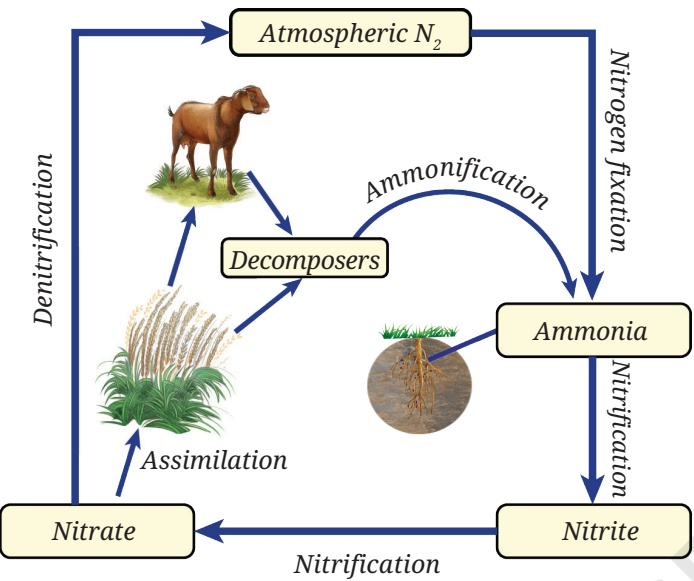

## 13.3.3 Nitrogen cycle

Nitrogen is an essential element for the synthesis of proteins and nucleic acids in all living organisms. The largest reservoir of nitrogen is in our atmosphere. However, nitrogen gas (N ) is rather non-reactive, and cannot be directly used by plants and animals. It must first be converted to soluble compounds that living beings can absorb. The overall movement of nitrogen between air, soil, water and organisms is called the **nitrogen** **cycle** (Fig. 13.15). The nitrogen cycle contains several steps — nitrogen fixation, assimilation**, ammonification**, **nitrification** and **denitrification**.

Fig. 13.15: Nitrogen cycle

Nitrogen-fixing bacteria, such as Rhizobium in the root nodules of legumes and Azotobacter in the soil, convert atmospheric $\mathrm { N } _ { 2 }$ into ammonia (NH3). Nitrifying bacteria like Nitrosomonas convert ammonia into nitrite (NO–2), while Nitrobacter convert nitrite into nitrate (NO–3). This process is known as **nitrification**. Plants assimilate these nitrogen compounds from the soil, whereas animals obtain nitrogen by consuming plants or other animals. When plants and animals die or produce waste, decomposers like bacteria and fungi break the organic matter, returning nitrogen compounds like ammonia to the soil. This process is known as **ammonification**. Denitrifying bacteria, such as Pseudomonas convert some nitrates back into nitrogen gas. This process is known as **denitrification**. This completes the cycle and maintains a balance of nitrogen in ecosystems. Lightning also contributes to the fixation of nitrogen oxides.

## Ready to Go Beyond

During lightning strikes, a tiny amount of atmospheric nitrogen is fixed to produce nitrogen oxides. Today most of the nitrogen is fixed artificially via the Haber-Bosch process (early 1900s) of making ammonia from atmospheric nitrogen, which produces most of the fertilisers used today. This ‘Bread from Air’ revolutionised agriculture, enabling India’s Green Revolution and feeding billions. More than half the nitrogen atoms in the human body come from the Haber-Bosch process. However, this reaction is energy intensive (uses \~ 1 – 2% of global energy), and the overuse of fertilisers has degraded soil and water.

## 13.3.4 Oxygen cycle

Oxygen is one of the Earth’s most abundant elements. About 21% of the atmosphere consist of free oxygen gas (O ). It is an essential component of most biological molecules like carbohydrates, proteins, nucleic acids and fats. Oxygen also exists in combined forms — in the Earth’s crust as