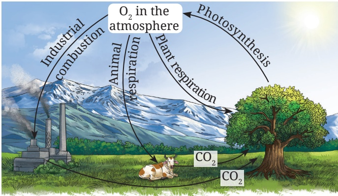
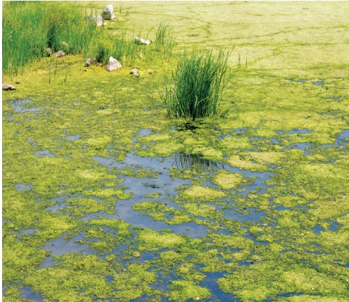

metal oxides and minerals, and in the air as carbon dioxide. While discussing the oxygen cycle, we focus on processes that regulate the oxygen level in the atmosphere (Fig. 13.16). Organisms like plants and animals use oxygen for respiration, and releases $\mathrm { { C O } _ { 2 ^ { \circ } } }$ Combustion of fuels uses oxygen and releases $\mathrm { { C O } _ { 2 ^ { \circ } } }$ Plants restore oxygen through photosynthesis using sunlight, water and $\mathrm { C O } _ { 2 }$ to form glucose and release $\mathrm { O } _ { 2 ^ { \bullet } }$ This balance between consumption (respiration and combustion) and production (photosynthesis) circulates oxygen between the atmosphere, land, oceans and living organisms, sustaining life across all spheres of the Earth.

Fig. 13.16: Oxygen cycle

## Pause and Ponder

5. What would happen to plants and animals on Earth if the biogeochemical cycles were disrupted and stopped? Explain by giving a few examples.

## 13.4 Human Impact on Earth’s Processes

You have learnt about the impact of climate change earlier, in which we examined the crises our planet Earth is facing. Rising $\mathrm{CO_{2}}$ levels from the use of fossil fuels leads to extreme weather and biodiversity loss. Here, we will examine how human actions disrupt the biogeochemical cycles across the Earth’s spheres. Excess atmospheric $\mathrm { { \mathbb { C O } _ { 2 } } }$ increases ocean absorption, making sea water more acidic. This could threaten tiny plankton and coral reefs, disrupting the marine ecosystems. However, warmer ocean water reduces the ocean’s capacity to absorb $\mathrm { C O } _ { 2 }$ as an effective carbon sink.

4 **Grade 8** Curiosity **Chapter 13**

Burning of fossil fuels and deforestation saturate natural carbon sinks like forests and oceans. Over the past 50 years, there has been a significant change in the Earth’s natural systems. In India, fossil fuels still generate a significant part of our electricity, contributing harmful emissions, although the rapid growth of solar energy offers hope. The excess $\mathrm { C O } _ { 2 }$ intensifies greenhouse warming, disrupting the carbon cycle.

**What if ...**

photosynthesis stopped, what would happen on the Earth?

The overuse of fertilisers in agriculture adds excessive nitrogen via nitrates to rivers and lakes, causing widespread growth of algae (algal blooms) that deplete oxygen and kill fish. This process is called **eutrophication** (Fig. 13.17), which threatens water bodies and coastal fisheries. Deforestation also creates multiple effects across air, water, land and living organisms. Clearing forests results in decreased photosynthesis and reduced transpiration, which can lead to decline in the local rainfall. It also alters surface albedo. Without tree roots to hold the soil together, soil erosion could increase. Over time, habitats could be destroyed, leading to a decline in biodiversity as many species lose their natural homes.

Fig. 13.17: Eutrophication (algal bloom)