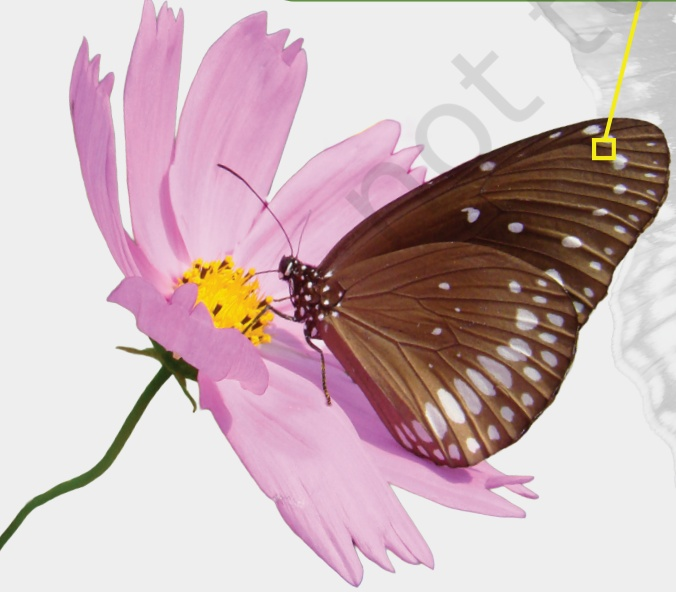
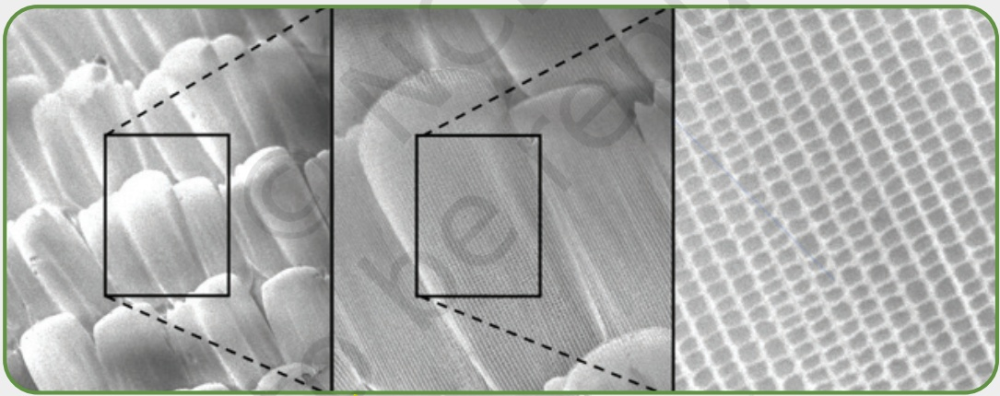

## Ready for New Horizons?

As you reach the end of this book, look back on your journey in science, from first being curious about the world around you to exploring it with deeper understanding and clearer ideas. You have travelled across the hidden world inside cells and atoms, learnt about the forces that shape motion, work and mechanical energy, the science of sound, and the systems that make our planet a living world. Together, these ideas show that science is not a collection of facts, but a connected way of understanding nature. More importantly, we hope you have learnt to think like a scientist — asking questions, looking for evidence and trying to understand patterns in nature. These ways of thinking also help us understand the technology around us, make informed choices, and see connections between the human life and the natural world.

In Grade 10, your journey of curiosity and exploration will become even more exciting. You will explore how life sustains itself, how traits are passed from one generation to the next, how chemical reactions transform matter, and how electricity, magnetism and light power our modern world. You will encounter ideas on scales from the large to the small, just as the electron microscope images given below reveal the beautiful structure of a butterfly wing at progressively higher magnifications. The habit of wondering why, testing how, and exploring what if are keys to solving the real-world challenges society is facing today. Science is an ongoing human adventure and you are now prepared not just to learn it but to question it, and to participate in it. The next discoveries may come from someone who is learning science today, someone like you!

Scanning electron microscope images of a butterfly wing at progressively higher magnification