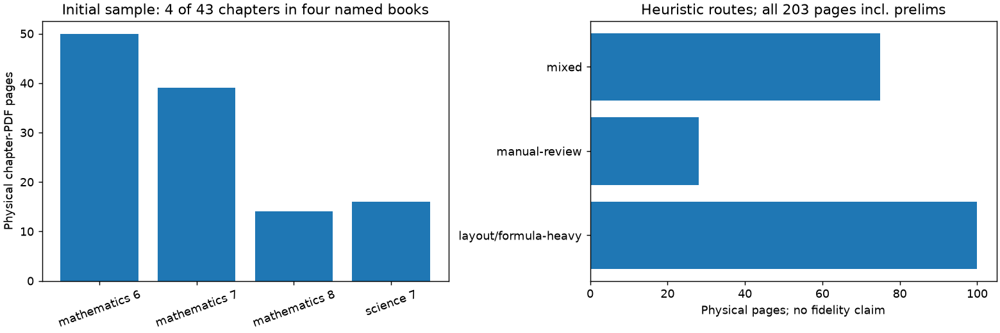

> **Phase report snapshots.** Current release status is generated in [CURRENT_CHECKPOINT.md](../CURRENT_CHECKPOINT.md). Dated entries below are historical evidence, not a second current-status source.

<!-- revised-plan-checkpoint-2026-11-03 -->
## Current revised-plan result — 3 November 2026

Audited 9 sources / 203 pages. Preserved the frozen 15-page parser development sample; the added answer key did not alter that sample. Run `20261102T184439-c5fdb769`.

Earlier notes below describe earlier runs and are superseded where counts/status conflict.

---

# Phase 02 execution report

Date: 2 November 2026. Owner: Hariom Kumar; execution assisted by Codex.
Status: **In progress — all pages audited; benchmark stratification/human review pending.**
Accepted extraction/content release: **None**.

Implemented and ran `code/audit_pdfs.py` with PyMuPDF 1.25.1. Inputs: the unchanged
8-PDF source manifest, source bytes and scope. Output [pdf_inventory.csv](outputs/pdf_inventory.csv)
accounts for 8 files; [page_audit.csv](outputs/page_audit.csv) accounts for all
**191/191** physical pages, with **0 probe failures** and **0 missing/duplicate page IDs**.
This is a native-text/metadata probe, not final extraction or formula acceptance.

| Provisional heuristic route | Pages, including prelims |
| --- | ---: |
| layout/formula-heavy | 89 |
| manual-review | 28 |
| mixed | 74 |
| scan/image-heavy | 0 |
| Total | 191 |

No page has zero native text; the smallest has 16 characters and remains in the
inventory. There are 694 private-use Unicode characters across the sample and no
replacement characters. These are encoding/layout flags, **not accuracy scores**.
Private-use glyphs, numeric-line patterns, superscript font flags, image blocks,
and vector paths are heuristics. A drawing/QR code can trigger a mixed-page flag;
font superscript flags need visual confirmation. Numeric lines were never removed.

[parser_benchmark_pages.csv](outputs/parser_benchmark_pages.csv) selects 15 chapter
pages deterministically: opener, largest stacked-numeric-line count, superscript
candidate, drawing-heavy candidate and sparsest native-text page per source,
with duplicate selections merged. Scanned-page testing remains unavailable in
this sample. Observed strata include prose, fraction walls, multi-column formulas, experiments/tables, diagrams, exercises, answer keys and notes pages. Independent review remains pending.

Rendered all 15 selected pages locally without modifying PDFs. Codex visually
inspected all fifteen; [visual_observations.csv](outputs/visual_observations.csv) records
findings and evidence paths. Independent human review remains pending. Four real
source/probe comparisons:

| Source, physical page / observed printed label | PDF versus unchanged text probe | Disposition |
| --- | --- | --- |
| Grade 6 fractions p15 / 165 | Fraction wall is two-dimensional; probe flattens stacked numerators/denominators and ordering | Requires math/layout comparison; no slash insertion |
| Grade 7 fractions p26 / 198 | Diagram-dependent ant exercise and fraction formulas coexist with a summary | Diagram question unsupported; formulas unaccepted |
| Grade 8 quantities p10 / 88 | Two-column powers/subscripts/fractions produce reordered tokens and private-use codes | Mathematical interpretation quarantined pending parser comparison |
| Grade 7 science p8 / 96 | Prose, speech bubble and diagram labels have separate visual regions; probe appends labels later | Reading-order/diagram limitation recorded |

Printed labels are recorded only in the visual-observation file where actually
seen. The automated audit's labels stay null/empty. Openers with no visible label
were not assigned inferred print numbers. All native probe text is retained in
local ignored `evidence/probes/<run_id>.jsonl`; local render paths are in the review
file. Source excerpts/renders are excluded from version control pending permission.

First run: `20261102T125146-7d5381f5` (14.64 s). Rerun:
`20261102T125417-0bfb57e8` (8.83 s). Both reconcile 191 pages and the same route
counts/15 selections; inventory/audit/selection output hashes match. Wall times
include rendering/charting and are not extraction-model benchmarks. Peak RAM was
not measured. Logs and hashes: local `logs/run_manifest.jsonl` and the
[root execution summary](../execution_summary.json).

Five boundary checks passed, including a sparse mathematical page with slashes,
operators, percent signs and a numeric-only line, plus an explicit blank-page
manual-review case. No 200-character filter or punctuation/noise removal exists
in this audit. EDA chart generation stays in the runnable script; a duplicate
notebook was not added.

Next: finalize stratification/reference snippets, compare PyMuPDF and MinerU on the
same pages, record OCR settings/time/memory/failures, then choose a parser policy.
No parser winner, OCR quality, cleaned release, reviewed graph or downstream
embedding quality is claimed here.

Additional boundary finding: Grade 7 physical p37 is an **answer key**, not explanatory evidence. [source_page_dispositions.csv](outputs/source_page_dispositions.csv) marks it private. Its page-196/197 headings refer to exercises and were not misrecorded as this physical page's printed label. Physical p29 is a rotated activity sheet; Grade 8 p14 is a blank notes area. None is accepted for open retrieval.
