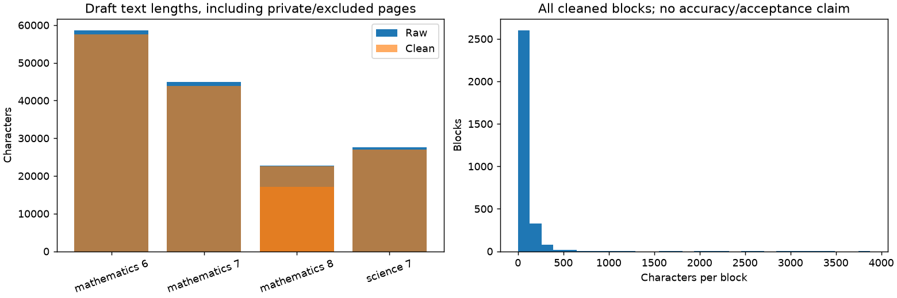

> **Phase report snapshots.** Current release status is generated in [CURRENT_CHECKPOINT.md](../CURRENT_CHECKPOINT.md). Dated entries below are historical evidence, not a second current-status source.

<!-- pilot-hardening-2026-11-04 -->
## Current repair result — 4 November 2026

Release gates pass for 22 usable explanation chunks and 20 complete rubric-based source/key pairs. There are 89 transcription-checked blocks; native-PDF agreement is distinct from passage suitability. Known hour, exercise-currency and science-order defects are repaired. Sixteen native-font pages remain flagged; 55 ambiguous positions are excluded. No human review is required and no corpus-wide accuracy estimate is claimed.

See [Pilot repairs and decision](../PILOT_HARDENING.md) for evidence, measured limits and remaining gates. Earlier entries below are historical and superseded where they conflict.

---

<!-- automatic-validation-2026-11-03 -->
## Automatic validation — 3 November 2026

No human review is required, per the user. Active policy permits Codex source checks and requires explicit authorization; deterministic integrity checks do not themselves claim semantic accuracy. The quality release was rebuilt under the new policy: 44 accepted AI-checked blocks, unchanged clean version `ncert-clean-684536a92909f67e`, 685 quarantined (run `20261103T165853-3f2cb40b`). The deterministic source-symbol audit flagged 17 pages (run `20261103T170028-e2cd96a3`). A reproducible four-page visual sample found missing rupee symbols, h0ur OCR, reordered science text, and figure labels absent from prose. Codex additionally rechecked four current retrieval chunks on a flagged page against the source. Findings are not claimed fixed; source flags are currently advisory and must be integrated into future question promotion. Historical human review files are not an active requirement.

---

<!-- model-human-db-handoff-2026-11-03 -->
## Model, review and database handoff — 3 November 2026

Created a private offline human-review packet and blank decision CSV covering 12 current retrieval chunks, 119 source question/answer records, 91 block checks, four whole quality pages and 15 graph pairs (241 queue records). Every original PDF link is bound to physical page/source metadata; original records and linked answers have snapshot hashes. No human decisions or approvals have been applied. The generator refuses to overwrite existing decisions. See the root REVIEW_AND_MODEL_HANDOFF.md for steps. Packet/output assertions passed; source excerpts and answers remain in ignored local storage.

---

<!-- revised-plan-checkpoint-2026-11-03 -->
## Current revised-plan result — 3 November 2026

203 pages / 3,090 records; 44 hash-bound blocks accepted by user-delegated Codex source review, zero missing lineage, 685 quarantined. All 60 earlier approve/reject reviews transferred only after exact source/page/text-hash matches. Four held-out quality pages remain unscored; no CER or independent human accuracy. Run `20261102T190358-83d57760`.

Earlier notes below describe earlier runs and are superseded where counts/status conflict.

---

# Phase 06 execution report

Date: 2 November 2026. Owner: Hariom Kumar; execution assisted by Codex.
Status: **Draft EDA and release gates executed; no accepted release.**
Latest run: `20261102T140240-2114338d`.

[eda_summary.json](outputs/eda_summary.json), [stage_counts.csv](outputs/stage_counts.csv)
and [content_type_counts.csv](outputs/content_type_counts.csv) reconcile the same
canonical/cleaned inputs and hashes as [clean_release_manifest.json](outputs/clean_release_manifest.json).
The manifest is **pending**, with `corpus_version=null`, **0 accepted records** and
explicit review/parser-policy blockers. No successful freeze is implied by file existence.

## Counts and quality findings

- 8 sources, 191/191 accounted pages; 3,980 raw → 3,980 cleaned block records.
- 228 candidate removals, 1,537 changes and 705 quarantined blocks; all raw lineage
  retained and every change checked against its exact transformation record.
- Parser-proposed content types: 1,691 prose, 368 headings, 211 image/diagram,
  117 formula, 13 table, 16 unknown and 1,564 private answer blocks.
- 28 remaining private-use characters occur in private/excluded source material;
  **0** occur in chapter-content blocks. They were retained/quarantined rather
  than silently converted. Replacement characters: **0**. These are diagnostics,
  not formula correctness measurements.
- Cleaned block lengths: minimum 0 (retained removals), median 13, maximum 3,877
  characters. The short-block distribution includes native answer fragments and
  headings; it is not a token/chunk-quality claim.
- Actual routes: 91 MinerU chapter pages and 100 native private/excluded pages.



The chart labels its denominator and includes private/excluded pages in the
aggregate. It displays no source excerpts or learner data. EDA changed the scope
handling: 23 appended solution pages are private, activity/notes/enrichment pages
are excluded, and mathematical/visual blocks require specific review. Question
segmentation, token lengths and retrieval metrics belong to later phases.

## Review and test isolation

[quality_sample_pages.csv](outputs/quality_sample_pages.csv) declared four source-
balanced quality pages before inspecting their parsed outputs: Grade 6 p36,
Grade 7 p25, Grade 8 p13 and science p16. They have **zero overlap** with the 15
parser-development pages. Native inventory/boundary probes existed beforehand;
this limitation is recorded. No held-out quality reference was used to tune parser
settings. These four pages have no human accuracy result yet.

[quality_annotations.csv](outputs/quality_annotations.csv) has 91 chapter-page
review rows bound to source hashes and cleaned-page hashes. It keeps human names,
dates, source/critical-check outcomes and evidence blank/pending rather than
fabricating approval. Reruns preserve unchanged reviews and reject approved reviews
against changed content. All flagged critical material remains unapproved.

Two release-boundary tests passed. Actual dataset checks establish:
- No missing/duplicate lineage; all original page/source/asset references resolve.
- LaTeX/HTML unchanged, content hashes correct, non-whitespace characters preserved
  outside explicit margin removals, and exact transform logs match actual changes.
- Missing reviewer/evidence, unresolved corruption, private answers and missing
  accepted parser policy cannot enter a released evidence file.

These checks prove boundary behavior, not educational correctness. The human
reference request is pending. No CER/WER, page/formula accuracy, accepted corpus,
question bank or downstream embedding result is claimed.

```powershell
& 'Ncert work\.venv\Scripts\python.exe' 'Ncert work\06_eda_and_quality\code\test_quality.py'
& 'Ncert work\.venv\Scripts\python.exe' 'Ncert work\06_eda_and_quality\code\build_quality_report.py'
```

Charts are generated by the same runnable report script; a duplicate EDA notebook
was not added. Source/semantic reviews and an accepted parser policy remain before
freezing the content release required by Phase 07. Skill mapping stays deferred by
user instruction; it is not used as a reason to hold this extraction/EDA work.
