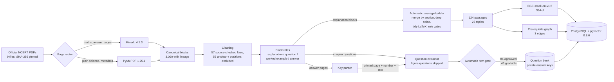
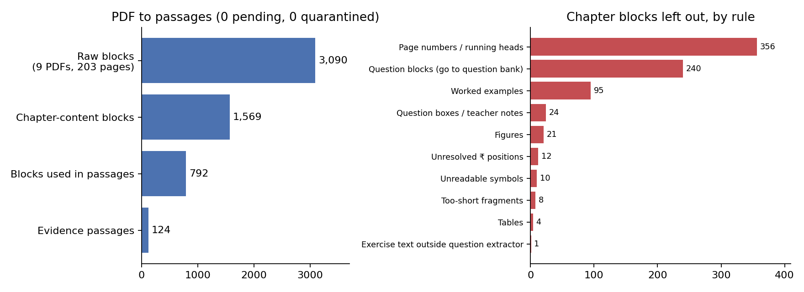
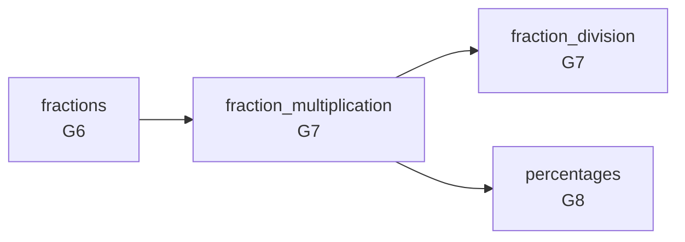
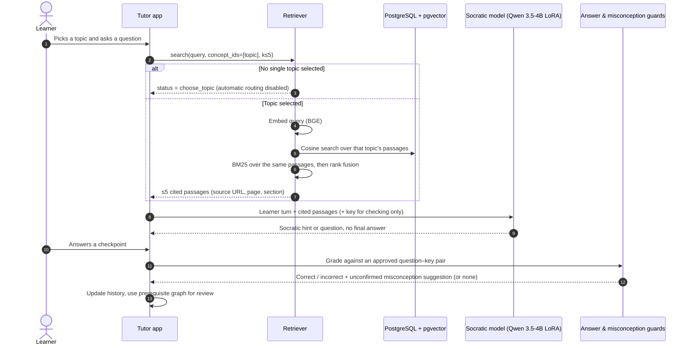
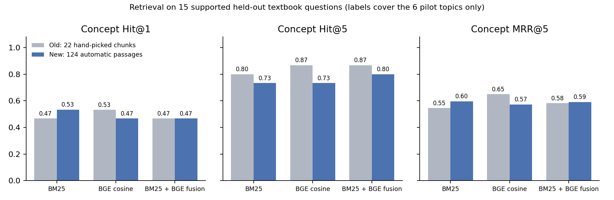
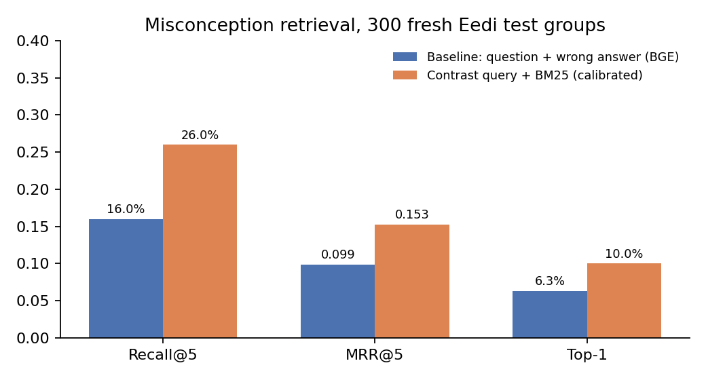

> **Final pilot report for Milestone 3.** One-page status: [CURRENT_CHECKPOINT.md](CURRENT_CHECKPOINT.md). Demo app: [`../mock-app`](../mock-app/README.md).

# NCERT Content & RAG Pilot — Report

**Project:** Group 2 DS & AI Lab — AI Socratic tutor for NCERT Classes 6–10
**Owner:** Hariom Kumar · **Updated:** 5 November 2026 · **Release:** `ncert-pilot-a2ac2147befaf6e1`
**Status:** Automatic release built and verified for the 4 pilot chapters. Nothing is left pending or quarantined in the evidence index; items are either used or excluded by a stated rule.

---

## 1. Summary

The pilot builds the content layer of the tutor. Official NCERT PDFs become traceable text; an **automatic passage builder** turns layout blocks into readable, cited passages; the passages are embedded and stored in PostgreSQL + pgvector; and a retriever returns cited evidence for the tutor to teach from. Practice questions come only from NCERT chapter pages, and their keys only from NCERT's answer pages.

| Area | Result |
|---|---|
| Sources | 9 official PDFs (4 chapters + prelims + Grade 8 answers), 203 pages |
| Extraction | 3,090 blocks with full source lineage; 115 pages via MinerU, 88 via PyMuPDF |
| Evidence passages | **124**, built automatically from 792 chapter blocks; 0 pending, 0 quarantined |
| Topics | **25**: the 6 pilot concepts + 19 named from the textbook's own section headings |
| Question bank | **85** NCERT questions: 84 approved, 1 held back; **43 gradable question–key pairs** |
| Figure questions | 16 skipped at extraction (kept until the app can show figures) |
| Prerequisite graph | 3 approved edges among the pilot concepts, no cycles |
| Retrieval (15 supported held-out questions) | Right topic in top 5 for **12/15 (80%)** with BM25 + BGE fusion |
| Automatic topic routing | Still fails (0/15 accepted) → disabled; the learner picks the topic |
| Misconception retrieval (300 fresh Eedi groups) | Recall@5 16% → 26%; only rule-checked, unconfirmed suggestions |
| Integrity | Embedding audit passed (124 NCERT vectors recomputed, 8,117 Eedi checked); release gates passed; 52 tests pass across the pipeline and app |

**What changed on 4–5 November:** per-item hand curation was replaced by rules that scale to Classes 6–10 without manual work: automatic passages, chapter-first questions with page-based key matching, an automatic item gate, and a figure filter. The demo app now lets a learner choose **Class → Chapter → Topic** before chatting, and the folder was cleaned for submission (Section 9).

---

## 2. Scope

| Source PDF | Book / edition |
|---|---|
| Grade 6 Ch 7 *Fractions* | Ganita Prakash, 2026–27 |
| Grade 7 Ch 8 *Working with Fractions* | Ganita Prakash Part I, 2026–27 |
| Grade 8 Ch 7 *Comparing Quantities* (+ Answers PDF) | Mathematics, 2024–25 |
| Grade 7 Ch 7 *Heat Transfer in Nature* | Curiosity, 2026–27 |

Prelims PDFs are kept for provenance only. The whole of each chapter is now processed, not just the six pilot objectives, but four chapters are still a small share of Classes 6–10.

---

## 3. Offline pipeline: from PDF to evidence



### 3.1 Parsing

Routing by page type: maths chapters and all answer pages go to MinerU (74 of 75 maths pages contain formulas); plain science pages use PyMuPDF unless a table, caption or notation is detected; everything else uses PyMuPDF and is excluded from retrieval. A separate 22-page Grade 9 science chapter was used to check the router (no formula or table page missed against MinerU's own detection).

### 3.2 Cleaning

- 241 repeated margin records removed; all 3,090 records stay traceable.
- **57 blocks corrected** against the original PDFs (e.g. `h0ur` → `hour`, ₹ symbols recovered from font positions); one science page's reading order repaired.
- **55 unclear ₹ positions** are excluded rather than guessed.

### 3.3 Why passages are built automatically

The parser outputs **layout blocks**, not passages: a heading, a lone equation, a line of dialogue ("Beni: You got it!"), a running header. Using each block as a chunk made 546 fragments that could not be used as evidence. The **passage builder** (`build_passages.py`) fixes this by rule:

1. **Merge by section.** Walk blocks in reading order; a numbered heading (e.g. `8.2 Division of Fractions`) starts a new section; consecutive explanation blocks are joined up to ~300 tokens (hard limit 400).
2. **Drop noise.** Page numbers and running heads (text repeated on 3+ pages), teacher's notes, and "Figure it Out" / "Try These" / exercise boxes.
3. **Keep the bank separate.** Question, worked-example and answer blocks never enter a passage.
4. **Exclude what can't be trusted.** Figures, tables, unresolved ₹ positions, broken maths markup or unreadable symbols.
5. **Tidy text without changing it.** Whitespace-only LaTeX normalisation (`\frac { 1 0 } { 2 7 }` → `\frac{10}{27}`) and OCR ligature repair ("fi ndings" → "findings").
6. **Merge or drop fragments.** Pieces under 25 tokens join the previous passage in the same section, or are dropped.
7. **Map topics from the syllabus.** `config/section_concepts.json` maps sections to the 6 pilot concepts in one line each; every other section becomes its own topic named after its heading (19 topics, e.g. *Equivalent Fractions*, *Compound Interest*, *Land and Sea Breeze*).



| Topic group | Passages |
|---|---:|
| 6 pilot concepts (fractions 6, multiplication 19, division 5, percentages 5, conduction 6, radiation 3) | 44 |
| 19 section topics (e.g. Addition and Subtraction of Fractions 10, Some Problems Involving Fractions 12, Compound Interest 7) | 80 |
| **Total** | **124** |

Passages run from 26 to 349 tokens.

### 3.4 Questions and answer keys

- **The chapter is the only source of questions.** The answer pages of the new books restate each question under its printed page ("Page no. 152 … Q4"). The printed-to-physical page offset is read from the PDF's page numbers, and each key is matched to the question on that chapter page by text.
- **In-text questions are found.** Questions the section extractor missed are located on the chapter page itself (17 for Grade 6, 1 for Grade 7).
- **Unmatched keys are reported, never turned into questions:** 14 for the two new books. The 209 keys for other Grade 8 chapters are outside the release.
- **Figure-dependent questions are skipped** (16 questions, 11 keys) and listed in `skipped_figure_questions.jsonl`. Detection reads the question text ("shaded", "shown below", "draw", "number line"…) and ignores hints such as "[Hint: draw a rough diagram]".
- **An automatic item gate** replaces per-item visual checks. It holds back a question that needs a figure, depends on another question, has broken maths markup, or is missing numbers that the official key shows.
  - When the chapter copy lost digits but the key restates the same question, the key's complete text is used (8 questions).
  - When wording and numbers both differ, the key is unlinked as a wrong match (2 keys).

| Questions (85) | Count |
|---|---:|
| Approved, gradable (complete text key) | 43 |
| Approved, practice only (no gradable key, or multi-part) | 41 |
| Held back: depends on another question | 1 |

| Answer items (286) | Count |
|---|---:|
| Approved | 52 |
| Image-only or empty key | 9 |
| Key not matched to chapter text (14) or rejected as a wrong match (2); reported | 16 |
| Other Grade 8 chapters | 209 |

The two known publisher key conflicts (e.g. a key answering "28% students" to a "how many students" question) stay ungraded. Answer keys stay in the private schema and never enter retrieval.

### 3.5 Embeddings and storage

| Setting | Value |
|---|---|
| Model | `BAAI/bge-small-en-v1.5`, pinned revision; 384-d, L2-normalised |
| Query text | `"Represent this sentence for searching relevant passages: " + query` |
| Store | PostgreSQL `ncert_pilot` on `127.0.0.1:54329`, pgvector exact cosine |
| Release safety | Repeat load identical; failed load rolls back; a frozen release cannot be overwritten (older releases kept) |

### 3.6 Prerequisite graph



Edge reviews bind to the six pilot concept records, which are unchanged. The 19 section topics have no edges yet.

---

## 4. How RAG works at runtime



The diagram shows the pipeline retriever (`11_retrieval_and_evaluation/code/retrieve.py`), which the evaluation uses. The demo app runs the same idea without a database: it loads the frozen passages and vectors from file, filters to the chosen topic and ranks by BGE cosine (top 2 passages). The app does not run Eedi vector search; the Eedi results in Section 5.2 are offline research.

- **The learner picks the topic.** Automatic routing still fails its test, so the retriever refuses to guess.
- **Hybrid ranking:** dense BGE for paraphrases, BM25 for exact terms, fused by rank.
- **Every passage is cited** by source URL, physical and printed page, and section.
- **Answers never enter retrieval**, and misconception output is a suggestion, never a stored label.

The live Qwen step with retrieved passages is not yet tested.

---

## 5. Findings

### 5.1 Retrieval

The frozen test uses all 83 publisher questions from the earlier bank, labelled against the six pilot concepts before any ranking. That gives 19 supported questions, plus 64 partial, figure, boundary and outside-objective cases that should be refused. The split is 24 calibration and 59 held-out.



| Method (15 supported held-out questions) | Hit@1 old → new | Hit@5 old → new | MRR@5 old → new |
|---|---|---|---|
| BM25 | 46.7% → 53.3% | 80.0% → 73.3% | 0.546 → 0.597 |
| BGE cosine | 53.3% → 46.7% | 86.7% → 73.3% | 0.649 → 0.572 |
| BM25 + BGE fusion | 46.7% → 46.7% | 86.7% → **80.0%** | 0.582 → 0.591 |

**Why Hit@5 fell, and why that's mostly the measurement:**

- The corpus grew from 22 hand-picked chunks to 124 passages covering whole chapters, so there are many more near-topic passages to compete with.
- The labels only know the six pilot topics. Several "misses" now land on reasonable new topics. For example, a word problem ("Tenzin drinks ½ glass of milk every day…") ranks *Some Problems Involving Fractions* first, while its label says *multiplication*.
- The three "false acceptances" in routing are all fraction-subtraction questions (5/8 − 3/8 …) resolved to the new topic *Addition and Subtraction of Fractions*. That is correct, but they were labelled "challenge" because the topic did not exist when the labels were written.
- The labels were **not** changed after seeing these results, because that would bias the test. A fresh test set labelled against all 25 topics is needed for a fair number.

**Routing:** at the calibrated cut-offs (similarity ≥0.90, margin ≥0.10) no answerable question is accepted, so automatic routing stays disabled. In the app the retriever searches only the selected topic, so passages from other sections can't crowd out the right ones.

### 5.2 Misconception retrieval (Eedi, unchanged)



| 300 fresh test groups | Recall@5 | MRR@5 | Top-1 |
|---|---:|---:|---:|
| Question + wrong answer, BGE | 16.0% | 0.099 | 6.3% |
| Contrast query + BM25 (calibrated) | **26.0%** | **0.153** | **10.0%** |

This is too weak to label learners. Only six rule-checked wrong-method families produce suggestions, and those are marked unconfirmed.

---

## 6. Decisions

| Decision | Reason |
|---|---|
| Automatic passages and item gate instead of per-item review | Must scale to Classes 6–10 without manual work |
| Questions only from chapter pages; keys matched by printed page | Older books' keys have no question text; learners should see the printed question |
| Unmatched keys reported, never made into questions | Avoids questions with no verified source on the chapter page |
| Skip figure-dependent questions | The app cannot show figures yet |
| Section headings become topics | Covers whole chapters without inventing concept names |
| Exclude unclear ₹ positions, figures, tables | A wrong amount or missing picture is worse than a missing passage |
| Learner selects the topic | Automatic routing failed positive coverage |
| Answer keys in a private schema | Retrieval can never reveal an answer |

---

## 7. Limitations

- **Evaluation labels are stale for the new topics** (Section 5.1). There are no real learner queries yet.
- **No passage-by-passage human review.** The rules and samples were checked, and unit tests cover each rule, but only automatic integrity checks cover every passage.
- **The 19 section topics** have no learning objectives beyond their heading and no prerequisite edges.
- **Coverage:** 4 chapters. Classes 6–10 have not started.
- **Live model:** retrieval-grounded Qwen teaching and answer leakage are untested.
- **Integration:** the demo app is rechecked against this release (offline check passes; 52 tests pass across the pipeline and app). The main team backend is not wired up yet and still has two known issues.

---

## 8. Next steps

1. Write a fresh retrieval test labelled against all 25 topics, ideally from real learner questions.
2. Run the live Qwen tutor on cited passages and the 43 gradable pairs, and measure answer leakage. Add more checked checkpoints so section topics get practice, not only explanations.
3. Run the same pipeline on more Classes 6–10 chapters; add each chapter's sections to `section_concepts.json` only where a curated concept exists.
4. Review prerequisite edges for the section topics.

---

## 9. Demo app, reproduction and folder layout

### Demo app (`../mock-app`)

1. **Class:** tiles for Class 6, 7 and 8, with chapter counts.
2. **Chapter:** chapter number, book, Maths/Science tag, topic count and practice-question count.
3. **Topic:** topics in textbook page order, marked "Explanations and practice" or "Explanations from the textbook".
4. **Chat:** Explain topic, Try a question, three levels of hints, Check answer. Every explanation cites the NCERT PDF page. A breadcrumb goes back at any step.

Seven checked maths checkpoints (fractions, multiplication, division, percentages) are gradable in the app. Other topics are teaching-only until more checkpoints pass the source/key gate. Off-topic messages and requests for the answer are refused. Verified by `check_offline.py` (all 25 topics return evidence; a full 7-question round completes; zero model calls) and `test_mock_app.py` (15 tests; 52 across the pipeline and app).

### Reproduce

```powershell
cd "Ncert work"; .\rebuild_release.ps1          # PDF outputs -> passages -> embeddings -> database -> evaluation -> gates -> tests
cd ..\mock-app; .\start.ps1                     # then open http://127.0.0.1:8765
```

Original PDFs, MinerU models, vectors, the local database and answer keys are not in Git (licensing and size); `rebuild_release.ps1` regenerates everything after the PDFs are downloaded by phase 01.

### Folder layout

| Path | Contents |
|---|---|
| `00_setup_and_scope` … `11_retrieval_and_evaluation` | One folder per pipeline phase: `code/`, `config/`, `outputs/`, `report.md` |
| `12_socratic_model_feasibility` | Hosting notebook and inspection of the fine-tuned Qwen adapter (local model files removed) |
| `13_backend_handoff_and_m3_demo`, `14_scale_and_maintenance` | Plans for integration and scale-up |
| `pilot_report_figures/` | Charts in this report, generated from the output files |
| `_archive/` | Retired scripts (human review, local LLM hosting, the old 26-query evaluation) kept for history |
| `PLAN.md`, `DATA_CONTRACTS.md` | Original plan and record formats |
| `report.md`, `PILOT_HARDENING.md`, `AUTOMATIC_VALIDATION.md`, `REVIEW_AND_MODEL_HANDOFF.md` | Dated earlier reports, kept as history |

**Cleanup on 5 November:** removed 8.1 GB of local model files from the retired local-LLM workflow, Python caches, a blank human-review packet, redundant backups and unused figures. `.gitignore` now also excludes logs, backups, archives and per-question evaluation rows (they repeat NCERT text).

---

## 10. Evidence

| Claim | File |
|---|---|
| Passage rules | `07_concepts_questions_and_chunks/code/build_passages.py`, `test_build_passages.py` |
| Section → concept map | `07_concepts_questions_and_chunks/config/section_concepts.json` |
| Content release and exclusions | `07_concepts_questions_and_chunks/outputs/content_manifest.json` |
| Questions, key matching | `07_concepts_questions_and_chunks/outputs/ncert_question_summary.json` |
| Item decisions | `07_concepts_questions_and_chunks/outputs/item_review_summary.json` |
| Skipped figure questions | `07_concepts_questions_and_chunks/outputs/skipped_figure_questions.jsonl` |
| Release gates | `06_eda_and_quality/outputs/release_gate_checks.json` |
| Database counts | `10_embeddings_and_database/outputs/database_counts.json` (passages), `ncert_database_counts.json` (question bank) |
| Embedding audit | `10_embeddings_and_database/outputs/automatic_embedding_audit.json` |
| Retrieval metrics | `11_retrieval_and_evaluation/outputs/textbook_retrieval_metrics.json` |
| Misconception metrics | `09_skill_misconception_and_scope_mapping/outputs/diagnostic_improvement_metrics.json` |
| Rebuild run and log | `rebuild_release.ps1`, `rebuild_release.log` |
| Pre-rebuild backup (local only) | `00_setup_and_scope/logs/pre-rebuild-20261104-235334` |
