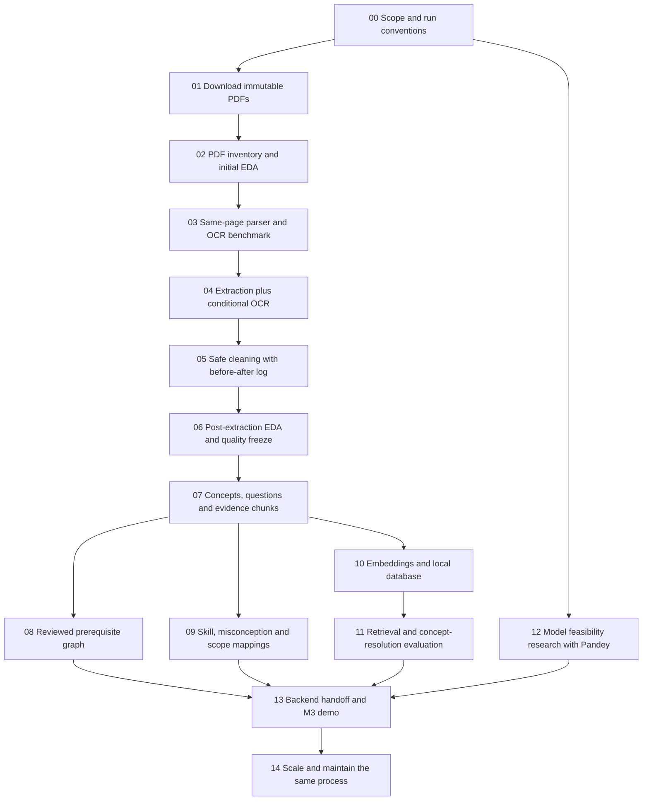

<!-- execution-note-2026-11-04 -->
> Current execution evidence: [CURRENT_CHECKPOINT.md](CURRENT_CHECKPOINT.md). Source/integrity and offline-demo checks pass for a bounded release. General routing/diagnosis accuracy gates are not passed; live hosted-model testing is deferred by the user. Acceptance criteria below have not been lowered.

# Detailed phased execution plan

Prepared: 2 November 2026  
Owner: Hariom Kumar  
Status: **Planning baseline, with execution now tracked separately in [CURRENT_CHECKPOINT.md](CURRENT_CHECKPOINT.md). Do not treat planned phases as completed results.**

## 1. What this work must produce

An auditable process from official NCERT PDFs to accepted source-linked evidence, practice questions, a reviewed prerequisite graph, curriculum mappings, searchable embeddings and a local database. Sandeep must be able to consume the resulting content/retrieval through agreed interfaces, and the TA must be able to inspect transformations, decisions, comparisons and an integrated tutor turn.

The source PDF and all intermediate records are retained locally. The final database is a derived product that can be rebuilt; a database dump alone does not demonstrate the preparation process.

The M3 pilot is a named, bounded subset. The complete intended curriculum is Mathematics and Science Classes 6–10, English medium. Book/edition differences are tracked explicitly. Do not promise every chapter, every diagram or a reviewed graph for the entire curriculum during M3.

## 2. Current evidence and limitations

- The repository has an older pypdf-based NCERT preparation script under `notes/sandeep/milestone-2/data/scripts/prep_ncert.py`. This plan does not run or modify it.
- Source inspection shows a minimum-character page filter, pattern-based noise removal and paragraph/word chunking. These need investigation for sparse maths pages, numeric lines and oversized single paragraphs. Their presence does not prove the new pipeline has repaired them.
- The backend retrieval service currently uses keyword overlap. Its comment calls it BM25-style, but it is not an actual BM25 implementation and must be labelled accurately in comparison results.
- Current local hardware was inspected: Intel i7-1260P, approximately 16 GB RAM, Intel Iris Xe. Local processing feasibility is not a measured throughput result.
- Two existing skill maps use different index sequences; mappings must bind to the selected checkpoint vocabulary.
- No source PDFs, embeddings, new database, accepted graph, model-training output or evaluation result is created by these planning documents.

## 3. Assumptions and decisions to verify

| Item | Planning assumption / decision | How to confirm |
| --- | --- | --- |
| Pilot | Named maths chain plus a bounded science sample | Phase 00 scope manifest |
| Coverage | Declare supported objectives, not only page count | Support matrix and reviewed questions |
| Language | English-medium corpus initially | Source manifest |
| Original data | Fresh official-source acquisition; no GyanSetu/dump dependency | Source hashes and provenance |
| Parser | **Decided 2 Nov:** maths pages → MinerU; science pages → PyMuPDF unless a table/formula is detected (see §13.1) | Phase 03 hybrid test; recheck on one Class 9/10 science chapter |
| OCR | Only through MinerU on routed pages; record internal MinerU OCR; no blanket second OCR | Per-page route log |
| Embeddings | BGE-small-en-v1.5 candidate; token-aware chunks | Model card, tokenizer checks and retrieval comparison |
| Database | Dedicated local PostgreSQL content schema, pgvector if available | Setup and load verification |
| Graph | Reviewed directed prerequisite links in files/PostgreSQL | Independent review and cycle checks |
| Learner state | Pandey's checkpoint plus explicit vocabulary; fallback where unmapped | Mapping audit and backend trace |
| Model runtime | Local small-model inference if benchmark succeeds; GPU notebooks for expensive work | Phase 12 measured feasibility |
| Response time | No promised latency before measurement | Phase 11/12/13 latency logs |
| Users/scale | Single-developer/small demonstration first | Scope and end-to-end checks |
| Privacy | No real student data required for content work | Sanitized artifacts and public-export check |
| Reliability | Resume failed source/page batches; validate before publishing a release | Failed-run and rerun checks |
| Maintenance | Hariom owns content releases; Sandeep owns service integration | Named handoff and version history |

The final parser, runtime and candidate-model choice remain open until comparison. The stored graph direction, source immutability, review separation, test isolation and ownership are the agreed planning conventions.

## 4. Whole workflow



Branches can progress independently once their inputs exist. Database setup can start early, but accepted graph/mapping tables are loaded only when available. Do not wait for a complete graph to benchmark evidence retrieval.

### EDA timing

**Before parsing:** inventory, coverage, corruption, page types, native-text probes and benchmark selection. The small probe helps decide routing; it is not final extraction.

**After parsing:** text/formula/table quality, missing blocks, route failures and raw-versus-clean changes.

**After content building:** concepts/questions/chunks, token lengths, question-answer availability, mapping coverage and graph/retrieval quality.

### Preprocessing timing

Before parsing, preserve the PDF and inspect it; repair/reacquire only as a documented derivative when necessary. Do not remove punctuation, symbols, images or pages first. After parsing, clean verified noise from derived records while retaining originals and provenance. Image deskew/denoise, if needed for an OCR route, is a derivative of the original page and must be recorded.

## 5. Detailed phases and dependency gates

| Phase | Work and detailed checklist | Input gate | Completion evidence |
| --- | --- | --- | --- |
| 00 | [Setup, pilot scope and reproducibility](00_setup_and_scope/README.md) | Project scope and TA M2 review actions. | Scope names actual source editions and objectives. |
| 01 | [Acquire and preserve original NCERT PDFs](01_download_pdfs/README.md) | Approved pilot scope from Phase 00. | Every included PDF opens and has a source row and hash. |
| 02_pdf_audit | [Pre-extraction audit and initial EDA](02_pdf_audit/README.md) | Verified original PDFs and sources.csv. | Every physical page has an audit disposition or logged failure. |
| 03_parser_benchmark | [Compare PyMuPDF, MinerU and conditional OCR](03_parser_benchmark/README.md) | Stratified benchmark page IDs and unchanged source PDFs. | Both parsers used identical page IDs. |
| 04_extract_text_and_ocr | [Produce canonical page/block records with OCR where required](04_extract_text_and_ocr/README.md) | Verified source manifest, page audit and chosen parser policy. | All pages accounted for, including empty/failing pages. |
| 05_clean_and_preprocess | [Clean conservatively without damaging mathematics](05_clean_and_preprocess/README.md) | Canonical blocks/pages and unchanged parser output. | Raw records are recoverable and all changes traceable. |
| 06_eda_and_quality | [Post-extraction EDA, quality evaluation and freeze](06_eda_and_quality/README.md) | Raw and cleaned records, source/page manifests and transformation logs. | Stage counts reconcile and every exclusion has a reason. |
| 07_concepts_questions_and_chunks | [Build source-grounded concepts, practice questions and evidence chunks](07_concepts_questions_and_chunks/README.md) | Accepted cleaned release and book/section metadata. | Every accepted concept/chunk/question has valid source references. |
| 08_prerequisite_graph | [Propose, review and publish prerequisite links](08_prerequisite_graph/README.md) | Reviewed concept catalogue, learning objectives and source passages. | All active M3 edges are reviewed and source-justified. |
| 09_skill_misconception_and_scope_mapping | [Map curriculum to KT skills, misconception labels and supported topics](09_skill_misconception_and_scope_mapping/README.md) | Concepts/questions and reviewed prerequisite graph. | Every accepted skill mapping resolves against the exact selected vocabulary. |
| 10_embeddings_and_database | [Embed accepted evidence and create a local retrieval database](10_embeddings_and_database/README.md) | Accepted chunks/concepts/questions, approved edges and mapping versions. | Vector dimensions/counts match the selected model and accepted chunks. |
| 11_retrieval_and_evaluation | [Compare retrieval, resolve concepts and verify citations](11_retrieval_and_evaluation/README.md) | Loaded content release and embedding index. | Every displayed reference resolves to the correct source and physical page. |
| 12_socratic_model_feasibility | [Hariom's model research and deployment feasibility evidence](12_socratic_model_feasibility/README.md) | Independent development prompts and a small reviewed NCERT evidence sample. | Recommendation is based on project-specific measured cases. |
| 13_backend_handoff_and_m3_demo | [Package Hariom's outputs and demonstrate the connected M3 tutor](13_backend_handoff_and_m3_demo/README.md) | Accepted content/database release, retrieval interface, graph, mappings and reports. | A learner input reaches an observable model response through the connected backend. |
| 14_scale_and_maintenance | [M4 onward: expand the same pipeline and maintain releases](14_scale_and_maintenance/README.md) | Accepted M3 pipeline, measured throughput and documented coverage gaps. | New release passes the same content/graph/retrieval boundaries. |

Each linked README gives step-by-step work, planned script names, artifacts, review requirements and a phase-specific report checklist. Follow the report alongside the work; do not reconstruct evidence only at submission time.

## 6. How to record exactly what changed

For each run, record: run ID, date, responsible person, code revision, input release/hashes, config/model/parser versions, hardware, executed command, start/end, counts, output hashes and failures. Never put credentials in commands or screenshots.

For a meaningful transformation example, save:
1. Source ID, PDF page, printed page label, block ID and a source crop/reference.
2. Raw parser text, unchanged.
3. Cleaned text, unchanged from the actual output.
4. Rule IDs and a precise reason for the change.
5. Codex source-check result, automated validation and review status.
6. Effect on downstream concept/chunk/question if any.

Show 3–4 real examples per major preparation stage, including an unchanged mathematical expression and a rejected/quarantined case. A report may show **no change required**; do not invent a transformation to fill the table.

Illustrative rule examples, not results:
- Repeated `Reprint ...` at the same footer position may be removed after verification.
- `20% of 50 = 10` should retain `%` and `=`.
- `1/2 + 1/3` must retain slashes and addition.
- A newline beside `-` is ambiguous: do not blindly join it as a hyphenated word.
- A number-only line may be a legitimate mathematical value rather than a page number.

When a phase changes representation rather than wording, show that actual representation: PDF→page records, section→concept records, text→chunk IDs/token counts, chunk→384-dimensional vector metadata, candidate edge→reviewed decision.

## 7. Quality gates and minimum checks

| Gate | Required checks |
| --- | --- |
| Source | Verified PDF, hash, source/edition identity, page count |
| Extraction | Every page accounted for; source/page/block lineage; difficult content reviewed |
| Cleaning | Logged transforms, meaningful regression examples, critical notation preserved |
| Content | Valid IDs/links, correct source spans, no silent truncation, reviewed supported questions |
| Graph | Valid direction/IDs, no self-links/cycles, approved demo links |
| Mapping | Exact checkpoint vocabulary, accepted reviews, explicit partial/unmapped states |
| Embeddings | Correct model/revision/dimension, finite values, count/ID alignment |
| Database | Foreign keys/counts, version-safe loads, duplicate prevention and rollback |
| Retrieval | Frozen query protocol, genuine baselines, correct source pages, answer-key exclusion |
| Integration | Real accepted release used, observable decisions, correct fallback paths, no off-topic KT update |

These are boundary checks, not a request to build a large test framework. Reuse existing validators/harnesses when they fit. Add a small meaningful check when new parsing, transformation or database mutation logic is implemented.

Avoid unsupported claims:
- OCR labels are not diagram understanding.
- Presence of a symbol is not formula correctness.
- Semantic similarity is not a prerequisite relationship.
- An LLM's self-reported confidence is not a calibrated probability.
- ASSISTments-trained maths predictions do not establish science mastery.
- Synthetic learner examples are not genuine KT training/evaluation histories.
- Keyword overlap is not BM25.
- A citation ID present in retrieved context does not prove sentence-level faithfulness.

## 8. What Hariom must hand off

| Handoff | Consumer | Required information |
| --- | --- | --- |
| Accepted content | Sandeep | IDs, source links/pages, version/hash, support matrix, schema/load instructions |
| Evidence retrieval | Sandeep | Inputs/outputs, corpus filters, limits, no-evidence/error behavior, latency |
| Graph | Sandeep/controller | Approved edges, direction, evidence, depth lookup and cycle checks |
| Concept/skill mapping | Pandey + Sandeep | Original IDs, checkpoint indices, vocabulary hash, exact/partial/unmapped states |
| Misconception/scope examples | Pandey + Sandeep | Label definitions, working/context, provenance, review and split isolation |
| Model comparison research | Pandey | Exact candidates, rubric, quality/speed/memory results and feasibility |
| M3 evidence | Mrityunjay + team | Charts, before/after examples, report sections, references and actual work log |

Proposed interfaces to agree, not implemented API names:
- Search evidence by course/query/optional concept/action, returning ranked source-linked chunks.
- Resolve a free-form doubt to candidate concepts or ask for clarification.
- Get concept details and reviewed prerequisites with bounded depth.
- Select approved practice questions while excluding hidden answer fields from learner responses.
- Read the exact skill mapping or return an explicit unmapped status.

Current retrieval integration has `search(db, course_id, query, k=5)` and `best_concept(db, course_id, query)`. Sandeep and Hariom should coordinate any interface extension and its callers. The NCERT pipeline stays inside this root; production backend integration naturally lives in the backend.

## 9. What is required by M3

From the MoM: a connected backend/model loop on a manageable subset, candidate comparisons, corrected preprocessing/EDA, NCERT page evidence, graph/controller, learner state, misconception baseline, response model and input/output checks. Baseline performance is acceptable; frontend completion is not required for this pipeline expectation.

The MoM prefers about three candidates where feasible. It does not mandate training three models for every component. Existing project documents sometimes state this more strongly; report feasibility honestly.

Hariom's M3 completion checklist:
- [ ] Exact pilot sources/editions and supported objectives frozen.
- [ ] Working download→extract/OCR→clean→EDA→content→embed→retrieve process.
- [ ] Critical mathematical notation checked and affected content regenerated.
- [ ] Every accepted chunk traceable to PDF physical page and source URL.
- [ ] Approved question bank and hidden answer handling for demo concepts.
- [ ] Reviewed meaningful cross-grade prerequisite chain; no cycles.
- [ ] Mapping against Pandey's actual vocabulary with gaps/fallbacks visible.
- [ ] Bounded misconception labels/examples and supported-topic evidence handed off.
- [ ] Retrieval comparison on independent queries, with actual measured results.
- [ ] Small-response-model research/feasibility evidence supplied to Pandey.
- [ ] Real content used in Sandeep's connected mathematics and science demonstrations.
- [ ] Before/after examples, EDA figures, configs, versions, failures and review records.
- [ ] Accessible permitted artifacts linked from the repository.

Do not delay the connected demo for a full curriculum graph, exhaustive diagram interpretation, a separate graph database, a new learned controller, or training all language models. Record unfinished coverage explicitly.

## 10. Schedule and priorities

The source project notes list 5 November 2026 for M3; the MoM does not restate the exact date. Prepared on 2 November, this plan must not imply that all phases and full-scale review fit into the remaining calendar time.

The pilot phases total roughly **36–60 active person-hours**, depending on reuse, selected content and review failures; additional unattended compute/download time and team coordination are variable. These are planning estimates, not benchmarks. Phase 14 is additional work estimated after the pilot.

A compressed M3 execution order:
- **First work block:** define a narrow pilot; acquire/audit sources; benchmark difficult pages; send Sandeep preliminary data contracts and Pandey the concept objectives.
- **Second work block:** extract and clean; review critical notation; produce counts/before-after evidence; build initial concepts/questions/chunks.
- **Third work block:** embed/load and evaluate retrieval; review a small prerequisite chain; map the demo skills and diagnostic labels.
- **Final work block:** integrate the same release with Sandeep; record complete traces, failure cases and report-ready evidence.
- **In parallel:** Pandey prepares/trains/compares KT and response models; Hariom supplies model research and feasibility measurements.

These blocks are dependency priorities, not guaranteed one-day commitments. If time is short, reduce chapter breadth and candidate breadth with documented justification; retain source fidelity, hidden-answer handling, real graph review, an integrated baseline and honest evidence.

Do early, before broader extraction:
- Confirm source editions and ask Sandeep/Pandey for interface/vocabulary inputs.
- Test one easy and one difficult page before processing whole books.
- Test local model loading and one response early; do not discover runtime incompatibility on demo day.
- Deliver an initial valid content bundle early; improve coverage in later releases.

## 11. TA M2 action traceability

| MoM action | Hariom evidence location / coordination |
| --- | --- |
| 01 Preserve mathematical notation | Phases 03–06; source comparisons and real transform examples |
| 02 Reusable preprocessing | Phase code plans, run manifests and rerun documentation |
| 03 EDA | Phases 02, 06, 07, 09–11 |
| 04 Before/after examples | Each phase report and root consolidated report |
| 05 KT sequence audit | Pandey owns; Phase 09 consumes verified vocabulary, not fabricated histories |
| 06 Skill count reconciliation | Pandey owns; Phase 09 records exact checkpoint/vocabulary identity |
| 07 problem_text decision | Pandey owns chat prep; Hariom supplies complete NCERT question context |
| 08 Source-tag spelling | Pandey/Mrityunjay own chat/report correction; retain consistent local source IDs |
| 09 Combined chat splits | Pandey owns; Phase 12 uses independent development prompts |
| 10 Actual prerequisite graph | Phase 08 reviewed content and graph metrics |
| 11 Misconception baseline | Phase 09 curriculum/examples; shared implementation with Pandey/Sandeep |
| 12 Dynamic backtracking | Phase 08 graph and Phase 13 integration; Sandeep controller with team evidence |
| 13 Candidate comparisons | Phases 03, 11, 12; Pandey owns KT/training experiments |
| 14 Memory/speed/quantization | Phases 03, 10–12 with recorded hardware |
| 15 Connected backend pipeline | Phase 13 shared demo |
| 16 Mock-up/concise teaching | Phase 13 coordination; retrieval evidence supports concise explanation/example |
| 17 Report/PPT/review fields | All phase reports plus root report; actual team review/sign-off |
| 18 Accessible permitted data | Phases 01, 09, 13 rights/provenance and publication links |

## 12. Sources and evidence boundaries

- Local project context: `CLAUDE_1.md`, `HANDOFF.md`, existing preparation script and backend retrieval source. Their historical claims are not newly measured results.
- M2 review: `C:\Users\Hario\Downloads\Group_2_Socratic_AI_Tutor_M2_Review_MoM.pdf`, especially sections 4 and 8–10. Current user ownership instructions supersede historical NCERT assignment to Sandeep.
- [Official NCERT textbook entry](https://ncert.nic.in/textbook.php). The page fetch timed out during planning; individual sources/availability/editions still need verification in Phase 01.
- [PyMuPDF page extraction/OCR API](https://pymupdf.readthedocs.io/en/latest/page.html).
- [MinerU official repository](https://github.com/opendatalab/MinerU).
- [BGE-small-en-v1.5 model card](https://huggingface.co/BAAI/bge-small-en-v1.5).
- [Eedi misconception taxonomy](https://huggingface.co/datasets/Eedi/Eedi-Misconceptions-Graph) and [dataset distinctions](https://www.eedi.com/data-and-competitions).
- [AL-CPL prerequisite benchmark](https://github.com/harrylclc/AL-CPL-dataset) and [multi-criteria NCERT-related prerequisite study](https://arxiv.org/html/2509.05393v1).
- [Official ASSISTments skill-builder notes](https://sites.google.com/site/assistmentsdata/home/2009-2010-assistment-data/skill-builder-data-2009-2010).

Pin tool/model/dataset revisions when execution begins. Review terms before reusing or publishing data. None of these references establishes that the planned pipeline has run or that an external curriculum transfers correctly.


## 13. Decisions of 2 November (evening) — implementation brief

These decisions override earlier wording where they conflict. Each item names the files to
change and a check that proves it works. Do not invent questions, answers, misconceptions or
student examples anywhere in this pipeline.

### 13.1 Parser routing: PyMuPDF and MinerU by subject

Evidence: [Phase 03 hybrid test](03_parser_benchmark/report.md#hybrid-routing-test-pymupdf-on-every-page-mineru-only-where-needed-2-nov-evening).
74/75 maths chapter pages contain formulas; 13/16 Class 7 science pages are plain prose.

Route every page in this order:
1. PyMuPDF runs on **every** page first. It is fast and gives native text, `find_tables()` and feature counts.
2. **Maths chapter pages → MinerU** (Basic, ONNX CPU, `--ocr-mode auto`).
3. **Science chapter pages → keep the PyMuPDF text**, unless any of these hold, in which case send the page to MinerU:
   - `find_tables()` finds a table;
   - there are ≥ 4 number-only lines;
   - chemical or mathematical notation shows up: sub/superscript spans next to letters (H₂O, x²), `→` or `⇌`, `=` with numbers, or units with exponents.
4. **Solution / answer-key pages (any subject) → MinerU.** They are full of fractions. The pilot parsed them with PyMuPDF and had to redo them.
5. Front matter and other excluded pages → PyMuPDF only; they never enter retrieval.

Implement in `04_extract_text_and_ocr/code/extract_content.py`. Reuse `subject_route()` from
`03_parser_benchmark/code/hybrid_route_test.py`; do not write a second router. Store the route and
the reason for every page in `pages.jsonl`. Before the full run, run the hybrid test on one Class 9
or 10 science chapter and confirm no table or formula page goes to PyMuPDF.
Neither parser describes what a diagram shows. Keep image assets and set `requires_diagram`; a
captioning or VLM step is a separate decision.

### 13.2 Extract once, then split into four record types

The pipeline extracts and cleans each page once (phases 04–05). Phase 07 then puts every cleaned
block into exactly one role. Nothing is re-extracted per role.

| Record | File / DB table | Visible to learner/LLM? | Source |
| --- | --- | --- | --- |
| Content chunk (explanations, definitions, summaries) | `outputs/chunks.jsonl` → `ncert_content.chunks` | Yes — retrieval evidence | Chapter prose, headings, formulas |
| Question (Figure it Out, Try These, Exercise, Let Us Enhance Our Learning, end-of-chapter) | `outputs/ncert_questions.jsonl` → `ncert_content.ncert_questions` | Yes — question text only | Chapter pages; plus solution-page questions with no chapter match |
| Answer / solution | `outputs/ncert_answers_private.jsonl` → `ncert_private.ncert_answers` | **No** — backend scoring only | NCERT solution pages only |
| Worked example (Example N + Solution) | `outputs/ncert_worked_examples.jsonl` → `ncert_content.ncert_worked_examples` | Yes — teaching material and hints | Chapter pages |

Rules:
- "Solution" means the NCERT answer text plus any working NCERT prints. Never derive or write an answer ourselves.
  A question without an NCERT answer stays `answer_available=false`.
- Question blocks and worked-example blocks are **excluded from content chunks**, so the tutor
  never retrieves the text of an active question as "evidence". Worked examples may be retrieved
  as hints; answers never are.
- Every record keeps `source_id`, physical page, `source_block_ids`, provenance
  (`ncert_extracted` or `ncert_solution_pages`) and `review_status`.
- Already implemented for the pilot: `07_concepts_questions_and_chunks/code/extract_ncert_questions.py`
  with test `test_extract_ncert_questions.py`, and loader
  `10_embeddings_and_database/code/load_ncert_questions.py`. To do:
  1. Make the chunk builder (`build_content_pack.py`) take every non-question, non-example, non-answer chapter block, not only the 44 hand-accepted blocks, and exclude question/example block IDs.
  2. Tag questions and worked examples with `concept_ids` once the full concept list exists.
  3. Add Grade 8's separate NCERT answers PDF the same way as the solution pages.
- Extraction gaps to keep visible: in-text narrative questions, activities and unlabelled prompts are not extracted yet.
- Later, the Socratic model may generate science answers or practice items only into a **separate**
  table with `provenance=model_generated`, never mixed with NCERT records.
- AI-written items retired from the pilot (moved, not deleted): `07_concepts_questions_and_chunks/evidence/_retired_codex_authored/`.
  Still AI-written and to be replaced: Phase 09 `diagnostic_examples.jsonl` and Phase 12 `evaluation/answers_private.jsonl`.

### 13.3 Socratic questions at runtime

NCERT questions are the fixed practice and checkpoint items. The Socratic model (Qwen3.5-4B, Phase 12)
writes the in-between probing questions live, using retrieved NCERT chunks, worked examples and the
private NCERT answer, which it uses to judge but never reveals. Generated probes are logged per
session and not stored as content.

### 13.4 Misconceptions: datasets, not hand-written lists

Datasets and permitted use (record licence, release and attribution in Phase 09):

| Dataset | Subject | Use | Terms |
| --- | --- | --- | --- |
| [Eedi Misconceptions Graph](https://huggingface.co/datasets/Eedi/Eedi-Misconceptions-Graph) | Maths | Catalogue: 8,117 misconceptions, 2,258 constructs, misconception→construct links | CC BY 4.0 (attribute) |
| [Eedi Mining Misconceptions (Kaggle)](https://www.kaggle.com/competitions/eedi-mining-misconceptions-in-mathematics/overview) | Maths | Evaluation: wrong MCQ options tagged with misconception IDs | Check competition data rules; local evaluation only, no redistribution |
| [MAP: Charting Student Math Misunderstandings (Kaggle)](https://www.kaggle.com/c/map-charting-student-math-misunderstandings/overview) | Maths | Evaluation: student explanations with misconception labels | Same as above |
| [BSCS Science Assessment](https://assess.bscs.org/science/) | Science | Reference for people curating a short NCERT science misconception list | Check access and reuse before copying any item |
| [SciEntsBank/BEETLE, SemEval-2013 Task 7](https://aclanthology.org/S13-2045/) | Science | Train/evaluate a correct / partial / contradictory answer checker that decides when to probe; **not** a misconception list | Check dataset licence |

Eedi construct links are not prerequisite edges and not per-student probabilities (Phase 09 step 10 stands).

**Runtime diagnosis (maths).** Start without any concept-to-construct mapping:

```
wrong answer (+ working if given)
  1. Rules: does the answer equal the output of a known wrong method? → candidate misconception ID + evidence
  2. Retrieve: embed "question + student answer + working" with BGE; search ALL Eedi misconception texts → top 5
  3. Qwen chooses one candidate, "none fits", or "need working"
  4. Weak evidence or no working → ask "Show the calculation you used", then repeat with the working
  5. Output: misconception ID (or unknown) + the evidence; never a free-text label
```

- **Rules** (`09_skill_misconception_and_scope_mapping/code/error_rules.py`): small checked functions,
  each mapping one wrong method to one Eedi misconception ID. Examples for 20% of 50:
  50÷20 = 2.5 (divides by the percent); 50×20 = 1000 (forgot ÷100). For 1/2 + 1/3, 2/5 means
  numerators and denominators were added. One `assert` self-check per rule.
- **Never diagnose from one number.** A single answer gives a candidate; only the working confirms it.
  Mark a misconception as persistent only when it repeats across attempts (attempt history or KT).
- **Optional concept filter, added only if evaluation shows off-topic picks.** Embed NCERT concepts
  and Eedi construct names, keep the top 5–10 constructs per concept, and have Codex judge
  a reproducible sample against the source; record uncertain links. Nothing is hand-written per topic.
- **Evaluate** on the Eedi Kaggle and MAP data: top-5 recall of the correct misconception, and the rate
  of wrong confident diagnoses. Report it in the Phase 09 report. The 161 team scenarios stay test-only.

**Science.** People write a short misconception list per supported concept, using BSCS as a
reference and NCERT text as evidence (for example, "radiation needs air"). Each entry gets a
stable ID and attribution. Runtime is the same flow without arithmetic rules: answer checker (trained
or evaluated on SciEntsBank) → retrieve from the science list → Qwen picks or asks the student to explain.

DB tables (Phase 10): `ncert_diag.misconceptions(misconception_id, source, text, construct_ids, licence)`,
`ncert_diag.constructs`, and optionally `ncert_diag.concept_constructs(concept_id, construct_id, review_status)`.
Embeddings of misconception texts are stored alongside, using the same BGE model.

### 13.5 Deferred until all extraction is finished

- **Concept-resolution cutoff:** keep the 0.70 / 0.02 working value. After the full corpus exists,
  build a larger query set with a calibration split and a held-out split, then rerun
  `11_retrieval_and_evaluation/code/sweep_cutoffs.py`. The pilot sweep (0.67 / 0.01, gap 0.006) is not a decision.
- **Prerequisite graph (Phase 08):** build once, after the full concept list exists. No paid API is needed:
  1. Candidates come from grade/chapter order, "recall / you learnt earlier" cues in NCERT text, and concept embedding similarity.
  2. Local Qwen or Codex judges each candidate pair.
  3. Codex checks a reproducible source sample.

  The pilot's 3 edges are enough for the M3 demo.
- **Concept→construct filter (13.4)** and science misconception list: after extraction.

### 13.6 Order of work for Codex

1. Re-run the pilot after the question change, in order:
   `07.../build_content_pack.py` → `08.../build_graph.py` → `10.../embed_chunks.py` →
   `10.../load_database.py` → `10.../load_ncert_questions.py` → `11.../evaluate_retrieval.py`.
2. Implement subject routing (13.1) in `extract_content.py`, with the Class 9/10 science check.
3. Make the chunk builder use all non-question chapter blocks (13.2).
4. Phase 09: load the Eedi graph and its embeddings, write `error_rules.py` for the 4 pilot maths concepts,
   implement the runtime retrieval + Qwen pick, and evaluate on Eedi Kaggle/MAP once the data terms are confirmed.
   Replace the synthetic `diagnostic_examples.jsonl`.
5. Scale extraction to Classes 6–10 (Phase 14).
6. Then do 13.5: cutoff sweep, prerequisite graph, optional concept filter and science list.

Update each phase `report.md` with real counts after every run.


## 14. Review policy — 3 November: no human-review requirement

The user directs that NCERT work must not require them or another person to review each item or any embedding. This overrides any earlier human-review or person-signoff wording in this plan and the phase READMEs. Do not delete historical review records or represent Codex checks as independent human review.

- Embeddings: deterministically verify all vector dimensions, finiteness, norms, source/ID alignment, artifact hashes and database values; recompute all current NCERT vectors and a reproducibly selected Eedi sample. No one visually inspects vectors. Measure retrieval relevance separately.
- Source text and solutions: validate source/page/role/answer separation, identify predictable OCR or symbol hazards, and have Codex compare reproducibly selected sample pages to original PDFs. Correct or flag observed defects and continue processing. Sampling does not establish that every uninspected equation or question is correct.
- Codex is authorized to judge source samples and graph decisions; no human sign-off is required. Unsafe, missing or contradictory material stays flagged until an automated check or Codex resolves it; do not label it verified solely because its hash and shape match.
- `human_review/` is a historical optional artifact, not an active task or release requirement. Do not request the user to review it. Existing historical human-review wording in older reports describes old planning, not a current requirement.
- Full Classes 6–10 extraction, question/answer checks, backend safety/integration and misconception accuracy remain separate work; this policy does not mean those tasks have completed.
