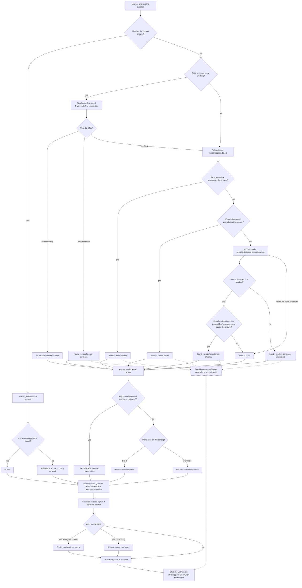

# Answer flow

What the backend does after a learner answers a question (`app/services/tutor.py`, `controller.py`,
`socratic.py`, `misconception.py`, `step_finder.py`). The dashed box marks where the misconception stops.

Notes

- The next action depends only on right or wrong, prerequisite readiness and the try count.
- The misconception, found or not, never reaches the controller, the learner model or the reply writer. It is
  only shown as a label in the chat.
- The rule detector has three layers: error patterns, expression search, then the Socratic model. The model's
  suggestion is kept for a numeric answer only when its calculation reproduces the answer; a non-numeric answer
  cannot be checked, so its suggestion is unconfirmed.
- Hint and probe replies use the step finder's step number ("Look again at step N").
