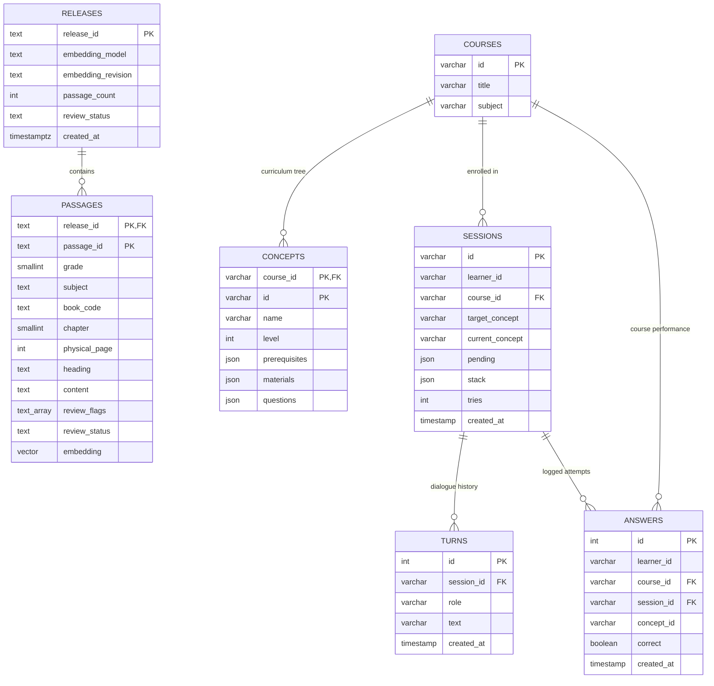
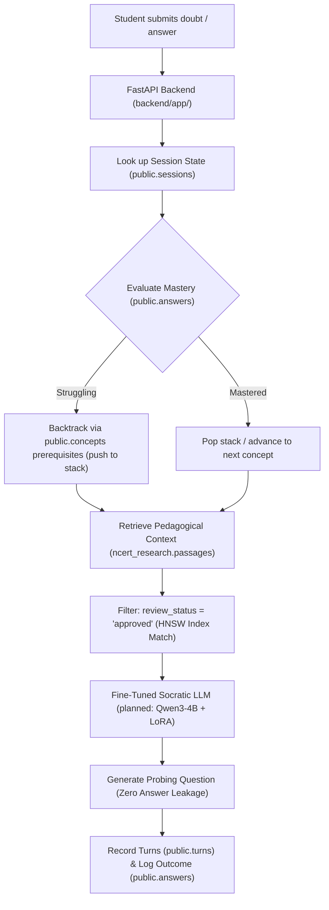

# Socratic AI Tutor — Complete Database Architecture & Schema Reference

> [!NOTE]
> **Host Infrastructure:** PostgreSQL 17.11 on Supabase (AWS `ap-northeast-1`, Tokyo)  
> **Core Extensions:** `vector (0.8.2)` (`pgvector`), `uuid-ossp (1.1)`, `pgcrypto (1.3)`, `pg_stat_statements (1.11)`  
> **Connected Backend:** `backend/app/db.py` reads `DATABASE_URL` from the environment (load `backend/.env` with `uv run --env-file .env ...`). Without it, the backend falls back to the local `docker-compose.yml` database (`pgvector/pgvector:pg16`).

---

## 1. System Architecture & Entity Relationship

The database is divided into two primary operational domains:
1. **`ncert_research` Schema:** The static, version-controlled **Retrieval-Augmented Generation (RAG)** knowledge base containing 7,221 textbook sections across Grades 6–10 Maths & Science with 1024-dimensional Qwen3 vector embeddings.
2. **`public` Schema:** The dynamic **Socratic Tutoring Engine** that manages course packs, prerequisite concept trees, live session state machines, conversation histories, and learner knowledge tracing logs (DKT/AKT).

---

## 2. Schema Breakdown: `ncert_research` (RAG Knowledge Base)

This schema houses textbook evidence that the Socratic tutor will use to ground its hints and explanations in official NCERT curriculum content.

> [!WARNING]
> **Planned, not yet wired into the backend.** No code in `backend/app/` reads this schema yet; `services/retrieval.py` is a keyword-overlap stub over `public.concepts.materials`. The RAG integration is owned by another team member, and the details in this section were not checked against the backend code.

### 2.1 Table: `ncert_research.releases` (Corpus Versioning)
Stores immutable metadata regarding each ingested textbook build.

* **Row Count:** 1 row
* **Primary Key:** `release_id`

| Column | Type | Nullable | Description | Sample Value |
| :--- | :--- | :---: | :--- | :--- |
| `release_id` | `text` | No | Unique build identifier hash | `'9aea0ce28990f86074b2d813'` |
| `embedding_model` | `text` | No | Model used to generate passage vectors | `'Qwen/Qwen3-Embedding-0.6B'` |
| `embedding_revision` | `text` | No | Hugging Face commit hash of the model | `'97b0c614be4d77ee51c0cef4e5f07c00f9eb65b3'` |
| `passage_count` | `integer` | No | Total passages bundled in this release | `7221` |
| `review_status` | `text` | No | Release approval status (`approved` / `candidate`) | `'approved'` |
| `created_at` | `timestamptz` | No | Creation timestamp | `'2026-11-12 04:43:20+00'` |

---

### 2.2 Table: `ncert_research.passages` (Textbook Evidence Store)
Stores segmented textbook sections, metadata, review flags, and 1024-dimensional semantic embeddings.

* **Row Count:** 7,221 rows
* **Primary Key:** `(release_id, passage_id)`
* **Foreign Key:** `release_id -> ncert_research.releases(release_id)`

| Column | Type | Nullable | Description | Sample Value |
| :--- | :--- | :---: | :--- | :--- |
| `release_id` | `text` | No | Release foreign key | `'9aea0ce28990f86074b2d813'` |
| `passage_id` | `text` | No | Unique passage hash | `'c5d9af368f06fc53dfc9038b'` |
| `grade` | `smallint` | No | Class / Grade level (6 to 10) | `6` |
| `subject` | `text` | No | Subject (`maths` or `science`) | `'maths'` |
| `book_code` | `text` | No | NCERT textbook code (e.g., `fegp1`) | `'fegp1'` |
| `chapter` | `smallint` | No | Chapter number | `5` |
| `physical_page` | `integer` | No | Page number in the printed textbook PDF | `11` |
| `source_file` | `text` | No | Original NCERT PDF filename | `'6_maths_fegp105.pdf'` |
| `source_url` | `text` | No | Canonical NCERT download URL | `'https://ncert.nic.in/textbook/pdf/fegp105.pdf'` |
| `heading` | `text` | No | Section heading | `'5.4 Prime Factorisation'` |
| `content` | `text` | No | Extracted markdown content | `'## 5.4 Prime Factorisation...'` |
| `review_flags` | `text[]` | No | Audit tags (`math_requires_review`, `answer_risk`, etc.) | `{'math_requires_review'}` |
| `review_status` | `text` | No | Status: `approved` (7,153 rows) or `quarantined` (68 rows) | `'approved'` |
| `embedding` | `vector(1024)` | No | Normalized 1024-d float vector | `[-0.0357, -0.0416, 0.0101, ...]` |

#### Grade & Subject Distribution:
* **Class 6:** 837 Maths, 489 Science (1,326 total)
* **Class 7:** 1,032 Maths, 469 Science (1,501 total)
* **Class 8:** 932 Maths, 651 Science (1,583 total)
* **Class 9:** 750 Maths, 944 Science (1,694 total)
* **Class 10:** 418 Maths, 699 Science (1,117 total)

> [!IMPORTANT]
> **Safety & Anti-Leakage Gate:**
> * **7,153 Approved Passages:** Pedagogical textbook explanations permitted in student retrieval queries.
> * **68 Quarantined Passages:** Passages flagged with `'answer_risk'` (printed end-of-chapter answer keys). These are strictly quarantined so the model never leaks final numerical answers during Socratic probing.

#### Active Indexes on `passages`:
1. `ix_passages_hnsw`: `USING hnsw (embedding vector_cosine_ops)` — Powers sub-second vector similarity retrieval.
2. `ix_passages_scope`: `USING btree (grade, subject, chapter, review_status)` — Fast filtering by grade/topic.
3. `ix_passages_flags`: `USING gin (review_flags)` — Instant searching across audit tags.

---

## 3. Schema Breakdown: `public` (Tutoring Application Engine)

This schema manages live student interaction, curriculum progress, and conversational state for the FastAPI backend (`backend/app/`).

### 3.1 Table: `public.courses` (Curriculum Packages)
Registers available subjects or course packs.

* **Row Count:** 1 row (Default seed: `ncert-maths`)
* **Primary Key:** `id`

| Column | Type | Nullable | Description | Sample Data |
| :--- | :--- | :---: | :--- | :--- |
| `id` | `varchar` | No | Unique course identifier | `'ncert-maths'` |
| `title` | `varchar` | No | Display title | `'NCERT Mathematics (sample)'` |
| `subject` | `varchar` | No | Academic discipline | `'Mathematics'` |

---

### 3.2 Table: `public.concepts` (Prerequisite Graph & Questions)
Defines each concept node, its difficulty level, prerequisite dependencies, and diagnostic questions.

* **Row Count:** 4 rows seeded (`multiplication`, `division`, `fractions`, `percentages`)
* **Primary Key:** `(course_id, id)`
* **Foreign Key:** `course_id -> public.courses(id)` (CASCADE on delete)

| Column | Type | Nullable | Description | Sample Value (`division`) |
| :--- | :--- | :---: | :--- | :--- |
| `course_id` | `varchar` | No | Course ID | `'ncert-maths'` |
| `id` | `varchar` | No | Concept identifier | `'division'` |
| `name` | `varchar` | No | Concept name | `'Division'` |
| `level` | `integer` | No | Cognitive difficulty depth | `2` |
| `prerequisites` | `json` | No | Array of parent concept IDs | `["multiplication"]` |
| `materials` | `json` | No | Textbook references & explanations | `[{"source": "NCERT Mathematics", "page": "...", "text": "...", "url": ""}]` |
| `questions` | `json` | No | Checkpoint diagnostic questions | `[{"id": "div-1", "text": "What is 100 / 20?", "answer": "5", "hint": "...", "difficulty": 1}]` |

---

### 3.3 Table: `public.sessions` (Socratic Tutoring State Machine)
Tracks active tutoring sessions. If a student struggles, the state machine backtracks down the prerequisite tree and uses the `stack` to resume later.

* **Row Count:** 0 rows (Populated dynamically on `POST /sessions`)
* **Primary Key:** `id`
* **Foreign Key:** `course_id -> public.courses(id)`
* **Index:** `ix_sessions_learner_id (learner_id)`

| Column | Type | Nullable | Description | Purpose in Tutoring Loop |
| :--- | :--- | :---: | :--- | :--- |
| `id` | `varchar` | No | Session UUID | Tracks unique interaction |
| `learner_id` | `varchar` | No | Student identifier | Isolates student history |
| `course_id` | `varchar` | No | Active course | Links curriculum pack |
| `target_concept`| `varchar` | Yes | Ultimate learning objective | E.g., `percentages` |
| `current_concept`| `varchar` | Yes | Concept currently being taught | E.g., backtracked to `fractions` |
| `pending` | `json` | Yes | Question awaiting student response | Holds current problem, gold answer, and `seen` (ids of questions already asked) |
| `stack` | `json` | No | Stack of concepts to return to | Enables backtracking recursion |
| `tries` | `integer` | No | Attempt counter on current question | Wrong answers get a hint for the first 2 tries, then a probe |
| `created_at` | `timestamp`| No | Session start time | Session aging |

---

### 3.4 Table: `public.turns` (Conversational Dialogue History)
Stores turn-by-turn chat messages between student and tutor.

* **Row Count:** 0 rows (Populated on `POST /sessions/{id}/messages`)
* **Primary Key:** `id` (auto-incrementing)
* **Foreign Key:** `session_id -> public.sessions(id)` (CASCADE on delete)
* **Index:** `ix_turns_session_id (session_id)`

| Column | Type | Nullable | Description |
| :--- | :--- | :---: | :--- |
| `id` | `integer` | No | Auto-incrementing turn ID |
| `session_id` | `varchar` | No | Session foreign key |
| `role` | `varchar` | No | Message speaker: `'tutor'` or `'learner'` |
| `text` | `varchar` | No | Message text content |
| `created_at` | `timestamp`| No | Message timestamp |

**`public.turn_steps`** stores what each layer reported while the tutor wrote a reply (router, guardrails, retrieval, learner model, controller, model). The chat shows these under the reply as "How this reply was made".

| Column | Type | Nullable | Description |
| :--- | :--- | :---: | :--- |
| `turn_id` | `integer` | No | Primary key; the tutor turn, `-> public.turns(id)` (CASCADE on delete) |
| `steps` | `json` | No | List of `{stage, title, detail}` in the order they happened |

---

### 3.5 Table: `public.answers` (Knowledge Tracing Logs)
Records student correctness per concept over time, feeding Deep Knowledge Tracing (DKT) and Attentive Knowledge Tracing (AKT) algorithms.

* **Row Count:** 0 rows (Populated on question evaluation)
* **Primary Key:** `id` (auto-incrementing)
* **Foreign Keys:** `course_id -> public.courses(id)`, `session_id -> public.sessions(id)` (CASCADE on delete)
* **Index:** `ix_answers_learner_course (learner_id, course_id)`

| Column | Type | Nullable | Description |
| :--- | :--- | :---: | :--- |
| `id` | `integer` | No | Primary key |
| `learner_id` | `varchar` | No | Student identifier |
| `course_id` | `varchar` | No | Course identifier |
| `session_id` | `varchar` | No | Originating session |
| `concept_id` | `varchar` | No | Concept evaluated (e.g., `fractions`) |
| `correct` | `boolean` | No | Answer correctness flag (`true` / `false`) |
| `created_at` | `timestamp`| No | Evaluation timestamp |

---

### 3.6 Diagnostic / Test Tables
* **`public.todos` (2 rows):** Initial setup test records (`['Test the connection']`, `['Build the tutor']`).
* **`public.test` (1 row):** Connection verification timestamp.

---

## 4. How the Two Schemas Work Together

> [!WARNING]
> **Target design, not the current behaviour.** Today the backend checks an answer by exact match against the pending question, uses `public.answers` only to score prerequisite readiness, retrieves by keyword overlap from `public.concepts.materials`, and writes replies from fixed templates (`services/socratic.py`). Retrieval from `ncert_research.passages` and the fine-tuned Socratic model are still to be connected.

---

## 5. pgAdmin Connection & Navigation Cheat Sheet

### Connection Settings
* **Host:** `aws-1-ap-northeast-1.pooler.supabase.com`
* **Port:** `5432`
* **Maintenance DB:** `postgres`
* **Username:** `postgres.cztuzjasxgmrznmdceev`
* **Password:** omitted. Use the value from `DATABASE_URL` in `backend/.env` (never write it in this file).
* **SSL Mode:** `Require`

### Navigating in pgAdmin
1. In pgAdmin's Object Explorer:  
   `Servers` $\rightarrow$ `[Your Connection Name]` $\rightarrow$ `Databases` $\rightarrow$ `postgres` $\rightarrow$ `Schemas`
2. Under **`ncert_research`** $\rightarrow$ `Tables`:
   * Right-click **`passages`** $\rightarrow$ *View/Edit Data* $\rightarrow$ *First 100 Rows* to view textbook chunks and vectors.
3. Under **`public`** $\rightarrow$ `Tables`:
   * Right-click **`concepts`** $\rightarrow$ *View/Edit Data* to view the prerequisite tree and questions.
