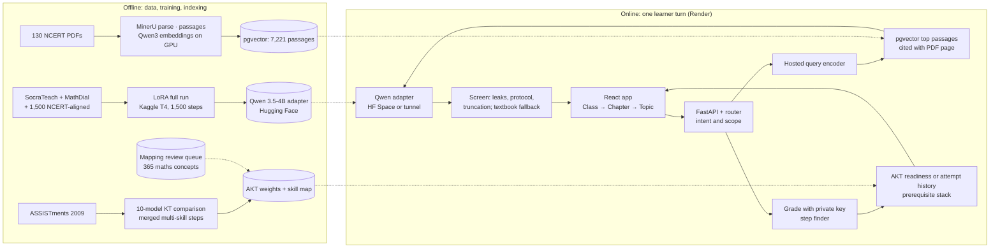

# Milestone 4 Report: Full Training, NCERT Mapping and the Deployed Tutor

**Project:** Socratic AI Tutor for NCERT Classes 6–10
**Team:** Group 2, Data Science and AI Lab, IIT Madras BS
**Members:** Sandeep Nalla (21f1006125), Hariom Kumar (23f2004225), Hariom Pandey (21f3002112), Mrityunjay Chakraborty (21f3001385)
**Date:** 19 November 2026
**Live app:** https://socratic-ai-tutor-z2s0.onrender.com/
**Repository:** `Hariomkr147/Group-2-DS-and-AI-Lab-Project`
**Companion files:** presentation (`M4_Presentation.pdf` / `.pptx`), work log (`Work_Contribution_Log.md`), AI usage logs (`ai-log/`)
**Models and dataset:** https://huggingface.co/IITM-2026T3-DSAI-GROUP2

## 1. Summary

M3 chose and measured the three learned parts of the tutor on small, controlled runs. M4 trains them on the full data, connects them to NCERT content, and ships one deployed app. Three of M3's results changed, and we report each change.

| Part | Job | M3 | M4 | Key M4 result |
|---|---|---|---|---|
| Knowledge tracing | Estimate per-skill mastery | AKT + Rasch, AUC 0.843 (7 models) | Retrained from scratch, 10 models, multi-skill attempts merged into one step | AKT still best: test AUC **0.779** (val 0.773). The 0.843 was inflated by duplicate rows |
| Socratic response model | Write the next tutor turn as a question | Qwen 3.5-4B, QLoRA, 2,000 dialogues | Full-pool LoRA run, 20,104 examples incl. 1,500 NCERT-aligned | Test loss **0.954** (perplexity 2.60), 1,500 steps on one T4 |
| NCERT retrieval (RAG) | Ground each turn in the textbook | BM25 + BGE-small, 124 passages, Hit@5 80% | Whole Classes 6–10 corpus extracted: 130 PDFs, 3,066 pages, **7,221 candidate passages**, pgvector, hosted encoder | Pilot benchmark unchanged (Hit@5 80%). First full-corpus routing check (notebook 06): 20 questions, chapter top-1 16/20, top-5 20/20. Passage relevance is not yet evaluated on a fresh labelled set spanning the full corpus |
| Concept-to-skill mapping | Reuse a trained KT skill for an NCERT concept | Not built | Review queue: 365 maths concepts, 937 ranked candidates; 567 science concepts labelled unmapped | Candidates only; no approved mappings yet |
| Prerequisite graph | Decide what to revisit | 3 pilot edges | Depth-limited traversal with cycle checks, wired to the session stack | 25 concepts, 15 pairs reviewed, 3 approved, 0 cycles |
| App | Chat, grade, track, backtrack | FastAPI demo (`mock-app/`) | React + FastAPI + PostgreSQL on Render, guardrail router, step finder, chat history | Live; 86 backend and 4 browser tests passed in the latest run |

The numbers in the KT and Qwen rows are not comparable: one is a next-answer classifier scored by AUC, the other a text generator scored by loss.

## 2. What M3 left open and where M4 stands

| M3 gap | M4 status | Evidence |
|---|---|---|
| Live Qwen with retrieved passages never tested end to end | Partly closed. The adapter runs on a Hugging Face ZeroGPU Space (and still on a Kaggle tunnel); the backend calls it through `NCERT_MODEL_URL` and falls back to a textbook clue when it is down. A 19 Nov audit ran two chat turns for each grade and subject: one Maths conversation reached the hosted model and the other nine used the fallback. No statistical evaluation yet | `backend/model_hosting/hf-space/`, `ai-log/hariom kumar/2026-11-19-backend-topic-audit.md` |
| App still loaded the early DKT checkpoint | Closed for the checkpoint, opt-in for use. `backend/models/akt/` holds the M4 AKT weights behind a checksum-checked loader; `KT_MODEL=akt` switches it on and any failure falls back to smoothed accuracy | `ai-log/sandeep/2026-11-19-akt-checkpoint-swap.md` |
| Only a 124-passage pilot | Closed for extraction, partly closed for evaluation. All 130 chapter PDFs are parsed and embedded, and a 20-question routing check on the full corpus passes (top-5 20/20, Section 6.3). We have chapter labels for 20 full-corpus routing questions. We have not yet evaluated passage relevance on a fresh labelled set spanning the full corpus | `Ncert Extraction Notebook/README.md`, notebook 06 |
| Demo app only | Closed. Production stack deployed from `render.yaml` | Section 7 |
| Score all models on the 599-dialogue MathDial test; BKT baseline; multi-seed KT; human and LLM rubric | **Not done.** Carried into M5 (Section 9) | n/a |

## 3. Full model training

### 3.1 Knowledge tracing: ten models, one corrected pipeline

Mrityunjay rebuilt the KT pipeline (`kt-models-comparision.ipynb`). The rebuild changes three things relative to M3: it merges all skill rows of one problem attempt into a single step (up to 4 skills, mean-pooled), it trains three more architectures (simpleKT, AT-DKT, a simplified QIKT), and it reports precision and recall beside AUC. Everything else follows M3: ASSISTments 2009, 123 skills, 15,922 questions, split by student 80/10/10 with seed 42, 200-step windows, Adam at 1e-3, batch 64, clip 5, up to 60 epochs with patience 8.

| Model | Params | Best epoch | Val AUC | Test AUC | Acc | Prec | Rec | F1 |
|---|---:|---:|---:|---:|---:|---:|---:|---:|
| DKT (LSTM) | 131,003 | 9 | 0.7558 | 0.7592 | 0.7344 | 0.7568 | 0.8789 | 0.8133 |
| DKT (GRU) | 106,171 | 12 | 0.7577 | 0.7626 | 0.7337 | 0.7533 | 0.8851 | 0.8139 |
| DKT (RNN) | 56,507 | 17 | 0.7514 | 0.7586 | 0.7344 | 0.7533 | 0.8868 | 0.8146 |
| SAKT | 49,025 | 32 | 0.7410 | 0.7440 | 0.7268 | 0.7401 | 0.9014 | 0.8128 |
| SAKT + positions | 61,825 | 18 | 0.7240 | 0.7299 | 0.7191 | 0.7378 | 0.8892 | 0.8065 |
| AKT (no Rasch) | 428,057 | 16 | 0.7544 | 0.7570 | 0.7333 | 0.7576 | 0.8745 | 0.8119 |
| **AKT (Rasch), selected** | 491,468 | 9 | **0.7729** | **0.7793** | 0.7438 | 0.7778 | 0.8550 | 0.8146 |
| simpleKT | 437,300 | 5 | 0.7637 | 0.7677 | 0.7368 | 0.7650 | 0.8662 | 0.8125 |
| AT-DKT | 4,239,146 | 7 | 0.7609 | 0.7640 | 0.7324 | 0.7671 | 0.8520 | 0.8073 |
| QIKT (simplified) | 1,166,639 | 12 | 0.7662 | 0.7717 | 0.7408 | 0.7638 | 0.8775 | 0.8167 |

**M3 vs M4.** AKT's test AUC fell from 0.843 to 0.779. M3 kept a multi-skill problem as several rows with the same answer, so one row could reveal the next row's target. That is the effect Xiong et al. found when ASSISTments 2009 AUC dropped from about 0.86 to about 0.75 [11], and M3 already called its absolute AUCs likely optimistic. The corrected number sits where [11] predicts. Three rank changes follow: AKT with Rasch is still first; the Rasch term now adds 0.022 AUC (0.757 → 0.779); and positional embeddings no longer help SAKT (0.744 without, 0.730 with).

**What the selection can and cannot claim.** `best_model_info.json` says the model was picked by highest *test* AUC, so the test number is a development estimate, not an untouched one. AKT also has the highest *validation* AUC (0.773 against 0.766 for QIKT and 0.764 for simpleKT), so selecting on validation alone would pick the same model. Its lead over simpleKT is 0.012 and over QIKT 0.008 on one seed, which is small. We therefore call AKT "selected", not "proven best". The compact models are our own reimplementations, not the authors' reference code.

### 3.2 Socratic model: full-pool LoRA run

Hariom Pandey ran the full training end to end (`qwen-3-5.ipynb`, Kaggle T4). The data extends M3's pool with 1,500 English CBSE/NCERT-aligned examples from `FoundryAILabs/k12-indian-curriculum-4.9m` (900 science and 208 maths; scanned 362,366 rows by streaming). Splits are by normalised question hash with seed 42 and the notebook reports zero overlaps.
| Item | Value |
|---|---|
| Base | Qwen/Qwen3.5-4B, 4,578,021,888 parameters |
| Examples after chat formatting and the 512-token cap | 15,690 train / 2,276 val / 2,138 test (20,104) |
| Pool before the token filter | 24,500 / 3,580 / 3,324 |
| LoRA | rank 16, alpha 32, dropout 0.05, all linear layers, bias none |
| Trainable parameters | 38,756,352 (0.85%) |
| Loss | cross-entropy on completion tokens only |
| Optimiser settings | lr 1e-4, cosine, 75 warm-up steps, 1,500 steps, effective batch 16 (1 × 16), seed 42 |
| Precision and hardware | float32 (float16 was refused on this runtime); one Tesla T4, 9.8 GB peak |
| Checkpoints | every 250 steps, keep 3, best by validation loss |
| Training time | 540.2 minutes |
| **Validation loss / perplexity** | **0.9581 / 2.6068** |
| **Test loss / perplexity** | **0.9544 / 2.5971** |
| Adapter | 130.67 MB ZIP (`adapter_model.safetensors`, config, tokenizer, chat template) |

Training loss fell from 1.5946 at step 10 to about 0.745 at step 1,500, with the usual noise from small batches. Validation and test loss are 0.004 apart.

**Hyperparameters.** The M3 grid (rank 8 or 16, lr 2e-4 or 5e-5, 400 dialogues) chose rank 16, lr 2e-4 and found the low learning rate under-trains. For the longer run we changed alpha from 16 to 32 and lr from 2e-4 to 1e-4 and added warm-up. We did not run an ablation that isolates those changes, so they are a design choice, not a finding.

**Qualitative checks.** MathDial and SocraTeach prompts give short follow-up questions that do not state the result: one asks about the six-hour quantity, another acknowledges a $140 trip cost and asks how much remains from $150. The science and social-science prompts failed: replies begin with "Thinking Process:" and expose reasoning text. We list this as a known failure, not as accepted behaviour.

**Second run in progress.** Hariom Kumar launched a mixed maths + science full-data run on Kaggle (`qwen35_unsloth_full.ipynb`, 12-hour limit, checkpointing at 11 h 45 min, optimizer and scheduler state saved for resume) with explicit science tutoring probes and reserved test partitions. Its results are not in this report.

**Why loss only.** Loss is the metric that exists for the full run. M3's leak rate, question rate and ROUGE-L were not re-scored on the expanded data, and no human or LLM rubric has been applied. Loss shows the model fits the data; it does not show the replies teach well.

### 3.3 Does the tutor need NCERT training data?

| Model | Needed? | Reasoning |
|---|---|---|
| AKT | **No, and not possible.** | The trained skill space is 123 ASSISTments maths skills. NCERT textbook text carries no right/wrong answer sequences, so there is nothing to train on. We reuse a trained skill only through an approved mapping (Section 4). Unmapped concepts get a labelled attempt history, never a made-up KT score |
| Qwen tutor, for facts | **No.** | Textbook facts come from retrieval at inference, with a page citation. Fine-tuning on facts would be a weaker, uncitable copy of that |
| Qwen tutor, for behaviour | **Probably, for science; not proven.** | The M3 data is English maths word problems. The model must still ask rather than tell on science and in NCERT style. M4 added 1,500 NCERT-aligned examples, but the evidence cannot say they help: pooled test loss hides subjects, and the science outputs show the "Thinking Process:" failure. A with-versus-without ablation, scored per subject with a rubric, is the test that would settle it |

## 4. Concept-to-skill mapping

Three relationships must stay separate, because each needs different evidence and a high score on one proves nothing about the others.

| Relationship | Direction | Evidence needed |
|---|---|---|
| NCERT question assesses skill(s) | `question_id → skill_id(s)` | Question stem, worked solution, rubric |
| NCERT concept maps to trained KT skill(s) | `ncert_concept_id → original_assistments_skill_id → checkpoint_skill_index` | Both vocabularies, example problems, objective and assessment-demand review |
| Prerequisite concept leads to dependent concept | `prerequisite_id → dependent_id` | Source-grounded dependency evidence and a reviewed direction |

A chapter is too broad to be one assessable skill, so every mapping starts from an atomic learning objective ("calculate an arithmetic mean"), not a chapter title.

**Workflow.**

1. Export the exact vocabulary the checkpoint uses, with original IDs and checkpoint indices (`skill_vocabulary_2009_with_checkpoint_index.csv`, 123 skills).
2. Recover each skill's name and, where possible, example problems. Mark missing names.
3. Give each NCERT concept a specific learning objective.
4. Use text similarity to shortlist up to three candidate skills per concept. Rank and score are retrieval aids only.
5. Review whether the assessment demands match: operation, representation, steps, prerequisites, expected answer.
6. Record each case as `exact`, `partial` or `unmapped` with evidence and `review_status`.
7. Tag each question with every skill it assesses, in its own table.
8. At inference, translate IDs through the checkpoint vocabulary. One attempt carries up to four skills, mean-pooled as in training; never split one answer into sibling rows.
9. For an unmapped concept, send nothing to KT. Show a clearly labelled per-concept attempt history.

**Mapping record.** `ncert_concept_id`, `original_assistments_skill_id`, `checkpoint_skill_index`, `mapping_type` (exact / partial / unmapped), `evidence`, `review_status` (candidate / approved / rejected / needs_review), plus reviewer, date, checkpoint hash, vocabulary hash and mapping version so index drift is detectable. Question tags and prerequisite edges are separate record types. Names are not identifiers: skills 85 and 163 share a name, so lookups use `original_assistments_skill_id`.

**Worked example.** Concept: arithmetic mean. Question: "calculate the mean of five observations". Assessed skill: calculating arithmetic mean. Candidate ASSISTments skill: **Mean** (original ID 12, checkpoint index 8). In the sheet, the broader Class 7 concept "Representative values" lists Median first (similarity 0.774) and Mean second (0.739). A question about the mean maps to Mean, but the concept also covers median and mode, so a reviewer must split or multi-map it. Similarity alone cannot do that.

**Current state (Mrityunjay).**

| Item | Count |
|---|---|
| Vocabulary | 123 skills: 102 named, 21 without a name (16 single-word, 1 standards code, 2 duplicate names) |
| Maths concepts, Classes 6–10 | 365 concepts, 937 candidate rows (class 6: 186, 7: 204, 8: 156, 9: 304, 10: 87 rows) |
| Tier A (every skill-name word appears in the concept) | 93 rows covering 78 concepts |
| Tier B (partial overlap, weak) | 814 rows covering 330 concepts |
| No suggestion | 30 concepts, to be confirmed as unmapped |
| Science concepts | 567, all `unmapped`: the 123 skills are all maths |
| Approved mappings | **0**. `mapping_type`, `evidence` and `review_status` are blank |

The backend's runtime map (`backend/models/akt/concept_skill_map.json`) is a starter list: `percentages` plus the NCERT fraction IDs, and 33 Tier A rows that a first pass marked "keep" from skill names alone. That pass was not a subject-expert review, and the backend does not use those maths concept IDs yet, so they have no effect today. Unseen NCERT questions use a neutral difficulty entry for the Rasch term; that is an engineering default, not evidence the model learned them.

Two cautions go into the app wording. AKT's output is the probability of a correct next answer, which is evidence about a learner's state, not a direct measure of mastery. And when a concept has no approved skill, the app abstains from showing a model probability.

## 5. Prerequisite graph and misconception handling

### 5.1 Prerequisite graph (Sandeep)

Edges mean prerequisite → dependent. To find what to revisit for target B, the code walks incoming edges backward up to a set depth (`Ncert work/08_prerequisite_graph/code/build_graph.py`). It validates IDs, rejects self-links and duplicates and checks the graph is acyclic. The pilot has 25 concepts and 15 candidate pairs, all reviewed, with 3 approved edges and 0 cycles: `fractions → fraction_multiplication → fraction_division` and `fraction_multiplication → percentages`. One AI reviewer made the 15 decisions, so precision and recall against an independent gold set are not available; this is a bounded pilot graph, not a validated curriculum graph.

The tutor uses the graph through a session stack (`backend/app/services/controller.py`). A wrong answer on concept C with a weak prerequisite B (readiness below 0.6) pushes C and moves to B (`BACKTRACK`). A correct answer pops the stack (`ADVANCE`). With no weak prerequisite, the first two wrong answers get a `HINT`, then the tutor switches to `PROBE`. Multi-level backtracking works the same way, and a session resumes after a page refresh.

### 5.2 Message router and guardrails (Hariom Kumar)

Every message is classified on two separate questions: intent (answer attempt, hint, doubt, off-topic) and curriculum scope (is it in this course?). We compared three CPU candidates for a 512 MB Render instance on a frozen synthetic set (132 train, 45 dev, 104 test; all AI-written). TF-IDF + logistic regression reached 78.8% intent and 93.3% scope accuracy in under 3 ms; DeBERTa zero-shot took over 800 ms and risks the memory limit. We shipped TF-IDF (`message_router.joblib`). A message is graded only when a question is pending, so a doubt or a bare number cannot move a mastery score by mistake. The intent head sits below its 0.5 threshold on most very short messages, so a rule-based conversation layer (greetings, "I don't know", "next", number words) runs first.

### 5.3 Step finder and misconception detection (Sandeep)

The tutor asks for working one step per line and finds the first wrong step: code checks the arithmetic and the fine-tuned Qwen names a wrong method (`step_finder.py`). On 50 AI-written cases (30 maths, 20 science; 29 misconception, 7 slip, 14 correct):

| Backend | Right step | False suggestion | 8 hard cases (valid alternative method) |
|---|---:|---:|---:|
| Gemini 3 Flash (reference) | 36/36 | 0/14 | 8/8 |
| Fine-tuned Qwen, Kaggle tunnel | 36/36 | 3/14 | 7/8 |
| Fine-tuned Qwen, HF Space, answer-only | 32/36 | 2/14 | 8/8 |

Qwen's false suggestions were on valid alternative methods. The cases are synthetic, so these figures are a development check. Misconception labels from Eedi (Recall@5 26% in M3) are shown as unconfirmed suggestions only.

## 6. NCERT content, embeddings and retrieval

### 6.1 Full Classes 6–10 corpus (Hariom Kumar)

Six executed Kaggle notebooks (`Ncert Extraction Notebook/`) took the corpus from PDFs to a database:

| Stage | Result |
|---|---|
| Inventory | 130 official chapter PDFs, 3,066 pages (maths and science, Classes 6–10) |
| GPU parse (MinerU 4.1.7, Basic tier, two T4 workers) | 3,047 non-empty pages, 19 empty, 0 page errors. The final run reused 103 chapters from an earlier parse (source hashes and per-page status checked) and parsed 27 |
| Content preparation | 7,221 candidate passages (median 584 characters, split on headings and capped near 1,600). Page flags: figure review 2,303, maths review 1,324, table review 385, replacement character 7, empty 19 |
| Embedding (GPU) | `Qwen/Qwen3-Embedding-0.6B`, 1,024-d, last-token pooling, L2-normalised, one vector per passage; hashes and ID order verified; 947 s |
| Database | Supabase PostgreSQL + pgvector, private schema `ncert_research` (no access for `anon` or `authenticated`). One immutable candidate release, `9aea0ce28990f86074b2d813`, 7,221 passages, loaded in one transaction; the stored count was checked. The load script creates no vector index, so search is an exact scan |
| Query routing | Notebook 06, rerun 17 Nov; results in Section 6.3 |

These are research candidates: maths notation, tables, figures and OCR fragments still need review against the PDFs before they count as approved teaching evidence. Two shortcuts are on record in the notebooks. The inventory step downloaded the PDFs with TLS verification off, because NCERT's certificate chain fails on Kaggle; it checked the host, the `%PDF-` header and recorded a SHA-256 for every file, and the later stages re-verify those hashes. Section headings come from noisy OCR (for example a Class 6 integers query lands on a passage headed "Brahmagupta's Rules for Subtraction"), so a heading is not a reliable topic label; the chapter is. The app cites "chapter · physical PDF page" with a `#page=` deep link so a reader can check the source.

### 6.2 Two retrieval stacks, stated plainly

| | Frozen pilot (M3, benchmarked) | Full corpus (M4, deployed) |
|---|---|---|
| Passages | 124 across 25 topics | 7,221 across Classes 6–10 |
| Encoder | BGE-small-en-v1.5, 384-d, with BM25 rank fusion | Qwen3-Embedding-0.6B, 1,024-d, cosine in pgvector |
| Benchmark | 83 publisher questions: 24 calibration, 59 held-out, 15 supported | 20 chapter-labelled routing questions (Section 6.3); no fresh passage-level benchmark yet |
| Result | Hit@5 80% (12 of 15) | Chapter top-1 16/20, top-5 20/20 (not comparable with Hit@5 above) |

| Retriever (15 supported held-out) | Hit@1 | Hit@5 | MRR |
|---|---:|---:|---:|
| BM25 | 53.3% | 73.3% | 0.597 |
| BGE-small | 46.7% | 73.3% | 0.572 |
| Rank fusion | 46.7% | 80.0% | 0.591 |

Hit@5 is whether the right concept appears in the top five, not whether an answer is right. Labels come from a single AI reviewer and the questions are publisher items, not learner queries.

The M3 pilot disabled automatic concept selection after its acceptance rule returned zero correct acceptances among 15 supported questions and accepted three of 44 challenge questions. The M4 NCERT app lets learners select a topic or enter a question. For a new question, the backend ranks chapters within the session’s selected scope, can request clarification when leading chapters score closely, and can reject a weak match. Section 6.3 reports the full-corpus routing check.

**Encoder benchmark (Hariom Kumar).** Eight embedding models and BM25 searched the same 124 passages from four chapters. On 40 AI-authored passage queries, Qwen3-Embedding-0.6B achieved 0.845 nDCG@5 and 39/40 Hit@5, versus 0.740 and 36/40 for BGE-small. The Qwen 4B model reached 0.850 with the same 39/40 hits but used 7.90 GiB of reserved GPU memory versus 2.53 GiB for the 0.6B model, which informed the choice of the 0.6B model for the full-corpus index. On the 15 reused publisher questions, which are concept-level checks, concept Hit@5 was 12/15 for Qwen3-Embedding-0.6B and 11/15 for BGE-small. The M3 fusion result of 12/15 also counts correct concepts, whereas the full-corpus 20/20 in Section 6.3 counts correct chapters on different questions. These figures cannot establish a percentage-point improvement between systems.

The pilot also keeps its question bank: 85 questions, 84 approved and one held back, 43 rubric-eligible question–key pairs. Answer keys live in a private schema and never enter a prompt.

### 6.3 Full-corpus routing check (notebook 06)

Notebook 06 embeds a question with the same pinned model, revision and instruction prefix as the index, scores it by cosine against every passage, and returns the best passage of each of the top five distinct chapters. Passages are excluded from routing if they carry the `answer_risk` flag, sit under an "Answer" or "Solution" heading, or are shorter than 80 characters after image links are removed. That leaves **6,207 of 7,221 passages searchable**; the other 1,014 are excluded. A question is rejected when its best score is below 0.6.

| Check | Result |
|---|---|
| Pilot spot-checks (Class 6 integers, Class 7 decimals) | 2 of 2 correct at rank 1 |
| Benchmark: 20 questions covering all ten class–subject combinations, chapter-level label. Class 7 maths had one question, Class 10 science three, and each other combination two | **Top-1 16 of 20 (80%), top-5 20 of 20 (100%)**. The four rank-2 cases: Class 9 maths ch. 13, Class 10 maths ch. 14, Class 8 science ch. 10, Class 10 science ch. 12 |
| Off-topic probes (10: sport, weather, travel, coding, recipes and similar) | 10 of 10 rejected. Highest off-topic score 0.537; lowest top score on the benchmark 0.697 |

**What this supports.** The Qwen3 index finds the right chapter in the top five for all 20 questions across all ten class-subject books, and the 0.6 cutoff separates these off-topic probes from these on-topic questions with a gap of about 0.16.

**What it does not support.**
- It is 20 questions across the ten books (Class 7 maths one, Class 10 science three, the rest two each), and is not the frozen 83-question pilot set, so it cannot be compared with the pilot Hit@5 or with the pilot's 3-of-44 wrong accepts. The probes here are plainly off-topic. The pilot's challenge questions were harder, and near-curriculum questions (Class 11 content, general science outside NCERT) are not tested.
- The notebook itself marks the 0.6 cutoff as calibrated on a small question set and to be recalibrated before learner use. The rejection result is therefore in-sample.
- The score is at chapter level, so it says nothing about whether the passage shown is the best one to teach from.
- The notebook reads an unfiltered ranking across all classes. The app's Class → Chapter → Topic picker is a separate path, and the hosted encoder has not been compared with this local float32 one.

These checks measure chapter ranking. The accuracy of the exact topic and supporting passage shown to a learner still needs evaluation.

**Milestone 5 commitment.** For Milestone 5, we will label fresh questions across Classes 6–10 with the expected chapter and acceptable supporting passages. We will tune the routing cutoff on a separate development set, then compare both retrievers on the same held-out questions and corpus. We will report chapter Hit@5, passage Hit@5, wrong acceptances and abstentions separately.

### 6.4 Why the encoder is hosted

The Qwen3 encoder needs torch and about 1.2 GB of model files, which does not fit a free Render instance (512 MB) and was missing from `requirements.txt`. The frontend audit flagged this as a release blocker. The deployment now calls a hosted encoder through `NCERT_EMBEDDING_URL` and `NCERT_EMBEDDING_API_KEY`, so the web service stays small. The query encoder must use the same model revision (`97b0c614`) and pooling as the indexed corpus, or similarity scores collapse.

## 7. End-to-end system

### 7.1 Architecture

### 7.2 Data flow

| Stage | Socratic model | Knowledge tracing | NCERT retrieval |
|---|---|---|---|
| Input data | Dialogues + 1,500 NCERT-aligned examples, 512 tokens, loss on completion only | Per-student attempts, multi-skill rows merged, 200-step windows | 130 PDFs → 7,221 passages |
| Training | LoRA r16/α32, 1,500 steps, T4, 540 min | 10 architectures, shared defaults, early stopping | None: encoder frozen |
| Validation | Val loss every 250 steps, best checkpoint kept | Val AUC each epoch | Integrity audit; pilot calibration set |
| Evaluation | Test loss 0.954; qualitative checks | Test AUC 0.779, scored once | Pilot Hit@5 80% |
| Output | One short Socratic turn that does not state the answer | Probability of a correct next answer, for mapped skills only | Cited passages and a gradable checkpoint |

### 7.3 Application

| Layer | What exists |
|---|---|
| Frontend (`frontend/`) | React + Vite workspace: sign-in, Class → Chapter → Topic navigation, chat, concept map, source panel, assessment view, previous chats saved in PostgreSQL that can be reopened, larger type, mobile navigation |
| Backend (`backend/`) | FastAPI with bearer-token auth, rate limits, restricted CORS, answer keys stripped from concept endpoints, idempotent retries by `request_id`, sessions and turns in PostgreSQL, `/search`, `/practice`, `/diagnostics`, `/assessments` |
| Tutor behaviour | Separate prompts for explanation, hint, problem guidance and reviewing working; replies screened for leaks, protocol and truncation; extractive textbook fallback when the model is down |
| Hosting | Render free web service built by `render.yaml` (React build + `pip install`), PostgreSQL, hosted encoder, Qwen on a Hugging Face ZeroGPU Space or a Kaggle tunnel |

The 18 Nov frontend audit found five P1 issues (first course decides the whole experience, missing encoder dependencies on Render, picking a concept keeps teaching the previous one, multi-line working cannot be submitted, diagnostics and practice have no end-to-end path) and four P2 issues (refresh abandons the lesson, a saved turn can look failed, outages interrupt sign-in, stale citations). Chat history, accessibility, the hosted encoder and chat-routing fixes have since landed. We have not re-run the audit against the live site, so each P1 needs a recheck before we call it closed.

## 8. Testing and evidence

| Check | Result |
|---|---|
| Backend unit and API tests | 86 passed with 4 Playwright browser tests (19 Nov, chat-history build). A separate run on a Windows checkout showed 126 passed and 3 `test_akt.py` errors caused by a checksum mismatch from CRLF line endings; to be reconciled |
| Offline NCERT app check | 52 tests pass with zero model calls (`mock-app/VERIFICATION.md`) |
| Topic audit | Citation fields checked for 2,346 topic entries; two chat turns per grade and subject on the real corpus; one used the hosted model, nine the fallback |
| Full-corpus routing check | 20 questions: chapter top-1 16/20, top-5 20/20; 10 of 10 off-topic probes rejected at a 0.6 cutoff (notebook 06; in-sample, Section 6.3) |
| Not yet verified | Live Render deployment under load, hosted-model reply quality, cross-browser and screen-reader accessibility, a fresh labelled passage-level retrieval benchmark on the 7,221-passage corpus |

## 9. Limitations and next steps

| Limitation | Plan for M5 |
|---|---|
| KT test AUC was used to pick the model; one seed; small gaps between top models | Reselect on validation AUC only, evaluate on a fresh student-level test split, repeat for 3 to 5 seeds, add a BKT baseline |
| The mapping is a review queue with no approved rows | A subject expert fills `mapping_type`, `evidence` and `review_status`; split broad concepts such as "Representative values"; tag questions to skills; then load approved rows only |
| Science has no KT signal | Keep labelled per-concept attempt history; consider collecting in-app answers |
| Qwen scored by loss only; "Thinking Process:" leaks on science | Score held-out generations with a rubric (correctness, answer leak, subject fit, clarity, reasoning leak) by blind raters; add a response-format control; run the with/without NCERT ablation |
| M3's leak rate, ROUGE-L and the 599-dialogue MathDial test were not re-run on the full model | Run them once on the final adapter, with Telling@k |
| Token-prefix warning in completion-only masking | Check prompt/completion boundaries before freezing preprocessing |
| 7,221 passages unreviewed; only a 20-question routing check; 0.6 cutoff set on a small set; PDFs fetched with TLS verification off (hashes recorded) | Review flagged maths notation and tables; label fresh questions, expected chapters and supporting passages across Classes 6–10; tune the cutoff on a development set, then compare both retrievers on held-out questions (Section 6.3); fix NCERT TLS handling or pin the hashes in the release |
| Prerequisite graph is 25 concepts, one reviewer | Extend to more classes; add an independent reviewer and report precision and recall |
| Router and step-finder data are synthetic | Evaluate on reviewed real learner conversations |
| All users share one project account | Per-learner accounts so progress and history are separate |
| Hosting depends on free tiers and a private Space | Make the Space persistent; measure latency and failure rates on Render |

## 10. Contributions

| Member | M4 work |
|---|---|
| Hariom Pandey | Full model training end to end on the complete dataset, with all metrics and hyperparameters; benchmarking; the question of whether NCERT data is needed for training and why (Section 3.3); the completed 1,500-step Qwen run and adapter |
| Mrityunjay Chakraborty | Knowledge-tracing fix and data preparation (merged multi-skill steps, ten-model comparison, checkpoint and ID maps); NCERT-to-skill mapping pack (vocabulary, 365-concept review sheet, science list); frontend; testing of the working app; **documentation** |
| Sandeep Nalla | Backend (auth, sessions, AKT loader and swap, controller and session stack); misconception and step finder; compiling the end-to-end pipeline; testing the working app; dynamic prerequisite graph from the notebook; Tier A shortlist and merge script |
| Hariom Kumar | Benchmarked OCR parsers on two NCERT chapters and compared eight embedding models with BM25 on 124 passages. These measurements informed the choice of MinerU 4.1.7 Basic Torch/CUDA for extraction and Qwen3-Embedding-0.6B for the full-corpus index; full NCERT database preparation on GPU (Classes 6–10, Qwen3 embeddings, pgvector); hosting the LLM; message router and guardrails; backend topic audit and tutoring behaviour fixes; frontend audit and chat-history layout; mixed maths + science Qwen run launch; **documentation** |

Roles overlapped across components as needed. Per-person detail is in `Work_Contribution_Log.md` and `ai-log/<person>/`.

## 11. Evidence

| Area | Location |
|---|---|
| KT comparison | `notes/Mrityunjay Chakraborty/kt-models-comparision.ipynb`, `scratch_results_assist2009.csv`, `best_model_info.json`, `best_weights.pt`, ID maps |
| Mapping pack | `notes/Mrityunjay Chakraborty/Ncert Pack/` (`skill_vocabulary_2009_with_checkpoint_index.csv`, `candidate_review_sheet_maths_2009_with_checkpoint_index.csv`, `science_unmapped.csv`, README) |
| Qwen full run | `qwen-3-5.ipynb` and `lora_adapter.zip` (copy into the repository; they were local files when this report was drafted); `notes/hariom kumar/milestone-4/model_finetune/qwen35_unsloth_full.ipynb` |
| Prerequisite graph | `Ncert work/08_prerequisite_graph/` |
| Corpus, embeddings, retrieval, routing check | `Ncert Extraction Notebook/` (notebooks 01–06), `Ncert work/10_embeddings_and_database/`, `Ncert work/11_retrieval_and_evaluation/`, `Ncert work/CURRENT_CHECKPOINT.md` |
| OCR parser and embedding benchmarks | `notes/hariom kumar/milestone-4/Benchmark/NCERT_OCR_Parser_Benchmark_TA_Report.pdf`; `notes/hariom kumar/milestone-4/Benchmark/NCERT_Embedding_Benchmark_Brief.pdf` (pp. 1–2 for the encoder choice). Notebook 06 remains the source for the 20-query full-corpus chapter check |
| Backend and AKT bridge | `backend/`, `backend/models/akt/`, `backend/eval/message_router/`, `backend/eval/misconception/`, `backend/model_hosting/hf-space/` |
| Frontend and audit | `frontend/`, `docs/frontend-audit.md` |
| Deployment | `render.yaml`; live app https://socratic-ai-tutor-z2s0.onrender.com/ |
| M3 baseline | `docs/milestone-3/` |
| AI usage | `AGENTS.md`, `ai-log/` |

## AI use

Claude, Codex and Antigravity helped with code, test drafting and documentation. Each member logged their sessions under `ai-log/<person>/`, with secrets omitted. This report was drafted with Claude from the team's M3 report and deck, the M4 training report, the repository and the AI logs. Numbers come from saved notebook outputs, JSON and CSV files, and the repository documents. The corpus and routing sections were cross-checked against the six executed extraction notebooks. We did not re-run training, and each member reviewed the report before signing.

## References

1. Hu et al. *LoRA: Low-Rank Adaptation of Large Language Models.* ICLR 2022. https://arxiv.org/abs/2106.09685
2. Dettmers et al. *QLoRA: Efficient Finetuning of Quantized LLMs.* NeurIPS 2023. https://arxiv.org/abs/2305.14314
3. Macina et al. *MathDial.* Findings of EMNLP 2023. https://arxiv.org/abs/2305.14536
4. Liu et al. *SocraticLM.* NeurIPS 2024.
5. Model cards: Qwen3.5-4B, Qwen3-Embedding-0.6B, BGE-small-en-v1.5 (Hugging Face); team adapters under `IITM-2026T3-DSAI-GROUP2`.
8. Piech et al. *Deep Knowledge Tracing.* NeurIPS 2015.
9. Pandey and Karypis. *A Self-Attentive Model for Knowledge Tracing.* EDM 2019.
10. Ghosh, Heffernan and Lan. *Context-Aware Attentive Knowledge Tracing.* KDD 2020.
11. Xiong et al. *Going Deeper with Deep Knowledge Tracing.* EDM 2016.
12. Xiao et al. *C-Pack* (BGE). 2023.
13. ASSISTments 2009 skill-builder data and official dataset notes (multi-skill questions, corrected duplicate records).
14. `FoundryAILabs/k12-indian-curriculum-4.9m` (Apache-2.0 per dataset card; check terms before redistribution).

## Sign-off

By signing, each member confirms they have reviewed this report, the presentation and the work log.

| Name | Roll number | Signature | Date |
|---|---|---|---|
| Sandeep Nalla | 21f1006125 |  | 19-11-2026 |
| Hariom Kumar | 23f2004225 |  | 19-11-2026 |
| Hariom Pandey | 21f3002112 |  | 19-11-2026 |
| Mrityunjay Chakraborty | 21f3001385 |  | 19-11-2026 |
