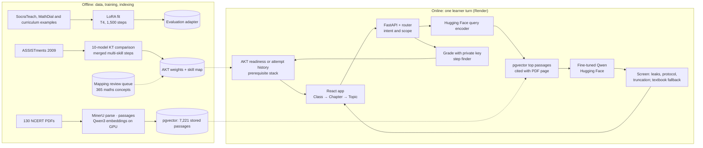

# Milestone 4 Report: Model Training, NCERT Mapping and the Deployed Tutor

**Project:** Socratic AI Tutor for NCERT Classes 6–10
**Team:** Group 2, Data Science and AI Lab, IIT Madras BS
**Members:** Sandeep Nalla (21f1006125), Hariom Kumar (23f2004225), Hariom Pandey (21f3002112), Mrityunjay Chakraborty (21f3001385)
**Date:** 19 November 2026
**Live app:** https://socratic-ai-tutor-z2s0.onrender.com/
**Repository:** `Hariomkr147/Group-2-DS-and-AI-Lab-Project`
**Companion files:** [presentation PDF](M4_Presentation.pdf), [editable PowerPoint](M4_Presentation.pptx), work contribution record (§10) and AI-use disclosures (Appendix A)
**Models and dataset:** https://huggingface.co/IITM-2026T3-DSAI-GROUP2

## 1. Summary

Milestone 4 evaluated the knowledge-tracing and Socratic models and expanded NCERT retrieval across Classes 6–10 maths and science. Render hosts the tutor app. Hugging Face hosts the query encoder and the fine-tuned Socratic model.

| Component | Milestone 4 result |
|---|---|
| Knowledge tracing | AKT validation AUC **0.7729**. Test AUC **0.7793** was used for model selection and is a development estimate |
| Socratic tutor | Qwen3.5-4B LoRA completed **1,500 steps**. Validation loss **0.9591**, internal test loss **0.9538** |
| NCERT retrieval | 130 PDFs, 3,066 pages and 7,221 stored passages. Qwen3-Embedding-0.6B retrieved a judged passage in the top five for **39/40** encoder queries. On the full-corpus chapter check, top-1 was **16/20** and top-5 was **20/20** |
| Mapping and prerequisites | 365 maths concepts and 937 mapping review rows. The prerequisite graph has 25 concepts and three approved edges |

## 2. Deployment and validation status

The Render backend calls the Hugging Face query encoder and fine-tuned Qwen tutor. The 19 November audit covered ten two-turn conversations. One used the hosted tutor and nine used textbook fallback. The exact serving adapter revision remains unverified. The checksum-checked AKT loader is available through `KT_MODEL=akt`. Independent evaluation of teaching quality, a fresh KT holdout and full-corpus passage relevance remain open.

## 3. Model training

### 3.1 Knowledge tracing: ten models, one corrected pipeline

Mrityunjay rebuilt the KT pipeline (`kt-models-comparision.ipynb`). The pipeline merges each attempt into a single step using mean pooling over up to four skills, compares ten architectures and reports precision and recall alongside AUC. The processed ASSISTments 2009 data contain 259,258 attempts from 4,022 students, 123 skills and 15,922 questions, with 65.8% correct responses. The code partitions by student with an 80/10/10 split and seed 42, then creates windows of up to 200 steps. Majority-class accuracy is 65.8%.

| Model | Params | Best epoch | Val AUC | Test AUC | Acc | Prec | Rec | F1 |
|---|---:|---:|---:|---:|---:|---:|---:|---:|
| DKT (LSTM) | 131,003 | 9 | 0.7558 | 0.7592 | 0.7344 | 0.7568 | 0.8789 | 0.8133 |
| DKT (GRU) | 106,171 | 12 | 0.7577 | 0.7626 | 0.7337 | 0.7533 | 0.8851 | 0.8139 |
| DKT (RNN) | 56,507 | 17 | 0.7514 | 0.7586 | 0.7344 | 0.7533 | 0.8868 | 0.8146 |
| SAKT | 49,025 | 32 | 0.7410 | 0.7440 | 0.7268 | 0.7401 | 0.9014 | 0.8128 |
| SAKT + positions | 61,825 | 18 | 0.7240 | 0.7299 | 0.7191 | 0.7378 | 0.8892 | 0.8065 |
| AKT (no Rasch) | 428,057 | 16 | 0.7544 | 0.7570 | 0.7333 | 0.7576 | 0.8745 | 0.8119 |
| **AKT (Rasch), selected** | 491,468 | 9 | **0.7729** | **0.7793** | 0.7438 | 0.7778 | 0.8550 | 0.8146 |
| simpleKT | 437,300 | 5 | 0.7637 | 0.7677 | 0.7368 | 0.7650 | 0.8662 | 0.8125 |
| AT-DKT | 4,239,146 | 7 | 0.7609 | 0.7640 | 0.7324 | 0.7671 | 0.8520 | 0.8073 |
| QIKT (simplified) | 1,166,639 | 12 | 0.7662 | 0.7717 | 0.7408 | 0.7638 | 0.8775 | 0.8167 |

**Architecture comparison.** AKT with Rasch scored 0.7729 on validation, compared with 0.7544 without Rasch. SAKT without positional embeddings scored 0.7410, compared with 0.7240 for the positional variant.

**What the selection can and cannot claim.** `best_model_info.json` says the model was picked by highest *test* AUC, so the test number is a development estimate, not an untouched one. AKT also has the highest *validation* AUC (0.773 against 0.766 for QIKT and 0.764 for simpleKT), so selecting on validation alone would pick the same model. Its validation lead is 0.0092 over simpleKT and 0.0067 over QIKT on one seed. We therefore call AKT "selected", not "proven best". The compact models are our own reimplementations, not the authors' reference code.

**Selected AKT configuration.** Each input window holds up to 200 attempts with four skill IDs per attempt. The model pools skills, encodes interactions with attention, applies a learned Rasch difficulty term and predicts the probability of a correct next response.

| Setting | Value |
|---|---|
| Architecture | Width 128, 8 attention heads, 1 block setting, feed-forward width 256, dropout 0.1, 491,468 parameters |
| Loss | Mean binary cross-entropy over valid steps plus 1e-5 times the sum of squared Rasch difficulty values in the batch |
| Optimization | Adam at 0.001, batch 64, gradient norm clip 5, up to 60 epochs, patience 8, seed 42 |
| Selection | Checkpoint selected by validation AUC within each run. Architecture selected by test AUC across ten runs |
| Convergence | 17 epochs for selected AKT. Training loss 0.6092 at epoch 1 and 0.4400 at epoch 17. Best validation AUC 0.7729 at epoch 9. Slide 5 plots the saved validation AUC series. Per-epoch validation loss is unavailable in the saved text history |

### 3.2 Socratic model

The training notebook combines the original MathDial train and test splits with SocraTeach for a team split keyed by normalized question with seed 42. It samples the same number of dialogues from each maths source within each split. The saved overlap check reports zero shared question keys between the team’s partitions. Audit overlap with the actual training manifest before using the original 599-dialogue MathDial test for independent evaluation.

The input pool included 1,500 selected English-language CBSE/NCERT-aligned examples from `FoundryAILabs/k12-indian-curriculum-4.9m`: 900 science, 317 social science, 208 maths and 75 English. The notebook scanned 362,366 rows. The 1,500 count precedes filtering. Examples without a user turn or longer than 512 tokens were dropped. Source: `notes/hariom pandey/milestone-4/qwen-3-5-finetuning.ipynb`.

| Setting | Value |
|---|---|
| Base | Qwen3.5-4B, 4,578,021,888 parameters in the trainer output |
| Pool before filtering | 24,500 train / 3,580 validation / 3,324 test |
| Pool after filtering | 15,690 train / 2,276 validation / 2,138 internal test (20,104 total) |
| LoRA | Rank 16, alpha 32, dropout 0.05, bias disabled. Notebook requests all-linear targeting. Trainer output lists 38,756,352 trainable parameters (0.85%) |
| Loss | Mean next-token cross-entropy over unmasked completion tokens, excluding prompt tokens |
| Notebook settings | Learning rate 0.0001, cosine schedule, 75 warm-up steps, seed 42. Evaluate and save every 250 steps, keep up to three checkpoints, and load the checkpoint with lowest validation loss |
| Executed fit | 1,500 optimizer steps, physical batch 1, accumulation 16, effective batch 16, one Tesla T4, FP32 fallback |
| Runtime and peak GPU memory | 483.3 minutes, 9.81 GB |
| Validation loss / perplexity | **0.9591 / 2.6093** over 2,276 examples |
| Internal test loss / perplexity | **0.9538 / 2.5956** over 2,138 examples |
| Checkpoint and adapter | Lowest scheduled validation loss at step 1,000. The trainer is configured to load the best checkpoint before exporting the 130.67 MB adapter ZIP |

**Convergence and tuning.** Training loss fell from 1.5945 at step 10 to 0.7430 at step 1,500. Validation loss reached its lowest scheduled value at step 1,000, then rose slightly. The terminal scheduled validation loss was 0.9627. Post-training evaluation returned 0.9591, consistent with loading the checkpoint selected by validation loss. Slide 6 shows all 150 logged training points and the six scheduled validation points.

| Step | Logged training loss | Scheduled validation loss |
|---:|---:|---:|
| 250 | 0.986292 | 1.005031 |
| 500 | 0.908020 | 0.981708 |
| 750 | 0.922841 | 0.969303 |
| 1,000 | 0.819581 | 0.959099 |
| 1,250 | 0.768543 | 0.963080 |
| 1,500 | 0.743026 | 0.962680 |

The notebook warns that some tokenized prompts are not prefixes of their concatenated completions. The saved outputs provide no controlled full-pool hyperparameter sweep or stability ablation.

**Qualitative checks.** The chair-production and field-trip examples ask the learner for a next step. Other examples expose reasoning text on science, social science, English and maths prompts. The saved responses support a qualitative failure analysis. Independent ratings, answer-leak rate and ROUGE-L remain open.

**Reproducibility.** The saved notebook exports the trainer's loaded adapter to `/kaggle/working/lora_adapter` and packages it as `/kaggle/working/lora_adapter.zip`. The notebook records checkpoint writes through step 1,500. The exact served adapter revision and a repository-accessible, versioned copy of the weights remain to be verified.

### 3.3 Does the tutor need NCERT training data?

| Model | Needed? | Reasoning |
|---|---|---|
| AKT | **No, and not possible.** | The trained skill space is 123 ASSISTments maths skills. NCERT textbook text carries no right/wrong answer sequences, so there is nothing to train on. We reuse a trained skill only through an approved mapping (Section 4). Unmapped concepts get a labelled attempt history, never a made-up KT score |
| Qwen tutor, for facts | **No.** | Textbook facts come from retrieval at inference, with a page citation. Fine-tuning on facts would be a weaker, uncitable copy of that |
| Qwen tutor, for behaviour | **Probably, for science; not proven.** | The model still needs to guide reasoning in science. The preparation stage selected 1,500 curriculum examples. Pooled loss and the qualitative outputs leave their effect on science tutoring unresolved. A with-versus-without ablation, scored per subject with a rubric, is the test that would settle it |

## 4. Concept-to-skill mapping

Three relationships must stay separate, because each needs different evidence and a high score on one proves nothing about the others.

| Relationship | Direction | Evidence needed |
|---|---|---|
| NCERT question assesses skill(s) | `question_id → skill_id(s)` | Question stem, worked solution, rubric |
| NCERT concept maps to trained KT skill(s) | `ncert_concept_id → original_assistments_skill_id → checkpoint_skill_index` | Both vocabularies, example problems, objective and assessment-demand review |
| Prerequisite concept leads to dependent concept | `prerequisite_id → dependent_id` | Source-grounded dependency evidence and a reviewed direction |

A chapter is too broad to be one assessable skill, so every mapping starts from an atomic learning objective ("calculate an arithmetic mean"), not a chapter title.

**Workflow.**

1. Export the exact vocabulary the checkpoint uses, with original IDs and checkpoint indices (`skill_vocabulary_2009_with_checkpoint_index.csv`, 123 skills).
2. Recover each skill's name and, where possible, example problems. Mark missing names.
3. Give each NCERT concept a specific learning objective.
4. Use text similarity to shortlist up to three candidate skills per concept. Rank and score are retrieval aids only.
5. Review whether the assessment demands match: operation, representation, steps, prerequisites, expected answer.
6. Record each case as `exact`, `partial` or `unmapped` with evidence and `review_status`.
7. Tag each question with every skill it assesses, in its own table.
8. At inference, translate IDs through the checkpoint vocabulary. One attempt carries up to four skills, mean-pooled as in training; never split one answer into sibling rows.
9. For an unmapped concept, send nothing to KT. Show a clearly labelled per-concept attempt history.

**Mapping record.** `ncert_concept_id`, `original_assistments_skill_id`, `checkpoint_skill_index`, `mapping_type` (exact / partial / unmapped), `evidence`, `review_status` (candidate / approved / rejected / needs_review), plus reviewer, date, checkpoint hash, vocabulary hash and mapping version so index drift is detectable. Question tags and prerequisite edges are separate record types. Names are not identifiers: skills 85 and 163 share a name, so lookups use `original_assistments_skill_id`.

**Worked example.** Concept: arithmetic mean. Question: "calculate the mean of five observations". Assessed skill: calculating arithmetic mean. Candidate ASSISTments skill: **Mean** (original ID 12, checkpoint index 8). In the sheet, the broader Class 7 concept "Representative values" lists Median first (similarity 0.774) and Mean second (0.739). A question about the mean maps to Mean, but the concept also covers median and mode, so a reviewer must split or multi-map it. Similarity alone cannot do that.

**Current state (Mrityunjay).**

| Item | Count |
|---|---|
| Vocabulary | 123 skills: 102 named, 21 without a name (16 single-word, 1 standards code, 2 duplicate names) |
| Maths concepts, Classes 6–10 | 365 concepts, 937 review rows (class 6: 186, 7: 204, 8: 156, 9: 304, 10: 87 rows) |
| Tier A (every skill-name word appears in the concept) | 93 rows covering 78 concepts |
| Tier B (partial overlap, weak) | 814 rows covering 330 concepts |
| No suggestion | 30 concepts, to be confirmed as unmapped |
| Science concepts | 567, all `unmapped`: the 123 skills are all maths |
| Approved mappings | **0**. `mapping_type`, `evidence` and `review_status` are blank |

The backend's runtime map (`backend/models/akt/concept_skill_map.json`) is a starter list: `percentages` plus the NCERT fraction IDs, and 33 Tier A rows that a first pass marked "keep" from skill names alone. That pass was not a subject-expert review, and the backend does not use those maths concept IDs yet, so they have no effect today. Unseen NCERT questions use a neutral difficulty entry for the Rasch term; that is an engineering default, not evidence the model learned them.

Two cautions go into the app wording. AKT's output is the probability of a correct next answer, which is evidence about a learner's state, not a direct measure of mastery. And when a concept has no approved skill, the app abstains from showing a model probability.

## 5. Prerequisite graph and misconception handling

### 5.1 Prerequisite graph (Sandeep)

Edges mean prerequisite → dependent. To find what to revisit for target B, the code walks incoming edges backward up to a set depth (`Pilot M3/08_prerequisite_graph/code/build_graph.py`). It validates IDs, rejects self-links and duplicates and checks the graph is acyclic. The pilot has 25 concepts and 15 candidate pairs, all reviewed, with 3 approved edges and 0 cycles: `fractions → fraction_multiplication → fraction_division` and `fraction_multiplication → percentages`. One AI reviewer made the 15 decisions, so precision and recall against an independent gold set are not available; this is a bounded pilot graph, not a validated curriculum graph.

The tutor uses the graph through a session stack (`backend/app/services/controller.py`). A wrong answer on concept C with a weak prerequisite B (readiness below 0.6) pushes C and moves to B (`BACKTRACK`). A correct answer pops the stack (`ADVANCE`). With no weak prerequisite, the first two wrong answers get a `HINT`, then the tutor switches to `PROBE`. Multi-level backtracking works the same way, and a session resumes after a page refresh.

### 5.2 Message router and guardrails (Hariom Kumar)

Every message is classified on two separate questions: intent (answer attempt, hint, doubt, off-topic) and curriculum scope (is it in this course?). We compared three CPU candidates for a 512 MB Render instance on a frozen synthetic set (132 train, 45 dev, 104 test; all AI-written). TF-IDF + logistic regression reached 78.8% intent and 93.3% scope accuracy with 3.4 ms median and 4.8 ms p95 latency. DeBERTa zero-shot took 4,751.1 ms median and used 1,558.5 MiB peak memory on the same CPU benchmark. We shipped TF-IDF (`message_router.joblib`). A message is graded only when a question is pending, so a doubt or a bare number cannot move a mastery score by mistake. The intent head sits below its 0.5 threshold on most very short messages, so a rule-based conversation layer (greetings, "I don't know", "next", number words) runs first.

### 5.3 Step finder and misconception detection (Sandeep)

The tutor asks for working one step per line and finds the first wrong step: code checks the arithmetic and the fine-tuned Qwen names a wrong method (`step_finder.py`). On 50 AI-written cases (30 maths, 20 science; 29 misconception, 7 slip, 14 correct):

| Backend | Right step | False suggestion | 8 hard cases (valid alternative method) |
|---|---:|---:|---:|
| Gemini 3 Flash (reference) | 36/36 | 0/14 | 8/8 |
| Fine-tuned Qwen, Kaggle tunnel | 36/36 | 3/14 | 7/8 |
| Fine-tuned Qwen, HF Space, answer-only | 32/36 | 2/14 | 8/8 |

Qwen's false suggestions were on valid alternative methods. The cases are synthetic, so these figures are a development check. Misconception labels from Eedi are shown as unconfirmed suggestions only.

## 6. NCERT content, embeddings and retrieval

### 6.1 Full Classes 6–10 corpus (Hariom Kumar)

Six executed Kaggle notebooks (`Ncert Extraction Notebook/`) took the corpus from PDFs to a database:

| Stage | Result |
|---|---|
| Inventory | 130 official chapter PDFs, 3,066 pages (maths and science, Classes 6–10) |
| GPU parse (MinerU 4.1.7, Basic tier, two T4 workers) | 3,047 non-empty pages, 19 empty, 0 page errors. The final run reused 103 chapters from an earlier parse (source hashes and per-page status checked) and parsed 27 |
| Content preparation | 7,221 candidate passages (median 584 characters, split on headings and capped near 1,600). Page flags: figure review 2,303, maths review 1,324, table review 385, replacement character 7, empty 19 |
| Embedding (GPU) | `Qwen/Qwen3-Embedding-0.6B`, 1,024-d, last-token pooling, L2-normalised, one vector per passage; hashes and ID order verified; 947 s |
| Database | Supabase PostgreSQL + pgvector, private schema `ncert_research` (no access for `anon` or `authenticated`). Notebook 05 loaded 7,221 candidate passages as release `9aea0ce28990f86074b2d813`. A read-only audit found the release marked approved, with 7,153 rows marked approved, 68 quarantined and an HNSW index. Applying the backend eligibility filters yielded 6,190 passages |
| Query routing | Notebook 06, rerun 17 Nov; results in Section 6.3 |

The database approval flag controls eligibility. Independent source review is still needed for flagged maths notation, tables, figures and OCR fragments. Two shortcuts are on record in the notebooks. The inventory step downloaded the PDFs with TLS verification off, because NCERT's certificate chain fails on Kaggle; it checked the host, the `%PDF-` header and recorded a SHA-256 for every file, and the later stages re-verify those hashes. Section headings come from noisy OCR (for example a Class 6 integers query lands on a passage headed "Brahmagupta's Rules for Subtraction"), so a heading is not a reliable topic label; the chapter is. The app cites "chapter · physical PDF page" with a `#page=` deep link so a reader can check the source.

**Parser choice.** On two complete chapters (30 pages), MinerU 4.1.7 Basic Torch/CUDA took 1.93 minutes and passed 6 of 8 selected AI-reviewed checks. LightOnOCR-3 0.8B and full PaddleOCR-VL 1.6 each passed 7 of 8 with longer runtimes. MinerU provided structured output and page image crops for the pipeline. [OCR benchmark](https://github.com/Hariomkr147/Group-2-DS-and-AI-Lab-Project/blob/7900bfd1/notes/hariom%20kumar/milestone-4/Benchmark/NCERT_OCR_Parser_Benchmark_TA_Report.pdf)

### 6.2 Encoder benchmark and model choice

Eight embedding models and BM25 searched the same **124 passages from four NCERT chapters** on **40 AI-authored queries**. Passage Hit@5 counts queries with at least one judged supporting passage in the top five. nDCG@5 rewards ranking judged passages higher.

| Encoder | Passage nDCG@5 | Passage Hit@5 | Reserved GPU memory |
|---|---:|---:|---:|
| **Qwen3-Embedding-0.6B (selected)** | **0.845** | **39/40** | **2.53 GiB** |
| Qwen3-Embedding-4B | 0.850 | 39/40 | 7.90 GiB |
| Jina v5 Small Retrieval | 0.848 | 39/40 | 2.52 GiB |
| Nemotron 3.5 Embed 1B | 0.845 | 40/40 | 6.29 GiB |
| BGE-small-en-v1.5 | 0.740 | 36/40 | 0.32 GiB |

**Why Qwen3-Embedding-0.6B.** It matched the 4B model’s 39/40 hits, came within 0.005 nDCG@5 and used about a third of its reserved GPU memory. Jina was a close alternative at similar memory. Nemotron retrieved a judged passage on one more query and used 6.29 GiB. The chosen Qwen model builds the 1,024-dimensional index and serves query embeddings on Hugging Face. The app supports automatic chapter routing within the learner’s session scope and manual topic selection. [Embedding benchmark](https://github.com/Hariomkr147/Group-2-DS-and-AI-Lab-Project/blob/7900bfd1/notes/hariom%20kumar/milestone-4/Benchmark/NCERT_Embedding_Benchmark_Brief.pdf)

### 6.3 Full-corpus routing check (notebook 06)

Notebook 06 uses the same pinned model, revision, pooling and normalization for documents and queries. Documents use an empty prefix. Queries use a retrieval instruction. The notebook ranks eligible passages by cosine similarity and returns the best passage from each of the top five distinct chapters. Passages are excluded from routing if they carry the `answer_risk` flag, sit under an "Answer" or "Solution" heading, or are shorter than 80 characters after image links are removed. That leaves **6,207 of 7,221 passages searchable**; the other 1,014 are excluded. A question is rejected when its best score is below 0.6.

| Check | Result |
|---|---|
| Benchmark: 20 questions covering all ten class–subject combinations, chapter-level label. Class 7 maths had one question, Class 10 science three, and each other combination two | **Top-1 16 of 20 (80%), top-5 20 of 20 (100%)**. The four rank-2 cases: Class 9 maths ch. 13, Class 10 maths ch. 14, Class 8 science ch. 10, Class 10 science ch. 12 |
| Off-topic probes (10: sport, weather, travel, coding, recipes and similar) | 10 of 10 rejected. Highest off-topic score 0.537; lowest top score on the benchmark 0.697 |

**What this supports.** The Qwen3 index finds the right chapter in the top five for all 20 questions across all ten class–subject combinations, and the 0.6 cutoff separates these off-topic probes from these on-topic questions with a gap of about 0.16.

**What it does not support.**
- The development set contains 20 fixed questions and ten clearly off-topic probes. A held-out set should include near-curriculum questions and fresh learner wording.
- The notebook itself marks the 0.6 cutoff as calibrated on a small question set and to be recalibrated before learner use. The rejection result is therefore in-sample.
- The score is at chapter level, so it says nothing about whether the passage shown is the best one to teach from.
- The notebook reads a ranking across all classes after its passage eligibility filters. The app's Class → Chapter → Topic picker is a separate path, and the hosted encoder has not been compared with this local float32 one.

These checks measure chapter ranking. The accuracy of the exact topic and supporting passage shown to a learner still needs evaluation.

**Milestone 5 commitment.** For Milestone 5, we will label fresh questions across Classes 6–10 with the expected chapter and acceptable supporting passages. We will tune the routing cutoff on a separate development set, then compare both retrievers on the same held-out questions and corpus. We will report chapter Hit@5, passage Hit@5, wrong acceptances and abstentions separately.

### 6.4 Render deployment and Hugging Face hosting

Render hosts the React and FastAPI tutor at [Socratic AI Tutor](https://socratic-ai-tutor-z2s0.onrender.com/). Hugging Face hosts the Qwen3-Embedding-0.6B query encoder and the fine-tuned Qwen Socratic model. The Render backend calls them through `NCERT_EMBEDDING_URL` and `NCERT_MODEL_URL`. Hosting the encoder separately keeps Torch and approximately 1.2 GB of model files outside the Render web service. The query encoder uses the indexed model revision beginning `97b0c614` and matching pooling and normalization.

## 7. End-to-end system

### 7.1 Architecture

### 7.2 Data flow

| Stage | Socratic model | Knowledge tracing | NCERT retrieval |
|---|---|---|---|
| Input data | 15,690 eligible training examples, 512-token limit, completion-only loss | Per-student attempts, multi-skill rows merged, 200-step windows | 130 PDFs → 7,221 passages |
| Training | LoRA r16/α32, 1,500 steps, one T4, 483.3 min | 10 architectures, shared defaults, early stopping | None: encoder frozen |
| Validation | Validation every 250 steps. Loaded checkpoint loss 0.9591 | Val AUC each epoch | Passage ID and vector integrity checks |
| Evaluation | Internal test loss 0.9538 and qualitative checks | Validation AUC 0.7729. Test AUC 0.7793 used in selection | Encoder passage Hit@5 39/40. Chapter top-1 16/20 and top-5 20/20 |
| Output | One short Socratic turn that does not state the answer | Probability of a correct next answer, for mapped skills only | Cited passages and a gradable checkpoint |

### 7.3 Application

| Layer | What exists |
|---|---|
| Frontend (`frontend/`) | React + Vite workspace: sign-in, Class → Chapter → Topic navigation, chat, concept map, source panel, assessment view, previous chats saved in PostgreSQL that can be reopened, larger type, mobile navigation |
| Backend (`backend/`) | FastAPI with bearer-token auth, rate limits, restricted CORS, answer keys stripped from concept endpoints, idempotent retries by `request_id`, sessions and turns in PostgreSQL, `/search`, `/practice`, `/diagnostics`, `/assessments` |
| Tutor behaviour | Separate prompts for explanation, hint, problem guidance and reviewing working; replies screened for leaks, protocol and truncation; extractive textbook fallback when the model is down |
| Hosting | Render hosts the app. Hugging Face hosts the encoder and fine-tuned tutor. PostgreSQL and pgvector store the corpus and vectors |

The 18 Nov frontend audit found five P1 issues (first course decides the whole experience, missing encoder dependencies on Render, picking a concept keeps teaching the previous one, multi-line working cannot be submitted, diagnostics and practice have no end-to-end path) and four P2 issues (refresh abandons the lesson, a saved turn can look failed, outages interrupt sign-in, stale citations). Chat history, accessibility, the hosted encoder and chat-routing fixes have since landed. We have not re-run the audit against the live site, so each P1 needs a recheck before we call it closed.

## 8. Testing and evidence

| Check | Result |
|---|---|
| Backend unit and API tests | 86 passed with 4 Playwright browser tests (19 Nov, chat-history build). A separate run on a Windows checkout showed 126 passed and 3 `test_akt.py` errors caused by a checksum mismatch from CRLF line endings; to be reconciled |
| Offline NCERT app check | 52 tests pass with zero model calls (`Pilot M3/mock-app/VERIFICATION.md`) |
| Topic audit | Citation fields checked for 2,346 topic entries; ten two-turn conversations, one per class and subject. One used the hosted model and nine used fallback |
| Full-corpus routing check | 20 questions: chapter top-1 16/20, top-5 20/20; 10 of 10 off-topic probes rejected at a 0.6 cutoff (notebook 06; in-sample, Section 6.3) |
| Not yet verified | Live Render deployment under load, hosted-model reply quality, cross-browser and screen-reader accessibility, a fresh labelled passage-level retrieval benchmark on the 7,221-passage corpus |

## 9. Limitations and next steps

| Limitation | Plan for M5 |
|---|---|
| KT test AUC was used to pick the model; one seed; small gaps between top models | Reselect on validation AUC only, evaluate on a fresh student-level test split, repeat for 3 to 5 seeds, add a BKT baseline |
| The mapping is a review queue with no approved rows | A subject expert fills `mapping_type`, `evidence` and `review_status`; split broad concepts such as "Representative values"; tag questions to skills; then load approved rows only |
| Science has no KT signal | Keep labelled per-concept attempt history; consider collecting in-app answers |
| Qwen has loss scores and qualitative reasoning leakage on science | Score held-out generations with a rubric (correctness, answer leak, subject fit, clarity, reasoning leak) by blind raters; add a response-format control; run the with/without NCERT ablation |
| Independent generation metrics and MathDial results are pending | Audit publisher test overlap with training keys. Freeze a fresh evaluation set and report ROUGE-L, answer leakage and Telling@k |
| Token-prefix warning in completion-only masking | Check prompt/completion boundaries before freezing preprocessing |
| Flagged passages need independent source review. The full-corpus routing check contains 20 questions; 0.6 cutoff set on a small set; PDFs fetched with TLS verification off (hashes recorded) | Review flagged maths notation and tables; label fresh questions, expected chapters and supporting passages across Classes 6–10; tune the cutoff on a development set, then compare both retrievers on held-out questions (Section 6.3); fix NCERT TLS handling or pin the hashes in the release |
| Prerequisite graph is 25 concepts, one reviewer | Extend to more classes; add an independent reviewer and report precision and recall |
| Router and step-finder data are synthetic | Evaluate on reviewed real learner conversations |
| All users share one project account | Per-learner accounts so progress and history are separate |
| Hosting depends on free tiers and a private Space | Make the Space persistent; measure latency and failure rates on Render |

## 10. Work contribution record

| Member | M4 work |
|---|---|
| Hariom Pandey | Qwen3.5-4B fine-tuning and benchmarking, including the completed 1,500-step fit, checkpoint selection and qualitative inference checks |
| Mrityunjay Chakraborty | Knowledge-tracing fix and data preparation (merged multi-skill steps, ten-model comparison, checkpoint and ID maps); NCERT-to-skill mapping pack (vocabulary, 365-concept review sheet, science list); frontend; testing of the working app; **documentation** |
| Sandeep Nalla | Backend (auth, sessions, AKT loader and swap, controller and session stack); misconception and step finder; compiling the end-to-end pipeline; testing the working app; dynamic prerequisite graph from the notebook; Tier A shortlist and merge script |
| Hariom Kumar | Benchmarked OCR parsers on two NCERT chapters and compared eight embedding models with BM25 on 124 passages. These measurements informed the choice of MinerU 4.1.7 Basic Torch/CUDA for extraction and Qwen3-Embedding-0.6B for the full-corpus index; full NCERT database preparation on GPU (Classes 6–10, Qwen3 embeddings, pgvector); hosting the LLM; message router and guardrails; backend topic audit and tutoring behaviour fixes; frontend audit and chat-history layout; **documentation** |

Roles overlapped across components. The table records contributions for the revised submission. The AI-use records in Appendix A give per-person detail.

## 11. Evidence

| Area | Location |
|---|---|
| KT comparison | `notes/Mrityunjay Chakraborty/kt-models-comparision.ipynb`, `scratch_results_assist2009.csv`, `best_model_info.json`, `best_weights.pt`, ID maps |
| Mapping pack | `notes/Mrityunjay Chakraborty/Ncert Pack/` (`skill_vocabulary_2009_with_checkpoint_index.csv`, `candidate_review_sheet_maths_2009_with_checkpoint_index.csv`, `science_unmapped.csv`, README) |
| Qwen fine-tuning | `notes/hariom pandey/milestone-4/qwen-3-5-finetuning.ipynb`. The notebook records the training and evaluation history and the Kaggle adapter ZIP. Attach the notebook and versioned weights when submitting |
| Prerequisite graph | `Pilot M3/08_prerequisite_graph/` |
| Corpus, embeddings, retrieval, routing check | `Ncert Extraction Notebook/` (notebooks 01–06), `Pilot M3/10_embeddings_and_database/`, `Pilot M3/11_retrieval_and_evaluation/`, `Pilot M3/CURRENT_CHECKPOINT.md` |
| OCR parser and embedding benchmarks | `notes/hariom kumar/milestone-4/Benchmark/NCERT_OCR_Parser_Benchmark_TA_Report.pdf`; `notes/hariom kumar/milestone-4/Benchmark/NCERT_Embedding_Benchmark_Brief.pdf` (pp. 1–2 for the encoder choice). Notebook 06 remains the source for the 20-query full-corpus chapter check |
| Backend and AKT bridge | `backend/`, `backend/models/akt/`, `backend/eval/message_router/`, `backend/eval/misconception/`, `backend/model_hosting/hf-space/` |
| Frontend and audit | `frontend/`, `docs/frontend-audit.md` |
| Deployment | `render.yaml`; live app https://socratic-ai-tutor-z2s0.onrender.com/ |
| AI usage | `AGENTS.md`, `ai-log/` |

## Appendix A. AI use and validation

Claude assisted in drafting the project report. Codex checked the submitted notebooks and benchmark records against the report and deck, reconciled scores, and plotted saved observations. Antigravity is listed in the original project disclosure. The records below preserve the available prompts, uses and validation steps.

| Interaction | Action and validation |
|---|---|
| Ask an assistant to document NCERT extraction and guide integration | The team recorded extraction counts, corpus and embedding checks, and retrieval integration in the project logs. [NCERT extraction](https://github.com/Hariomkr147/Group-2-DS-and-AI-Lab-Project/blob/7900bfd1/ai-log/hariom%20kumar/2026-11-06-ncert-extraction.md) · [Integration](https://github.com/Hariomkr147/Group-2-DS-and-AI-Lab-Project/blob/7900bfd1/ai-log/hariom%20kumar/2026-11-13-ncert-rag-integration.md) |
| Ask Codex to align the report and deck with Hariom Pandey’s executed Milestone 4 notebook | The revision uses the saved 1,500-step results and compares the scheduled validation history with the post-training evaluation. Independent evaluation and the served adapter revision remain open. |
| Project AI-use records by member | [Team logs](https://github.com/Hariomkr147/Group-2-DS-and-AI-Lab-Project/tree/7900bfd1/ai-log) |

The sign-off below records each member’s review of the revised submission and supporting code.

## References

1. Hu et al. *LoRA: Low-Rank Adaptation of Large Language Models.* ICLR 2022. https://arxiv.org/abs/2106.09685
2. Dettmers et al. *QLoRA: Efficient Finetuning of Quantized LLMs.* NeurIPS 2023. https://arxiv.org/abs/2305.14314
3. Macina et al. *MathDial.* Findings of EMNLP 2023. https://arxiv.org/abs/2305.14536
4. Liu et al. *SocraticLM.* NeurIPS 2024.
5. Model cards: Qwen3.5-4B, Qwen3-Embedding-0.6B, BGE-small-en-v1.5 (Hugging Face); team adapters under `IITM-2026T3-DSAI-GROUP2`.
8. Piech et al. *Deep Knowledge Tracing.* NeurIPS 2015.
9. Pandey and Karypis. *A Self-Attentive Model for Knowledge Tracing.* EDM 2019.
10. Ghosh, Heffernan and Lan. *Context-Aware Attentive Knowledge Tracing.* KDD 2020.
11. Xiong et al. *Going Deeper with Deep Knowledge Tracing.* EDM 2016.
12. Xiao et al. *C-Pack* (BGE). 2023.
13. ASSISTments 2009 skill-builder data and official dataset notes (multi-skill questions, corrected duplicate records).
14. `FoundryAILabs/k12-indian-curriculum-4.9m` (Apache-2.0 per dataset card; check terms before redistribution).

## Sign-off

The signatures and dates below are from the original Milestone 4 submission.

| Name | Roll number | Signature | Date |
|---|---|---|---|
| Sandeep Nalla | 21f1006125 |  | 19-11-2026 |
| Hariom Kumar | 23f2004225 |  | 19-11-2026 |
| Hariom Pandey | 21f3002112 |  | 19-11-2026 |
| Mrityunjay Chakraborty | 21f3001385 |  | 19-11-2026 |
