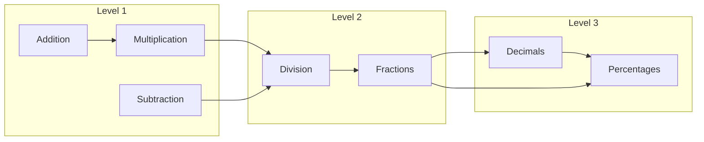
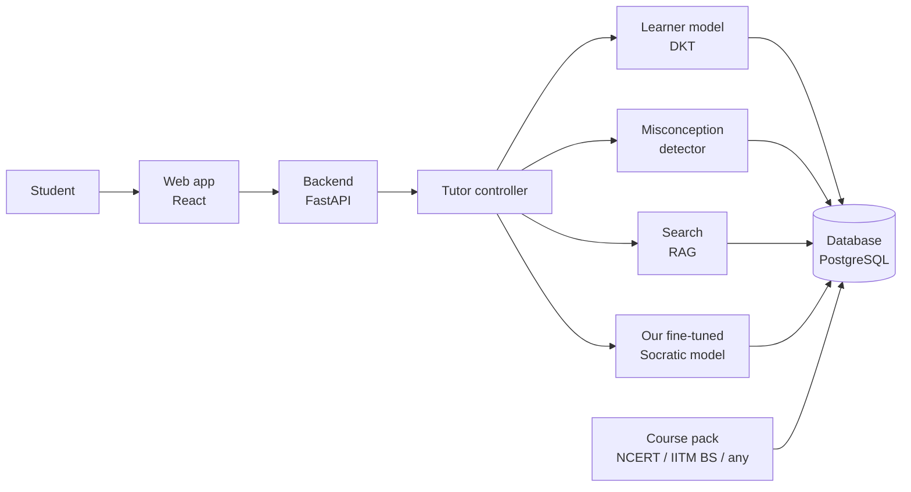
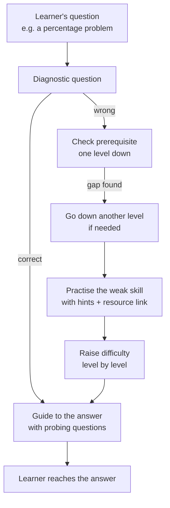

# Milestone 1 Report: Socratic AI Tutor

**Course:** Data Science and AI Lab, IIT Madras BS
**Team:** Group 2
**Submission:** Milestone 1, 22 October 2026

| Name | Roll number |
|---|---|
| Sandeep Nalla | 21f1006125 |
| Hariom Kumar | 23f2004225 |
| Hariom Pandey | 21f3002112 |
| Mrityunjay Chakraborty | 21f3001385 |

> This is a planning report. Nothing has been built or trained yet. Numbers marked "target" are our goals. Other numbers come from published work (see References).

---

## 1. Objective

**Project statement:** *Development of an intelligent small-scale tutor that guides a learner to the answer through a set of probing questions.*

When a learner has a doubt, the tutor should **help them reach the answer themselves** instead of giving it directly. To do this, the tutor:

1. **Breaks the question down** into the smaller ideas it depends on (its *prerequisites*).
2. **Asks probing questions** about each idea, one at a time.
3. **Checks the learner's answer**, spots likely misconceptions and gives feedback.
4. **Points to the right resource** (video, slide, notes or textbook page) when the learner makes a mistake.
5. **Goes back to earlier levels when needed:** if a learner is stuck, the tutor finds the gap in an earlier level, practises it with questions, and then climbs back up to the learner's current level.
6. **Tests and adapts:** a short test finds the learner's level, and practice questions are generated at the learner's own pace.

### Learning builds across levels

Knowledge builds level by level, so the tutor must trace a problem back through earlier levels.



**Example:** a learner is stuck on **percentages** (Level 3). The tutor checks **fractions** and **division** (Level 2), then **multiplication** (Level 1). It practises the weak skill with a few questions, then raises the difficulty step by step until the learner can solve the percentage question, explaining each step.

*Levels map to NCERT classes. We will confirm the exact class for each topic from the NCERT textbooks.*

### Scope: one pipeline, any course

The TA confirmed that NCERT content is allowed, provided the **pipeline is domain-agnostic and reusable**. All subject knowledge is kept in a **course pack**, never in the code:

| Course pack part | What it contains |
|---|---|
| Concepts | Topics with IDs and levels, e.g. `division` (Level 2) |
| Prerequisite links | "A is needed before B", including links across levels |
| Study material | Textbook PDFs, notes, slides, lecture transcripts |
| Questions | Practice questions with answers, hints and difficulty |

We will build two course packs:

- **Main pilot: NCERT Mathematics across several classes** (Levels 1 → 3 as above).
- **Second domain: IITM BS courses that build on each other**, e.g. Maths & Stats → MLF → MLT, with the brief's example *"How does training happen in Linear Regression?"*. We will gather the lecture transcripts and slides ourselves.

---

## 2. Existing solutions

| Solution | What it does well | What it lacks for our objective |
|---|---|---|
| **ChatGPT / Gemini (study or guided-learning modes), Khanmigo** | Good conversation; tries to guide instead of answering | Driven by a system prompt; does not track what the student knows across levels; can still give away answers |
| **MATHia, ALEKS** (intelligent tutoring systems) | Track student skill; ALEKS uses prerequisites | Paid and closed; no free conversation; fixed curriculum |
| **ASSISTments** | Free practice with hints; public research data | Teacher-written hints only; no conversation |
| **Course platforms (IITM BS portal, DIKSHA, YouTube lectures)** | Host videos, notes and assignments | Do not diagnose why a student is stuck |

---

## 3. Baselines and benchmarks from research

### 3.1 Tracking what a student knows ("knowledge tracing")

**DKT (Deep Knowledge Tracing)** [1] is a small neural network (an LSTM) that reads a student's answer history, for example "fractions: wrong, fractions: right, division: wrong", and predicts the chance of a correct answer on each concept next. The standard metric is **AUC**, where 0.5 is random guessing and 1.0 is perfect.

| Model | AUC on ASSISTments 2009 |
|---|---|
| BKT (classic method, 1994) | 0.69 [2] |
| DKT (LSTM, 2015) | 0.754 [3] |
| AKT (attention model, 2020) | 0.785 [3] |


*The original DKT paper reported 0.86, but later work found that duplicate rows had inflated this figure [4]. The pyKT benchmark [3] gives fair, cleaned numbers.*

### 3.2 AI chat tutors

| Study | Finding |
|---|---|
| **MathDial** (2023) [5] | 2,861 tutoring conversations. Prompted AI teachers often **reveal the answer too early**. Models **fine-tuned** on MathDial guide better. |
| **Bastani et al.** (PNAS 2025) [6] | Students using plain GPT-4 did 48% better in practice but **17% worse on the exam** afterwards. A version with guardrails avoided this drop. |
| **Tack & Piech** (2022) [7] | AI chatbots scored lower than human teachers on helpfulness. |

**Main finding:** a chatbot driven only by a system prompt is not a good tutor. It needs **its own trained models** that decide *what to ask next* and *how much to reveal*.

---

## 4. Gaps and how we address them

| Gap in existing solutions | How our project addresses it |
|---|---|
| Chatbots give the answer directly | **Our fine-tuned Socratic model** asks probing questions, and the controller limits how much is revealed |
| Chatbots don't remember what the student knows | **Learner model (DKT)** tracks every concept |
| No backtracking across levels | A **prerequisite graph across levels** plus a controller that goes back, practises, and climbs back up |
| Mistakes don't lead to study material | **Search (RAG)** links each mistake to the exact page, slide or video |
| Same questions for every learner | **Diagnostic test + generated practice questions** at the learner's pace |
| Tied to one subject | **Course packs** make the pipeline domain-agnostic |

---

## 5. Our approach

### 5.1 Our own models are the "main brain"

Following the TA's guidance, the core of the tutor is **models we build and train ourselves**, not an LLM API controlled by a system prompt.

| Component | Built by us? | Role |
|---|---|---|
| **Learner model (DKT)** | ✓ trained by us | Estimates what the learner knows for each concept |
| **Tutor controller** | ✓ written by us | Decides the next step: probe, hint, backtrack to an earlier level, retest, move up |
| **Socratic question model** | ✓ fine-tuned by us (Qwen3-4B + LoRA on MathDial and our own examples) | Writes probing questions and feedback |
| **Misconception detector** | ✓ built by us | Spots common error patterns (e.g. dividing the wrong way round) |
| Search (RAG) | Uses a pretrained embedding model | Finds the relevant study material |
| External LLM API (optional) | ✗ | Only helps draft practice questions offline (each checked before use), and serves as a **baseline** for comparison |

### 5.2 Architecture



### 5.3 Tutor loop with backtracking



### 5.4 How the pipeline stays domain-agnostic

- Subject knowledge lives only in the **course pack** (data files and documents).
- The **learner model** is first trained on public datasets. For a new course with no student data, the tutor uses a simple fallback (recent accuracy per concept) and retrains DKT later.
- The **Socratic model** learns a general *style* (probe, don't tell), so it can be reused across subjects. The course pack supplies the facts through search.
- Adding a new course = writing its course pack + running the ingestion script.

### 5.5 Difference from a normal chatbot tutor

| | LLM API + system prompt | Our tutor |
|---|---|---|
| Main brain | External LLM | Our own DKT + controller + fine-tuned model |
| Gives the answer | Often | No: guides with questions |
| Remembers student skills | No | Yes, per concept |
| Backtracks across levels | Not reliably | Yes, using the prerequisite graph |
| Links to study material | Generic or invented | Exact page, slide or video from the course pack |

---

## 6. Datasets

| Dataset | Use | Size | License (to verify before use) |
|---|---|---|---|
| **ASSISTments 2009–2010** [8] | Train and test DKT | ~346k answers, 4,217 students, 123 skills [3] | Research use, per provider terms |
| **EdNet KT1** [9] (optional) | Larger learning-pattern data for DKT | ~95M answers, ~784k students | CC BY-NC 4.0 |
| **FoundationalASSIST** (candidate) | Learning patterns | To review | To verify |
| **MathDial** [5] | Fine-tune the Socratic model | 2,861 dialogues | CC BY-SA 4.0 |
| **NCERT textbooks** | Course pack (main pilot) | Several classes of Mathematics | Public; no redistribution of raw files |
| **IITM BS transcripts and slides** | Course pack (second domain) | Gathered by the team | For course use only |

---

## 7. Baseline metrics and our targets

| Part | Metric | Baseline (what we compare with) | Our target |
|---|---|---|---|
| Learner model | AUC | Simple per-concept accuracy; published DKT: 0.754 | AUC ≥ 0.74 and better than the simple baseline |
| Socratic model | % of replies that reveal the answer | Base model (before fine-tuning); LLM API + system prompt | ≤ 5%, lower than both baselines |
| Socratic model | Quality score from a rubric (1–5): relevant, one question at a time, correct | Same baselines | Higher than the base model |
| Backtracking | % of test learners whose gap level is correctly found | LLM API + system prompt | ≥ 85% |
| Search (RAG) | Correct resource in top 5 (Recall@5) | Keyword search (BM25) | ≥ 0.80 |
| Full tutor | % of test scenarios handled correctly | Fixed rules; LLM API + system prompt | ≥ 90% |

---

## 8. Evaluation plan

1. **Annotated test set:** we will write and label 60–100 test scenarios (e.g. careless mistake, gap one level down, gap two levels down, no gap, success only after a hint). The TA's test samples will also be used.
2. **Compare three tutors on the same scenarios:**
   - a standard chatbot that answers directly,
   - **an LLM API with a Socratic system prompt** (the typical industry approach),
   - **our tutor**.
3. **Learner model:** DKT vs the simple baseline on students not seen in training; compare with published research numbers [3].
4. **Socratic model:** base model vs our fine-tuned model vs LLM API, scored on answer leakage and the rubric, on held-out MathDial dialogues and our scenarios.
5. **Domain-agnostic check:** the same tests on the NCERT and IITM BS packs, with no code changes.
6. **Fairness:** test scenarios are fixed before the final comparison and never used for tuning.

---

## 9. Data samples

### 9.1 ASSISTments 2009–2010 (for training DKT)

Each row is one answer by one student:

| user_id | skill_name | correct | hint_count | attempt_count |
|---|---|---|---|---|
| 64525 | Equivalent Fractions | 0 | 2 | 3 |
| 64525 | Equivalent Fractions | 1 | 0 | 1 |
| 64525 | Box and Whisker | 1 | 0 | 1 |

*Values show the format; real rows will be shown in Milestone 2. `correct` is 1 only if the first attempt was right without hints.*

### 9.2 MathDial (for fine-tuning the Socratic model): real record

From the public dataset (`eth-nlped/mathdial`, record 5000012):

> **Problem:** An aquarium (4 × 6 × 3 ft) is filled halfway, half is spilled, then the water is tripled. How much water is in it? *(Answer: 54)*
> **Student's wrong answer:** 72 (added an extra step at the end)
>
> **Teacher** *(probing)*: If you had 4 of something and tripled that amount, how much would you have?
> **Student:** 12.
> **Teacher** *(probing)*: So if Nancy triples the 18 cubic feet of water, how much would she have?
> **Student:** 54 cubic feet.
> **Teacher** *(generic)*: Exactly correct!

The teacher never says the answer. Each turn is labelled (*probing*, *focus*, *telling*, *generic*), so we can train our model to probe instead of tell.

### 9.3 Course pack examples (illustrative)

**NCERT Mathematics, across levels (main pilot):**
```text
Level 1: addition → multiplication
Level 2: division → fractions
Level 3: decimals, percentages
```

**IITM BS, across courses (second domain):**
```text
Maths 2: vectors, dot product, derivatives
   → MLF: loss functions, gradient descent
      → MLT: training linear regression
```

A study-material entry (the same format for every course):
```json
{
  "course": "ncert-maths",
  "concept": "fractions",
  "level": 2,
  "source": "NCERT Mathematics, chapter on fractions",
  "page": "to fill from textbook",
  "text": "A fraction shows a part of a whole. 1/5 of 50 means 50 shared into 5 equal parts ..."
}
```

---

## 10. Expected outputs

### 10.1 Tutoring session with backtracking (NCERT example, mock-up)

```text
Learner:  What is 20% of 50?   My answer: 2.5

Tutor:    Let's check together. What does "20%" mean: 20 out of how many?
Learner:  100                                                       ✓
Tutor:    So 20% is the fraction 20/100. Can you write it in simplest form?
Learner:  I don't know.
          [gap found at Level 2: fractions → checking division]
Tutor:    Let's revisit division first. What is 100 ÷ 20?
Learner:  5                                                         ✓
Tutor:    Great! So 20/100 = 1/5. What is 1/5 of 50?
          Hint: share 50 into 5 equal groups.   📖 NCERT: Fractions
Learner:  10                                                        ✓
Tutor:    One more at this level: what is 1/4 of 20?
Learner:  5                                                         ✓
          [back to Level 3]
Tutor:    Now try your question again: what is 20% of 50?
Learner:  10                                                        ✓
Tutor:    Excellent! Earlier you divided 50 by 20; a percentage means
          "out of 100". Ready for a harder one: 15% of 60?
```

### 10.2 Progress report (shown to the learner)

| Level | Concept | Correct (without help) | Readiness estimate |
|---|---|---|---|
| 1 | Multiplication | 3 / 3 | 0.90 |
| 2 | Division | 2 / 2 | 0.84 |
| 2 | Fractions | 1 / 2 | 0.66 |
| 3 | Percentages | 1 / 2 | 0.58, more practice suggested |

### 10.3 Current vs expected (LLM API + system prompt vs our tutor)

| | Response to "What is 20% of 50? My answer is 2.5" |
|---|---|
| **LLM API with a Socratic prompt (typical today)** | "Not quite! 20% means 20/100, so 20/100 × 50 = **10**." The answer is often revealed; the tutor doesn't check *why* the learner divided 50 by 20 or whether fractions are weak. |
| **Our tutor (expected)** | Asks what "20%" means, detects the fraction/division gap, practises at Level 2 with a link to the NCERT page, then returns to the percentage question. The learner finds 10 themselves. |

---

## 11. Next steps (Milestone 2)

- Clean ASSISTments (and optionally EdNet); train the simple baseline and DKT.
- Prepare MathDial for fine-tuning; run a first small LoRA fine-tune of the Socratic model.
- Build the multi-level NCERT course pack and start gathering IITM BS transcripts.
- Build a first version of the controller, search and web app.
- Write the first 30 annotated test scenarios.

**Decisions recorded from the TA:**
- External datasets allowed (licenses must be checked).
- NCERT allowed; the pipeline must be domain-agnostic.
- The main brain must be our own model; an LLM API may only play a minor role. We will therefore fine-tune our own Socratic model.
- IITM transcripts allowed; we gather them ourselves.
- Scope must cover several connected levels or subjects, with backtracking across them.
- Evaluation must include a comparison with an LLM-API + system-prompt tutor; the TA will provide test samples.

---

## 12. References

1. Piech et al. (2015). *Deep Knowledge Tracing.* NeurIPS.
2. Corbett & Anderson (1994). *Knowledge Tracing.* User Modeling and User-Adapted Interaction. (AUC as reported in [1].)
3. Liu et al. (2022). *pyKT: A Python Library to Benchmark Deep Learning based Knowledge Tracing Models.* NeurIPS Datasets & Benchmarks.
4. Xiong et al. (2016). *Going Deeper with Deep Knowledge Tracing.* EDM.
5. Macina et al. (2023). *MathDial: A Dialogue Tutoring Dataset.* Findings of EMNLP. https://github.com/eth-nlped/mathdial
6. Bastani et al. (2025). *Generative AI without guardrails can harm learning.* PNAS.
7. Tack & Piech (2022). *The AI Teacher Test.* EDM.
8. ASSISTments 2009–2010 Skill Builder data. https://sites.google.com/site/assistmentsdata
9. Choi et al. (2020). *EdNet: A Large-Scale Hierarchical Dataset in Education.* AIED. https://github.com/riiid/ednet
10. Hu et al. (2022). *LoRA: Low-Rank Adaptation of Large Language Models.* ICLR.
11. Qwen3-4B-Instruct-2507 model card. https://huggingface.co/Qwen/Qwen3-4B-Instruct-2507

---

## 13. Team sign-off

By signing, each member confirms they have read this report, understand it and agree to submit it.

| Name | Roll number | Signature | Date |
|---|---|---|---|
| Sandeep Nalla | 21f1006125 | | |
| Hariom Kumar | 23f2004225 | | |
| Hariom Pandey | 21f3002112 | | |
| Mrityunjay Chakraborty | 21f3001385 | | |

*Drafted with help from an AI assistant and reviewed by the team.*
