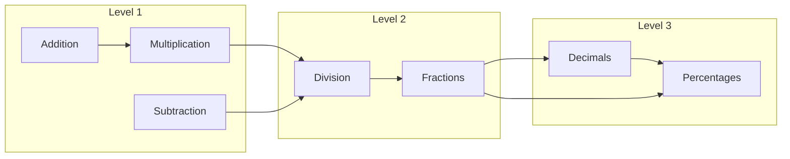
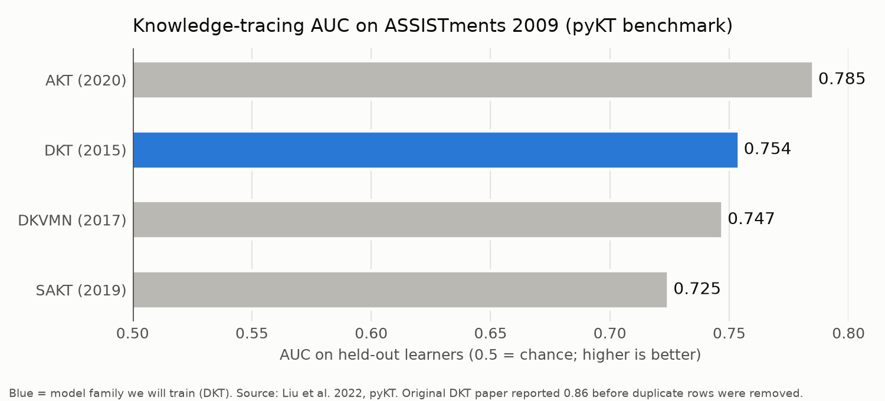
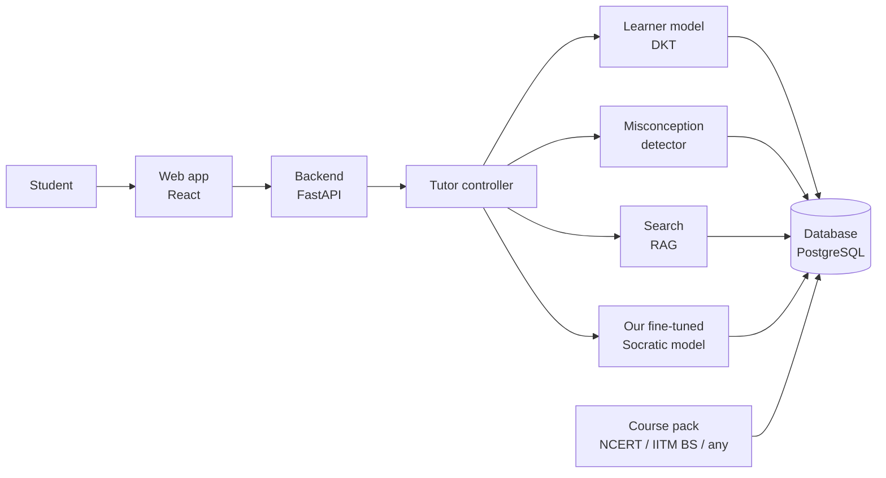
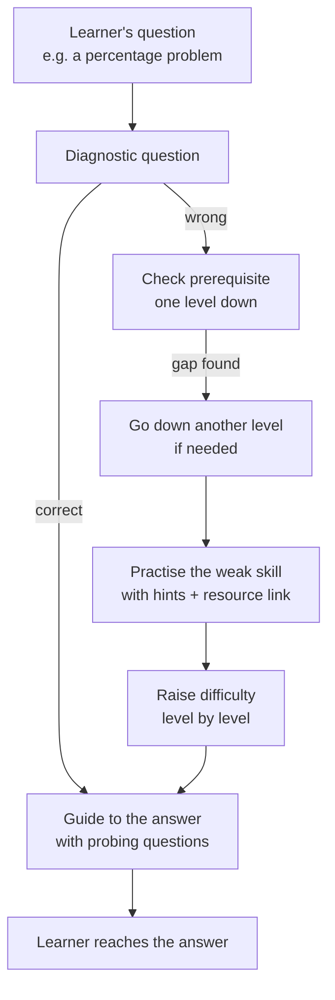

# Milestone 1 Report: Socratic AI Tutor

**Course:** Data Science and AI Lab, IIT Madras BS
**Team:** Group 2
**Submission:** Milestone 1, 22 October 2026

| Name | Roll number | Primary role |
|---|---|---|
| Sandeep Nalla | 21f1006125 | Backend developer |
| Hariom Kumar | 23f2004225 | Build the RAG (search) agent |
| Hariom Pandey | 21f3002112 | Build the fine-tuned models |
| Mrityunjay Chakraborty | 21f3001385 | Frontend developer |

*Roles are not fixed; members contribute to other parts as the project needs.*

> This is a planning report. Nothing has been built or trained yet. Numbers marked "target" are our goals. Other numbers come from published work (see References).

---

## 1. Objective

**Project statement:** *Development of an intelligent small-scale tutor that guides a learner to the answer through a set of probing questions.*

**Why "Socratic"?** The name comes from the Greek philosopher Socrates, who taught by asking questions that led students to discover answers themselves instead of telling them. That is exactly how our tutor works.

When a learner has a doubt, the tutor should **help them reach the answer themselves** instead of giving it directly. To do this, the tutor:

1. **Breaks the question down** into the smaller ideas it depends on (its *prerequisites*).
2. **Asks probing questions** about each idea, one at a time.
3. **Checks the learner's answer**, spots likely misconceptions and gives feedback.
4. **Points to the right resource** (textbook page, video or notes) when the learner makes a mistake.
5. **Goes back to earlier levels when needed:** if a learner is stuck, the tutor finds the gap in an earlier level, practises it with questions, and then climbs back up to the learner's current level.
6. **Tests and adapts:** a short test finds the learner's level, and practice questions are generated at the learner's own pace.

### Learning builds across levels

Knowledge builds level by level, so the tutor must trace a problem back through earlier levels.



**Example:** a learner is stuck on **percentages** (Level 3). The tutor checks **fractions** and **division** (Level 2), then **multiplication** (Level 1). It practises the weak skill with a few questions, then raises the difficulty step by step until the learner can solve the percentage question, explaining each step.

*Levels map to NCERT classes. We will confirm the exact class for each topic from the NCERT textbooks.*

### Scope: one pipeline, any course

Our **primary goal is NCERT content**, chosen because of **data availability**: NCERT textbooks are public and cover every class and subject, so we can build complete multi-level course packs now. The tutor is **not limited to one subject**: it works for any subject that has study material and questions (e.g. Mathematics, Science, Social Science).

The **pipeline is domain-agnostic and reusable**: all subject knowledge is kept in a **course pack**, never in the code.

| Course pack part | What it contains |
|---|---|
| Concepts | Topics with IDs and levels, e.g. `division` (Level 2) |
| Prerequisite links | "A is needed before B", including links across levels |
| Study material | Textbook PDFs, notes, slides, lecture transcripts |
| Questions | Practice questions with answers, hints and difficulty |

We will build two course packs:

- **Primary: NCERT content across several classes and subjects** (e.g. Levels 1 → 3 as above).
- **Secondary: IITM BS course material**, e.g. Maths & Stats → MLF → MLT, with the brief's example *"How does training happen in Linear Regression?"*. We will gather the lecture transcripts and slides ourselves. This shows the same pipeline works for a different subject and level, with no code changes.

### Visual aids and what is out of scope

The tutor is conversational, but not text-only:

- **Links to existing material:** when the learner makes a mistake, the tutor points to the exact textbook page, or the video and timestamp (e.g. an IITM lecture at 12:40), found by searching the course material.
- **Simple diagrams in the conversation:** fraction bars, percentage grids, number lines and graphs, drawn from templates by small scripts, plus properly rendered formulas.

**Out of scope: AI-generated videos or animations.** Generating them is expensive, slow and error-prone for maths. It is also not the focus of this project, which is the tutoring "brain": finding the learner's gap and asking the right next question. We reuse existing high-quality videos instead.

---

## 2. Existing solutions

| Solution | What it does well | What it lacks for our objective |
|---|---|---|
| **Khanmigo** (Khan Academy) [12] | Helps students understand concepts by questioning them, and builds understanding based on their answers | Runs on an external LLM (GPT-4) guided by prompts, not its own trained tutoring model; no explicit backtracking across levels; tied to Khan Academy content; not open |
| **MathGPT.ai** [14] | Socratic AI tutor that withholds final answers and guides with hints and follow-up questions; used in 50+ US colleges; instructors control when it can be used | College maths only; no learner model or backtracking to earlier levels; closed |
| **ChatGPT Study Mode / Gemini Guided Learning / Claude Learning mode** [23] | Good conversation; general assistants switched into a guiding, question-asking style | Driven by a system prompt; does not track what the student knows across levels; can still give away answers; not tied to NCERT or course material |
| **MATHia** (Carnegie Learning) [11] | Adapts to each student's needs; guides through every step of a problem with real-time feedback and targeted practice | Paid and closed; only its own fixed maths curriculum; hints follow fixed step-by-step paths, with no free conversation about the learner's own doubt; new courses can't be added |
| **Squirrel AI** [22] | Adaptive AI tutor: a diagnostic test finds gaps on a very fine-grained knowledge graph, then builds a personal learning path with videos and practice | Recommends content and practice rather than holding a probing conversation; closed; mostly company-reported results |
| **ALEKS** (McGraw Hill) [13]: adaptive learning system, not a chat assistant | Uses Knowledge Space Theory to find what a student knows and is ready to learn next, based on prerequisites | No conversation or probing questions; paid and closed; fixed curriculum |

### NCERT-focused AI tutors in India

| Solution | What it does well | What it lacks for our objective |
|---|---|---|
| **Alakh AI** (Physics Wallah) [19] | "AI Guru" answers doubts 24/7 by text, image or speech; "Sahayak" recommends videos and practice by chapter; "NCERT Pitara" generates questions from NCERT textbooks | Built mainly to answer doubts, not to guide with probing questions; no backtracking across levels; closed, with no published evaluation |
| **BYJU'S WIZ** [20] | BADRI predicts a student's strengths and weaknesses (knowledge tracing with forgetting curves); MathGPT solves maths problems; TeacherGPT guides students toward the answer instead of giving it | Closed; accuracy figures are self-reported; current availability is unclear; tied to BYJU'S content |
| **Embibe** [21] | A knowledge graph across grades that tracks gaps from earlier grades; Bayesian Knowledge Tracing mastery scores; large practice bank with hints and solutions | Practice- and recommendation-based, not a probing conversation about the learner's own doubt; closed |

*Features are as described by each company or in launch-time press coverage; most claims are self-reported and may have changed since.*

**Closest existing solutions: Khanmigo, MathGPT.ai, BYJU'S TeacherGPT, Squirrel AI and Embibe.** Khanmigo, MathGPT.ai and TeacherGPT guide by questioning; Squirrel AI and Embibe find gaps, including gaps from earlier grades; MATHia adapts and guides step by step. Our tutor combines these ideas **in one loop** and differs in four ways: it **converses** about the learner's own doubt with probing questions *and* **backtracks across levels** to fix earlier gaps, it is **domain-agnostic** (any course can be added as a course pack), it is **open and built from our own models**, and it is **evaluated openly** against published baselines.

---

## 3. Baselines and benchmarks from research

### 3.1 Tracking what a student knows ("knowledge tracing")

**DKT (Deep Knowledge Tracing)** [1] is a small neural network (an LSTM) that reads a student's answer history, for example "fractions: wrong, fractions: right, division: wrong", and predicts the chance of a correct answer on each concept next. The standard metric is **AUC**, where 0.5 is random guessing and 1.0 is perfect.

| Model | How it works | AUC on ASSISTments 2009 |
|---|---|---|
| **BKT**: Bayesian Knowledge Tracing (1994) [2] | Classic probability model; each skill is either "known" or "not known" | 0.69 [1] |
| **DKT**: Deep Knowledge Tracing (2015) [1] | One LSTM reads the whole answer history | 0.754 [3] |
| **DKVMN**: Dynamic Key-Value Memory Network (2017) [16] | Memory table with one slot per concept, updated after each answer | 0.747 [3] |
| **SAKT**: Self-Attentive Knowledge Tracing (2019) [17] | Self-attention (as in Transformers) picks the most relevant past answers | 0.725 [3] |
| **AKT**: Attentive Knowledge Tracing (2020) [15] | Attention with time-based decay and question-difficulty embeddings | 0.785 [3] |

*AUC = Area Under the ROC (Receiver Operating Characteristic) Curve. LSTM = Long Short-Term Memory, a type of recurrent neural network. The BKT value comes from the original DKT paper [1]; the others come from the pyKT benchmark [3], which uses one standard, cleaned setup, so the BKT value is only a rough comparison.*



*The original DKT paper reported 0.86, but later work found that duplicate rows had inflated this figure [4]. The pyKT benchmark [3] gives fair, cleaned numbers.*

### Why we chose Deep Knowledge Tracing (DKT)

DKT is the **simplest model that performs well**. Compared with each alternative:

| Model | Why not chosen as our main model |
|---|---|
| **BKT** (Bayesian Knowledge Tracing) | Clearly less accurate (0.69 vs 0.754). It treats each skill separately, so it cannot learn links between concepts, which matters for backtracking across levels. |
| **DKVMN** (Dynamic Key-Value Memory Network) | Slightly less accurate than DKT (0.747 vs 0.754) and more complex to build and tune. The extra memory network brings no gain. |
| **SAKT** (Self-Attentive Knowledge Tracing) | Less accurate (0.725 vs 0.754). Self-attention needs many students and long histories to work well; the pyKT authors found that sequential models like DKT beat SAKT in most cases [3]. New courses will start with little data. |
| **AKT** (Attentive Knowledge Tracing) | The most accurate, but only about 0.03 AUC better (0.785 vs 0.754). It needs many students per question to learn question difficulty, and it is much more complex (attention layers, time-based decay, many settings to tune). |

Further reasons for DKT:

1. **Simple to build, train and explain:** a single LSTM over the answer sequence that trains quickly on a free GPU.
2. **Copes better with little data,** which suits new courses with no student history yet.
3. **The standard reference point:** most research compares against DKT, so our results are easy to check against published numbers.
4. **The learner model is not our main contribution.** Our focus is the whole tutor: the fine-tuned Socratic model, backtracking across levels and links to study material.

**If time allows, we will also train AKT on the same data split** (the pyKT library includes all of these models) and report both results.

### 3.2 AI chat tutors

| Study | Finding |
|---|---|
| **Bastani et al.** (PNAS 2025) [5] | Students using plain GPT-4 did 48% better in practice but **17% worse on the exam** afterwards. A version with guardrails avoided this drop. |
| **Tack & Piech** (2022) [6] | AI chatbots scored lower than human teachers on helpfulness. |

**Main finding:** a chatbot driven only by a system prompt is not a good tutor. It needs **its own trained models** that decide *what to ask next* and *how much to reveal*.

---

## 4. Gaps and how we address them

| Gap in existing solutions | How our project addresses it |
|---|---|
| Chatbots give the answer directly | **Our fine-tuned Socratic model** asks probing questions, and the controller limits how much is revealed |
| Chatbots don't remember what the student knows | **Learner model (DKT)** tracks every concept |
| No backtracking across levels | A **prerequisite graph across levels** plus a controller that goes back, practises, and climbs back up |
| Mistakes don't lead to study material | **Search (RAG)** links each mistake to the exact page, video or notes |
| Same questions for every learner | **Diagnostic test + generated practice questions** at the learner's pace |
| Tied to one subject | **Course packs** make the pipeline domain-agnostic |

---

## 5. Our approach

### 5.1 Our own models are the "main brain"

The core of the tutor is **models we build and train ourselves**, not an LLM API controlled by a system prompt.

| Component | Built by us? | Role |
|---|---|---|
| **Learner model (DKT)** | ✓ trained by us | Estimates what the learner knows for each concept |
| **Tutor controller** | ✓ written by us | Decides the next step: probe, hint, backtrack to an earlier level, retest, move up |
| **Socratic question model** | ✓ fine-tuned by us (Qwen3-4B + LoRA on tutoring dialogues and our own NCERT and IITM BS examples) | Writes probing questions and feedback |
| **Misconception detector** | ✓ built by us | Spots common error patterns (e.g. dividing 50 by 20 instead of finding 20/100 of 50) |
| Search (RAG) | Uses a pretrained embedding model | Finds the relevant textbook page, video or notes |
| External LLM API (optional) | ✗ | Only helps draft practice questions offline (each checked before use), and serves as a **baseline** for comparison |

### 5.2 Architecture



### 5.3 Tutor loop with backtracking



### 5.4 How the pipeline stays domain-agnostic

- Subject knowledge lives only in the **course pack** (data files and documents).
- The **learner model** is first trained on public datasets. For a course with no student data yet, the tutor uses a simple fallback (recent accuracy per concept). If anonymised student data (from NCERT or IITM learners) becomes available, DKT can be retrained on it.
- The **Socratic model** learns a general *style* (probe, don't tell), so it can be reused across subjects. The course pack supplies the facts through search.
- Adding a new course = writing its course pack + running the ingestion script.

### 5.5 Difference from a normal chatbot tutor

| | LLM API + system prompt | Our tutor |
|---|---|---|
| Main brain | External LLM | Our own DKT + controller + fine-tuned model |
| Gives the answer | Often | No: guides with questions |
| Remembers student skills | No | Yes, per concept |
| Backtracks across levels | Not reliably | Yes, using the prerequisite graph |
| Links to study material | Generic or invented | Exact page, video or notes from the course pack |

---

## 6. Datasets

| Dataset | Use | Size | License (to verify before use) |
|---|---|---|---|
| **NCERT textbooks** | Course pack (primary) | Several classes and subjects | Public; no redistribution of raw files |
| **ASSISTments 2009–2010** [7] | Train and test DKT | ~346k answers, 4,217 students, 123 skills [3] | Research use, per provider terms |
| **EdNet KT1** [8] (optional) | Larger learning-pattern data for DKT | ~95M answers, ~784k students | CC BY-NC 4.0 |
| **FoundationalASSIST** (candidate) | Learning patterns | To review | To verify |
| **MathDial** [18] (public tutoring dialogues) + our NCERT and IITM BS examples | Fine-tune the Socratic model | 2,861 dialogues + examples written by us | CC BY-SA 4.0 (MathDial) |
| **IITM BS transcripts, slides and assignments** | Course pack (secondary) | Gathered by the team | For course use only |

### Why ASSISTments for training Deep Knowledge Tracing (DKT)

DKT must first learn how students' knowledge develops, from many **real student answer histories** (which question, which skill, right or wrong, in what order). We use ASSISTments 2009–2010 because:

1. **It has the data DKT needs.** It contains about 346,000 real answers from 4,217 students, each tagged with a skill and ordered in time. Neither NCERT nor IITM publishes student answer data of this kind.
2. **It is the standard benchmark for DKT.** The original DKT paper and the pyKT benchmark both use it, so we can check our model against published scores (DKT: 0.754 AUC) and know our training is correct.
3. **It is mathematics.** Its skills (fractions, equations, graphs, etc.) closely match NCERT school mathematics, our primary course pack.
4. **It is free for research** and widely used, with known data issues (such as duplicate rows) already documented, so we can clean it properly.

**Limitation:** ASSISTments is from US school students, not Indian learners. It teaches DKT *how learning generally progresses*, not exact NCERT or IITM concepts. Where a concept is not covered, the tutor uses a simple fallback (recent accuracy per concept) and retrains DKT if anonymised student data becomes available.

---

## 7. Baseline metrics and our targets

| Part | Metric | Baseline (what we compare with) | Our target |
|---|---|---|---|
| Learner model | AUC | Simple per-concept accuracy; published DKT: 0.754 | AUC ≥ 0.74 and better than the simple baseline |
| Socratic model | % of replies that reveal the answer | Base model (before fine-tuning); LLM API + system prompt | ≤ 5%, lower than both baselines |
| Socratic model | Quality score from a rubric (1–5): relevant, one question at a time, correct | Same baselines | Higher than the base model |
| Backtracking | % of test learners whose gap level/concept is correctly found | LLM API + system prompt | ≥ 85% |
| Search (RAG) | Correct resource in top 5 (Recall@5) | Keyword search (BM25) | ≥ 0.80 |
| Full tutor | % of test scenarios handled correctly | Fixed rules; LLM API + system prompt | ≥ 90% |

---

## 8. Evaluation plan

1. **Annotated test set:** we will write and label 60–100 test scenarios, mainly from NCERT content (e.g. careless mistake, gap one level down, gap two levels down, no gap, success only after a hint). Any test samples provided for the course will also be used.
2. **Compare three tutors on the same scenarios:**
   - a standard chatbot that answers directly,
   - **an LLM API with a Socratic system prompt** (the typical industry approach),
   - **our tutor**.
3. **Learner model:** DKT vs the simple baseline on students not seen in training; compare with published research numbers [3].
4. **Socratic model:** base model vs our fine-tuned model vs LLM API, scored on answer leakage and the rubric, on held-out tutoring dialogues and our scenarios.
5. **Domain-agnostic check:** the same tests on the NCERT and IITM BS packs, with no code changes.
6. **Fairness:** test scenarios are fixed before the final comparison and never used for tuning.

---

## 9. Data samples

### 9.1 ASSISTments 2009–2010 (for training DKT)

Each row is one answer by one student:

| user_id | skill_name | correct | hint_count | attempt_count |
|---|---|---|---|---|
| 64525 | Equivalent Fractions | 0 | 2 | 3 |
| 64525 | Equivalent Fractions | 1 | 0 | 1 |
| 64525 | Box and Whisker | 1 | 0 | 1 |

*Values show the format. `correct` is 1 only if the first attempt was right without hints.*

### 9.2 NCERT training example (for fine-tuning the Socratic model)

Each training example pairs a tutoring situation with a good tutor reply:

| | Content |
|---|---|
| **Concept** | Percentages (Level 3), prerequisite: fractions (Level 2) |
| **Question** | What is 20% of 50? |
| **Learner's reply** | "2.5" |
| **Controller action** | PROBE the meaning of percent; do not reveal the answer |
| **Resource** | NCERT Mathematics, chapter on percentages (page to fill from textbook) |
| **Target tutor reply** *(probing)* | "Let's check together. What does 20% mean: 20 out of how many?" |

Each tutor reply is labelled (*probing*, *focus*, *telling*), so the model learns to probe instead of tell. *Illustrative example written by the team.*

### 9.3 Course pack examples (illustrative)

**NCERT, across levels (primary; example from Mathematics):**
```text
Level 1: addition → multiplication
Level 2: division → fractions
Level 3: decimals, percentages
```

**IITM BS, across courses (secondary):**
```text
Maths 1: functions, slope of a line        Stats 1: mean, variance
   → Maths 2: vectors, dot product, derivatives, chain rule
      → MLF: loss functions, gradient descent
         → MLT: training linear regression
```

A study-material entry (the same format for every course):
```json
{
  "course": "ncert-maths",
  "concept": "fractions",
  "level": 2,
  "source": "NCERT Mathematics, chapter on fractions",
  "page": "to fill from textbook",
  "text": "A fraction shows a part of a whole. 1/5 of 50 means 50 shared into 5 equal parts ..."
}
```

---

## 10. Expected outputs

### 10.1 Tutoring session with backtracking (NCERT example, mock-up)

```text
Learner:  What is 20% of 50?   My answer: 2.5

Tutor:    Let's check together. What does "20%" mean: 20 out of how many?
Learner:  100                                                       ✓
Tutor:    So 20% is the fraction 20/100. Can you write it in simplest form?
Learner:  I don't know.
          [gap found at Level 2: fractions → checking division]
Tutor:    Let's revisit division first. What is 100 ÷ 20?
Learner:  5                                                         ✓
Tutor:    Great! So 20/100 = 1/5. What is 1/5 of 50?
          Hint: share 50 into 5 equal groups.   📖 NCERT: Fractions
Learner:  10                                                        ✓
Tutor:    One more at this level: what is 1/4 of 20?
Learner:  5                                                         ✓
          [back to Level 3]
Tutor:    Now try your question again: what is 20% of 50?
Learner:  10                                                        ✓
Tutor:    Excellent! Earlier you divided 50 by 20; a percentage means
          "out of 100". Ready for a harder one: 15% of 60?
```

### 10.2 Progress report (shown to the learner)

| Level | Concept | Correct (without help) | Readiness estimate |
|---|---|---|---|
| 1 | Multiplication | 3 / 3 | 0.90 |
| 2 | Division | 2 / 2 | 0.84 |
| 2 | Fractions | 1 / 2 | 0.66 |
| 3 | Percentages | 1 / 2 | 0.58, more practice suggested |

### 10.3 Current vs expected (LLM API + system prompt vs our tutor)

| | Response to "What is 20% of 50? My answer is 2.5" |
|---|---|
| **LLM API with a Socratic prompt (typical today)** | "Not quite! 20% means 20/100, so 20/100 × 50 = **10**." The answer is often revealed; the tutor doesn't check *why* the learner divided 50 by 20 or whether fractions are weak. |
| **Our tutor (expected)** | Asks what "20%" means, detects the fraction/division gap, practises at Level 2 with a link to the NCERT page, then returns to the percentage question. The learner finds 10 themselves. |

### 10.4 Same pipeline, secondary domain (IITM BS, short example)

A learner asks *"How does training happen in Linear Regression?"* (MLT). The tutor guides them through the prediction `y = w·x` and the squared error. When they can't find the gradient, it goes back to derivatives (Maths 2) and slope (Maths 1) with lecture links, then climbs back to the gradient-descent update. Only the course pack changes; the code is the same.

---

## 11. References

1. Piech et al. (2015). *Deep Knowledge Tracing.* NeurIPS.
2. Corbett & Anderson (1994). *Knowledge Tracing.* User Modeling and User-Adapted Interaction. (AUC as reported in [1].)
3. Liu et al. (2022). *pyKT: A Python Library to Benchmark Deep Learning based Knowledge Tracing Models.* NeurIPS Datasets & Benchmarks. https://arxiv.org/abs/2206.11460. AUC values: Table 2 and Table 8 (question level, ASSISTments 2009); dataset statistics: Table 1.
4. Xiong et al. (2016). *Going Deeper with Deep Knowledge Tracing.* EDM.
5. Bastani et al. (2025). *Generative AI without guardrails can harm learning.* PNAS.
6. Tack & Piech (2022). *The AI Teacher Test.* EDM.
7. ASSISTments 2009–2010 Skill Builder data. https://sites.google.com/site/assistmentsdata
8. Choi et al. (2020). *EdNet: A Large-Scale Hierarchical Dataset in Education.* AIED. https://github.com/riiid/ednet
9. Hu et al. (2022). *LoRA: Low-Rank Adaptation of Large Language Models.* ICLR.
10. Qwen3-4B-Instruct-2507 model card. https://huggingface.co/Qwen/Qwen3-4B-Instruct-2507
11. Carnegie Learning. *MATHia* overview video. https://youtu.be/sjfw_7jXoBk
12. Khan Academy. *Khanmigo* overview video. https://youtu.be/I1JVQg52DDI
13. McGraw Hill. *ALEKS* overview video. https://youtu.be/mxOWeJ_lhEc
14. Dataconomy (2025). *MathGPT.ai expands to 50+ colleges with "cheat-proof" AI tutor.* https://dataconomy.com/2025/08/29/mathgpt-ai-expands-to-50-colleges-with-cheat-proof-ai-tutor/
15. Ghosh, Heffernan & Lan (2020). *Context-Aware Attentive Knowledge Tracing.* KDD.
16. Zhang, Shi, King & Yeung (2017). *Dynamic Key-Value Memory Networks for Knowledge Tracing.* WWW.
17. Pandey & Karypis (2019). *A Self-Attentive Model for Knowledge Tracing.* EDM.
18. Macina et al. (2023). *MathDial: A Dialogue Tutoring Dataset with Rich Pedagogical Properties Grounded in Math Reasoning Problems.* Findings of EMNLP. https://github.com/eth-nlped/mathdial
19. YourStory (2024). *PhysicsWallah unveils AI-powered suite 'Alakh AI' to personalise education.* https://yourstory.com/2024/03/physicswallah-ai-education-alakh-pandey-edtech-artificial-intelligence
20. BYJU'S (2023). *BYJU'S launches BYJU'S WIZ, a suite of AI models for hyper-personalized learning.* https://byjus.com/press/byjus-launches-byjus-wiz-a-suite-of-cutting-edge-ai-models-for-hyper-personalized-learning/
21. Embibe. *AI in Education.* https://www.embibe.com/in-en/artificial-intelligence-ai-in-education/
22. MIT Technology Review (2019). *China has started a grand experiment in AI education* (Squirrel AI). https://www.technologyreview.com/2019/08/02/131198/china-squirrel-has-started-a-grand-experiment-in-ai-education-it-could-reshape-how-the/
23. Engadget (2025). *Claude's new Learning mode will prompt students to answer questions on their own.* https://www.engadget.com/ai/claudes-new-learning-mode-will-prompt-students-to-answer-questions-on-their-own-172057828.html

---

## 12. Team sign-off

By signing, each member confirms they have read this report, understand it and agree to submit it.

| Name | Roll number | Signature | Date |
|---|---|---|---|
| Sandeep Nalla | 21f1006125 |  | 2026-10-22 |
| Hariom Kumar | 23f2004225 |  | 2026-10-22 |
| Hariom Pandey | 21f3002112 |  | 2026-10-22 |
| Mrityunjay Chakraborty | 21f3001385 |  | 2026-10-22 |

*Drafted with help from an AI assistant and reviewed by the team.*
