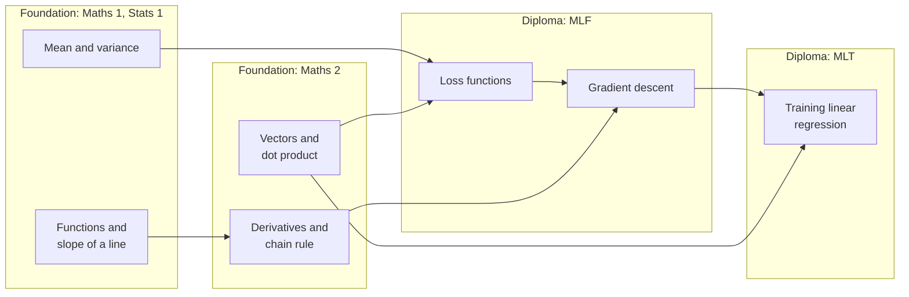
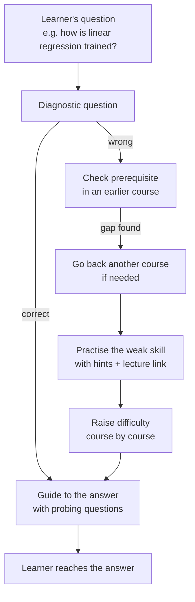

# Milestone 1 Report: Socratic AI Tutor

**Course:** Data Science and AI Lab, IIT Madras BS
**Team:** Group 2
**Submission:** Milestone 1, 22 October 2026

| Name | Roll number |
|---|---|
| Sandeep Nalla | 21f1006125 |
| Hariom Kumar | 23f2004225 |
| Hariom Pandey | 21f3002112 |
| Mrityunjay Chakraborty | 21f3001385 |

> This is a planning report. Nothing has been built or trained yet. Numbers marked "target" are our goals. Other numbers come from published work (see References).

---

## 1. Objective

**Project statement:** *Development of an intelligent small-scale tutor that guides a learner to the answer through a set of probing questions.*

**Why "Socratic"?** The name comes from the Greek philosopher Socrates, who taught by asking questions that led students to discover answers themselves instead of telling them. That is exactly how our tutor works.

Our primary goal is a **study companion for IIT Madras BS learners**, built on the same material they use on the IITM BS portal: lecture videos, slides and weekly assignments.

When a learner has a doubt, the tutor should **help them reach the answer themselves** instead of giving it directly. To do this, the tutor:

1. **Breaks the question down** into the smaller ideas it depends on (its *prerequisites*).
2. **Asks probing questions** about each idea, one at a time.
3. **Checks the learner's answer**, spots likely misconceptions and gives feedback.
4. **Points to the right resource** (lecture video with timestamp, slide or assignment) when the learner makes a mistake.
5. **Goes back to earlier courses when needed:** if a learner is stuck, the tutor finds the gap in an earlier course, practises it with questions, and then climbs back up to the learner's current course.
6. **Tests and adapts:** a short test finds the learner's level, and practice questions are generated at the learner's own pace.

### Learning builds across courses

IITM BS courses build on each other. For example, MLT uses ideas from Maths, Stats and MLF. The tutor traces a doubt back through these earlier courses.



**Example (from the project brief):** a learner asks *"How does training happen in Linear Regression?"* (MLT). The tutor guides them through supervised learning, the model `y = w·x`, the loss and gradient descent. If the learner can't work out the gradient, the tutor goes back to **derivatives** (Maths 2), and if needed to **slope of a line** (Maths 1). It practises the weak skill with a few questions, then climbs back up to MLT.

*The concept-to-course mapping is illustrative; we will confirm it from the IITM BS course content.*

### Scope: one pipeline, any course

IITM BS is our primary goal, but the **pipeline is domain-agnostic and reusable**. All subject knowledge is kept in a **course pack**, never in the code:

| Course pack part | What it contains |
|---|---|
| Concepts | Topics with IDs and levels, e.g. `derivatives` (Maths 2) |
| Prerequisite links | "A is needed before B", including links across courses |
| Study material | Lecture transcripts, slides, notes, textbook PDFs |
| Questions | Practice questions with answers, hints and difficulty |

We will build two course packs:

- **Primary: IITM BS courses that build on each other** (Maths & Stats → MLF → MLT). We will gather the lecture transcripts, slides and assignments ourselves.
- **Second domain: NCERT Mathematics across several classes** (e.g. multiplication → division → fractions → percentages). This shows the same pipeline works for a completely different subject and level, with no code changes.

### Visual aids and what is out of scope

The tutor is conversational, but not text-only:

- **Links to existing videos:** when the learner makes a mistake, the tutor points to the exact lecture video and timestamp (e.g. "MLT Week 2, Lecture 3 at 12:40"), found by searching lecture transcripts.
- **Simple diagrams in the conversation:** graphs (e.g. a loss curve with gradient-descent steps), vector diagrams, number lines and fraction bars, drawn from templates by small scripts, plus properly rendered formulas.

**Out of scope: AI-generated videos or animations.** Generating them is expensive, slow and error-prone for maths. It is also not the focus of this project, which is the tutoring "brain": finding the learner's gap and asking the right next question. We reuse the existing IITM lecture videos instead.

---

## 2. Existing solutions

| Solution | What it does well | What it lacks for our objective |
|---|---|---|
| **Khanmigo** (Khan Academy) [13] | Helps students understand concepts by questioning them, and builds understanding based on their answers | Runs on an external LLM (GPT-4) guided by prompts, not its own trained tutoring model; no explicit backtracking across levels; tied to Khan Academy content; not open |
| **ChatGPT / Gemini (study or guided-learning modes)** | Good conversation; tries to guide instead of answering | Driven by a system prompt; does not track what the student knows across courses; can still give away answers; does not know IITM course material |
| **MATHia** (Carnegie Learning) [12] | Adapts to each student's needs; guides through every step of a problem with real-time feedback and targeted practice | Paid and closed; only its own fixed maths curriculum; hints follow fixed step-by-step paths, with no free conversation about the learner's own doubt; new courses can't be added |
| **ALEKS** (McGraw Hill) [14]: adaptive learning system, not a chat assistant | Uses Knowledge Space Theory to find what a student knows and is ready to learn next, based on prerequisites | No conversation or probing questions; paid and closed; fixed curriculum |
| **ASSISTments** (WPI) [15] | Free platform for teachers to assign practice and give students personalized feedback; public research data | Feedback and hints are written by teachers in advance; no conversation; no automatic backtracking to prerequisites |
| **IITM BS portal and other course platforms (DIKSHA, YouTube lectures)** | Host lecture videos, slides, notes and assignments | Do not diagnose why a student is stuck or guide them step by step |

**Closest existing solutions: MATHia and Khanmigo.** MATHia adapts to each student and guides them step by step with feedback. Khanmigo builds understanding by questioning the student. Our tutor combines both ideas and differs in four ways: it **converses** about the learner's own doubt with probing questions, it **backtracks across courses** to fix earlier gaps, it is **domain-agnostic** (any course can be added as a course pack), and it is **open and built from our own models**.

---

## 3. Baselines and benchmarks from research

### 3.1 Tracking what a student knows ("knowledge tracing")

**DKT (Deep Knowledge Tracing)** [1] is a small neural network (an LSTM) that reads a student's answer history, for example "derivatives: wrong, derivatives: right, gradient descent: wrong", and predicts the chance of a correct answer on each concept next. The standard metric is **AUC**, where 0.5 is random guessing and 1.0 is perfect.

| Model | AUC on ASSISTments 2009 |
|---|---|
| BKT: Bayesian Knowledge Tracing (classic method, 1994) | 0.69 [2] |
| DKT: Deep Knowledge Tracing (LSTM, 2015) | 0.754 [3] |
| AKT: Attentive Knowledge Tracing (attention model, 2020) [16] | 0.785 [3] |

*AUC = Area Under the ROC (Receiver Operating Characteristic) Curve. LSTM = Long Short-Term Memory, a type of recurrent neural network.*


*The original DKT paper reported 0.86, but later work found that duplicate rows had inflated this figure [4]. The pyKT benchmark [3] gives fair, cleaned numbers.*

### Why Deep Knowledge Tracing (DKT) and not Attentive Knowledge Tracing (AKT)?

AKT scores higher than DKT on the benchmark, but we choose DKT as our main learner model for these reasons:

1. **The gap is small.** On the same cleaned dataset, AKT is only about 0.03 AUC better (0.785 vs 0.754). Both predict well enough for the tutor controller to tell which concept is weak.
2. **AKT needs data we don't have.** AKT works best with many students and a large history per question, so it can learn each question's difficulty. IITM courses start with little or no student data and new questions, and a simpler model like DKT copes better with this.
3. **DKT is simpler to build, train and explain.** DKT is a single LSTM over the answer sequence and trains quickly on a free GPU. AKT adds attention layers, time-based decay and question-difficulty embeddings, with many more settings to tune.
4. **DKT is the standard reference point.** Most research compares against DKT, so our results are easy to check against published numbers.
5. **The learner model is not our main contribution.** Our focus is the whole tutor: the fine-tuned Socratic model, backtracking across courses and links to study material.

**If time allows, we will also train AKT on the same data split** (the pyKT library includes both models) and report both results.

### 3.2 AI chat tutors

| Study | Finding |
|---|---|
| **MathDial** (2023) [5] | 2,861 tutoring conversations. Prompted AI teachers often **reveal the answer too early**. Models **fine-tuned** on MathDial guide better. |
| **Bastani et al.** (PNAS 2025) [6] | Students using plain GPT-4 did 48% better in practice but **17% worse on the exam** afterwards. A version with guardrails avoided this drop. |
| **Tack & Piech** (2022) [7] | AI chatbots scored lower than human teachers on helpfulness. |

**Main finding:** a chatbot driven only by a system prompt is not a good tutor. It needs **its own trained models** that decide *what to ask next* and *how much to reveal*.

---

## 4. Gaps and how we address them

| Gap in existing solutions | How our project addresses it |
|---|---|
| Chatbots give the answer directly | **Our fine-tuned Socratic model** asks probing questions, and the controller limits how much is revealed |
| Chatbots don't remember what the student knows | **Learner model (DKT)** tracks every concept |
| No backtracking across courses | A **prerequisite graph across courses** plus a controller that goes back, practises, and climbs back up |
| Mistakes don't lead to study material | **Search (RAG)** links each mistake to the exact lecture video, slide or assignment |
| Same questions for every learner | **Diagnostic test + generated practice questions** at the learner's pace |
| Tied to one subject | **Course packs** make the pipeline domain-agnostic |

---

## 5. Our approach

### 5.1 Our own models are the "main brain"

The core of the tutor is **models we build and train ourselves**, not an LLM API controlled by a system prompt.

| Component | Built by us? | Role |
|---|---|---|
| **Learner model (DKT)** | ✓ trained by us | Estimates what the learner knows for each concept |
| **Tutor controller** | ✓ written by us | Decides the next step: probe, hint, backtrack to an earlier course, retest, move up |
| **Socratic question model** | ✓ fine-tuned by us (Qwen3-4B + LoRA on MathDial and our own examples) | Writes probing questions and feedback |
| **Misconception detector** | ✓ built by us | Spots common error patterns (e.g. a sign error in the gradient) |
| Search (RAG) | Uses a pretrained embedding model | Finds the relevant lecture, slide or assignment |
| External LLM API (optional) | ✗ | Only helps draft practice questions offline (each checked before use), and serves as a **baseline** for comparison |

### 5.2 Architecture


### 5.3 Tutor loop with backtracking



### 5.4 How the pipeline stays domain-agnostic

- Subject knowledge lives only in the **course pack** (data files and documents).
- The **learner model** is first trained on public datasets. For a course with no student data yet, the tutor uses a simple fallback (recent accuracy per concept). If anonymised IITM assignment data becomes available, DKT can be retrained on it.
- The **Socratic model** learns a general *style* (probe, don't tell), so it can be reused across subjects. The course pack supplies the facts through search.
- Adding a new course = writing its course pack + running the ingestion script.

### 5.5 Difference from a normal chatbot tutor

| | LLM API + system prompt | Our tutor |
|---|---|---|
| Main brain | External LLM | Our own DKT + controller + fine-tuned model |
| Gives the answer | Often | No: guides with questions |
| Remembers student skills | No | Yes, per concept |
| Backtracks across courses | Not reliably | Yes, using the prerequisite graph |
| Links to study material | Generic or invented | Exact IITM lecture, slide or assignment from the course pack |

---

## 6. Datasets

| Dataset | Use | Size | License (to verify before use) |
|---|---|---|---|
| **IITM BS transcripts, slides and assignments** | Course pack (primary) | Gathered by the team | For course use only |
| **ASSISTments 2009–2010** [8] | Train and test DKT | ~346k answers, 4,217 students, 123 skills [3] | Research use, per provider terms |
| **EdNet KT1** [9] (optional) | Larger learning-pattern data for DKT | ~95M answers, ~784k students | CC BY-NC 4.0 |
| **FoundationalASSIST** (candidate) | Learning patterns | To review | To verify |
| **MathDial** [5] | Fine-tune the Socratic model | 2,861 dialogues | CC BY-SA 4.0 |
| **NCERT textbooks** | Course pack (second domain) | Several classes of Mathematics | Public; no redistribution of raw files |

---

## 7. Baseline metrics and our targets

| Part | Metric | Baseline (what we compare with) | Our target |
|---|---|---|---|
| Learner model | AUC | Simple per-concept accuracy; published DKT: 0.754 | AUC ≥ 0.74 and better than the simple baseline |
| Socratic model | % of replies that reveal the answer | Base model (before fine-tuning); LLM API + system prompt | ≤ 5%, lower than both baselines |
| Socratic model | Quality score from a rubric (1–5): relevant, one question at a time, correct | Same baselines | Higher than the base model |
| Backtracking | % of test learners whose gap course/concept is correctly found | LLM API + system prompt | ≥ 85% |
| Search (RAG) | Correct resource in top 5 (Recall@5) | Keyword search (BM25) | ≥ 0.80 |
| Full tutor | % of test scenarios handled correctly | Fixed rules; LLM API + system prompt | ≥ 90% |

---

## 8. Evaluation plan

1. **Annotated test set:** we will write and label 60–100 test scenarios, mainly from IITM BS courses (e.g. careless mistake, gap one course back, gap two courses back, no gap, success only after a hint). Any test samples provided for the course will also be used.
2. **Compare three tutors on the same scenarios:**
   - a standard chatbot that answers directly,
   - **an LLM API with a Socratic system prompt** (the typical industry approach),
   - **our tutor**.
3. **Learner model:** DKT vs the simple baseline on students not seen in training; compare with published research numbers [3].
4. **Socratic model:** base model vs our fine-tuned model vs LLM API, scored on answer leakage and the rubric, on held-out MathDial dialogues and our scenarios.
5. **Domain-agnostic check:** the same tests on the IITM BS and NCERT packs, with no code changes.
6. **Fairness:** test scenarios are fixed before the final comparison and never used for tuning.

---

## 9. Data samples

### 9.1 ASSISTments 2009–2010 (for training DKT)

Each row is one answer by one student:

| user_id | skill_name | correct | hint_count | attempt_count |
|---|---|---|---|---|
| 64525 | Equivalent Fractions | 0 | 2 | 3 |
| 64525 | Equivalent Fractions | 1 | 0 | 1 |
| 64525 | Box and Whisker | 1 | 0 | 1 |

*Values show the format. `correct` is 1 only if the first attempt was right without hints.*

### 9.2 MathDial (for fine-tuning the Socratic model): real record

From the public dataset (`eth-nlped/mathdial`, record 5000012):

> **Problem:** An aquarium (4 × 6 × 3 ft) is filled halfway, half is spilled, then the water is tripled. How much water is in it? *(Answer: 54)*
> **Student's wrong answer:** 72 (added an extra step at the end)
>
> **Teacher** *(probing)*: If you had 4 of something and tripled that amount, how much would you have?
> **Student:** 12.
> **Teacher** *(probing)*: So if Nancy triples the 18 cubic feet of water, how much would she have?
> **Student:** 54 cubic feet.
> **Teacher** *(generic)*: Exactly correct!

The teacher never says the answer. Each turn is labelled (*probing*, *focus*, *telling*, *generic*), so we can train our model to probe instead of tell.

### 9.3 Course pack examples (illustrative)

**IITM BS, across courses (primary):**
```text
Maths 1: functions, slope of a line        Stats 1: mean, variance
   → Maths 2: vectors, dot product, derivatives, chain rule
      → MLF: loss functions, gradient descent
         → MLT: training linear regression
```

**NCERT Mathematics, across classes (second domain):**
```text
multiplication → division → fractions → decimals, percentages
```

A study-material entry (the same format for every course):
```json
{
  "course": "iitm-maths2",
  "concept": "derivatives",
  "type": "video",
  "source": "Maths 2, Week 5, Lecture 2",
  "location": "08:15–11:30",
  "text": "The derivative of a function at a point is the slope of the tangent at that point ..."
}
```

---

## 10. Expected outputs

### 10.1 Tutoring session with backtracking (IITM example from the brief, mock-up)

```text
Learner:  How does training happen in Linear Regression?

Tutor:    Let's work it out together. In supervised learning, what do we
          give the model during training?
Learner:  Inputs and their correct outputs.                          ✓
Tutor:    Our model predicts y = w·x. If w = [2, 1] and x = [3, 4],
          what does it predict?
Learner:  10                                                         ✓
Tutor:    The true y is 12. What is the squared error?
Learner:  4                                                          ✓
Tutor:    To reduce the error, we need to know how it changes as w changes.
          For L(w) = (6 − 2w)², what is dL/dw?
Learner:  I don't know.
          [gap found in Maths 2: derivatives → checking Maths 1: slope]
Tutor:    Let's step back. For the line y = 3x + 1, how much does y change
          when x increases by 1?
Learner:  3                                                          ✓
Tutor:    Right, that's the slope. A derivative is the slope at a point.
          What is the derivative of w²?   📺 Maths 2, Week 5, Lecture 2 (08:15)
Learner:  2w                                                         ✓
          [back to Maths 2]
Tutor:    Now use the chain rule on (6 − 2w)². Hint: the inside changes at −2.
Learner:  2(6 − 2w)(−2) = −4(6 − 2w)                                 ✓
          [back to MLF / MLT]
Tutor:    At w = 1 the gradient is −16. It's negative, so should w go up or
          down to reduce the loss?
Learner:  Up.                                                        ✓
Tutor:    Exactly: w ← w − (learning rate) × gradient. That's gradient
          descent, and repeating it is how linear regression is trained!
          📺 MLT Week 2, Lecture 3 (12:40)
```

### 10.2 Progress report (shown to the learner)

| Course | Concept | Correct (without help) | Readiness estimate |
|---|---|---|---|
| Maths 1 | Slope of a line | 2 / 2 | 0.90 |
| Maths 2 | Derivatives and chain rule | 1 / 2 | 0.64 |
| MLF | Gradient descent | 1 / 1 | 0.70 |
| MLT | Training linear regression | 1 / 2 | 0.60, more practice suggested |

### 10.3 Current vs expected (LLM API + system prompt vs our tutor)

| | Response to "How does training happen in Linear Regression?" |
|---|---|
| **LLM API with a Socratic prompt (typical today)** | Usually gives the full explanation at once: "We minimise the mean squared error with gradient descent, updating w ← w − η∇L…". The learner reads the answer but is never checked, and a gap in derivatives stays hidden. |
| **Our tutor (expected)** | Guides step by step, finds the derivative gap, revisits Maths 1 and Maths 2 with lecture links, then returns to MLT. The learner works out the update rule themselves. |

### 10.4 Same pipeline, second domain (NCERT, short example)

A learner answers "20% of 50" with 2.5. The tutor asks what "20%" means, finds a gap in fractions, practises a few fraction and division questions with a link to the NCERT page, then returns to the percentage question. The learner finds 10. Only the course pack changes; the code is the same.

---

## 11. References

1. Piech et al. (2015). *Deep Knowledge Tracing.* NeurIPS.
2. Corbett & Anderson (1994). *Knowledge Tracing.* User Modeling and User-Adapted Interaction. (AUC as reported in [1].)
3. Liu et al. (2022). *pyKT: A Python Library to Benchmark Deep Learning based Knowledge Tracing Models.* NeurIPS Datasets & Benchmarks.
4. Xiong et al. (2016). *Going Deeper with Deep Knowledge Tracing.* EDM.
5. Macina et al. (2023). *MathDial: A Dialogue Tutoring Dataset.* Findings of EMNLP. https://github.com/eth-nlped/mathdial
6. Bastani et al. (2025). *Generative AI without guardrails can harm learning.* PNAS.
7. Tack & Piech (2022). *The AI Teacher Test.* EDM.
8. ASSISTments 2009–2010 Skill Builder data. https://sites.google.com/site/assistmentsdata
9. Choi et al. (2020). *EdNet: A Large-Scale Hierarchical Dataset in Education.* AIED. https://github.com/riiid/ednet
10. Hu et al. (2022). *LoRA: Low-Rank Adaptation of Large Language Models.* ICLR.
11. Qwen3-4B-Instruct-2507 model card. https://huggingface.co/Qwen/Qwen3-4B-Instruct-2507
12. Carnegie Learning. *MATHia* overview video. https://youtu.be/sjfw_7jXoBk
13. Khan Academy. *Khanmigo* overview video. https://youtu.be/I1JVQg52DDI
14. McGraw Hill. *ALEKS* overview video. https://youtu.be/mxOWeJ_lhEc
15. ASSISTments. Overview video. https://youtu.be/8t62Aj-VGig
16. Ghosh, Heffernan & Lan (2020). *Context-Aware Attentive Knowledge Tracing.* KDD.

---

## 12. Team sign-off

By signing, each member confirms they have read this report, understand it and agree to submit it.

| Name | Roll number | Signature | Date |
|---|---|---|---|
| Sandeep Nalla | 21f1006125 | | |
| Hariom Kumar | 23f2004225 | | |
| Hariom Pandey | 21f3002112 | | |
| Mrityunjay Chakraborty | 21f3001385 | | |

*Drafted with help from an AI assistant and reviewed by the team.*
