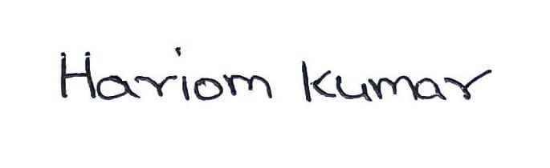

# Work Contribution Log: Milestone 1

**Project:** Socratic AI Tutor: guiding a learner to the answer through probing questions
**Team:** Group 2, Data Science and AI Lab, IIT Madras BS

## Team

| Name | Roll number | Primary role |
|---|---|---|
| Sandeep Nalla | 21f1006125 | Backend developer |
| Hariom Kumar | 23f2004225 | Build the RAG (search) agent |
| Hariom Pandey | 21f3002112 | Build the fine-tuned models |
| Mrityunjay Chakraborty | 21f3001385 | Frontend developer |

These are primary roles only. They are not fixed: as the project needs, members will switch roles and contribute to other parts as well.

## Contributions

Each member fills in their own rows.

| Name | Work done |
|---|---|
| Sandeep Nalla | Prepared the Milestone 1 report, presentation and contribution log; reviewed existing tutoring solutions (Khanmigo, MATHia, ALEKS, ASSISTments) and compared knowledge-tracing models (DKT, AKT, DKVMN, SAKT) |
| Hariom Kumar | Prepared the technical architecture and delivery plan (PDF) and shared it with the team for review; researched approaches for building and fine-tuning the Socratic tutoring model |
| Hariom Pandey | Explored candidate datasets for fine-tuning the Socratic tutoring model |
| Mrityunjay Chakraborty | Coordinated team activities and managed the JIRA board for task tracking |

## Sign-off

By signing, each member confirms that this log is accurate and that they have reviewed the report and presentation.

| Name | Roll number | Signature | Date |
|---|---|---|---|
| Sandeep Nalla | 21f1006125 |  | 2026-10-22 |
| Hariom Kumar | 23f2004225 |  | 2026-10-22 |
| Hariom Pandey | 21f3002112 | | 2026-10-22 |
| Mrityunjay Chakraborty | 21f3001385 |  | 2026-10-22 |
