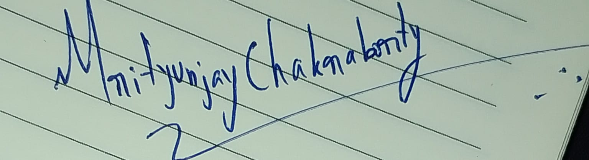

# Milestone 2 Report: Dataset Preparation

**Course:** Data Science and AI Lab, IIT Madras BS
**Team:** Group 2
**Submission:** Milestone 2, 29 October 2026

| Name | Roll number | Primary role |
|---|---|---|
| Sandeep Nalla | 21f1006125 | Backend developer |
| Hariom Kumar | 23f2004225 | Build the RAG (search) agent |
| Hariom Pandey | 21f3002112 | Build the fine-tuned models |
| Mrityunjay Chakraborty | 21f3001385 | Frontend developer |

*Roles are not fixed; members contribute to other parts as the project needs.*

**Goal of this milestone:** collect suitable datasets and prepare them for training and validation.

All code is in `data/scripts/`. Raw files and large outputs are not committed; `data/README.md` shows how to rebuild them.

## 1. Datasets

| Dataset | Used for | Source | License |
|---|---|---|---|
| ASSISTments 2009-2010 (corrected) | Train and test the learner model (DKT) | assistmentsdata site [1, 3] | Research use |
| MathDial (2,861 dialogues) | Fine-tune the Socratic model | github.com/eth-nlped/mathdial | CC BY-SA 4.0 on GitHub, CC BY 4.0 on Hugging Face; we follow the stricter one |
| NCERT Maths and Science, classes 6-10 | Course pack (study material for search) | ncert.nic.in | Public; text kept local, not redistributed |

EdNet was not used: ASSISTments is enough for the DKT baseline.

## 2. Preparation steps and results

### ASSISTments (learner model)
1. Sort each student's answers in time order; remove duplicates.
2. Remove 63,755 answers with no skill label, and students with fewer than 3 answers (same recipe as pyKT).
3. Number the skills 0..148 and cut each history into windows of at most 200 answers.
4. Split **by student** so no student is in two sets.

| | Students | Windows | Answers | Correct rate |
|---|---|---|---|---|
| Train | 3,081 | 3,571 | 228,924 | 65.9% |
| Validation | 385 | 449 | 28,037 | 66.4% |
| Test | 386 | 434 | 25,644 | 64.8% |

Raw: 346,860 answers, 4,217 students. Clean: 282,619 answers, 3,852 students, 149 skills. (Milestone 1 quoted 123 skills from pyKT; the raw file has 149 skill ids, and we did not merge any.)

### MathDial (Socratic model)
1. Split each dialogue into turns and read MathDial's label for each tutor reply (probing, focus, generic, telling).
2. Make one training example per tutor reply: problem, hidden reference solution, the student's wrong solution and the conversation so far, then the next tutor reply as the target.
3. Mark `keep = false` for "telling" replies and replies containing the final answer. They are saved but not used as targets.
4. Keep MathDial's own test set. Validation is cut from train **by problem**, because the same problem appears in several dialogues.

| | Dialogues | Examples | Kept | Leak the answer |
|---|---|---|---|---|
| Train | 2,045 | 13,380 | 10,797 | 838 |
| Validation | 217 | 1,475 | 1,182 | 81 |
| Test | 599 | 3,686 | 2,972 | 275 |

Note: 283 of the 394 test problems also appear in train (MathDial's own split). We keep it so results match the paper, but a score on unseen problems should be reported separately.

### NCERT (study text)
Maths and Science, classes 6-10: 10 books, 116 chapters, 2,401 pages. Text is extracted page by page, cleaned, and split into chunks of up to 250 words, each tagged with subject, class, chapter and page: **3,164 chunks**. Four pages failed extraction (drawings) and were skipped. Chapter titles are verified for the 20 chapters we use; the rest are marked `needs_review`.

## 3. Course packs (concepts, prerequisites, practice questions)

Hand-written in `data/course_packs/specs.py` and built into the backend's course-pack format by `build_course_packs.py`. Each concept points to the NCERT chapter that teaches it, and the builder attaches the best-matching text from that chapter.

| Pack | Concepts | Prerequisite links | Practice questions |
|---|---|---|---|
| NCERT Maths (classes 6-8) | 10 | 13 | 52 |
| NCERT Science: motion and force (classes 6-9) | 6 | 6 | 18 |

- **Levels:** 1 whole-number operations, factors; 2 fractions, integers; 3 decimals, ratio, percentages, letter expressions; 4 linear equations. The main example follows this chain: percentages -> fractions -> multiplication and division.
- **Questions:** written by the team in the style of the NCERT exercises, each with a hint and difficulty. Answers are computed in code, not typed, so they cannot be mistyped.
- **Checks:** every prerequisite exists, none is at a higher level, no cycles, every concept has questions and study text.

## 4. Test scenarios (our own, 159 in total)

Written by the team, kept separate from training data and never used for tuning (`data/test_scenarios/`).

| Set | Items | What it tests |
|---|---|---|
| Backtracking | 82 | Learner is correct (16), careless mistake (16), correct after a hint (16), gap one level down (19), gap two levels down (15). Label: the first tutor action and the weak prerequisite to go back to. |
| Misconceptions | 32 | A wrong answer and the error behind it (24 kinds, e.g. dividing 50 by 20 for "20% of 50", adding tops and bottoms of fractions). |
| Guardrails | 45 | 15 on-topic, 15 off-topic (including other subjects and "ignore your instructions"), 15 answer requests. |

Backtracking labels come from the prerequisite graph, so they are consistent by construction; they test the tutor's logic, not real learners. Every item has an empty `reviewed_by` field for a second team member to check. TA-provided samples will be added when received.

## 5. Checks
`check_data.py` passes: no student shared between splits, no problem shared between MathDial train and validation, skill ids in range, labels 0/1, kept examples never tell or leak the answer, NCERT chunk ids unique, pack graphs valid, scenario labels consistent (23 checks).

## 6. Model-training data prepared by Hariom Pandey
Hariom Pandey prepared a second, model-ready version of two datasets (in `notes/hariom pandey/`, with his own two write-ups). It is kept alongside the pipeline above, not merged into it.

| Item | What was prepared |
|---|---|
| DKT data (`dkt_data.npz`) | ASSISTments 2009-2010 as fixed-length arrays: one number per answer (`skill + 82 x correct`), windows of 200 padded with a mask. 82 skills, 3,408 students, 256,060 answers; 80/20 train/test split by student, seed 42 (train 2,726 students / 205,418 answers, test 682 / 50,642). `test_dkt_data.py` prints the array shapes and statistics and checks the encoding; file hashes are in `SHA256.txt`. |
| Chat corpus (`socratic_tutor_combined.jsonl`) | 35,151 SocraTeach dialogues [2] and 2,262 MathDial training conversations (37,413 in all) as chat messages for fine-tuning Qwen2.5-1.5B-Instruct. MathDial's test set is held out. |

Differences from the main pipeline (to be settled before training):
- **Skills:** 82 here, 149 in Section 2. His file starts from a 303,260-row skill-builder file and removes duplicates; the main pipeline uses the 346,860-row corrected file and also drops answers with no skill label. The two should not be mixed.
- **Split:** train/test only, no validation set. The main pipeline has train/validation/test.
- **Licence:** SocraTeach is CC BY-NC 4.0 (non-commercial). Fine for coursework; not for redistribution of the data or a commercial product.
- **Not yet done on the chat corpus:** no deduplication across the two sources, no `keep` flag for answer-telling replies (Section 2 has it), and SocraTeach's step and persona fields are dropped. Both sources are maths only.

## 7. Limits and next steps
- ASSISTments is US data and has no session information, so session-scoped DKT (mentor feedback) cannot be tested on it; windows of 200 answers are used instead.
- The answer-leak check is a simple number match and can miss answers written in words. We accept this for now.
- NCERT text quality: the older Class 8-10 maths books lose some digits and symbols in extraction (e.g. "80/100" appears as "80100"), and the study passages attached to each concept are picked automatically, so some are exercise text. Each needs a manual pass before use in search.
- The packs cover one chain per subject (10 Maths and 6 Science concepts). More chapters can be added by extending `specs.py`; no code change is needed.
- Concepts and prerequisite links are our own judgement, so a second member should review them.
- Next: agree on one ASSISTments version (82 or 149 skills) and one chat corpus, train DKT, fine-tune the Socratic model, and have a second member check the scenarios.

## 8. References
1. ASSISTments data page (Goldstein, Baker and Heffernan, 2011): https://sites.google.com/site/assistmentsdata/datasets/2011-goldstein-baker-heffernan
2. SocraTeach_Multi dataset card, Hugging Face (CC BY-NC 4.0): https://huggingface.co/datasets/ulises-c/SocraTeach_Multi
3. ASSISTments data file (Google Drive): https://drive.google.com/file/d/0B2X0QD6q79ZJUFU1cjYtdGhVNjg/view?resourcekey=0-OyI8ZWxtGSAzhodUIcMf_g

## 9. Team sign-off

By signing, each member confirms they have read this report, understand it and agree to submit it.

| Name | Roll number | Signature | Date |
|---|---|---|---|
| Sandeep Nalla | 21f1006125 |  | 2026-10-29 |
| Hariom Kumar | 23f2004225 |  | 2026-10-29 |
| Hariom Pandey | 21f3002112 |  | 2026-10-29 |
| Mrityunjay Chakraborty | 21f3001385 |  | 2026-10-29 |

*Drafted with help from an AI assistant and reviewed by the team.*
