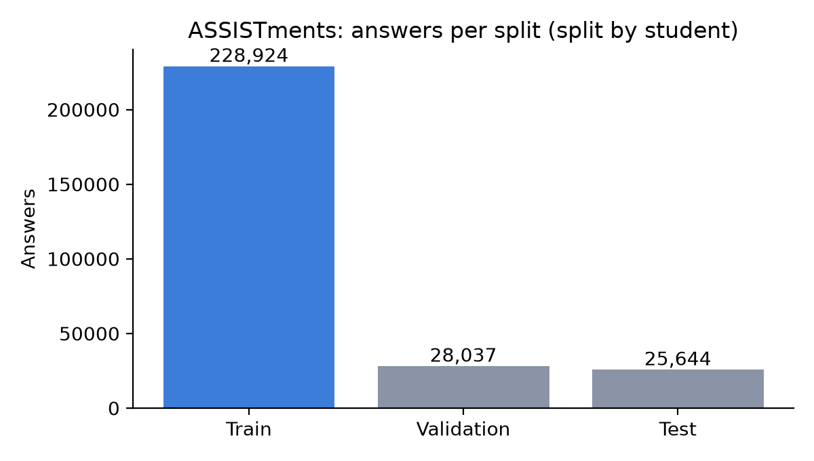
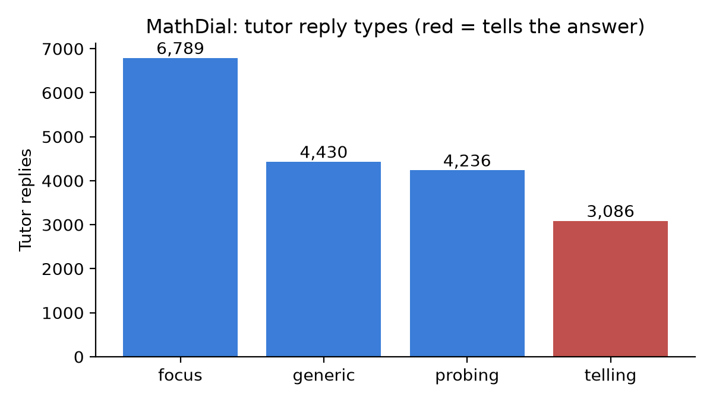

# Milestone 2 Report: Dataset Preparation

**Course:** Data Science and AI Lab, IIT Madras BS
**Team:** Group 2
**Submission:** Milestone 2, 29 October 2026

| Name | Roll number | Primary role |
|---|---|---|
| Sandeep Nalla | 21f1006125 | Backend developer |
| Hariom Kumar | 23f2004225 | Build the RAG (search) agent |
| Hariom Pandey | 21f3002112 | Build the fine-tuned models |
| Mrityunjay Chakraborty | 21f3001385 | Frontend developer |

*Roles are not fixed; members contribute to other parts as the project needs.*

**Goal of this milestone:** collect suitable datasets and prepare them in the format the Milestone 3 models will read.

**Hosted processed dataset (Google Drive):** https://drive.google.com/drive/folders/15vIRFghBsqfHjvHrIztgvVSUv2vP4tws?usp=sharing  (layout in Section 6; the same folder is staged locally at `notes/sandeep/milestone-2/hosted_dataset/`).
**EDA and preprocessing notebook:** `Milestone2_EDA.ipynb` (this folder, outputs saved).

The data was prepared in two versions so that Milestone 3 can compare them:
- **Version A** (Sandeep Nalla): scripts in `notes/sandeep/milestone-2/data/scripts/`, outputs in `notes/sandeep/milestone-2/data/processed/`. Raw files and large outputs are not committed; `data/README.md` there shows how to rebuild them.
- **Version B** (Hariom Pandey): Colab workflow, outputs and write-ups in `notes/hariom pandey/milestone-2/`. Ready-made arrays for DKT and a chat corpus for fine-tuning.

Sections 2 and 7 give both side by side. **Files from the two versions must not be mixed.**

## 1. Datasets

| Dataset | Used for | Prepared in | Source | Licence |
|---|---|---|---|---|
| ASSISTments 2009-2010 skill builder | Train and test the learner model (DKT) | A and B | assistmentsdata site [1, 3, 4] | Research use under the site's terms of use; cite the data page and Feng et al. (2009) [5] |
| MathDial (2,861 dialogues) | Fine-tune the Socratic model | A and B | github.com/eth-nlped/mathdial; `eth-nlped/mathdial-chat` on Hugging Face [6] | CC BY-SA 4.0 on GitHub, CC BY 4.0 on Hugging Face; we follow the stricter one |
| SocraTeach Multi (10,273 problems, 35,151 dialogues) | Fine-tune the Socratic model | B only | `ulises-c/SocraTeach_Multi` on Hugging Face [2, 7] | CC BY-NC 4.0 (non-commercial) |
| NCERT Maths and Science, classes 6-10 | Course pack (study material for search) | A only | ncert.nic.in | Public; text kept local, not redistributed |

EdNet was not used: ASSISTments is enough for the DKT baseline.

### What each dataset contains

| | Data points | Classes / categories | Other metadata |
|---|---|---|---|
| ASSISTments (A) | 282,619 answers, 3,852 students | Label: correct on first try (0/1), 65.8% correct. 149 skills (e.g. *Equation Solving Two or Fewer Steps*, *Conversion of Fraction Decimals Percents*, *Addition and Subtraction Integers*), 17,737 problems | Per answer: student, order, problem, skill. Skill counts are very uneven: the top skill has 19,738 train answers, 33 skills have under 100. |
| MathDial (A) | 18,541 tutor-reply examples from 2,861 dialogues | Tutor reply type: focus 6,789; generic 4,430; probing 4,236; telling 3,086 | Problem, hidden reference solution, student's wrong solution, outcome of the dialogue |
| SocraTeach + MathDial (B) | 37,413 conversations, 366,171 messages | Roles: assistant 200,048; user 163,861; system 2,262 | `source` tag per conversation |
| NCERT (A) | 3,164 chunks from 2,401 pages, 10 books, 116 chapters | Subject (maths, science) and class (6-10) | Chunk counts per book in Section 5 |

## 2. Preparation steps, reasons and results

### ASSISTments, version A (learner model)

| # | Step | Why |
|---|---|---|
| 1 | Sort each student's answers in time order (`order_id`); drop duplicate `order_id` | DKT reads a history in order. In this corrected file every `order_id` is already unique, so the dedup removed 0 rows (checked in the notebook); it only matters for files where one answer appears once per skill. |
| 2 | Remove 63,755 answers with no skill label | DKT tracks skills; an answer with no skill cannot update any. |
| 3 | Remove students with fewer than 3 answers | Too little history to learn from; same rule as pyKT, so scores are comparable with published ones. |
| 4 | Number the skills 0..148 (none merged) | The model needs a contiguous index; merging skills would be our own judgement and would lose information. |
| 5 | Cut each history into windows of at most 200 answers | Fixed-size input. Cutting at 200 would discard answers; windows keep all of them. |
| 6 | Split **by student** (80/10/10) | If a student were in two splits the model could memorise them and the test score would be too high. |

| | Students | Windows | Answers | Correct rate |
|---|---|---|---|---|
| Train | 3,081 | 3,571 | 228,924 | 65.9% |
| Validation | 385 | 449 | 28,037 | 66.4% |
| Test | 386 | 434 | 25,644 | 64.8% |

Raw: 346,860 answers, 4,217 students. Clean: 282,619 answers, 3,852 students, 149 skills. (Milestone 1 quoted 123 skills from pyKT; the raw file has 149 skill ids and we did not merge any.)



### ASSISTments, version B (Hariom Pandey)
Starts from a 303,260-row skill-builder file and keeps four columns: student, order, skill and correct (first try). Other columns (teacher, school, class) are dropped because they do not describe what the student knows and the live tutor will not have them.

| Step | What was done | Rows after |
|---|---|---|
| 1 | Load the 4 columns | 303,260 |
| 2 | Remove 1 row with missing values | 303,259 |
| 3 | Remove 46,668 duplicates (same student, order and skill) | 256,591 |
| 4 | Remove 325 students with fewer than 3 answers | 256,073 |

5. Number the skills 0..81 (82 skills). Encode each answer as one number `x = skill + 82 x correct` (0 to 163, so 164 possible inputs). *Why:* one token carries both skill and result, the usual input for an embedding-based DKT.
6. Sort by student and time. Questions with several skills stay as **separate steps** (the usual DKT choice; it means one answer can count as several steps). Long histories are cut into chunks of 200 (cutting at 200 would lose about 27% of the rows); chunks under 3 steps are dropped (8 chunks, 13 answers); short chunks are padded with zeros and a mask marks real steps, so padding is ignored in the loss.
7. Split **by student**, 80% train and 20% test, seed 42. There is no validation set.

| | Students | Sequences | Answers | Correct rate | Skills used |
|---|---|---|---|---|---|
| Train | 2,726 | 3,168 | 205,418 | 65.7% | 82 |
| Test | 682 | 781 | 50,642 | 64.4% | 80 |
| Total | 3,408 | 3,949 | 256,060 | | |

### MathDial, version A (Socratic model)

| # | Step | Why |
|---|---|---|
| 1 | Split each dialogue into turns; read MathDial's label for each tutor reply | The label (probing, focus, generic, telling) tells us which replies are Socratic. |
| 2 | One training example per tutor reply: problem, hidden reference solution, the student's wrong solution and the conversation so far; the next tutor reply is the target | This is exactly the model's job at run time: write the next reply given the conversation. |
| 3 | Mark `keep = false` for "telling" replies and replies containing the final answer (saved, not used as targets) | Training on them would teach the model to give answers away. |
| 4 | Keep MathDial's own test set; cut validation from train **by problem** | Keeps results comparable with the paper. The same problem appears in several dialogues, so a random cut would put near-identical conversations on both sides. |

| | Dialogues | Examples | Kept | Leak the answer | probing | focus | generic | telling |
|---|---|---|---|---|---|---|---|---|
| Train | 2,045 | 13,380 | 10,797 | 838 | 2,987 | 5,000 | 3,165 | 2,228 |
| Validation | 217 | 1,475 | 1,182 | 81 | 302 | 537 | 375 | 261 |
| Test | 599 | 3,686 | 2,972 | 275 | 947 | 1,252 | 890 | 597 |

Note: 283 of the 394 test problems also appear in train (MathDial's own split). We keep it so results match the paper, but a score on unseen problems should be reported separately.



### MathDial and SocraTeach, version B (Hariom Pandey)
Each dialogue becomes one chat record with a `messages` list (system, assistant, user), for fine-tuning a chat model.
1. **SocraTeach:** expand the 10,273 problems into their 35,151 dialogues. The tutor's text becomes an `assistant` message and the student's reply a `user` message; turn order is kept. All dialogues were kept.
2. **MathDial** (`mathdial-chat`, train split): keep the existing system/assistant/user messages, trim whitespace, remove 4 empty messages. All 2,262 conversations were kept. The 599 test conversations are held out and not in the file.
3. Merge into `socratic_tutor_combined.jsonl` with a `source` tag per record (spelled `soctrateach` in the file).

| Source | Conversations | Assistant messages | User messages | System messages |
|---|---|---|---|---|
| SocraTeach | 35,151 | 185,600 | 150,451 | 0 |
| MathDial (train) | 2,262 | 14,448 | 13,410 | 2,262 |
| Total | 37,413 | 200,048 | 163,861 | 2,262 |

Reported checks: no empty messages, no invalid records, no duplicate SocraTeach dialogue ids, valid JSON. In SocraTeach 2 turns had no tutor text. Every SocraTeach dialogue starts with a tutor message.

### NCERT (study text)
Maths and Science, classes 6-10: 10 books, 116 chapters, 2,401 pages.

| Step | Why |
|---|---|
| Extract text page by page | Keeps the page number so the tutor can cite "chapter X, page Y". |
| Clean headers, footers and stray characters | They add noise to search. |
| Split into chunks of up to 250 words, tag each with subject, class, chapter, page | Small enough to retrieve precisely, large enough to hold one idea; tags support citations and level filtering. |

Result: **3,164 chunks**. Four pages failed extraction (drawings) and were skipped.


## 3. Course packs (concepts, prerequisites, practice questions)

Hand-written in `notes/sandeep/milestone-2/data/course_packs/specs.py` and built into the backend's course-pack format by `build_course_packs.py`. Each concept points to the NCERT chapter that teaches it, and the builder attaches the best-matching text from that chapter.

| Pack | Concepts | Prerequisite links | Practice questions |
|---|---|---|---|
| NCERT Maths (classes 6-8) | 10 | 13 | 52 |
| NCERT Science: motion and force (classes 6-9) | 6 | 6 | 18 |

- **Levels:** 1 whole-number operations, factors; 2 fractions, integers; 3 decimals, ratio, percentages, letter expressions; 4 linear equations. The main example follows this chain: percentages -> fractions -> multiplication and division.
- **Questions:** written by the team in the style of the NCERT exercises, each with a hint and difficulty. For 53 of the 70 questions the answer is computed in code; **17 short answers (for example "metre", "no", "23") are typed by hand** and were checked by the author.
- **Hints must not give the answer.** A review found hints that named it (for example "Named after Isaac Newton" for the unit of force). They were rewritten, and `check_data.py` now fails if a hint contains the answer.
- **Level 1 limit:** NCERT has no Class 6-10 chapter on plain multiplication and division (that is Class 3-5 content, which we did not process). The concept is attached to Class 6 chapter 3 (Number Play), the closest chapter, so its study text is general number-operations text, not a lesson on the topic. It is named "Whole-number operations" to say so.
- **Chapters used:** the packs use 15 distinct chapters. Titles are verified for these 15 plus 5 Class 10 chapters (20 in `chapter_titles.csv`); other chapter titles are marked `needs_review`.
- **Editions:** Classes 6 and 7 use the new *Ganita Prakash* books. Class 8 maths uses the older book (code `hemh1`), used for linear equations and percentages; the Milestone 1 plan assumed the new Class 8 book. We could not reach ncert.nic.in on the submission day to fetch and check it, so the switch is left for Milestone 3.
- **Checks:** every prerequisite exists, none is at a higher level, no cycles, every concept has questions and study text.

## 4. Test scenarios (our own, 161 in total)

Written by the team, kept separate from training data and never used for tuning (`notes/sandeep/milestone-2/data/test_scenarios/`).

| Set | Items | What it tests |
|---|---|---|
| Backtracking | 82 | Learner is correct (16), careless mistake (16), correct after a hint (16), gap one level down (19), gap two levels down (15). Label: the first tutor action and the weak prerequisite to go back to. |
| Misconceptions | 32 | A wrong answer and the error behind it (24 kinds, e.g. dividing 50 by 20 for "20% of 50", adding tops and bottoms of fractions). |
| Guardrails | 47 | 15 on-topic, 15 off-topic (other subjects, chit-chat, "ignore your instructions"), 17 answer requests (including maths questions asked outright, such as "Solve 2x + 3 = 11 for me"). |

**Fixes after review.**
- *Contradictory labels.* In the first version a "careless mistake" and a "correct after a hint" case had the same question, same wrong answer and same weak concepts, but different labels (probe vs hint), so no controller could score well on both. Every backtracking item now carries `mastery`, the learner model's estimate for the target and any weak concept: a slip is a wrong answer with high mastery (0.9, probe), a shaky spot is a wrong answer with middling mastery (0.5, hint), a weak prerequisite means backtrack. `check_data.py` now fails if two items with the same inputs have different labels.
- *Guardrail noise.* Two maths answer requests had been labelled off-topic. They are now `answer_request`, and two genuinely off-topic messages replaced them.

Backtracking labels come from the prerequisite graph and the mastery rule, so they are consistent by construction; they test the tutor's logic, not real learners. Every item has an empty `reviewed_by` field for a second team member to check. TA-provided samples will be added when received.

### Sample records

ASSISTments, version A (one training window, first answers) and its skill map:
```json
{"user_id": 14, "skills": [136, 136, 136, 136, 136, 136, 144, 137], "correct": [0, 1, 0, 0, 0, 0, 0, 0]}
skill,skill_id,skill_name
136,23770,Circle Graph
```
ASSISTments, version B (one step of `dkt_processed_steps.csv`; `x = skill_index + 82 x correct`):
```
split,user_id,chunk_id,step,skill_index,correct,x,skill_id_original
train,80959,0,1,9,1,91,13
```
MathDial (one example per tutor reply, fields shortened):
```json
{"qid": "5000012", "turn": 0, "act": "probing", "keep": true, "leaks_answer": false,
 "messages": [{"role": "system", "content": "You are a patient maths tutor... Problem: Nancy is filling a ..."}, "..."],
 "target": "Steven, If you had 4 of something and tripled that amount, how much would you have?"}
```
Chat corpus, version B:
```json
{"source": "mathdial", "messages": [{"role": "system", "content": "..."}, {"role": "assistant", "content": "..."}, {"role": "user", "content": "..."}]}
```
NCERT chunk (text omitted, it is not redistributed):
```json
{"id": "ncert-maths-10-06-p017-0", "subject": "maths", "class": 10, "chapter": 6, "page": 17, "source": "NCERT Maths Class 10, chapter 6", "text": "..."}
```
Backtracking scenarios (same question and answer, different mastery, different first action):
```json
{"type": "careless_mistake", "learner_answer": "121", "weak_concepts": [], "mastery": {"multiplication_division": 0.9}, "expected_first_action": "probe"}
{"type": "success_after_hint", "learner_answer": "121", "weak_concepts": [], "mastery": {"multiplication_division": 0.5}, "expected_first_action": "hint"}
```
Misconception: `{"question": "What is 20% of 50?", "correct_answer": "10", "wrong_answer": "2.5", "misconception": "divides_by_the_percent"}`.
Guardrail: `{"message": "What is the weather like today?", "label": "off_topic"}`.

## 5. Exploratory data analysis

The full analysis, with plots, sample records and a reason for every step, is in **`Milestone2_EDA.ipynb`**. Main findings:
- **ASSISTments:** very uneven skills (top skill 19,738 train answers; 33 of 149 skills under 100) and 13.8% of windows at the 200 cap. Evaluate per skill, not only overall, and compare against a per-skill accuracy baseline.
- **MathDial:** 17% of tutor replies (3,086 of 18,541) are "telling" and 1,194 contain the final answer. They are flagged, not deleted, so we can measure how often a model leaks.
- **NCERT:** about 20% of chunks are under 50 words (chapter ends, captions). Older Class 8-10 maths books lose digits and symbols in extraction (e.g. "80/100" appears as "80100").
- **Versions A and B:** only 66 skill ids are in both, and B has 16 that A does not, so the two ASSISTments versions come from different source files and scores are not comparable.

NCERT chunks per book (3,164 in all):

| Class | 6 | 7 | 8 | 9 | 10 |
|---|---|---|---|---|---|
| Maths | 475 | 369 | 213 | 301 | 253 |
| Science | 345 | 330 | 181 | 480 | 217 |

## 6. Processed dataset: folder structure and splits

Hosted on Google Drive: https://drive.google.com/drive/folders/15vIRFghBsqfHjvHrIztgvVSUv2vP4tws?usp=sharing (about 113 MB; the folder's README holds the same layout and licence notes).

```
hosted_dataset/
├── version_a_assistments/        train.jsonl  val.jsonl  test.jsonl  skill_map.csv  stats.json
├── version_b_assistments_dkt/    dkt_data.npz  dkt_processed_steps.csv  skill_map.csv  SHA256.txt  test_dkt_data.py
├── mathdial/                     train.jsonl  val.jsonl  test.jsonl  stats.json
├── version_b_socratic_chat/      socratic_tutor_combined.jsonl
├── ncert_metadata/               chapters.csv  stats.json      (NCERT text not included)
├── course_pack_specs/            specs.py  chapter_titles.csv
└── test_scenarios/               backtracking.jsonl  misconceptions.jsonl  guardrails.jsonl  stats.json
```

| Set | Train | Validation | Test | Split rule |
|---|---|---|---|---|
| ASSISTments A | 3,081 students | 385 | 386 | by student |
| ASSISTments B | 2,726 students | none | 682 | by student, seed 42 |
| MathDial A | 2,045 dialogues | 217 | 599 (MathDial's own) | validation cut by problem |
| Chat corpus B | 37,413 conversations | none | none | MathDial test held out |

Because of share-alike (MathDial) and non-commercial (SocraTeach) terms, the bundle is offered under CC BY-NC-SA 4.0 for coursework use.

## 7. Version A and version B compared

| | Version A (Sandeep) | Version B (Hariom Pandey) |
|---|---|---|
| **ASSISTments** | | |
| Input file | corrected file, 346,860 answers | skill-builder file, 303,260 answers |
| Skills | 149 | 82 (66 ids shared with A, 16 only in B) |
| Answers after cleaning | 282,619 | 256,060 |
| Students | 3,852 | 3,408 |
| Splits | train / validation / test (80/10/10 by student) | train / test (80/20 by student), seed 42 |
| Format | JSONL, one window per line | `.npz` arrays with mask, plus a step-level CSV |
| **Socratic model data** | | |
| Sources | MathDial | MathDial and SocraTeach |
| Unit | one tutor reply per example, with problem, solution and history | one whole conversation |
| Size | 18,541 examples (13,380 + 1,475 + 3,686) | 37,413 conversations |
| Splits | train / validation (by problem) / test | train only; MathDial test held out |
| Answer-leak flag | yes (`keep`) | no |
| **Other** | NCERT chunks, 2 course packs, 161 test scenarios | none |

How the two relate:
- **MathDial leakage:** version B's 2,262 conversations are version A's train and validation dialogues (2,045 + 217). **Training on B and validating on A's validation set would leak.** Use A's validation split only with A's training split, or train B on A's train problems.
- **ASSISTments:** different input files, skill counts and splits, so models trained on one cannot be scored on the other.
- **Which to use:** B is more convenient for fast model training (fixed-length arrays, chat format); A is more careful for evaluation (validation set, answer-leak flag, problem-level split).
- **Licence:** SocraTeach is CC BY-NC 4.0, fine for coursework, not for commercial use.
- **Not yet done on B's chat corpus:** no deduplication across the two sources, no marking of answer-telling replies, SocraTeach's step and persona fields are dropped, and both sources are maths only.
- **Model mismatch:** B's write-up targets Qwen2.5-1.5B-Instruct, while the Milestone 1 plan and `README.md` say Qwen3-4B with LoRA. The data format is the same. Until Milestone 3 shows otherwise, the Milestone 1 choice (Qwen3-4B with LoRA) stays the target; the smaller model can be used for quick tests.
- **Open items in B's own documents:** his DKT report still has a placeholder for the exact file name and download link (reference [4] is the likely source), and it says the data is "not re-shared" while his files are in the team repository and the hosted folder. Hariom Pandey is to confirm both.

## 8. Checks
`check_data.py` passes 26 checks on version A: no student shared between splits, no problem shared between MathDial train and validation, skill ids in range, labels 0/1, kept examples never tell or leak the answer, NCERT chunk ids unique, pack graphs valid, no hint contains its answer, items with the same inputs never have different labels, scenario labels consistent.

Version B checks (Hariom Pandey): row counts add up (303,260 - 1 - 46,668 = 256,591), `x = skill + 82 x correct` holds for every real step, student counts match (2,726 and 682), and train and test correct rates are close (65.7% and 64.4%). The 13-answer gap between 256,073 and 256,060 is the dropped short chunks. `test_dkt_data.py` re-prints shapes and statistics from the `.npz` file, and `SHA256.txt` holds file hashes.

## 9. Status against the Milestone 1 plan

| Milestone 1 plan | Status |
|---|---|
| NCERT as primary course | Done: text, chunks and two course packs. |
| IITM BS pack (secondary domain) | **Not done.** No IITM material was collected or packed this milestone; the pipeline is course-agnostic, so a pack can be added later without code changes. |
| Guardrail methods explored and compared in M2 | **Not done.** We built the evaluation set (47 labelled messages, Section 4); trying and comparing guardrail methods moves to Milestone 3. |
| Continue the search for controller and misconception baselines | **Not started**; moves to Milestone 3, where the baselines are needed for comparison. |
| Class 3-5 content for the lowest level | **Not done** (only classes 6-10 were processed); see the Level 1 limit in Section 3. |

## 10. Limits and next steps
- ASSISTments is US data and has no session information, so session-scoped DKT (mentor feedback) cannot be tested on it; windows of 200 answers are used instead.
- The answer-leak check is a simple number match and can miss answers written in words. We accept this for now.
- NCERT text quality: older Class 8-10 maths books lose digits and symbols in extraction, and the study passages attached to each concept are picked automatically, so some are exercise text. Each needs a manual pass before use in search.
- The packs cover one chain per subject (10 Maths and 6 Science concepts). More chapters can be added by extending `specs.py`; no code change is needed.
- Concepts, prerequisite links and scenario labels are our own judgement, so a second member should review them.
- Version B notes: a chunk after a student's first starts without that student's earlier history, rows for questions with several skills count as several steps, and the test set uses 80 of the 82 skills.
- Next: train DKT on both ASSISTments versions and compare against the published baseline (AUC 0.754 for DKT on ASSISTments 2009 in the pyKT benchmark [8]), fine-tune the Socratic model on MathDial (and SocraTeach if the licence allows), compare guardrail methods, and have a second member check the scenarios.

## 11. References
1. ASSISTments, Skill-builder data 2009-2010 (the dataset we use): https://sites.google.com/site/assistmentsdata/home/2009-2010-assistment-data/skill-builder-data-2009-2010
2. SocraTeach_Multi dataset card, Hugging Face (CC BY-NC 4.0): https://huggingface.co/datasets/ulises-c/SocraTeach_Multi
3. ASSISTments data site, main page (terms of use; users are asked to cite the data page and email their citations): https://sites.google.com/site/assistmentsdata. Version A downloads the corrected file from Google Drive (file id `1NNXHFRxcArrU0ZJSb9BIL56vmUt5FhlE`, set in `data/scripts/download.py`).
4. Google Drive file supplied by the team, taken as the source of version B's 303,260-row file (to be confirmed by Hariom Pandey): https://drive.google.com/file/d/0B2X0QD6q79ZJUFU1cjYtdGhVNjg/view?resourcekey=0-OyI8ZWxtGSAzhodUIcMf_g
5. Feng, M., Heffernan, N. and Koedinger, K. (2009). *Addressing the assessment challenge with an online system that tutors as it assesses.* User Modeling and User-Adapted Interaction.
6. Macina, J., Daheim, N., Chowdhury, S., Sinha, T., Kapur, M., Gurevych, I. and Sachan, M. (2023). *MathDial: A Dialogue Tutoring Dataset with Rich Pedagogical Properties Grounded in Math Reasoning Problems.* Findings of EMNLP 2023. https://github.com/eth-nlped/mathdial
7. Liu, J. et al. (2024). *SocraticLM: Exploring Socratic Personalized Teaching with Large Language Models.* NeurIPS 2024.
8. Liu, Z. et al. (2022). *pyKT: A Python Library to Benchmark Deep Learning based Knowledge Tracing Models.* NeurIPS Datasets and Benchmarks. https://arxiv.org/abs/2206.11460 (DKT AUC 0.754 on ASSISTments 2009, as quoted in the Milestone 1 report).
9. Related ASSISTments dataset page (Goldstein, Baker and Heffernan, 2011), supplied by the team; a different dataset that we did not use: https://sites.google.com/site/assistmentsdata/datasets/2011-goldstein-baker-heffernan

## 12. Team sign-off

By signing, each member confirms they have read this report, understand it and agree to submit it.

| Name | Roll number | Signature | Date |
|---|---|---|---|
| Sandeep Nalla | 21f1006125 |  | 2026-10-29 |
| Hariom Kumar | 23f2004225 |  | 2026-10-29 |
| Hariom Pandey | 21f3002112 |  | 2026-10-29 |
| Mrityunjay Chakraborty | 21f3001385 |  | 2026-10-29 |

*Drafted with help from an AI assistant and reviewed by the team.*
