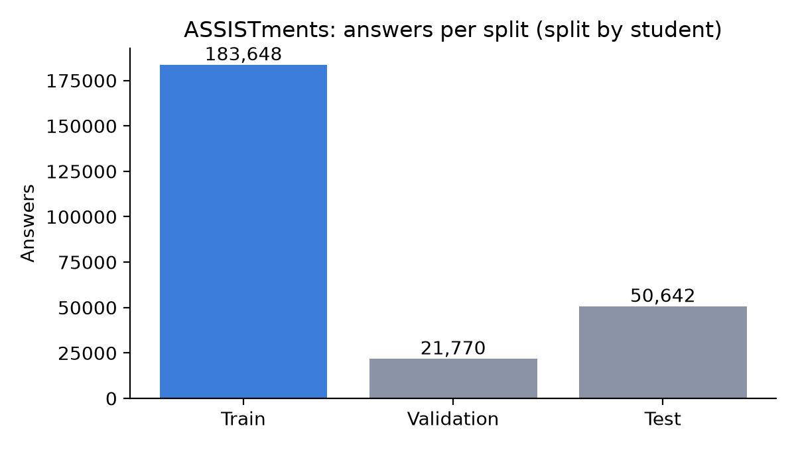
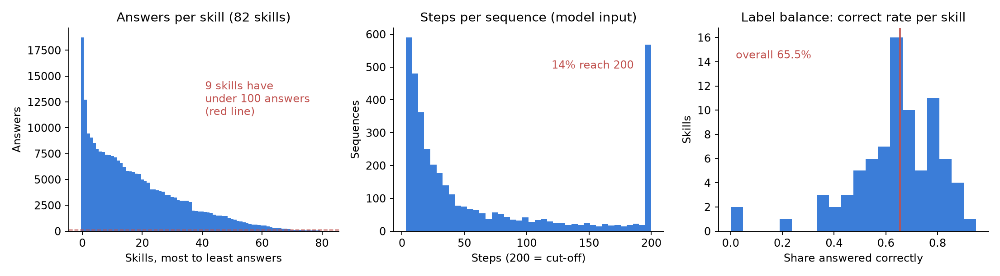
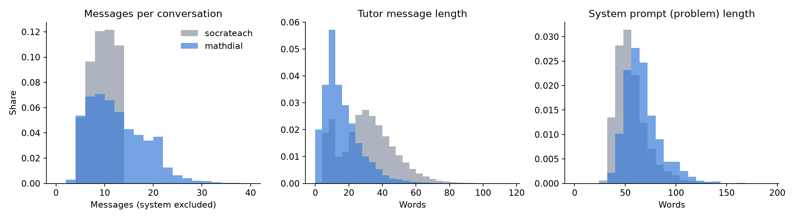
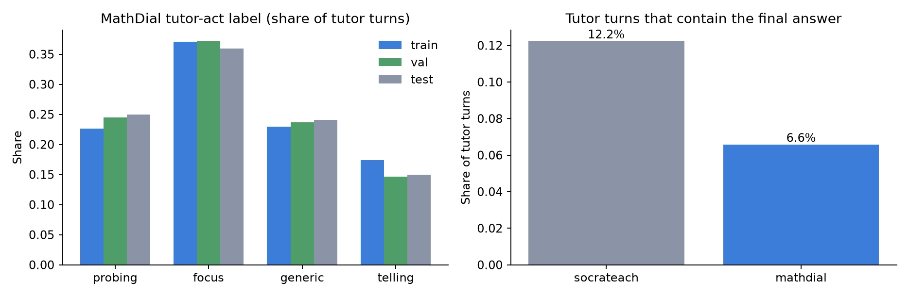
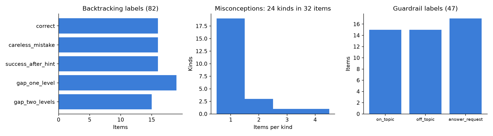
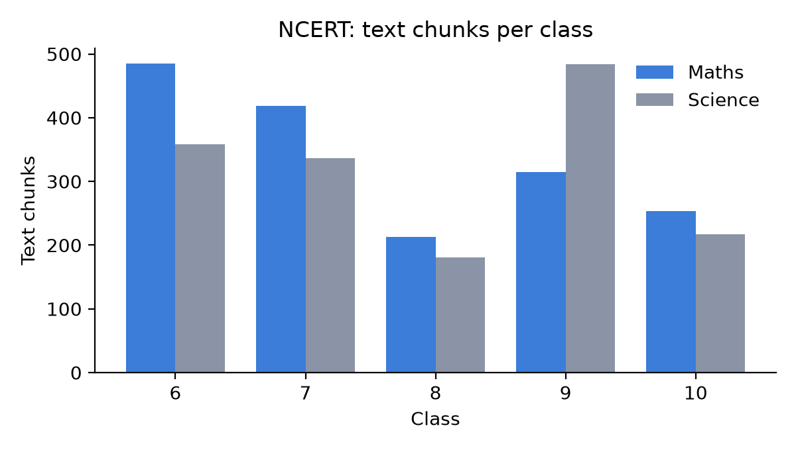
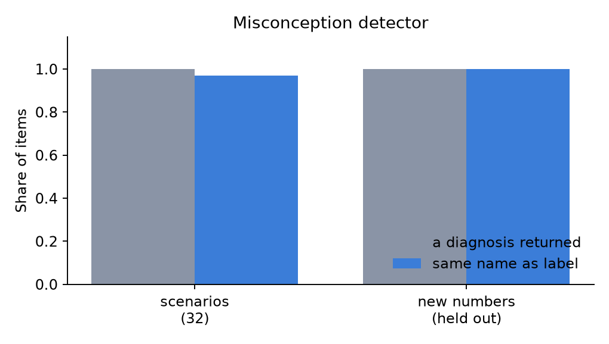
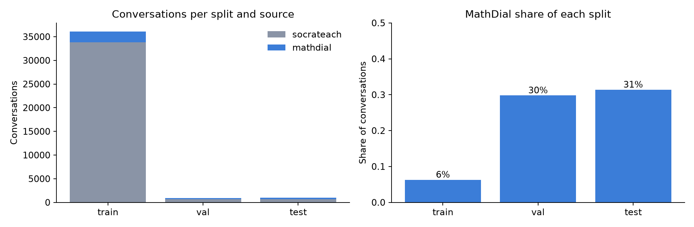

# Milestone 2 Report: Dataset Preparation

**Course:** Data Science and AI Lab, IIT Madras BS
**Team:** Group 2
**Submission:** Milestone 2, 29 October 2026

| Name | Roll number | Primary role |
|---|---|---|
| Sandeep Nalla | 21f1006125 | Backend developer |
| Hariom Kumar | 23f2004225 | Build the RAG (search) agent |
| Hariom Pandey | 21f3002112 | Build the fine-tuned models |
| Mrityunjay Chakraborty | 21f3001385 | Frontend developer |

*Roles are not fixed; members contribute to other parts as the project needs.*

**Goal of this milestone:** collect suitable datasets and prepare them in the format the Milestone 3 models will read.

**Hosted processed dataset (Google Drive):** https://drive.google.com/drive/folders/15vIRFghBsqfHjvHrIztgvVSUv2vP4tws?usp=sharing (layout in Section 6; in this repository everything is under `data/`).
**EDA and preprocessing notebook:** `data/scripts/Milestone2_EDA.ipynb`. **Preprocessing code for every step, with run instructions:** the `data/scripts/` folder (run instructions in `data/scripts/README.md`).

### Folder layout

```
docs/milestone-2/
├── report, presentation, EDA notebook, contribution log
├── data/                 raw/ (downloads), processed/ (rebuilt data), generated/ (AI-written specs and test scenarios),
│                         scripts/ (every step that makes the data, with a README)
├── presentation/         slide builder and the course packs it uses
└── figures/              every figure used in the report and slides
```

**Where the data comes from.** The learner-model arrays were prepared in Colab and are kept as a frozen set. The chat corpus, NCERT text, course packs, test scenarios, validation splits, the misconception detector and its score are made by scripts in `data/scripts/`. Raw downloads and NCERT text are not committed; the README there shows how to rebuild them.

## 1. Datasets

| Dataset | Used for | Source | Licence |
|---|---|---|---|
| ASSISTments 2009-2010 skill builder | Train and test the learner model (DKT) | assistmentsdata site [1, 3, 4] | Research use under the site's terms; cite the data page and Feng et al. (2009) [5] |
| MathDial (2,861 dialogues: 2,262 train + 599 test) | Fine-tune and test the Socratic model | `eth-nlped/mathdial` on Hugging Face (original release); github.com/eth-nlped/mathdial [6] | CC BY-SA 4.0 on GitHub, CC BY 4.0 on Hugging Face; we follow the stricter one |
| SocraTeach Multi (10,273 problems, 35,151 dialogues) | Fine-tune and test the Socratic model | `ulises-c/SocraTeach_Multi` on Hugging Face [2, 7] | CC BY-NC 4.0 (non-commercial) |
| NCERT Maths and Science, classes 6-10 | Course pack (study material for search) | ncert.nic.in | Public; text kept local, not redistributed |

EdNet was not used: ASSISTments is enough for the DKT baseline.

### What each dataset contains

| | Data points | Classes / categories | Other metadata |
|---|---|---|---|
| ASSISTments | 256,060 steps (one per answer and skill), 3,408 students, 3,949 sequences | Label: correct on first try (0/1), 65.5% correct overall. 82 skills (indices 0-81, mapped to the original skill ids) | Per step: student, skill, correct. Skill counts are very uneven: the top skill has 14,880 train answers and 11 of 82 skills have under 100. |
| Chat corpus (rebuilt) | 38,012 conversations (SocraTeach 35,151; MathDial 2,861) | Tutor act of each MathDial tutor turn: probing, focus, generic, telling (MathDial only); answer-leak flag on every tutor turn | `source` tag (`mathdial`, `socrateach`); the system message of every record holds the problem |
| NCERT | 3,164 chunks from 2,401 pages, 10 books, 116 chapters | Subject (maths, science) and class (6-10) | Chunk counts per book in Section 5 |

## 2. Preparation steps, reasons and results

### ASSISTments (learner model)
Starts from the skill-builder file (303,260 rows), the ASSISTments 2009-2010 skill-builder file [1, 5], and keeps four columns: student, order, skill and correct (first try). Other columns (teacher, school, class) are dropped because they do not describe what the student knows and the live tutor will not have them.

| Step | What was done | Rows after |
|---|---|---|
| 1 | Load the 4 columns | 303,260 |
| 2 | Remove 1 row with missing values | 303,259 |
| 3 | Remove 46,668 duplicates (same student, order and skill) | 256,591 |
| 4 | Remove 325 students with fewer than 3 answers | 256,073 |

| # | Step | Why |
|---|---|---|
| 5 | Number the skills 0..81 (82 skills) | The model needs a contiguous index. |
| 6 | Encode each answer as one number `x = skill + 82 x correct` (0 to 163, 164 possible inputs) | One token carries both skill and result, the usual input for an embedding-based DKT. |
| 7 | Sort by student and time. Questions with several skills stay as separate steps | Time order is what DKT reads. Keeping every skill is the common DKT choice; the cost is that one answer can count as several steps. |
| 8 | Cut long histories into chunks of 200 answers; drop chunks under 3 steps (8 chunks, 13 answers); pad short chunks with zeros and add a mask | Fixed-size input for batching. Cutting at 200 would lose about 27% of the rows. The mask makes the model ignore padding. |
| 9 | Split **by student**, 80% train and 20% test, seed 42 | If a student were in two splits the model could memorise them and the test score would be too high. Checked: no student is in both. |
| 10 | Validation: 10% of the train students (seed 42), saved as a list of sequence numbers | The prepared file has no validation set. We list the validation sequences instead of changing the arrays. Also split by student. |

| | Students | Sequences | Answers | Correct rate | Skills used |
|---|---|---|---|---|---|
| Train as prepared | 2,726 | 3,168 | 205,418 | 65.7% | 82 |
| of which training | 2,453 | 2,848 | 183,648 | 65.9% | |
| of which validation | 273 | 320 | 21,770 | 64.4% | |
| Test | 682 | 781 | 50,642 | 64.4% | 80 |
| Total | 3,408 | 3,949 | 256,060 | | |

Files: the arrays (X input id, S skill, C correct, M mask, for train and test, plus N), a table of every step with its split, student, chunk and original skill id, the skill map, and file hashes.





The same steps are also available as a script. Run on the Drive copy of the file in reference [4], which has more rows (525,534) and more skills (123), it gives different counts from the tables above. Every number and model in this report uses the 82-skill arrays.

### Chat corpus: MathDial and SocraTeach (Socratic model)
Each dialogue becomes one chat record (system, assistant, user messages) for fine-tuning a chat model.

| # | Step | Why | Result |
|---|---|---|---|
| 1 | **MathDial** (`eth-nlped/mathdial`, original release, train and test, 2,861 dialogues): split each dialogue into turns and keep the label of each tutor turn (probing, focus, generic, telling) | The label tells which kind of reply the tutor gave | 2,861 conversations |
| 2 | Remove 68 empty turns. Join 495 consecutive turns of one speaker with a space. One piece with no speaker name is joined to the turn before it | Chat templates need alternating roles; nothing is repeated or cut | |
| 3 | **SocraTeach** (`SocraTeach_Multi`, 10,273 problems): the `system` text of each turn becomes an assistant message and the `user` text a user message | Same chat format as MathDial | 35,151 conversations; 2 turns had no tutor text |
| 4 | Add one system message to **every** record: "You are a friendly and supportive teacher. The student is trying to solve the following problem: ..." | Both sources get the same input format, and the problem text is available for splitting | |
| 5 | Flag each tutor message that contains the problem's final answer (`tutor_leaks_answer`) | The tutor must not give the answer away; the flag lets us drop or study such replies | 12.2% of SocraTeach and 6.6% of MathDial tutor turns. It is a number-match heuristic, so short answers such as "2" can match by chance |
| 6 | Check: no character lost against the original, no empty message, roles alternate, ids unique, tags are exactly `mathdial` and `socrateach` | Catches lost or damaged text | all pass |
| 7 | Split by problem across both sources (Section 6) | No problem seen in training appears in validation or test | |

Record example (`tutor_acts` exists for MathDial only):
```json
{"source": "mathdial", "id": "mathdial-train-13", "problem": "jame is trying to ...", "messages": [{"role": "system", "content": "You are a friendly and supportive teacher.\nThe student is trying to solve the following problem: Jame is trying to learn ..."}, {"role": "assistant", "content": "..."}, {"role": "user", "content": "..."}], "tutor_acts": ["telling", "probing", "probing", "generic"], "tutor_leaks_answer": [false, false, false, false]}
```

| Source | Conversations | Distinct problems |
|---|---|---|
| SocraTeach | 35,151 | 10,056 |
| MathDial (train 2,262 + test 599) | 2,861 | about 1,110 |

Two facts found on the way: 1,006 of the 1,035 MathDial training problems also appear in SocraTeach (both come from GSM8K), and 318 of the 394 problems in MathDial's own test set also appear in its training set. So neither MathDial's official split nor a random split keeps problems apart, which is why Section 6 splits by problem across both sources.





### 2A. Inputs and labels for each model

| Model | Input (one training example) | Label (what the model must predict) | Size |
|---|---|---|---|
| Learner model (DKT) | A sequence of up to 200 answers, each one number `x = skill + 82 x correct`, plus a mask for padding | Whether the next answer is correct (0/1); 65.5% are 1 | 3,949 sequences, 256,060 answers |
| Socratic model | The system message with the problem, then the conversation so far | The next tutor message. Extra labels: tutor act (MathDial) and whether it leaks the answer | 38,012 conversations |
| Misconception detector | Question, learner's wrong answer, correct answer | Name of the error, or none | 32 scenarios, 24 kinds |
| Controller (backtracking) | Learner's answer, mastery estimates, prerequisite graph | First action (probe, hint, backtrack, ...) and weak prerequisite | 82 scenarios |
| Guardrail | One learner message | on_topic, off_topic, answer_request | 47 messages |



### NCERT (study text)
Maths and Science, classes 6-10: 10 books, 116 chapters, 2,401 pages.

| Step | Why |
|---|---|
| Extract text page by page | Keeps the page number so the tutor can cite "chapter X, page Y". |
| Clean headers, footers and stray characters | They add noise to search. |
| Split into chunks of up to 250 words, tag each with subject, class, chapter, page | Small enough to retrieve precisely, large enough to hold one idea; tags support citations and level filtering. |

Result: **3,164 chunks**. Four pages failed extraction (drawings), and 48 near-empty pages (under 200 characters, e.g. blank or figure-only) were dropped, so 2,353 of the 2,401 pages produced chunks.



## 3. Course packs (concepts, prerequisites, practice questions)

Written by an AI assistant, reviewed by the team, and built into the backend's course-pack format by a script. Each concept points to the NCERT chapter that teaches it, and the builder attaches the best-matching text from that chapter.

| Pack | Concepts | Prerequisite links | Practice questions |
|---|---|---|---|
| NCERT Maths (classes 6-8) | 10 | 13 | 52 |
| NCERT Science: motion and force (classes 6-9) | 6 | 6 | 18 |

- **Levels:** 1 whole-number operations, factors; 2 fractions, integers; 3 decimals, ratio, percentages, letter expressions; 4 linear equations. The main example follows this chain: percentages -> fractions -> multiplication and division.
- **Questions:** drafted by an AI assistant in the style of the NCERT exercises and reviewed by the team, each with a hint and difficulty. For 53 of the 70 questions the answer is computed in code; **17 short answers (for example "metre", "no", "23") are typed in, not computed** and were checked by the team.
- **Hints must not give the answer.** A review found hints that named it (for example "Named after Isaac Newton" for the unit of force). They were rewritten, and the data checks now fail if a hint contains the answer.
- **Level 1 limit:** NCERT has no Class 6-10 chapter on plain multiplication and division (that is Class 3-5 content, which we did not process). The concept is attached to Class 6 chapter 3 (Number Play), the closest chapter, so its study text is general number-operations text, not a lesson on the topic. It is named "Whole-number operations" to say so.
- **Chapters used:** the packs use 15 distinct chapters. Titles are verified for these 15 plus 5 Class 10 chapters (20 in total); other chapter titles are marked `needs_review`.
- **Editions:** Classes 6 and 7 use the new *Ganita Prakash* books. Class 8 maths uses the older book (code `hemh1`), used for linear equations and percentages; the Milestone 1 plan assumed the new Class 8 book. We could not reach ncert.nic.in on the submission day to fetch and check it, so the switch is left for Milestone 3.
- **Checks:** every prerequisite exists, none is at a higher level, no cycles, every concept has questions and study text.

## 4. Test scenarios (our own, 161 in total)

Written by the team, kept separate from training data and never used for tuning (`data/generated/test_scenarios/`).

| Set | Items | What it tests |
|---|---|---|
| Backtracking | 82 | Learner is correct (16), careless mistake (16), correct after a hint (16), gap one level down (19), gap two levels down (15). Label: the first tutor action and the weak prerequisite to go back to. |
| Misconceptions | 32 | A wrong answer and the error behind it (24 kinds, e.g. dividing 50 by 20 for "20% of 50", adding tops and bottoms of fractions). |
| Guardrails | 47 | 15 on-topic, 15 off-topic (other subjects, chit-chat, "ignore your instructions"), 17 answer requests (including maths questions asked outright, such as "Solve 2x + 3 = 11 for me"). |

**Fixes after review.**
- *Contradictory labels.* In the first version a "careless mistake" and a "correct after a hint" case had the same question, same wrong answer and same weak concepts, but different labels (probe vs hint), so no controller could score well on both. Every backtracking item now carries `mastery`, the learner model's estimate for the target and any weak concept: a slip is a wrong answer with high mastery (0.9, probe), a shaky spot is a wrong answer with middling mastery (0.5, hint), a weak prerequisite means backtrack. `check_data.py` now fails if two items with the same inputs have different labels.
- *Guardrail noise.* Two maths answer requests had been labelled off-topic. They are now `answer_request`, and two genuinely off-topic messages replaced them.

Backtracking labels come from the prerequisite graph and the mastery rule, so they are consistent by construction; they test the tutor's logic, not real learners. Every item has an empty `reviewed_by` field for a second team member to check. TA-provided samples will be added when received.

### 4B. Dynamic misconception detector

The detector is not a fixed list. It does not look the question up. Every call rebuilds the possible wrong answers from the numbers in that question, in two ways:
1. **Error patterns:** 13 error procedures (for example "divides the amount by the percent", "adds tops and bottoms of fractions", "reads 3x as 34"). Each applies only if the question has the right shape, and computes its wrong answer from the question's own numbers.
2. **Search:** for other questions it tries every expression of up to three numbers from the question (+, -, x, ÷) and keeps those equal to the learner's answer. If the correct answer is also such an expression, the error is named by comparing them ("multiplies instead of dividing").

It also adapts to the learner: an error seen before for the same learner wins ties and raises the confidence (0.90 to 0.99 the second time in our test). With no match it returns nothing and the tutor gives a generic hint. The tutor returns the found error in its reply (`misconception`) but does not put it in the text, because "you divided instead of multiplying" would give the method away.

| Test | Items | Diagnosis returned | Same name as label |
|---|---|---|---|
| Our 32 scenarios | 32 | 32 | 31 |
| Same error types, new numbers (made by the scoring script) | 31 | 31 | 31 |



How to read this: the 32 scenarios and the 13 patterns were written by the same team, so 31 of 32 is optimistic; the new-numbers row only shows that answers come from the question's numbers, not from memory of the 32 items. The one miss ("acceleration from 10 to 30 m/s in 5 s, answered 8") is found by search and explained ("your answer equals (10 + 30) / 5") but named "adds instead of subtracting", not our label "adds the speeds". One scenario label was renamed from `divides_instead_of_multiplies` to `divides_instead_of_multiplying` to match the grammar of the other labels. A test on real learners is still missing.

### Sample records

ASSISTments (one step of the processed steps table; `x = skill_index + 82 x correct`):
```
split,user_id,chunk_id,step,skill_index,correct,x,skill_id_original
train,80959,0,1,9,1,91,13
```
Chat corpus:
```json
{"source": "mathdial", "messages": [{"role": "system", "content": "You are a friendly and supportive teacher.\nThe student is trying to solve the following problem: Nancy is filling an aquarium ..."}, {"role": "assistant", "content": "..."}, {"role": "user", "content": "..."}]}
```
NCERT chunk (text omitted, it is not redistributed):
```json
{"id": "ncert-maths-10-06-p017-0", "subject": "maths", "class": 10, "chapter": 6, "page": 17, "source": "NCERT Maths Class 10, chapter 6", "text": "..."}
```
Backtracking scenarios (same question and answer, different mastery, different first action):
```json
{"type": "careless_mistake", "learner_answer": "121", "weak_concepts": [], "mastery": {"multiplication_division": 0.9}, "expected_first_action": "probe"}
{"type": "success_after_hint", "learner_answer": "121", "weak_concepts": [], "mastery": {"multiplication_division": 0.5}, "expected_first_action": "hint"}
```
Misconception: `{"question": "What is 20% of 50?", "correct_answer": "10", "wrong_answer": "2.5", "misconception": "divides_by_the_percent"}`.
Guardrail: `{"message": "What is the weather like today?", "label": "off_topic"}`.

## 5. Exploratory data analysis

The full analysis, with plots, sample records and a reason for every step, is in **`data/scripts/Milestone2_EDA.ipynb`**. Main findings:
- **ASSISTments:** very uneven skills (top skill 14,880 train answers; 11 of 82 skills under 100). Most sequences are short (median 29 steps, 14.3% at the 200 cap). Evaluate per skill, not only overall, and compare against a per-skill accuracy baseline.
- **Chat corpus:** SocraTeach is 92% of the conversations, but MathDial is closer to the target (a student with a wrong solution), so a model trained on the mix may lean toward SocraTeach's style; validation and test therefore hold about 30% MathDial, and results should be reported per source. 12.2% of SocraTeach and 6.6% of MathDial tutor turns contain the final answer, and 15% of MathDial tutor turns are labelled "telling": the model must not imitate these.
- **NCERT:** about 20% of chunks are under 50 words (chapter ends, captions). Older Class 8-10 maths books lose digits and symbols in extraction (e.g. "80/100" appears as "80100").

NCERT chunks per book (3,164 in all):

| Class | 6 | 7 | 8 | 9 | 10 |
|---|---|---|---|---|---|
| Maths | 475 | 369 | 213 | 301 | 253 |
| Science | 345 | 330 | 181 | 480 | 217 |

## 6. Processed dataset: folder structure and splits

Hosted on Google Drive: https://drive.google.com/drive/folders/15vIRFghBsqfHjvHrIztgvVSUv2vP4tws (the layout and licence notes are in `data/README.md`). In this repository the frozen learner-model files are in `data/processed/assistments/frozen/`; the chat corpus, NCERT metadata, course-pack specs and test scenarios are rebuilt in `data/processed/` and `data/generated/`.

```
Google Drive bundle                              In this repository
assistments_dkt/    dkt_data.npz, steps, ...     data/processed/assistments/frozen/
splits/             dkt_validation.json          data/processed/assistments/frozen/
socratic_chat/      train, val, test, stats      data/processed/socratic_chat/
ncert_metadata/     chapters.csv, stats.json     data/processed/ncert/   (NCERT text not shared)
course_pack_specs/  specs.py, chapter_titles.csv data/generated/ncert/
test_scenarios/     3 evaluation sets, stats     data/generated/test_scenarios/
```

| Set | Train | Validation | Test | Split rule |
|---|---|---|---|---|
| ASSISTments (DKT) | 2,453 students, 2,848 sequences, 183,648 answers | 273 students, 320 sequences, 21,770 answers | 682 students, 781 sequences, 50,642 answers | by student, seed 42 |
| Chat corpus (hybrid) | 36,104 conversations (2,277 MathDial + 33,827 SocraTeach), 9,685 problems | 943 (281 MathDial + 662 SocraTeach), 201 problems | 965 (303 MathDial + 662 SocraTeach), 201 problems | by problem across both sources, seed 42 |

`splits/dkt_validation.json` lists the validation rows of the train arrays (the arrays stay unchanged). The chat splits are three files: train, validation and test. The bundle is for coursework use only; each part keeps its own source licence (share-alike for MathDial, non-commercial for SocraTeach, the ASSISTments site's terms).

**How the hybrid chat split works.** All 38,012 conversations are grouped by problem text, so the same problem in MathDial and SocraTeach always lands in the same split. Validation and test each take 10% of the problems that MathDial covers (these come with their SocraTeach dialogues) plus 1% of the SocraTeach-only problems. Result: each held-out split has both sources, about 30% MathDial, and no problem is shared between splits (checked). MathDial's own test set is not kept as the test set, because 318 of its 394 problems also occur in its training set; its 599 conversations are spread over our splits by problem. This means we cannot compare numbers one-to-one with the MathDial paper; MathDial and SocraTeach results are reported separately in Milestone 3.



## 7. Checks
- **ASSISTments:** row counts add up (303,260 - 1 - 46,668 = 256,591); `x = skill + 82 x correct` holds for every real step; student counts match (2,726 and 682); train and test correct rates are close (65.7% and 64.4%); the 13-answer gap between 256,073 and 256,060 is the dropped short chunks. A test script in the bundle re-prints shapes and statistics, and a hash file protects the data from silent changes. We also confirmed that no student appears in both train and test.
- **Validation splits:** The validation script asserts that each sequence maps to one student and that sequence lengths match the mask, and it picks whole students. The data checks also confirm that no chat problem is in two splits and that validation and test each hold both sources.
- **All scripted checks:** The data checks pass in full: the DKT encoding and padding, the chat corpus (no problem in two splits, both sources in validation and test, tags, no empty message, every symbol of the original MathDial turns still present), NCERT chunks, course packs (prerequisites exist, no cycles, every concept has questions and study text, no hint contains its answer) and scenarios (items with the same inputs never have different labels).

## 8. Status against the Milestone 1 plan

| Milestone 1 plan | Status |
|---|---|
| NCERT as primary course | Done: text, chunks and two course packs. |
| IITM BS pack (secondary domain) | **Not done.** No IITM material was collected or packed this milestone; the pipeline is course-agnostic, so a pack can be added later without code changes. |
| Guardrail methods explored and compared in M2 | **Not done.** We built the evaluation set (47 labelled messages, Section 4); trying and comparing guardrail methods moves to Milestone 3. |
| Continue the search for controller and misconception baselines | **Not started**; moves to Milestone 3, where the baselines are needed for comparison. |
| Class 3-5 content for the lowest level | **Not done** (only classes 6-10 were processed); see the Level 1 limit in Section 3. |

## 9. Limits and next steps
- ASSISTments is US data and has no session information, so session-scoped DKT (mentor feedback) cannot be tested on it; windows of 200 answers are used instead. A chunk after a student's first starts without that student's earlier history, and the test set uses 80 of the 82 skills.
- NCERT text quality: older Class 8-10 maths books lose digits and symbols in extraction, and the study passages attached to each concept are picked automatically, so some are exercise text. Each needs a manual pass before use in search.
- Chat corpus: SocraTeach's step and persona fields are dropped, its turns have no act label, and both sources are maths only.
- The packs cover one chain per subject (10 Maths and 6 Science concepts). More chapters can be added by extending the pack specification; no code change is needed.
- Concepts, prerequisite links and scenario labels are our own judgement, so a second team member should review them.
- The misconception detector has not been tested on real learner answers; its score (Section 4B) comes from scenarios written by the team.
- Next: train DKT on the ASSISTments data and compare against the published baseline (AUC 0.754 for DKT on ASSISTments 2009 in the pyKT benchmark [8]), fine-tune the Socratic model on the chat corpus, compare guardrail methods, and have a second member check the scenarios.

## 10. References
1. ASSISTments, Skill-builder data 2009-2010 (the dataset we use): https://sites.google.com/site/assistmentsdata/home/2009-2010-assistment-data/skill-builder-data-2009-2010
2. SocraTeach_Multi dataset card, Hugging Face (CC BY-NC 4.0): https://huggingface.co/datasets/ulises-c/SocraTeach_Multi
3. ASSISTments data site, main page (terms of use; users are asked to cite the data page and email their citations): https://sites.google.com/site/assistmentsdata.
4. Google Drive file supplied by the team with the ASSISTments skill-builder data: https://drive.google.com/file/d/0B2X0QD6q79ZJUFU1cjYtdGhVNjg/view?resourcekey=0-OyI8ZWxtGSAzhodUIcMf_g
5. Feng, M., Heffernan, N. and Koedinger, K. (2009). *Addressing the assessment challenge with an online system that tutors as it assesses.* User Modeling and User-Adapted Interaction.
6. Macina, J., Daheim, N., Chowdhury, S., Sinha, T., Kapur, M., Gurevych, I. and Sachan, M. (2023). *MathDial: A Dialogue Tutoring Dataset with Rich Pedagogical Properties Grounded in Math Reasoning Problems.* Findings of EMNLP 2023. https://github.com/eth-nlped/mathdial
7. Liu, J. et al. (2024). *SocraticLM: Exploring Socratic Personalized Teaching with Large Language Models.* NeurIPS 2024.
8. Liu, Z. et al. (2022). *pyKT: A Python Library to Benchmark Deep Learning based Knowledge Tracing Models.* NeurIPS Datasets and Benchmarks. https://arxiv.org/abs/2206.11460 (DKT AUC 0.754 on ASSISTments 2009, as quoted in the Milestone 1 report).
9. Related ASSISTments dataset page (Goldstein, Baker and Heffernan, 2011), supplied by the team; a different dataset that we did not use: https://sites.google.com/site/assistmentsdata/datasets/2011-goldstein-baker-heffernan

## 11. Team sign-off

By signing, each member confirms they have read this report, understand it and agree to submit it.

| Name | Roll number | Signature | Date |
|---|---|---|---|
| Sandeep Nalla | 21f1006125 |  | 2026-10-29 |
| Hariom Kumar | 23f2004225 |  | 2026-10-29 |
| Hariom Pandey | 21f3002112 |  | 2026-10-29 |
| Mrityunjay Chakraborty | 21f3001385 |  | 2026-10-29 |

*Drafted with help from an AI assistant and reviewed by the team.*
