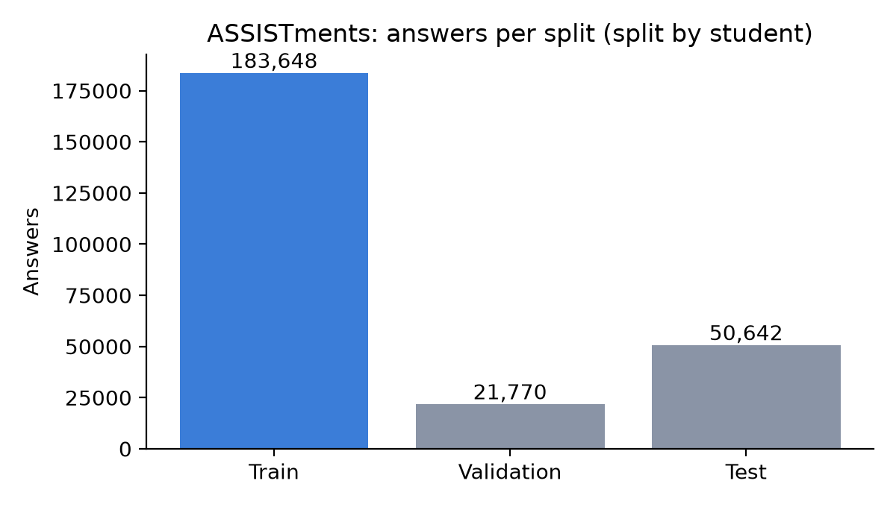
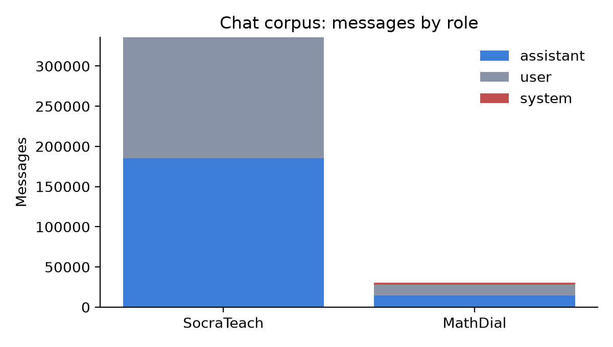
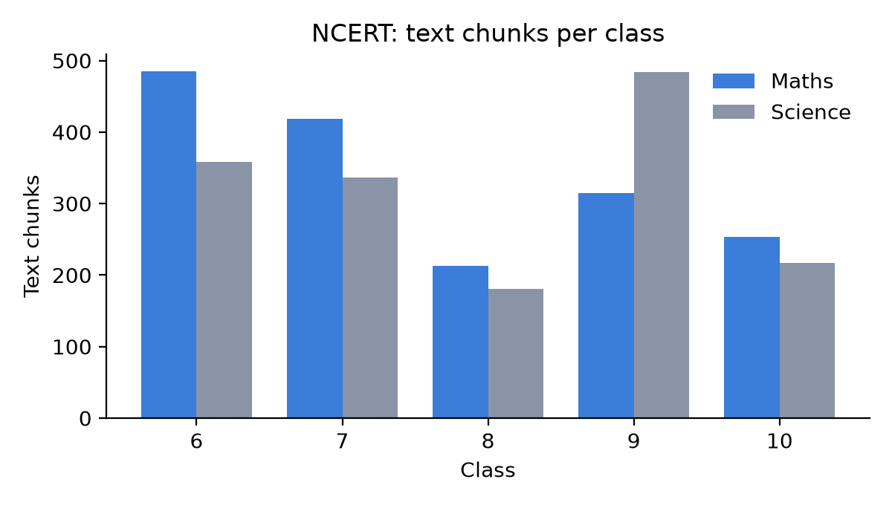

# Milestone 2 Report: Dataset Preparation

**Course:** Data Science and AI Lab, IIT Madras BS
**Team:** Group 2
**Submission:** Milestone 2, 29 October 2026

| Name | Roll number | Primary role |
|---|---|---|
| Sandeep Nalla | 21f1006125 | Backend developer |
| Hariom Kumar | 23f2004225 | Build the RAG (search) agent |
| Hariom Pandey | 21f3002112 | Build the fine-tuned models |
| Mrityunjay Chakraborty | 21f3001385 | Frontend developer |

*Roles are not fixed; members contribute to other parts as the project needs.*

**Goal of this milestone:** collect suitable datasets and prepare them in the format the Milestone 3 models will read.

**Hosted processed dataset (Google Drive):** https://drive.google.com/drive/folders/15vIRFghBsqfHjvHrIztgvVSUv2vP4tws?usp=sharing  (layout in Section 6; the same folder is staged locally at `notes/sandeep/milestone-2/hosted_dataset/`).
**EDA and preprocessing notebook:** `Milestone2_EDA.ipynb` (this folder, outputs saved).

The data comes from two places:
- **Learner-model data and chat corpus** were prepared by **Hariom Pandey** (Colab). This is the data we use for the DKT and the Socratic model. Files, his preprocessing notebook (`pandey_dkt_chat_preprocessing.ipynb`) and his two write-ups: `notes/hariom pandey/milestone-2/`.
- **NCERT text, course packs, test scenarios and the validation splits** were prepared by **Sandeep Nalla** (scripts in `notes/sandeep/milestone-2/data/scripts/`), because they have no counterpart in the downloaded datasets. Raw files and NCERT text are not committed; `data/README.md` there shows how to rebuild them.

An earlier script-based preparation of ASSISTments and MathDial (149 skills, its own train/validation/test split) is kept in `notes/sandeep/milestone-2/data/` for reference. It is not part of the submitted dataset and is not used below.

## 1. Datasets

| Dataset | Used for | Prepared by | Source | Licence |
|---|---|---|---|---|
| ASSISTments 2009-2010 skill builder | Train and test the learner model (DKT) | Hariom Pandey | assistmentsdata site [1, 3, 4] | Research use under the site's terms; cite the data page and Feng et al. (2009) [5] |
| MathDial (2,861 dialogues; 2,262 train used) | Fine-tune the Socratic model | Hariom Pandey | `eth-nlped/mathdial-chat` on Hugging Face; github.com/eth-nlped/mathdial [6] | CC BY-SA 4.0 on GitHub, CC BY 4.0 on Hugging Face; we follow the stricter one |
| SocraTeach Multi (10,273 problems, 35,151 dialogues) | Fine-tune the Socratic model | Hariom Pandey | `ulises-c/SocraTeach_Multi` on Hugging Face [2, 7] | CC BY-NC 4.0 (non-commercial) |
| NCERT Maths and Science, classes 6-10 | Course pack (study material for search) | Sandeep Nalla | ncert.nic.in | Public; text kept local, not redistributed |

EdNet was not used: ASSISTments is enough for the DKT baseline.

### What each dataset contains

| | Data points | Classes / categories | Other metadata |
|---|---|---|---|
| ASSISTments | 256,060 steps (one per answer and skill), 3,408 students, 3,949 sequences | Label: correct on first try (0/1), 65.5% correct overall. 82 skills (indices 0-81, mapped to original ids in `skill_map.csv`) | Per step: student, skill, correct. Skill counts are very uneven: the top skill has 14,880 train answers and 11 of 82 skills have under 100. |
| Chat corpus | 37,413 conversations, 366,171 messages | Roles: assistant 200,048; user 163,861; system 2,262. Sources: SocraTeach 35,151, MathDial 2,262 | `source` tag per conversation; MathDial's system message holds the problem |
| NCERT | 3,164 chunks from 2,401 pages, 10 books, 116 chapters | Subject (maths, science) and class (6-10) | Chunk counts per book in Section 5 |

## 2. Preparation steps, reasons and results

### ASSISTments (learner model)
Starts from `skill_builder_data.csv` (303,260 rows), the ASSISTments 2009-2010 skill-builder file [1, 5], and keeps four columns: student, order, skill and correct (first try). Other columns (teacher, school, class) are dropped because they do not describe what the student knows and the live tutor will not have them.

| Step | What was done | Rows after |
|---|---|---|
| 1 | Load the 4 columns | 303,260 |
| 2 | Remove 1 row with missing values | 303,259 |
| 3 | Remove 46,668 duplicates (same student, order and skill) | 256,591 |
| 4 | Remove 325 students with fewer than 3 answers | 256,073 |

| # | Step | Why |
|---|---|---|
| 5 | Number the skills 0..81 (82 skills) | The model needs a contiguous index. |
| 6 | Encode each answer as one number `x = skill + 82 x correct` (0 to 163, 164 possible inputs) | One token carries both skill and result, the usual input for an embedding-based DKT. |
| 7 | Sort by student and time. Questions with several skills stay as separate steps | Time order is what DKT reads. Keeping every skill is the common DKT choice; the cost is that one answer can count as several steps. |
| 8 | Cut long histories into chunks of 200 answers; drop chunks under 3 steps (8 chunks, 13 answers); pad short chunks with zeros and add a mask | Fixed-size input for batching. Cutting at 200 would lose about 27% of the rows. The mask makes the model ignore padding. |
| 9 | Split **by student**, 80% train and 20% test, seed 42 | If a student were in two splits the model could memorise them and the test score would be too high. Checked: no student is in both. |
| 10 | Validation: 10% of the train students (seed 42), listed in `splits/dkt_validation.json` | The prepared file has no validation set. We list the validation sequences instead of changing his files. Also split by student. |

| | Students | Sequences | Answers | Correct rate | Skills used |
|---|---|---|---|---|---|
| Train as prepared | 2,726 | 3,168 | 205,418 | 65.7% | 82 |
| of which training | 2,453 | 2,848 | 183,648 | 65.9% | |
| of which validation | 273 | 320 | 21,770 | 64.4% | |
| Test | 682 | 781 | 50,642 | 64.4% | 80 |
| Total | 3,408 | 3,949 | 256,060 | | |

Files: `dkt_data.npz` (arrays X input id, S skill, C correct, M mask, for train and test, plus N), `dkt_processed_steps.csv` (every step with its split, student, chunk and original skill id), `skill_map.csv`, `SHA256.txt`.



### Chat corpus: MathDial and SocraTeach (Socratic model)
Each dialogue becomes one chat record with a `messages` list (system, assistant, user), for fine-tuning a chat model.

| # | Step | Why |
|---|---|---|
| 1 | **SocraTeach:** expand the 10,273 problems into their 35,151 dialogues; the tutor's text becomes an `assistant` message, the student's reply a `user` message; keep turn order | Chat format is what the fine-tuning tools read. A dialogue is the natural training unit. |
| 2 | **MathDial** (`mathdial-chat`, train split): keep the system/assistant/user messages, trim whitespace, remove 4 empty messages | Empty messages add noise. The system message carries the problem and the tutor instructions, so it stays. |
| 3 | Hold out MathDial's 599 test conversations (not in the file) | Keeps results comparable with the paper. |
| 4 | Merge into `socratic_tutor_combined.jsonl` with a `source` tag per record (spelled `soctrateach` in the file) | Lets us train on one source or both and trace each record. |
| 5 | Validation: 10% of the MathDial problems (seed 42), listed in `splits/chat_validation.json` | Split **by problem**, because several dialogues share one problem and a random cut would put near-identical conversations on both sides. SocraTeach has no problem text in its messages, so it cannot be grouped and stays in train. |

| Source | Conversations | Assistant messages | User messages | System messages |
|---|---|---|---|---|
| SocraTeach | 35,151 | 185,600 | 150,451 | 0 |
| MathDial (train) | 2,262 | 14,448 | 13,410 | 2,262 |
| Total | 37,413 | 200,048 | 163,861 | 2,262 |

Validation: 215 MathDial conversations from 104 of the 1,035 problems. Train: the other 37,198. Test: MathDial's own 599 conversations, taken from Hugging Face.

Reported checks: no empty messages, no invalid records, no duplicate SocraTeach dialogue ids, valid JSON. In SocraTeach 2 turns had no tutor text. Every SocraTeach dialogue starts with a tutor message.



### NCERT (study text)
Maths and Science, classes 6-10: 10 books, 116 chapters, 2,401 pages.

| Step | Why |
|---|---|
| Extract text page by page | Keeps the page number so the tutor can cite "chapter X, page Y". |
| Clean headers, footers and stray characters | They add noise to search. |
| Split into chunks of up to 250 words, tag each with subject, class, chapter, page | Small enough to retrieve precisely, large enough to hold one idea; tags support citations and level filtering. |

Result: **3,164 chunks**. Four pages failed extraction (drawings), and 48 near-empty pages (under 200 characters, e.g. blank or figure-only) were dropped, so 2,353 of the 2,401 pages produced chunks.



## 3. Course packs (concepts, prerequisites, practice questions)

Hand-written in `notes/sandeep/milestone-2/data/course_packs/specs.py` and built into the backend's course-pack format by `build_course_packs.py`. Each concept points to the NCERT chapter that teaches it, and the builder attaches the best-matching text from that chapter.

| Pack | Concepts | Prerequisite links | Practice questions |
|---|---|---|---|
| NCERT Maths (classes 6-8) | 10 | 13 | 52 |
| NCERT Science: motion and force (classes 6-9) | 6 | 6 | 18 |

- **Levels:** 1 whole-number operations, factors; 2 fractions, integers; 3 decimals, ratio, percentages, letter expressions; 4 linear equations. The main example follows this chain: percentages -> fractions -> multiplication and division.
- **Questions:** written by the team in the style of the NCERT exercises, each with a hint and difficulty. For 53 of the 70 questions the answer is computed in code; **17 short answers (for example "metre", "no", "23") are typed by hand** and were checked by the author.
- **Hints must not give the answer.** A review found hints that named it (for example "Named after Isaac Newton" for the unit of force). They were rewritten, and `check_data.py` now fails if a hint contains the answer.
- **Level 1 limit:** NCERT has no Class 6-10 chapter on plain multiplication and division (that is Class 3-5 content, which we did not process). The concept is attached to Class 6 chapter 3 (Number Play), the closest chapter, so its study text is general number-operations text, not a lesson on the topic. It is named "Whole-number operations" to say so.
- **Chapters used:** the packs use 15 distinct chapters. Titles are verified for these 15 plus 5 Class 10 chapters (20 in `chapter_titles.csv`); other chapter titles are marked `needs_review`.
- **Editions:** Classes 6 and 7 use the new *Ganita Prakash* books. Class 8 maths uses the older book (code `hemh1`), used for linear equations and percentages; the Milestone 1 plan assumed the new Class 8 book. We could not reach ncert.nic.in on the submission day to fetch and check it, so the switch is left for Milestone 3.
- **Checks:** every prerequisite exists, none is at a higher level, no cycles, every concept has questions and study text.

## 4. Test scenarios (our own, 161 in total)

Written by the team, kept separate from training data and never used for tuning (`notes/sandeep/milestone-2/data/test_scenarios/`).

| Set | Items | What it tests |
|---|---|---|
| Backtracking | 82 | Learner is correct (16), careless mistake (16), correct after a hint (16), gap one level down (19), gap two levels down (15). Label: the first tutor action and the weak prerequisite to go back to. |
| Misconceptions | 32 | A wrong answer and the error behind it (24 kinds, e.g. dividing 50 by 20 for "20% of 50", adding tops and bottoms of fractions). |
| Guardrails | 47 | 15 on-topic, 15 off-topic (other subjects, chit-chat, "ignore your instructions"), 17 answer requests (including maths questions asked outright, such as "Solve 2x + 3 = 11 for me"). |

**Fixes after review.**
- *Contradictory labels.* In the first version a "careless mistake" and a "correct after a hint" case had the same question, same wrong answer and same weak concepts, but different labels (probe vs hint), so no controller could score well on both. Every backtracking item now carries `mastery`, the learner model's estimate for the target and any weak concept: a slip is a wrong answer with high mastery (0.9, probe), a shaky spot is a wrong answer with middling mastery (0.5, hint), a weak prerequisite means backtrack. `check_data.py` now fails if two items with the same inputs have different labels.
- *Guardrail noise.* Two maths answer requests had been labelled off-topic. They are now `answer_request`, and two genuinely off-topic messages replaced them.

Backtracking labels come from the prerequisite graph and the mastery rule, so they are consistent by construction; they test the tutor's logic, not real learners. Every item has an empty `reviewed_by` field for a second team member to check. TA-provided samples will be added when received.

### Sample records

ASSISTments (one step of `dkt_processed_steps.csv`; `x = skill_index + 82 x correct`):
```
split,user_id,chunk_id,step,skill_index,correct,x,skill_id_original
train,80959,0,1,9,1,91,13
```
Chat corpus:
```json
{"source": "mathdial", "messages": [{"role": "system", "content": "You are a friendly and supportive teacher.\nThe student is trying to solve the following problem: Nancy is filling an aquarium ..."}, {"role": "assistant", "content": "..."}, {"role": "user", "content": "..."}]}
```
NCERT chunk (text omitted, it is not redistributed):
```json
{"id": "ncert-maths-10-06-p017-0", "subject": "maths", "class": 10, "chapter": 6, "page": 17, "source": "NCERT Maths Class 10, chapter 6", "text": "..."}
```
Backtracking scenarios (same question and answer, different mastery, different first action):
```json
{"type": "careless_mistake", "learner_answer": "121", "weak_concepts": [], "mastery": {"multiplication_division": 0.9}, "expected_first_action": "probe"}
{"type": "success_after_hint", "learner_answer": "121", "weak_concepts": [], "mastery": {"multiplication_division": 0.5}, "expected_first_action": "hint"}
```
Misconception: `{"question": "What is 20% of 50?", "correct_answer": "10", "wrong_answer": "2.5", "misconception": "divides_by_the_percent"}`.
Guardrail: `{"message": "What is the weather like today?", "label": "off_topic"}`.

## 5. Exploratory data analysis

The full analysis, with plots, sample records and a reason for every step, is in **`Milestone2_EDA.ipynb`**. Main findings:
- **ASSISTments:** very uneven skills (top skill 14,880 train answers; 11 of 82 skills under 100). Most sequences are short (median 29 steps, 14.3% at the 200 cap). Evaluate per skill, not only overall, and compare against a per-skill accuracy baseline.
- **Chat corpus:** SocraTeach is 94% of the conversations, but MathDial is closer to the target (a student with a wrong solution), so a model trained on the mix may lean toward SocraTeach's style. No reply is marked as "telling the answer", so a model trained on it can learn to give answers away.
- **NCERT:** about 20% of chunks are under 50 words (chapter ends, captions). Older Class 8-10 maths books lose digits and symbols in extraction (e.g. "80/100" appears as "80100").

NCERT chunks per book (3,164 in all):

| Class | 6 | 7 | 8 | 9 | 10 |
|---|---|---|---|---|---|
| Maths | 475 | 369 | 213 | 301 | 253 |
| Science | 345 | 330 | 181 | 480 | 217 |

## 6. Processed dataset: folder structure and splits

Hosted on Google Drive: https://drive.google.com/drive/folders/15vIRFghBsqfHjvHrIztgvVSUv2vP4tws (about 67 MB; the folder's README holds the same layout and licence notes).

```
hosted_dataset/
├── assistments_dkt/    dkt_data.npz  dkt_processed_steps.csv  skill_map.csv  SHA256.txt  test_dkt_data.py
├── socratic_chat/      socratic_tutor_combined.jsonl
├── splits/             dkt_validation.json  chat_validation.json
├── ncert_metadata/     chapters.csv  stats.json      (NCERT text not included)
├── course_pack_specs/  specs.py  chapter_titles.csv
└── test_scenarios/     backtracking.jsonl  misconceptions.jsonl  guardrails.jsonl  stats.json
```

| Set | Train | Validation | Test | Split rule |
|---|---|---|---|---|
| ASSISTments (DKT) | 2,453 students, 2,848 sequences, 183,648 answers | 273 students, 320 sequences, 21,770 answers | 682 students, 781 sequences, 50,642 answers | by student, seed 42 |
| Chat corpus | 37,198 conversations | 215 MathDial conversations (104 problems) | MathDial's own 599 (not in the file) | validation by problem, seed 42 |

`splits/dkt_validation.json` lists the validation rows of the train arrays; `splits/chat_validation.json` lists the validation line numbers of the chat file. Both are made by `make_validation_splits.py` and leave Hariom Pandey's files unchanged. The bundle is for coursework use only; each part keeps its own source licence (share-alike for MathDial, non-commercial for SocraTeach, the ASSISTments site's terms).

## 7. Notes on the learner-model and chat data
- **Licence:** SocraTeach is CC BY-NC 4.0, fine for coursework, not for commercial use.
- **Not yet done on the chat corpus:** no deduplication across the two sources, no marking of answer-telling replies, SocraTeach's step and persona fields are dropped, and both sources are maths only. These are the first things to improve for the fine-tuning.
- **Overlap between sources:** MathDial and SocraTeach both take their problems from GSM8K, so some MathDial validation or test problems may also appear in SocraTeach training dialogues. SocraTeach's problem text was dropped from the file, so this is checked in Milestone 3 before any test score is reported.
- **Validation split:** the prepared files had none; we derive it from the train data (Section 2). If the validation rows are used, train on the rest only.
- **Model:** the write-up targets Qwen2.5-1.5B-Instruct, while the Milestone 1 plan and `README.md` say Qwen3-4B with LoRA. The data format is the same. Until Milestone 3 shows otherwise, Qwen3-4B stays the target; the smaller model can be used for quick tests.
- **Source file and sharing:** the DKT write-up names the source file (`skill_builder_data.csv`, from the skill-builder data page [1]). The write-up describes the data as not re-shared; within the team bundle it is shared for coursework only, under each source's terms.

## 8. Checks
- **ASSISTments (Hariom Pandey):** row counts add up (303,260 - 1 - 46,668 = 256,591); `x = skill + 82 x correct` holds for every real step; student counts match (2,726 and 682); train and test correct rates are close (65.7% and 64.4%); the 13-answer gap between 256,073 and 256,060 is the dropped short chunks. `test_dkt_data.py` re-prints shapes and statistics, and `SHA256.txt` holds file hashes. We also confirmed that no student appears in both train and test.
- **Validation splits:** `make_validation_splits.py` asserts that each sequence maps to one student and that sequence lengths match the mask, and it picks whole students or whole problems.
- **Our own data:** `check_data.py` passes 18 checks on the NCERT chunks, course packs and test scenarios (it also runs 8 on our earlier ASSISTments and MathDial files): prerequisites exist, no cycles, every concept has questions and study text, no hint contains its answer, items with the same inputs never have different labels, scenario labels are consistent.

## 9. Status against the Milestone 1 plan

| Milestone 1 plan | Status |
|---|---|
| NCERT as primary course | Done: text, chunks and two course packs. |
| IITM BS pack (secondary domain) | **Not done.** No IITM material was collected or packed this milestone; the pipeline is course-agnostic, so a pack can be added later without code changes. |
| Guardrail methods explored and compared in M2 | **Not done.** We built the evaluation set (47 labelled messages, Section 4); trying and comparing guardrail methods moves to Milestone 3. |
| Continue the search for controller and misconception baselines | **Not started**; moves to Milestone 3, where the baselines are needed for comparison. |
| Class 3-5 content for the lowest level | **Not done** (only classes 6-10 were processed); see the Level 1 limit in Section 3. |

## 10. Limits and next steps
- ASSISTments is US data and has no session information, so session-scoped DKT (mentor feedback) cannot be tested on it; windows of 200 answers are used instead. A chunk after a student's first starts without that student's earlier history, and the test set uses 80 of the 82 skills.
- NCERT text quality: older Class 8-10 maths books lose digits and symbols in extraction, and the study passages attached to each concept are picked automatically, so some are exercise text. Each needs a manual pass before use in search.
- The packs cover one chain per subject (10 Maths and 6 Science concepts). More chapters can be added by extending `specs.py`; no code change is needed.
- Concepts, prerequisite links and scenario labels are our own judgement, so a second member should review them.
- Next: train DKT on the ASSISTments data and compare against the published baseline (AUC 0.754 for DKT on ASSISTments 2009 in the pyKT benchmark [8]), fine-tune the Socratic model on the chat corpus, compare guardrail methods, and have a second member check the scenarios.

## 11. References
1. ASSISTments, Skill-builder data 2009-2010 (the dataset we use): https://sites.google.com/site/assistmentsdata/home/2009-2010-assistment-data/skill-builder-data-2009-2010
2. SocraTeach_Multi dataset card, Hugging Face (CC BY-NC 4.0): https://huggingface.co/datasets/ulises-c/SocraTeach_Multi
3. ASSISTments data site, main page (terms of use; users are asked to cite the data page and email their citations): https://sites.google.com/site/assistmentsdata.
4. Google Drive file supplied by the team with the ASSISTments skill-builder data: https://drive.google.com/file/d/0B2X0QD6q79ZJUFU1cjYtdGhVNjg/view?resourcekey=0-OyI8ZWxtGSAzhodUIcMf_g
5. Feng, M., Heffernan, N. and Koedinger, K. (2009). *Addressing the assessment challenge with an online system that tutors as it assesses.* User Modeling and User-Adapted Interaction.
6. Macina, J., Daheim, N., Chowdhury, S., Sinha, T., Kapur, M., Gurevych, I. and Sachan, M. (2023). *MathDial: A Dialogue Tutoring Dataset with Rich Pedagogical Properties Grounded in Math Reasoning Problems.* Findings of EMNLP 2023. https://github.com/eth-nlped/mathdial
7. Liu, J. et al. (2024). *SocraticLM: Exploring Socratic Personalized Teaching with Large Language Models.* NeurIPS 2024.
8. Liu, Z. et al. (2022). *pyKT: A Python Library to Benchmark Deep Learning based Knowledge Tracing Models.* NeurIPS Datasets and Benchmarks. https://arxiv.org/abs/2206.11460 (DKT AUC 0.754 on ASSISTments 2009, as quoted in the Milestone 1 report).
9. Related ASSISTments dataset page (Goldstein, Baker and Heffernan, 2011), supplied by the team; a different dataset that we did not use: https://sites.google.com/site/assistmentsdata/datasets/2011-goldstein-baker-heffernan

## 12. Team sign-off

By signing, each member confirms they have read this report, understand it and agree to submit it.

| Name | Roll number | Signature | Date |
|---|---|---|---|
| Sandeep Nalla | 21f1006125 |  | 2026-10-29 |
| Hariom Kumar | 23f2004225 |  | 2026-10-29 |
| Hariom Pandey | 21f3002112 |  | 2026-10-29 |
| Mrityunjay Chakraborty | 21f3001385 |  | 2026-10-29 |

*Drafted with help from an AI assistant and reviewed by the team.*
