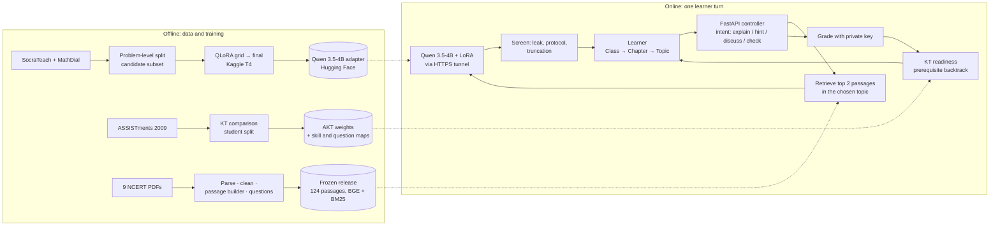
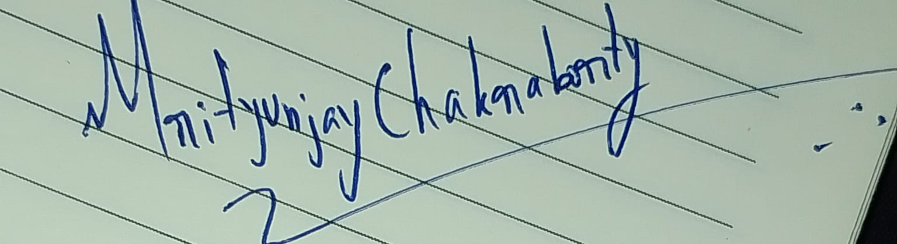

# Milestone 3 Report: Model Architecture, Baselines and Tuning

**Project:** Socratic AI Tutor for NCERT Classes 6–10
**Team:** Group 2, Data Science and AI Lab, IIT Madras BS
**Members:** Sandeep Nalla (21f1006125), Hariom Kumar (23f2004225), Hariom Pandey (21f3002112), Mrityunjay Chakraborty (21f3001385)
**Date:** 5 November 2026
**Companion files:** presentation (`M3_Presentation.pdf` / `.pptx`), work log (`Work_Contribution_Log.md`)
**Models and dataset:** https://huggingface.co/IITM-2026T3-DSAI-GROUP2

## 1. Summary

The tutor has three parts, and we chose and measured each one in M3:

| Part | Job | Selected | Key result |
|---|---|---|---|
| Socratic response model | Write the next tutor turn as a guiding question, never the answer | Qwen 3.5-4B + QLoRA (r16, lr 2e-4) | Leak rate 0.01 → 0.00, reply length 56 → 20 words (tutors: 22), ROUGE-L 0.190 → 0.331 (+74%) |
| Knowledge tracing | Estimate per-skill mastery from the learner's answers | AKT with Rasch difficulty | Test AUC 0.843, best of seven models (DKT 0.829); trained weights in `KT_model/akt_best.pt` |
| NCERT retrieval (RAG) | Ground every turn in the textbook | BM25 + BGE-small rank fusion over automatically built passages | Hit@5 80% on 15 held-out questions; 124 passages, 25 topics, 84 approved questions |

A FastAPI demo app connects the three. The learner picks Class, Chapter and Topic, then chats with a tutor that cites NCERT passages, grades checkpoints and updates mastery after each answer. The fine-tuned adapters and the processed dialogue dataset are on the team's Hugging Face page.

## 2. Model architecture selection

### 2.1 Socratic response model

We fine-tuned four small open LLMs with QLoRA. Three of them share one protocol: the same data, the same 100 evaluation contexts and the same settings.

| Candidate | Size | Architecture notes | LoRA targets | Licence |
|---|---|---|---|---|
| Qwen 3.5-4B (selected) | 4B | Hybrid linear + full attention; thinking mode off | q, k, v, o, gate, up, down | Apache 2.0 |
| Gemma 4 E4B | ~4B effective | Multimodal base; vision and audio towers excluded from LoRA | language-model q…down | Gemma terms |
| Phi-4-mini-instruct | 3.8B | Phi-3 family, fused qkv and gate_up projections | qkv, o, gate_up, down | MIT |
| Qwen3-4B-Instruct-2507 | 4B | Early feasibility trial on a different split; loss only, not ranked | q…down (α 32) | Apache 2.0 |

### 2.2 Knowledge tracing

Seven models from three families were trained on ASSISTments 2009 with one shared training engine: DKT with LSTM, GRU and plain RNN cells [8]; SAKT with and without positional embeddings [9]; and AKT with and without Rasch question difficulty [10]. DKT keeps a single recurrent knowledge state. SAKT attends over past answers. AKT adds a learned decay on old practice and, in the Rasch version, a difficulty term for each individual question.

### 2.3 Retrieval

We compared three retrievers on a frozen set of textbook questions: BM25 keyword search, BGE-small-en-v1.5 dense embeddings (384-d) [12], and reciprocal rank fusion of the two. The pipeline stores passages in PostgreSQL + pgvector; the demo app loads them from a frozen file.

## 3. Architecture justification

### 3.1 Why a fine-tuned small LLM

Untrained models already know the maths; what they lack is tutoring behaviour. They solve and explain at 2 to 2.5 times a real tutor's length, and Phi-4-mini states the answer in 6% of replies (12% on MathDial). Fine-tuning on real tutoring dialogues targets that behaviour directly.

The literature points the same way. In MathDial, a fine-tuned Flan-T5 (780M) told students the answer in under 1% of turns (Telling@5), against 16% for prompted ChatGPT [3]. SocraticLM, a fine-tuned 6B model, beat GPT-4 on ROUGE-L (47.5 vs 32.4) on SocraTeach [4].

A 4B model in 4-bit also trains on one free 16 GB Kaggle T4 and runs on infrastructure the team hosts, so student conversations do not go to a paid third-party API.

Qwen 3.5-4B was chosen over the alternatives on the tuned results. It has the best overall ROUGE-L (0.331 vs 0.319 for Gemma and 0.294 for Phi), the best MathDial ROUGE-L (0.244 vs 0.228 and 0.186), zero leaks, and a MathDial question rate (0.42) closest to real teachers (0.44). It is Apache 2.0, and its adapter is already published and served to the app. Gemma is close enough to call a tie on 100 contexts and one seed. Phi trains fastest (49 min) but falls behind on MathDial.

### 3.2 Why AKT

AKT with Rasch difficulty has the best test AUC (0.843), 0.014 ahead of DKT (GRU) and 0.015 ahead of DKT (LSTM), and the best F1 (0.848). Most of that lead comes from the Rasch term, which gives every question its own difficulty: without it AKT scores 0.826. That per-question difficulty is useful for the tutor, which needs to know which checkpoint is hard, not only which skill. AKT's monotonic attention also discounts old practice, which matches how learners forget.

NCERT questions have no ASSISTments IDs, so each NCERT question starts at average difficulty (the Rasch offset is zero) and learns its own difficulty as in-app answers come in. Until then AKT behaves like the no-Rasch version, which scores close to DKT (0.826 vs 0.829). The cost is size: 491K parameters against 131K for DKT (LSTM).

### 3.3 Design decisions

- Loss is computed on tutor turns only. Turns flagged as leaking or "telling" stay in the context but are never targets.
- The correct answer is in the system prompt so the model can check the learner's work, and we measure the leak rate on every run.
- The end-of-turn token is trained so the model stops after one turn.
- QLoRA uses a 4-bit NF4 base and fp16 compute, with 10 to 35M trainable parameters [1, 2].
- Knowledge-tracing data is split by student, so test students are never seen in training.

### 3.4 Trade-offs

| Choice | Gain | Cost |
|---|---|---|
| 4B model, not 7–8B | Trains and serves on a free T4 | Probably a lower ceiling on reasoning |
| 768-token cap | Fits T4 memory | About 22% of dialogues are cut back to the last tutor turn that fits |
| fp16 (T4 has no bf16) | Runs on free hardware | Needs a finite-loss check before training |
| ROUGE/BLEU | Cheap and reproducible | They reward wording, not teaching, so we report leak rate, question rate and length beside them |
| AKT over DKT | +0.015 AUC on ASSISTments; per-question difficulty | 3.7× more parameters; NCERT question difficulty must be learned from in-app answers |
| Learner picks the topic | No grounding in the wrong topic | One extra click; automatic routing failed its test (Section 6.3) |

## 4. Baseline performance and candidate dataset

### 4.1 Candidate dataset

The dialogues come from SocraTeach (LLM-generated Socratic dialogues) and MathDial (real teachers correcting student errors). Full detail is in `notes/hariom kumar/milestone-3/socratic_data_prep/REPORT.md`, and the processed data is on Hugging Face.

| Split | SocraTeach | MathDial | Use |
|---|---:|---:|---|
| Full train | 22,574 | 1,302 | Source pool |
| Full validation | 2,682 | 311 | Source pool |
| `candidate_train` | 1,000 | 1,000 | Grid search (the same 400-dialogue subset for every model) and final training |
| `candidate_val` | 100 | 100 | 100 evaluation contexts (50 per source) and validation loss |
| MathDial test | 0 | 599 | Untouched, kept for the final evaluation in M4 |

The split is by problem, using a `sha1` of the normalised question. Every train dialogue that shares a problem with the test set is removed, and the notebook asserts that no problem appears in two splits. Within each source, the subset is stratified by word-count quartile with seed 42.

A two-sample KS test compares the subset with the full train split:

| Source | Feature | Full train | Subset | KS | p |
|---|---|---:|---:|---:|---:|
| SocraTeach | Words per dialogue | 234.9 | 234.3 | 0.020 | 0.81 |
| SocraTeach | Messages per dialogue | 9.71 | 9.69 | 0.013 | 0.99 |
| MathDial | Words per dialogue | 314.2 | 312.9 | 0.010 | 1.00 |
| MathDial | Messages per dialogue | 12.04 | 12.03 | 0.013 | 1.00 |
| MathDial | Leak share of tutor turns | 0.017 | 0.017 | 0.004 | 1.00 |
| MathDial | "Telling" share of tutor turns | 0.154 | 0.153 | 0.006 | 1.00 |

MathDial is 5.5% of full train but 50% of the subset. We did this on purpose: MathDial is the only real-teacher data and makes up the whole test set, and at its natural share the subset would hold about 110 MathDial dialogues. Results are therefore reported per source.

For knowledge tracing we use the ASSISTments 2009 skill-builder data: 123 skills and 15,922 questions (`skill_map.csv`, `question_map.csv`). Rows without a skill and scaffolding sub-questions are dropped, students are split 80/10/10, and the test split gives 27,329 predictions on students the models never saw.

### 4.2 Metrics

| Metric | Definition | Target |
|---|---|---|
| Leak rate | Reply states the final numeric answer before the student has | Lower; real tutors 0.01 |
| Question rate | Reply contains a question | Near real tutors (0.62 overall) |
| Words | Reply length | Near real tutors (22.2) |
| ROUGE-L [6] | Longest-common-subsequence overlap with the real tutor's next turn | Higher |
| BLEU [7] | sacreBLEU ÷ 100 against the real next turn | Higher |
| Validation loss | Cross-entropy on tutor turns | Compared within a model only, since tokenizers differ |
| KT: AUC, accuracy, F1 | Correctness of the next answer | Higher; chance AUC is 0.5 |
| RAG: Hit@1, Hit@5, MRR | Rank of the gold passage among results | Higher |

### 4.3 Socratic baselines

Pretrained weights in 4-bit, greedy decoding, at most 96 new tokens, on the same 100 contexts:

| Baseline | Leak | Question | Words | ROUGE-L | BLEU | MathDial ROUGE-L |
|---|---:|---:|---:|---:|---:|---:|
| Real tutors | 0.01 | 0.62 | 22.2 | n/a | n/a | n/a |
| Gemma 4 E4B | 0.00 | 0.87 | 48.0 | 0.189 | 0.040 | 0.111 |
| Qwen 3.5-4B | 0.01 | 0.52 | 56.4 | 0.190 | 0.040 | 0.124 |
| Phi-4-mini | 0.06 | 0.60 | 39.6 | 0.226 | 0.071 | 0.137 |

The knowledge-tracing baseline always predicts the majority answer ("correct"): accuracy 0.670, AUC 0.500.

### 4.4 Published benchmarks

These use different splits and metrics, so they put our numbers in context rather than rank them.

| Source | Setting | Result |
|---|---|---|
| MathDial [3] | Flan-T5 780M fine-tuned, MathDial test | sBLEU 9.7; Telling@5 <1% vs ChatGPT 16% |
| SocraticLM [4] | ChatGLM3-6B on SocraTeach vs GPT-4 | ROUGE-L 47.5 vs 32.4; BLEU-4 48.6 vs 36.2 |
| DKT [8] and re-check [11] | ASSISTments 2009 | AUC about 0.86 as first reported; about 0.75 after duplicate rows were removed |
| Ours, tuned Qwen | 50 SocraTeach / 50 MathDial contexts | ROUGE-L 41.9 / 24.4 |
| Ours, KT | Student split, one row per (order, skill) | AUC 0.826 to 0.843 for DKT and AKT |

Our tuned SocraTeach ROUGE-L sits between GPT-4 and SocraticLM's fine-tuned 6B model. Our KT preprocessing keeps a problem tagged with several skills as several rows with the same answer, the effect [11] identified, so our AUCs are likely optimistic in absolute terms. The comparison between our seven models is still fair because they all see the same data.

## 5. Hyperparameter tuning

### 5.1 Socratic model

We ran a grid search of 3 settings for each of 3 models. Each setting trains for 1 epoch on the same 400 candidate dialogues (about 50 optimizer steps) and is scored on the same 100 contexts. We fixed the selection rule before training: pick the lowest validation loss among settings whose leak rate is at most 0.02 above real tutors.

| Hyperparameter | Tried | Rationale |
|---|---|---|
| LoRA rank r (α = r) | 8, 16 | Tests whether more adapter capacity helps; α = r keeps the scale at 1 |
| Learning rate | 2e-4, 5e-5 | 2e-4 is the QLoRA default [2]; 5e-5 tests a gentler update |
| Fixed | n/a | dropout 0.05, cosine schedule with 5% warm-up, paged AdamW 8-bit, effective batch 8, max 768 tokens, seed 42 |

Grid results (ROUGE-L / validation loss / leak):

| Model | r8, 2e-4 | r16, 2e-4 (selected) | r8, 5e-5 |
|---|---|---|---|
| Gemma 4 E4B | 0.250 / 1.260 / 0.02 | 0.267 / 1.233 / 0.00 | 0.216 / 1.406 / 0.03 |
| Qwen 3.5-4B | 0.302 / 1.169 / 0.00 | 0.308 / 1.154 / 0.00 | 0.259 / 1.255 / 0.01 |
| Phi-4-mini | 0.265 / 1.273 / 0.01 | 0.266 / 1.256 / 0.01 | 0.220 / 1.403 / 0.00 |

The low learning rate under-trains every model: it gives the highest loss and lowest ROUGE-L each time. At 2e-4, rank 16 beats rank 8 for all three at the same 10 to 19 minute cost. We then trained r16 / 2e-4 on the full 2,000-dialogue candidate set.

### 5.2 Tuned vs baseline

| Final model | Leak | Question (0.62) | Words (22.2) | ROUGE-L | BLEU | Val loss | Train time |
|---|---:|---:|---:|---:|---:|---|---:|
| Gemma 4 E4B | 0.00 | 0.69 | 20.5 | 0.319 | 0.175 | 2.76 → 1.12 | 62 min |
| Qwen 3.5-4B | 0.00 | 0.59 | 20.3 | 0.331 | 0.176 | 1.82 → 1.07 | 80 min |
| Phi-4-mini | 0.00 | 0.65 | 21.8 | 0.294 | 0.174 | 1.85 → 1.17 | 49 min |

| Per source (50 each) | SocraTeach ROUGE-L | MathDial ROUGE-L | SocraTeach Q (0.80) | MathDial Q (0.44) |
|---|---:|---:|---:|---:|
| Gemma 4 E4B | 0.409 | 0.228 | 0.80 | 0.58 |
| Qwen 3.5-4B | 0.419 | 0.244 | 0.76 | 0.42 |
| Phi-4-mini | 0.402 | 0.186 | 0.80 | 0.50 |

All three now write replies of human length with zero leaks. ROUGE-L rose 69% for Gemma, 74% for Qwen and 30% for Phi. The comparison plots are in `notes/hariom kumar/milestone-3/model_finetune/*_finetune_output/` and on slides 7 and 8.

### 5.3 Knowledge tracing

KT used no per-model search. Every model gets the same defaults so the ranking compares architectures: Adam at lr 1e-3, batch 64, gradient-norm clip 5, 200-step windows, seed 42, and up to 60 epochs with early stopping after 8 epochs without a gain in validation AUC. The epoch with the best validation AUC is restored, and the test set is scored once.

| Model | Params | Best epoch | Val AUC | Test AUC | Accuracy | F1 |
|---|---:|---:|---:|---:|---:|---:|
| DKT (LSTM) | 131,003 | 11 | 0.826 | 0.829 | 0.780 | 0.846 |
| DKT (GRU) | 106,171 | 14 | 0.830 | 0.829 | 0.778 | 0.845 |
| DKT (RNN) | 56,507 | 20 | 0.825 | 0.826 | 0.777 | 0.844 |
| SAKT | 49,025 | 30 | 0.767 | 0.765 | 0.744 | 0.827 |
| SAKT + positions | 61,825 | 27 | 0.801 | 0.805 | 0.767 | 0.842 |
| AKT (no Rasch) | 428,057 | 25 | 0.828 | 0.826 | 0.776 | 0.845 |
| AKT (Rasch), selected | 491,468 | 16 | 0.836 | 0.843 | 0.787 | 0.848 |
| Majority class | 0 | n/a | n/a | 0.500 | 0.670 | n/a |

All three DKT cells land within 0.003 AUC of each other. Positional embeddings add 0.040 AUC to SAKT. The Rasch difficulty term adds 0.017 AUC to AKT, the largest single gain in the table. Full results are in `KT_model/results_summary.csv`; the selected AKT's weights are in `akt_best.pt` and its test predictions in `akt_test_predictions.csv`.

### 5.4 Retrieval

Retrieval has no trained weights. The tuned values are the passage size (300-token target, 400 maximum, 25 minimum) and the routing cut-offs (similarity ≥ 0.90, margin ≥ 0.10). We set them on 24 calibration questions and froze them before the held-out test.

| Retriever (15 held-out) | Hit@1 | Hit@5 | MRR |
|---|---:|---:|---:|
| BM25 | 53.3% | 73.3% | 0.597 |
| BGE-small | 46.7% | 73.3% | 0.572 |
| Rank fusion (used) | 46.7% | 80.0% | 0.591 |

The labels cover only the six original pilot concepts, so some misses land on new topics that are actually correct. We did not change the labels after seeing the results. For misconception retrieval on 300 Eedi groups, Recall@5 rose from 16% (BGE) to 26% (contrast query + BM25). That is too weak to label learners, so the app shows these suggestions as unconfirmed.

## 6. End-to-end setup

### 6.1 Architecture diagram

### 6.2 Data flow, training, validation, evaluation and outputs

| Stage | Socratic model | Knowledge tracing | NCERT retrieval |
|---|---|---|---|
| Input data | SocraTeach + MathDial → chat format, loss on tutor turns, 768 tokens | ASSISTments 2009 → per-student sequences, 200-step windows | 9 pinned NCERT PDFs → passages, questions, private keys |
| Training | QLoRA on Kaggle T4; grid on 400 dialogues → final r16 on 2,000 | 7 architectures, shared defaults, up to 60 epochs with early stopping | None: BGE-small frozen; BM25 index; calibrated cut-offs |
| Validation | Val loss each run; 100 fixed contexts, 50 per source | Val AUC each epoch; best epoch restored | 24 calibration questions; release gates and fingerprints |
| Evaluation | Leak, question rate, words, ROUGE-L, BLEU vs baseline | Test AUC, accuracy, F1, scored once | Hit@1, Hit@5, MRR on 15 held-out; Eedi Recall@5 |
| Expected output | One short Socratic turn (about 20 words) that does not state the answer | Per-skill probability of a correct next answer | Cited passages ("book · PDF page") and a gradable checkpoint |

### 6.3 NCERT pipeline

1. Parse: MinerU handles maths and answer pages (74 of 75 maths pages contain formulas); PyMuPDF handles plain science pages.
2. Clean: drop page numbers, running heads, question boxes, teacher notes, figures, tables, unclear ₹ amounts and broken markup.
3. Passages: an automatic builder merges blocks by numbered section heading (300-token target, 400 maximum). Section headings become topics, so the same code runs for Classes 6–10 without manual chunking.
4. Questions: chapter questions are matched to answer-page keys by printed page. The 16 questions that depend on a figure are skipped until the app can show figures, and unmatched keys are reported instead of being turned into questions.
5. Index and release: BGE-small vectors in pgvector plus BM25, frozen into a fingerprinted release (`ncert-pilot-a2ac2147befaf6e1`). Answer keys live in a private schema and never enter a prompt.

At the calibrated cut-offs, automatic topic routing accepted 0 of 15 answerable questions, so it is disabled. The learner picks the topic and retrieval searches only inside it.

### 6.4 Demo app status

The FastAPI app keeps learner history in SQLite and offers Class → Chapter → Topic navigation and three hint levels. It grades checkpoints against private keys, tracks readiness with knowledge tracing and backtracks to prerequisites, screens replies for leaks and truncation, and keeps progress when a model call fails. Unit tests and `check_offline.py` run on the real release with zero model calls; 52 tests pass across the pipeline and app. The Qwen adapter is hosted behind an HTTPS tunnel from a Kaggle or Colab notebook (`notes/hariom kumar/milestone-3/model_hosting/README.md`).

Two things are not yet tested. The live Qwen step with retrieved passages (`check_live.py`) is scheduled for M4. The demo app still loads the earlier DKT checkpoint, so only NCERT topics that map to an ASSISTments skill get a model prediction; switching the app to the selected AKT weights is an M4 task.

## 7. Limitations and next steps

| Limitation | Plan for M4 |
|---|---|
| 100 contexts per model and one seed; Qwen vs Gemma is a near tie | Score all models once on the 599-dialogue MathDial test split, with Telling@k as in [3] |
| ROUGE/BLEU reward wording, not teaching | Add a rubric rating from a human sample and an LLM judge |
| The tutoring data is English maths word problems | Evaluate on NCERT science topics; consider NCERT-grounded dialogues |
| KT is one seed, untuned, with multi-skill rows kept and no BKT baseline | Run 3 to 5 seeds, add BKT, retrain without duplicate rows, load AKT in the app and learn NCERT question difficulty from in-app answers |
| 15 held-out retrieval questions, labels for 6 of 25 topics | Extend the builder to all Classes 6–10 books, label a fresh test against every topic, re-test routing |
| The leak guard is lexical | Run `check_live.py` end to end and review a sample of live replies |

## 8. Contributions

| Member | M3 work |
|---|---|
| Sandeep Nalla | Zero-shot baseline evaluation script (ROUGE-L, question rate, reply length, per source); Phi-4-mini-instruct QLoRA grid and final run; Phi adapter on Hugging Face |
| Hariom Kumar | Team coordination; Socratic data preparation and candidate set; Gemma 4 E4B and Qwen 3.5-4B fine-tuning and the four-model comparison; NCERT pilot; demo app; Qwen hosting; dataset and model uploads to Hugging Face; this report and the presentation |
| Hariom Pandey | Knowledge-tracing comparison of DKT, SAKT and AKT (with Mrityunjay Chakraborty); Qwen3-4B-Instruct fine-tuning trial (`claudeaisocratic.ipynb`) |
| Mrityunjay Chakraborty | Knowledge-tracing comparison of DKT, SAKT and AKT (with Hariom Pandey) |

## 9. Evidence

| Area | Location |
|---|---|
| Data preparation | `notes/hariom kumar/milestone-3/socratic_data_prep/REPORT.md` |
| Socratic fine-tuning (4 models) | `notes/hariom kumar/milestone-3/model_finetune/report.md`, `README.md`, notebooks and `*_output/results.json` |
| Models and dataset | https://huggingface.co/IITM-2026T3-DSAI-GROUP2 |
| Model hosting | `notes/hariom kumar/milestone-3/model_hosting/README.md` |
| Knowledge tracing | `docs/milestone-3/KT_model/`: `KT_Models_Comparison_AKT_firstnb_processing.ipynb`, `results_summary.csv`, `akt_best.pt` (AKT weights), `skill_map.csv`, `question_map.csv`, `akt_test_predictions.csv` |
| NCERT pipeline | `Ncert work/PILOT_REPORT.md`, `Ncert work/README.md` |
| Demo app | `mock-app/README.md`, `mock-app/VERIFICATION.md` |
| Presentation | Design canvas exported as `M3_Presentation.pdf` (13 slides) |

## References

1. Hu et al. *LoRA: Low-Rank Adaptation of Large Language Models.* ICLR 2022. https://arxiv.org/abs/2106.09685
2. Dettmers et al. *QLoRA: Efficient Finetuning of Quantized LLMs.* NeurIPS 2023. https://arxiv.org/abs/2305.14314
3. Macina et al. *MathDial: A Dialogue Tutoring Dataset with Rich Pedagogical Properties Grounded in Math Reasoning Problems.* Findings of EMNLP 2023. https://arxiv.org/abs/2305.14536
4. Liu et al. *SocraticLM: Exploring Socratic Personalized Teaching with Large Language Models.* NeurIPS 2024.
5. Model cards: Qwen3.5-4B, Gemma 4 E4B, Phi-4-mini-instruct (Hugging Face); team adapters under `IITM-2026T3-DSAI-GROUP2`.
6. Lin. *ROUGE: A Package for Automatic Evaluation of Summaries.* ACL Workshop 2004.
7. Papineni et al. *BLEU.* ACL 2002; Post. *A Call for Clarity in Reporting BLEU Scores.* WMT 2018.
8. Piech et al. *Deep Knowledge Tracing.* NeurIPS 2015.
9. Pandey and Karypis. *A Self-Attentive Model for Knowledge Tracing.* EDM 2019.
10. Ghosh, Heffernan and Lan. *Context-Aware Attentive Knowledge Tracing.* KDD 2020.
11. Xiong et al. *Going Deeper with Deep Knowledge Tracing.* EDM 2016.
12. Xiao et al. *C-Pack: Packaged Resources to Advance General Chinese Embedding* (BGE). 2023.

## Sign-off

By signing, each member confirms they have reviewed this report, the presentation and the work log.

| Name | Roll number | Signature | Date |
|---|---|---|---|
| Sandeep Nalla | 21f1006125 |  | 05-11-2026 |
| Hariom Kumar | 23f2004225 |  | 05-11-2026 |
| Hariom Pandey | 21f3002112 |  | 05-11-2026 |
| Mrityunjay Chakraborty | 21f3001385 |  | 05-11-2026 |
