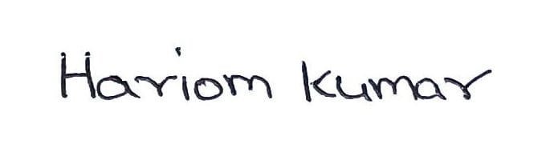
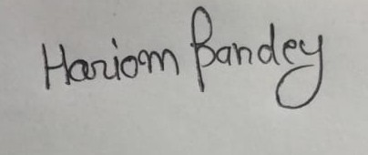
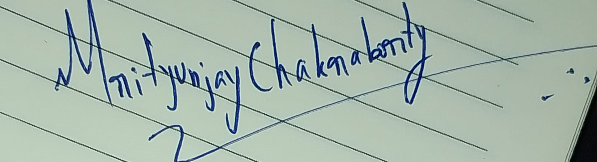

# Work Contribution Log: Milestone 3

**Project:** Socratic AI Tutor: guiding a learner to the answer through probing questions
**Team:** Group 2, Data Science and AI Lab, IIT Madras BS
**Date:** 5 November 2026
**Models and dataset:** https://huggingface.co/IITM-2026T3-DSAI-GROUP2

## Team

| Name | Roll number | Primary role |
|---|---|---|
| Sandeep Nalla | 21f1006125 | Backend developer |
| Hariom Kumar | 23f2004225 | Build the RAG (search) agent |
| Hariom Pandey | 21f3002112 | Build the fine-tuned models |
| Mrityunjay Chakraborty | 21f3001385 | Frontend developer |

These are primary roles only. They are not fixed: as the project needs, members contribute to other parts as well.

## Work split for this milestone

| Area | Owner | Models compared |
|---|---|---|
| Knowledge tracing (DKT) and Qwen Socratic model | Hariom Pandey | DKT; Qwen3.5-4B |
| Knowledge tracing (BKT, AKT) and backtracking / misconception detection | Mrityunjay Chakraborty | BKT, AKT; LLM call as the misconception detector |
| Socratic response model | Sandeep Nalla | Gemma 4 E4B, Phi-4-mini-instruct, other models if time allows |
| Search (RAG) and NCERT embeddings | Hariom Kumar | Embedding models and vector stores |

## Contributions

| Name | Work done |
|---|---|
| Sandeep Nalla | Wrote the zero-shot baseline evaluation script (ROUGE-L, question rate, reply length, per source); ran the Phi-4-mini-instruct QLoRA grid and final run (`notes/sandeep/milestone-3/model_finetune/phi4mini-finetuning.ipynb`) and published its adapter on Hugging Face |
| Hariom Kumar | Coordinated the team; prepared the Socratic dialogue data and candidate set (`socratic_data_prep`); fine-tuned Qwen 3.5-4B and Gemma 4 E4B with QLoRA (baselines, 3-setting grid, final runs) and compared all four models (`model_finetune`); ran the NCERT pilot (`Ncert work/PILOT_REPORT.md`); built the demo app (`mock-app`); hosted the Qwen model; uploaded the dataset and models to Hugging Face; prepared `M3_Report.md` and the presentation |
| Hariom Pandey | Compared knowledge-tracing models DKT, SAKT and AKT with Mrityunjay Chakraborty (`KT_model/KT_Models_Comparison_AKT_firstnb_processing.ipynb`); fine-tuned the Qwen3-4B-Instruct trial (`model_finetune/claudeaisocratic.ipynb`) |
| Mrityunjay Chakraborty | Compared knowledge-tracing models DKT, SAKT and AKT with Hariom Pandey (`KT_model/KT_Models_Comparison_AKT_firstnb_processing.ipynb`) |

## Documents

| Document | File |
|---|---|
| Report | `M3_Report.md` (also `.docx` and `.pdf`) |
| Presentation | `M3_Presentation.pdf` (also `.pptx`) |
| Work log | `Work_Contribution_Log.md` (also `.docx` and `.pdf`) |

## Sign-off

By signing, each member confirms that this log is accurate and that they have reviewed the report and presentation.

| Name | Roll number | Signature | Date |
|---|---|---|---|
| Sandeep Nalla | 21f1006125 |  | 05-11-2026 |
| Hariom Kumar | 23f2004225 |  | 05-11-2026 |
| Hariom Pandey | 21f3002112 |  | 05-11-2026 |
| Mrityunjay Chakraborty | 21f3001385 |  | 05-11-2026 |
